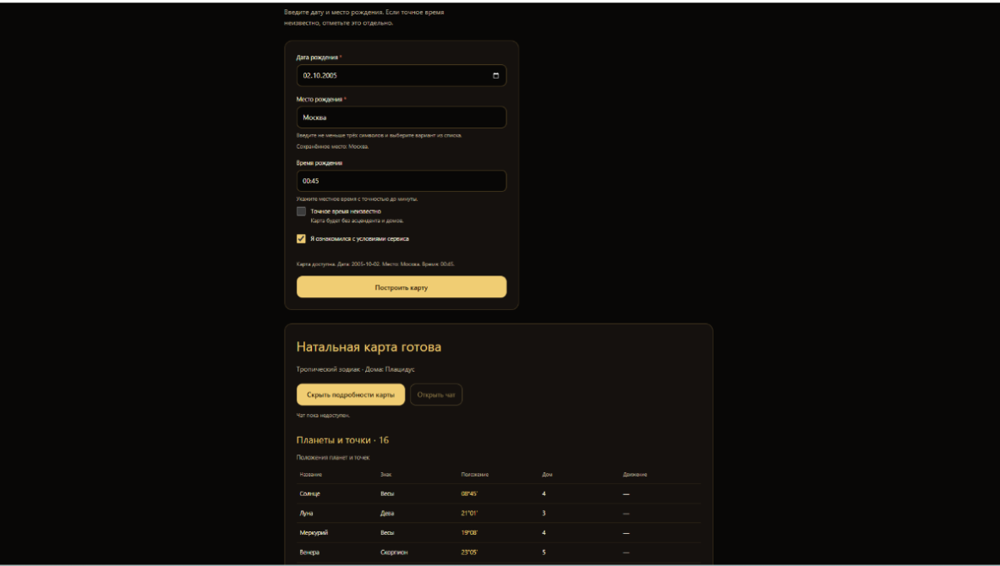

# exact-orb

**Исследовательский проект. Не продукт, не сервис, не коммерческое предложение.**

Предмет исследования — методология управляемой разработки с AI-агентами:
как распределить работу между людьми и агентами так, чтобы требования, решения
и качество оставались под контролем. Цель — методология, которую можно применить
в enterprise-команде.

Полигон — небольшая система расчёта астрологических карт: строго вычислимый
источник фактов рядом с задачей, которую естественно решать языковой моделью.
Проект не исследует и не утверждает научную валидность астрологии, не оказывает
услуг и никому ничего не предсказывает.

Репозиторий стоит читать как дневник эксперимента: процесс, требования,
архитектурные решения, тесты и разборы собственных ошибок.

`Python 3.11+` · `Swiss Ephemeris` · `FastAPI` · `AGPL-3.0` · активная R&D-разработка

## Оглавление

- [О проекте](#о-проекте)
- [Метод разработки](#метод-разработки)
- [Примеры: что показал эксперимент](#примеры-что-показал-эксперимент)
- [Текущее состояние](#текущее-состояние)
- [Быстрый старт](#быстрый-старт)
- [Пример результата](#пример-результата)
- [Архитектура](#архитектура)
- [Известные ограничения](#известные-ограничения)
- [Документация](#документация)
- [Структура репозитория](#структура-репозитория)
- [Что дальше](#что-дальше)
- [Лицензия](#лицензия)

## О проекте

Цель проекта — построить и проверить методологию разработки с AI-агентами, пригодную
для переноса в enterprise-команду. Исследовательский вопрос: насколько далеко
специалист, отвечающий за требования, архитектуру и качество, может масштабировать
разработку, делегируя AI-агентам код и часть технической проработки, — и какая
инженерная control model для этого нужна: формализованные требования, явные
решения владельца, контракты на границах компонентов, исполняемые архитектурные
ограничения, независимая проверка.

**Кто ведёт разработку.** Проект ведёт один человек, который не пишет код вручную:
весь код написан AI-агентами. Автор формулирует требования и сценарии, принимает
архитектурные решения, читает и ревьюит код, разбирает полный диагностический вывод.
Часть дефектов найдена именно так — чтением реализации и журналов при зелёных тестах
(см. примеры). Поэтому качество опирается
не на навык программирования автора, а на явные контракты, исполняемые проверки
и независимое тестирование. Это опыт одного оператора, и автоматически он
не обобщается.

### Как читать репозиторий

**Репозиторий — дневник эксперимента.** Каждый pull request в основную ветку `main`
фиксирует очередной этап: изменения, наблюдения и выводы, появившиеся в ходе
разработки системы и применения процесса. В описаниях PR сохраняется контекст:
что обнаружилось в работе, какие подходы сработали, какие потребовали пересмотра
и как это повлияло на последующие решения.

Код и актуальная документация показывают текущий результат. История PR позволяет
проследить ход эксперимента: как развивалась система, как менялся процесс
разработки и на каких наблюдениях основаны эти изменения.

### Куда движется методология

1. Проверить на этом проекте. Сейчас все роли процесса совмещает один человек,
   исполнительскую часть берут на себя агенты. Процесс меняется по наблюдениям
   из реальных изменений, а не по рассуждениям.
2. Разложить по ролям в enterprise-команде. Владелец продукта, менеджер изменения,
   аналитик, разработчик и тестировщик — разные люди. Каждый работает со своими
   агентами по инструкции своей роли, а связывают их общие артефакты, единый реестр
   решений, gates и независимая проверка.
3. Подключить к корпоративным системам — Jira, Confluence и другим. Только
   после проверки: инструменты должны закреплять работающий процесс, а не
   автоматизировать непроверенный. Сейчас всё состояние изменения хранится
   в Markdown рядом с кодом; задания, статусы и gates в дальнейшем можно отобразить
   на workflow трекера, а требования, решения и ADR — на базу знаний.

### Почему такой полигон

Главный архитектурный принцип полигона:

> **LLM не является источником расчётных фактов.**

Положения, дома, аспекты, конфигурации и другие показатели появляются только
в детерминированном расчёте. Языковая модель может объяснять рассчитанное,
но не достраивает отсутствующие факты.

```text
structured input → deterministic resolution → deterministic calculation
    → validated chart artifact → evidence selection → LLM interpretation
```

Предметная область заменяема: тот же контур — детерминированный источник фактов,
явные контракты, вероятностный слой строго за ними — применим к любой области,
где ошибка модели в фактах недопустима. Зато она позволяет публиковать процесс,
требования и код без корпоративных данных.

## Метод разработки

Каждое изменение — change с ролями Owner, Manager, Analyst, Developer и Tester.
У ролей определены полномочия и шаблоны артефактов; для Manager, Analyst, Developer
и Tester есть инструкции для агентов (skills). Роли могут занимать как один человек,
так и разные люди; смена роли фиксируется явно. Manager ведёт текущие состояния,
следующий шаг, блокеры и единый реестр решений change; evidence остаётся у роли,
которая его получила.

```text
намерение Owner → brief
  → требования и сценарии (Analyst) + единый реестр решений DP-*
  → консультации и оценки Developer / Tester → допуск Owner
  → bounded prompts + реализация + Developer checks
  → независимое тестирование (Tester)
  → приёмка Owner → перенос в requirements/current/ → сверка → merge
```

Переходы защищены gates G0–G5; для небольших изменений по действующему контракту
есть сокращённый маршрут.

Принципы, на которых держится процесс:

- LLM не решает за владельца. Модель находит развилку, предлагает варианты
  и последствия, но рекомендация не становится решением без явного подтверждения:
  LLM расширяет пространство анализа и ускоряет реализацию, но не определяет
  продуктовую семантику и не принимает архитектурные решения.
- Prompt не является source of truth. `prompts/` — журнал поручений;
  требования и ADR важнее.
- Дефект разбирается до корневой причины и нарушенного инварианта. Ошибку
  реализации исправляет Developer с regression-тестом и независимым retest Tester;
  пробел или противоречие требований возвращается Analyst через DP.
- Количество тестов — не метрика. Используются component, contract,
  property-based, integration, persistence conformance, concurrency, golden
  и module-boundary проверки; mock не считается доказательством интеграции.

Документы метода: [принципы](docs/development_approach/development-approach.md),
[процесс](docs/development_approach/process/process.md),
[роли](docs/development_approach/roles.md),
[шаблоны](docs/development_approach/artifacts/README.md),
[инструкции ролей](docs/development_approach/skills/README.md).

## Примеры: что показал эксперимент

Ниже — примеры, а не полный перечень и не статистика. Они показывают, какие классы
ошибок ловит процесс и где проходит граница автоматических проверок.

### Дефекты, найденные человеком

Владелец находил дефекты чтением журналов, реализации и спецификаций. Часть
обнаружена при зелёных тестах, часть — до реализации; итог каждого разбора
указан отдельно ([все разборы](docs/project_management/problems_detected_by_human/)):

| № | Что обнаружено | Итог |
|---|---|---|
| 001 | Полный DEBUG-вывод показал, что BuildNatalSuccess хранит одни данные в нескольких местах: структурно валидный, но противоречивый результат | ADR-0027, канонические владельцы значений |
| 002 | Разбор полной карты выявил ошибки самих требований: два пространства имён точек, аспект оси узлов к себе, ложная точность при неизвестном времени | ADR-0029…0032 |
| 003 | Ревью спецификации Orchestrator: ответственность незаметно перетекала между компонентами, outcome-контракты неполны | Требования отправлены на переработку до реализации |
| 004 | Ревью реализации Orchestrator: внутренние сбои commit-flow теряли terminal-событие | Воспроизведено, исправлено, regression-случаи |
| 005 | Журнал не показывал, кто координирует вызовы: поток выглядел как хореография | ADR-0035…0038, интеграционный тест |

> **Структурно валидная модель ≠ семантически корректная модель.**

### Пример: кто находил дефекты в первом UI-change (M1-7)

В этом изменении из 10 дефектов реализации 8 нашло ревью кода другой моделью ещё
до независимого тестирования, 1 — ручная проверка владельца, 1 — Tester. На момент
ревью 126 зелёных UI-тестов найденных моделью случаев не покрывали
([реестр](docs/testing/ui-birth-form-and-facts/manual-test-bugs.md),
[разбор](docs/project_management/problems_detected_by_human/006-ui-review-found-counterexamples-missed-by-green-tests.md)).

Это один change, но он показывает: ревью другой моделью полезно как поиск
воспроизводимых контрпримеров, хотя совпадение мнений двух моделей доказательством
не является.

Открытый вопрос метода — стоимость: документация процесса и артефакты change
растут быстрее кода, и процесс должен оправдывать каждое своё правило.

## Текущее состояние

Работает первый пользовательский сценарий: в браузере ввести данные рождения,
выбрать место из подсказок, построить натальную карту или космограмму и прочитать
таблицы фактов. Интерпретации пока нет.

| Область | Состояние |
|---|---|
| Детерминированный расчёт натала и космограммы | Реализован; аспектная модель пересмотрена ADR-0029…0032, достоинства и диспозиторы — ADR-0033 |
| Транзиты | Реализованы в engine/; application flow для них нет |
| Resolution данных рождения и каталог мест | Реализованы (M1-5) |
| Calculation identity, cache артефактов, single-flight | Реализованы |
| Сессии: in-memory и SQLite, ContextService | Реализованы |
| Application Orchestrator, BuildNatalHandler, process runtime | Реализованы, приняты на реальном стеке |
| HTTP API: FastAPI, анонимная сессия, поиск мест, построение карты | Реализован (M1-6); формальный итог приёмки M1-6 не записан |
| Web UI: форма, подсказки мест, построение, таблицы точек, домов и аспектов, восстановление сессии | Реализован и принят (M1-7) |
| Колесо карты, перенос прототипа V2 | Следующие этапы (M1-8, M1-8.1) |
| Удалённый сервер | Не развёрнут; публичный трафик закрыт до решений по данным и условиям использования |
| Интерпретация, agent runtime | Нет; LLM gateway — инфраструктурный слой, agent orchestration — каркас |
| Research corpus | Whitelist-проекция и in-memory corpus |



Целевой дизайн с колесом карты и чатом — в [разделе UI/UX](docs/ui_ux/README.md)
и [интерактивном прототипе](docs/ui_ux/web-prototype.html); это черновики.

Подробный план и статусы вех — в [roadmap](docs/project_management/Roadmap/roadmap.md).

## Быстрый старт

Требуется Python 3.11+.

```bash
git clone https://github.com/ksenia-baranova/exact-orb-demo.git
cd exact-orb-demo
python -m venv .venv
```

Linux / macOS:

```bash
source .venv/bin/activate
```

Windows:

```powershell
.venv\Scripts\Activate.ps1
```

Установка и проверки:

```bash
pip install -e ".[dev]"
pytest
```

**CLI — прямой вызов расчётного движка:**

```bash
exact-orb "02.09.1985 00.45 gmt+4" --lat 55.7522 --lon 37.6155 --place "Moscow"
exact-orb "02.09.1985 00.45 gmt+4" --lat 55.7522 --lon 37.6155 --place "Moscow" --format json
```

CLI пока не проходит через Application Orchestrator; браузерный сценарий проходит.

**Web UI локально.** HTTP API требует HTTPS во всех окружениях
([ADR-0039](docs/requirements/decisions/0039-https-in-all-environments.md)), поэтому
локальный стенд — Uvicorn за Caddy с сертификатом mkcert на
https://exact-orb.localhost. Пошаговая инструкция (PowerShell):
[`docs/runbooks/http_api_local_https.md`](docs/runbooks/http_api_local_https.md).

Каталог мест [`data/places.sqlite`](data/README.md) приходит вместе с checkout.

## Пример результата

Фрагмент human-readable вывода CLI для карты из примера выше. Полный эталон —
[`tests/golden/natal_1985_human.txt`](tests/golden/natal_1985_human.txt).

```text
НАТАЛЬНАЯ КАРТА
2 сентября 1985, 00:45 (+04:00) · Москва 55.75N 37.62E · Плацидус

ПЛАНЕТЫ
  Солнце      Дева        09°20'27"    4 дом
  Луна        Овен        07°39'54"   11 дом
  Юпитер      Водолей     08°41'01" R  9 дом
  ...

ДОМА
  1 (ASC)    Рак         08°06'21"    упр. Луна (11 дом)
  4 (IC)     Лев         27°37'46"    упр. Солнце (4 дом) + Меркурий [Дева]
  ...

АСПЕКТЫ
  ТОЧНЫЕ (орбис < 1°)
    Луна       □  ASC         0°26'
    Уран       ☍  Хирон       0°27'
    ...

КОНФИГУРАЦИИ
  ПЛОТНЫЕ (< 3°)
    Йод             max 1°41'  apex: Солнце · base: Юпитер, Луна

СИЛА И СТРУКТУРА
  Плутон     обитель   эсс.  5  акц.  2  итого  7  сильная (посл.)
  Стихии: огонь 10 (40.0%, excess), земля 4 (16.0%, deficit), ...
  Луна: полнолуние, фаза 5, элонгация 208.324°
```

Это выход детерминированного ядра; интерпретации этих фактов проект пока не даёт.

## Архитектура

Modular monolith с явными границами
([service_ready_architecture.md](docs/architecture/service_ready_architecture.md),
[ADR-0021](docs/requirements/decisions/0021-modular-monolith-service-seams.md)).

Путь построения карты:

```text
Browser ─HTTPS─▶ FastAPI ─▶ Application Orchestrator
                               │  load SessionSnapshot (ContextService)
                               ▼
                         BuildNatalHandler
                          │              │
              BirthDataResolver     ChartArtifactResolver
              (каталог мест, tz)     │ cache ─ codec ─ validation
                                     ▼
                              EngineService → Swiss Ephemeris
                               │
                               ▼  BuildNatalSuccess {artifact, delta}
                         Orchestrator: проверка версии → CAS commit
                               │
                               ▼  типизированный ApplicationResult
```

Ключевые решения:

- Handler не владеет расчётом и состоянием. Он резолвит вход, выбирает натал или
  космограмму, запрашивает артефакт и возвращает BuildNatalOutcome со StateDelta
  при успехе. Запись координирует Orchestrator через ContextService — compare-and-set
  по версии, так что устаревшая операция не перезапишет новое состояние
  ([ADR-0006](docs/requirements/decisions/0006-application-orchestrator.md),
  [ADR-0014](docs/requirements/decisions/0014-explicit-state-mutations.md)).
- Неизвестное время — космограмма, а не натал с подставленным полднем.
  Неопределённость представлена в модели, а не скрыта в presentation; аспекты,
  зависящие от времени суток, не выдаются за факт момента рождения
  ([ADR-0032](docs/requirements/decisions/0032-unknown-birth-time-aspect-semantics.md)).
- Cache — оптимизация, а не источник истины. Ключ артефакта включает
  ChartSpec и CalculationVersion: версии движка, профилей, Swiss Ephemeris,
  native-модуля и файлов эфемерид. Устаревший или повреждённый артефакт
  пересчитывается, сбой cache не блокирует расчёт, одинаковые одновременные
  запросы делят одну задачу ([ADR-0017](docs/requirements/decisions/0017-calculation-cache-and-chartspec.md)).
- Детерминированные операции не идут через agent runtime. Agent Runtime появится
  только за interpretation handler; построение карты остаётся вне LLM
  ([ADR-0020](docs/requirements/decisions/0020-agent-runtime-behind-handlers.md)).
- Наблюдаемость на границах компонентов. В DEBUG журнал содержит полные
  payload вызовов — это уже находило межкомпонентные дефекты (см. примеры выше),
  но такие данные не считаются production-safe
  ([ADR-0028](docs/requirements/decisions/0028-full-debug-component-boundary-payloads.md),
  [ADR-0034](docs/requirements/decisions/0034-birth-data-and-terms-of-use.md)).
- Research corpus получает только whitelist-проекцию категориальных признаков
  карты ([требования](docs/requirements/component_responsibilities/exact-orb_research_corpus.md),
  [ADR-0023](docs/requirements/decisions/0023-research-corpora-and-consent.md)).

### Архитектура как исполняемое ограничение

Правило зависимости, которое можно проверить, становится тестом.
[`tests/test_module_boundaries.py`](tests/test_module_boundaries.py) помимо разбора
импортов импортирует модули в отдельном процессе (транзитивные протечки) и сканирует
AST research-слоя на скрытые входы: `datetime.now()`, `uuid4()`, `random` и чтение
`os.environ`. Такие проверки ловят нарушения заданных границ даже при зелёных
функциональных тестах.

Метаправило: правило без автоматической проверки — не инвариант, а соглашение
review, и оно так и называется.

Подробнее: [component responsibilities](docs/requirements/component_responsibilities/),
[sequence diagrams](docs/sequence_diagrams/), [реестр ADR](docs/requirements/decisions/README.md).

## Известные ограничения

Ограничения и условия возврата собраны в
[реестре технического долга](docs/project_management/technical_debt.md).

Миграционная опись ещё требует согласования недостающих обязательных реквизитов;
исходные решения и ограничения сохраняются.

| Ограничение | Где отслеживается |
|---|---|
| Методология проверена только одним оператором, совмещающим все роли; работа распределённой команды и интеграции с корпоративными системами не проверялись | Этапы 2–3 развития методологии |
| Интерпретации нет; соляр и синастрия не входят в текущие требования | Roadmap M2 |
| Публичный запуск закрыт: нет страницы условий использования, общего IP-limit на прокси, решений по PII в журналах | DEBT-UI-001, DEBT-HTTP-002, DEBT-LOG-001, ADR-0034 |
| Нет CI; воспроизводимость golden-эталонов на других платформах не подтверждена | Roadmap M1-11 |
| Один property-тест конфигураций аспектов пропущен до исправления генератора | DEBT-CALC-001 |
| Расчётный движок читает процессную конфигурацию | DEBT-ARCH-001 |
| NatalTool вызывает расчёт мимо ChartArtifactResolver | Roadmap M3-1 |
| CLI не проходит через application-слой | — |

## Документация

| Где | Что |
|---|---|
| [`docs/development_approach/`](docs/development_approach/README.md) | Метод: принципы, процесс, роли, шаблоны, skills, эксперименты |
| [`docs/project_management/`](docs/project_management/) | [Roadmap](docs/project_management/Roadmap/roadmap.md), change plans, [техдолг](docs/project_management/technical_debt.md), разборы дефектов |
| [`docs/requirements/`](docs/requirements/README.md) | Требования: [`current/`](docs/requirements/current/) — чистовые, тематические документы до переноса, [ADR](docs/requirements/decisions/README.md) |
| [`docs/architecture/`](docs/architecture/service_ready_architecture.md) | Modular monolith, service seams, архитектурные схемы |
| [`docs/sequence_diagrams/`](docs/sequence_diagrams/) | Позитивные, негативные и concurrency-сценарии в PlantUML |
| [`docs/testing/`](docs/testing/) | Отчёты Tester и evidence прежних change |
| [`docs/runbooks/`](docs/runbooks/http_api_local_https.md) | Локальный HTTPS-стенд |
| [`docs/ui_ux/`](docs/ui_ux/README.md) | Целевой дизайн, прототип, рендеры |
| [`prompts/`](prompts/) | История bounded implementation tasks |

Диаграммы хранятся в PlantUML: человек читает их при review, агент — как
машиночитаемую часть спецификации.

## Структура репозитория

```text
src/exact_orb/
├── application/     команды, handlers, Orchestrator, composition и runtime
├── birth/           данные рождения, часовые пояса, каталог мест
├── calculation/     граница расчёта, артефакты, cache, ключи, версии
├── engine/          детерминированные расчёты
├── http_api/        FastAPI: маршруты, DTO, admission; ui/ — браузерный клиент
├── session/         состояние, диалог, persistence
├── research/        whitelist-проекция и corpus
├── interpretation/  подготовка evidence и prompts
├── llm/             LLM gateway
├── orchestration/   каркас будущего agent runtime
├── intent/, tools/  контракты планирования и agent-facing инструменты
├── cli.py           CLI
└── http_server.py   фабрика локального приложения

tests/        автоматические проверки, включая golden/, fixtures/, http_api/, ui/
docs/         требования, ADR, процесс, планы, отчёты (см. «Документация»)
data/         проверенный снимок каталога мест places.sqlite
ephe/         файлы Swiss Ephemeris — см. ephe/README.md
prompts/      история поручений агентам
scripts/      вспомогательные скрипты
```

## Что дальше

Методология развивается по трём этапам, описанным
выше: проверка на этом проекте, распределение ролей
в enterprise-команде, подключение к Jira, Confluence и другим системам. Сейчас идёт
первый этап; каждое следующее изменение полигона — ещё один прогон процесса.

Полигон:

1. M1 — первый сценарий с UI на удалённом сервере: колесо карты (M1-8),
   перенос прототипа V2 (M1-8.1), условия использования (M1-9), замеры
   конкурентности, CI и развёртывание (M1-10…M1-13), сквозная приёмка.
2. M2 — первая интерпретация коротким путём:
   InterpretSelectionHandler → InterpretationService → LLM Gateway, с отбором
   evidence, проверкой выхода на «чужие» факты и бюджетом расходов.
3. M3 — Agent Runtime, tools и streaming.

Сначала детерминированный lifecycle, затем проверенная интерпретация,
и только после этого — runtime агентов.

## Лицензия

GNU Affero General Public License v3.0. Политика contributions —
[`CONTRIBUTING.md`](CONTRIBUTING.md).
