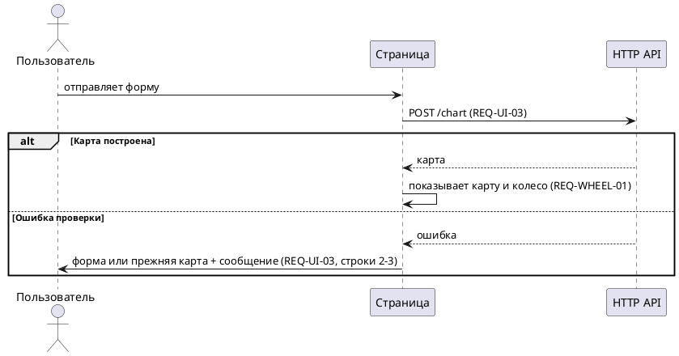

# Шаблон: инкремент требований

Файлы инкремента лежат в папке изменения:

```text
docs/project_management/changes/<change-id>/
  requirements.md        # глоссарий и требования инкремента
  sequences/*.puml       # поведенческие sequence-диаграммы
```

Примеры ниже — иллюстрация формата, а не требования проекта.

## requirements.md

```markdown
# Требования <change-id> <название>

## Глоссарий
| Термин | Значение |
| --- | --- |
| Карта | Результат расчёта для одного времени и места рождения |
| Принятая карта | Карта, которую страница получила и показывает пользователю |

## REQ-WHEEL-01 Колесо показывает ту же карту, что и таблицы
action: ADD
target: docs/requirements/current/ui/chart-wheel.md
source: owner (TASK-M-01); DP-A-02
goal: Цель 1 в change.md
priority: P1

Система должна строить колесо только по принятой карте.

Given принятая карта есть на странице
When страница показывает результат
Then колесо и таблицы показывают одни и те же планеты и градусы

Given рисование колеса завершилось ошибкой
When страница показывает результат
Then таблицы остаются видны, а на месте колеса — сообщение об ошибке

## REQ-UI-03 Что показывать после ответа сервера
action: MODIFY
base: docs/requirements/current/ui/birth-form-and-facts.md#REQ-UI-03 @ 5355510
target: docs/requirements/current/ui/birth-form-and-facts.md
source: DP-T-01
goal: Цель 2 в change.md
priority: P1

Система должна выбирать, что показать, по таблице:

| Ответ сервера | Принятая карта в сессии | Что видит пользователь |
| --- | --- | --- |
| Карта построена | любое | Новую карту |
| Ошибка проверки | есть | Прежнюю карту и сообщение об ошибке |
| Ошибка проверки | нет | Форму и сообщение об ошибке |
| Сервер недоступен | любое | Прежнее состояние и предложение повторить |

Given ответ «Ошибка проверки» и принятой карты нет
When страница обрабатывает ответ
Then пользователь видит форму и сообщение об ошибке

## REQ-UI-05 Подсветка планеты по наведению
action: REMOVE
base: docs/requirements/current/ui/birth-form-and-facts.md#REQ-UI-05 @ 5355510
source: DP-O-03
причина: колесо без кликов, выбор только через таблицы
```

Правила:

- Поля action, source, goal, priority обязательны. base обязателен для MODIFY и REMOVE, target — для ADD и MODIFY.
- ID требования сохраняется при MODIFY. Новый ID только для ADD.
- Сценарий на каждую строку таблицы условий; в примере показан один для краткости.
- Нефункциональное требование пишется так же, но с числом: «Система должна показывать колесо не позже чем через 500 мс после получения карты».

## sequences/*.puml



## Перенос в current/ (задача transfer)

Для каждого REQ инкремента:

| action | Что сделать в current/ |
| --- | --- |
| ADD | Добавить требование и его сценарии в target без полей action, base, source |
| MODIFY | Заменить пункт base новым текстом целиком; ID сохранить |
| REMOVE | Удалить пункт base и его сценарии; ссылок на него не оставлять |

Диаграммы переносятся по строке `target` в шапке. Проверка после переноса: поиск по ID каждого REQ инкремента — добавленные и изменённые есть в current/, удалённых нет нигде.
