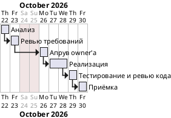

```plantuml
@startgantt
Project starts 2026-10-22
saturday are closed
sunday are closed
[Анализ] requires 2 days
@endgantt
```

# Шаблон: roadmap изменения

Файл: `docs/project_management/changes/<change-id>/roadmap.md`. Ведёт Manager: создаёт в intake, обновляет в summary перед апрувом и перед приёмкой. Оценки берёт только у ролей, сам их не придумывает.

Правила:

- **Анализ на старте — всегда 2 чд** (16 чч). Это оценка по умолчанию, пока Analyst не дал свою. Строка остаётся в таблице с источником «правило процесса».
- **Каждая роль даёт две оценки своей работы:**
  - **чч** — человеко-часы: сколько заняло бы у человека той же роли;
  - **мч** — машино-часы: сколько займёт у агента, включая перезапуски.
- Оценки роль пишет в поле estimate своей задачи: analysis — Analyst, review — Developer за реализацию и Tester за тестирование. Ревью кода оценивает Developer вместе с реализацией.
- **Факт мч** — время работы агента по журналу отладки. Заполняется после этапа, оценки задним числом не правятся.
- **Gantt строится по мч:** длительность этапа = мч ÷ 8, округлить вверх до целых рабочих дней, но не меньше 1 дня — в день входит ожидание ответа owner'а. Ревью требований, апрув owner'а и приёмка — по 1 рабочему дню, если роль не дала другую оценку. Остальные этапы без оценки на Gantt не рисуются.
- Если факт превысил оценку больше чем в 1,5 раза, Manager записывает причину в «Отклонения» и сообщает owner'у в ближайшей сводке.

## Заготовка

````markdown
# Roadmap <change-id> <название>

Старт: <YYYY-MM-DD> · Обновлено: <YYYY-MM-DD>, <TASK-M-…>

## Оценки
| Этап | Роль | Оценка чч | Оценка мч | Уверенность | Источник | Факт мч |
| --- | --- | --- | --- | --- | --- | --- |
| Анализ | Analyst | 16 (2 чд) | — | — | правило процесса | — |
| Анализ | Analyst | <чч> | <мч> | <low · medium · high> | <TASK-A-…> | <мч> |
| Реализация и ревью кода | Developer | <чч> | <мч> | <…> | <TASK-D-…> | <мч> |
| Тестирование | Tester | <чч> | <мч> | <…> | <TASK-T-…> | <мч> |
| **Итого** | | **<Σ чч>** | **<Σ мч>** | | | **<Σ мч>** |

## Gantt
```plantuml
@startgantt
Project starts <YYYY-MM-DD>
saturday are closed
sunday are closed
[Анализ] requires <N> days
[Ревью требований] requires <N> days
[Ревью требований] starts at [Анализ]'s end
[Апрув owner'а] requires 1 day
[Апрув owner'а] starts at [Ревью требований]'s end
[Реализация] requires <N> days
[Реализация] starts at [Апрув owner'а]'s end
[Тестирование и ревью кода] requires <N> days
[Тестирование и ревью кода] starts at [Реализация]'s end
[Приёмка] requires 1 day
[Приёмка] starts at [Тестирование и ревью кода]'s end
@endgantt
```

## Отклонения
| Этап | Оценка мч | Факт мч | Причина |
| --- | --- | --- | --- |
````

## Пример на старте

Пример иллюстрирует формат, а не реальное изменение. На старте известна только оценка анализа по умолчанию, поэтому на Gantt один этап.

````markdown
# Roadmap ui-chart-wheel Колесо карты

Старт: 2026-10-22 · Обновлено: 2026-10-22, TASK-M-01

## Оценки
| Этап | Роль | Оценка чч | Оценка мч | Уверенность | Источник | Факт мч |
| --- | --- | --- | --- | --- | --- | --- |
| Анализ | Analyst | 16 (2 чд) | — | — | правило процесса | — |

## Gantt

````

## Пример перед апрувом

````markdown
## Оценки
| Этап | Роль | Оценка чч | Оценка мч | Уверенность | Источник | Факт мч |
| --- | --- | --- | --- | --- | --- | --- |
| Анализ | Analyst | 16 (2 чд) | — | — | правило процесса | — |
| Анализ | Analyst | 12 | 3 | medium | TASK-A-01 | 4 |
| Реализация и ревью кода | Developer | 40 | 10 | medium | TASK-D-01 | — |
| Тестирование | Tester | 16 | 4 | high | TASK-T-01 | — |
| **Итого** | | **68** | **17** | | | **4** |

## Gantt

````
