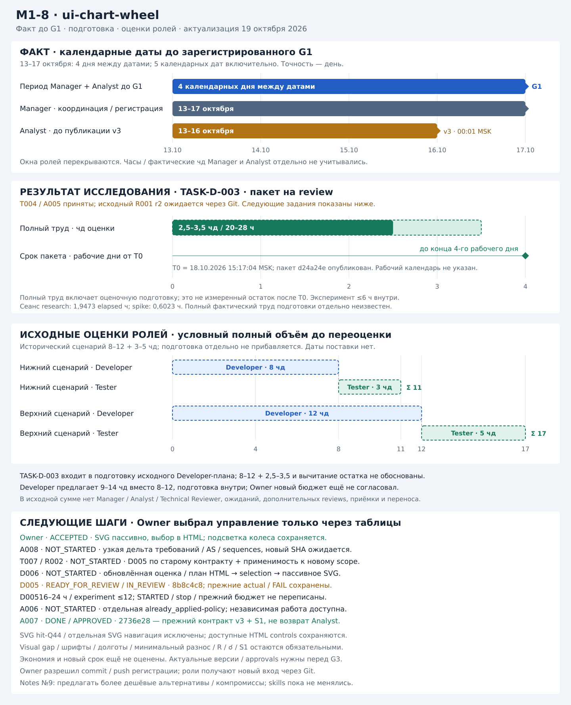

# Change: M1-8 — Chart Renderer, SVG-колесо

- **Change ID:** `ui-chart-wheel`
- **Roadmap:** M1-8, `feat/ui-chart-wheel`
- **Owner:** владелец проекта, пользователь текущего чата; продуктовые решения, бюджет и приёмка не делегированы.
- **Manager / исполнитель сборки состояния:** Codex, роль Change Manager.
- **Режим состояния:** ручной, по process.md §1.1.
- **Маршрут:** полный; новый Chart Renderer и отрисовочные ADR требуют Analysis и Developer / Tester consultations. G1 / G2 не исключены.
- **Интеграционная ветка:** `change/ui-chart-wheel`
- **Worktree интеграционной ветки:** сборка Manager — текущий detached checkout C:\Users\KateUser\.codex\worktrees\79e1\exact-orb-recovered. Перед текущим commit/push HEAD = origin/change/ui-chart-wheel = `883b6d3a47f7113e44ede73c9ad16b40f15bbdaf`. Публикационная версия переноса — commit с §2.29; точный TransferSHA и remote ref сверяются после push. Чужие worktrees не читались.
- **Исходный main / MainBaseline:** Analysis baseline `535551026af6eedaf2a0aa5c0daa96fa94655ec1`. Актуальный origin/main `bba8d6cfb22f586f86c3035423f2535ede158b9f` проверен 21.10: дерево идентично исходному baseline, хотя main не предок change (отдельная история merge/revert PR #66/#67). Изменений реализации / tests / нормативного контракта со стороны main нет. Однако read-only merge-tree выявил 21 modify/delete пересечение в change-артефактах из-за revert; при интеграции сохранить их актуальные версии change и повторить сверку ref. Исторические D003 / D005 / 502589d сохраняют собственные предметы.
- **История ролевых версий (актуальный итог — §2.27):** Analyst v3 @ `2634b224894b1046113557bfe241f0a5f2d46f8c`; Developer consultation v2 / TASK-D-002 @ `f9c70f75ea815b2f3bf7e01426ee5afe65b31606`, интеграция PR #70 @ `278a95285901c24a7a31fbef0258bc189f83603e`; Tester consultation v2 / TASK-T-002 @ `7e95c0f680cc790fc8b45d9e25d69cc6e94fbc12`, интеграция PR #71 @ `888215674e4ade13cbfc5bf6377b78f2c0e18c06`. Обе консультации проверяют Analyst v3 на общем InputSHA `543b7ec726ee96c951dc0abbf1067ca6ad47a1ba`; их условные выводы зарегистрированы в §2.9. Commit `8921e9d` / PR #72 @ `3da42d6` ранее зарегистрировал только статус TASK-D-002, не новую версию Developer-пакета. Назначенные reviews опубликованы и интегрированы: Tester TASK-T-003 @ `c59cc3f68e7769841134801dc125633decade032`, PR #73 @ `a7e495c0f86940da3531475477702ff991454896`; Analyst TASK-A-002 @ `2f5579677114ea2dc86c66cf0fd656fdb5910df5`, PR #74 @ `6c4607165085d7297f044cef026353f36f6c842f`. Manager принял оба адресных review в своём предмете §2.12. Оценка TASK-D-003 @ `11a703ed6a01eb368f0f0ba23dc23f1e90fac81f` интегрирована PR #75 @ `49b9d7ce58be8171ee0159643f9f085afe090972`; параметры исследования согласованы Owner §2.13; на момент этой регистрации STARTED ещё не было. Предстартовые reviews приняты Manager §2.14: Analyst TASK-A-003 @ `4055a9cb2bb18919c776c9d4e8585e2408a638c7` / PR #76 @ 7ebeaa2, Tester TASK-T-005 @ `71aa21cb79b046d25c77f68c6e87a9e48bd4c7fe` / PR #77 @ 67fd9db. Вывод Tester — исправить T005-R01…R03 до положительного допуска. TASK-D-004 v2 @ `f6f289cda25e7f228dff064175805130cc770b63`, PR #78 @ `8a05b73c2af2c36043f9ede04834dd3867f4a686`, передавался на review §2.15; последующие положительные результаты зарегистрированы §2.16. Последующая регистрация §2.16: T006 @ 435337f / A004 @ 5de9e66 приняты, D004 v2 APPROVED для bounded research; TASK-D-003 разблокирован / прямо разрешён Owner. Исследование D003 @ d24a24e / merge 030826f зарегистрировано §2.17: READY_FOR_REVIEW / IN_REVIEW, T0 18.10 15:17:04 MSK; Последующая регистрация §2.18: T004 @ ad5206e / A005 @ 4057d6e приняты DONE / APPROVED как reviews; R001 r2 получен через Owner, исходный OutputSHA отсутствует. Созданы A006 / D005 и последующие T007 / R002. Текущий AnalystContractSHA (v3 + S1) — `2736e2848c977ec4c770a9a4dec2a0d7c1b62a71`; A007 принят Manager §2.20 DONE / APPROVED, прежний v3 — исторический baseline. A006 остаётся отдельным заданием. Последующая регистрация §2.21: D005 @ `8b8c4c818147b037cb90f93a42e64eb86d809183` READY_FOR_REVIEW / IN_REVIEW; оценка / Owner-допуск / STARTED и отрицательный drawing-результат зарегистрированы по подписанному handoff. T007 / R002 разблокированы в NOT_STARTED; создан D006 для подготовки scope / оценки первого этапа controller/HTML, без production. Последующая ревизия scope §2.23: Owner принял пассивное SVG / выбор только через таблицы; прежний AnalystContractSHA 2736e28 остаётся baseline для истории, его активное SVG-управление заменено новым решением DP-O-008. Создан A008 NOT_STARTED для адресной дельты; новый целевой AnalystContractSHA ещё отсутствует. A007 DONE / APPROVED не возвращается. Последующая регистрация §2.24: Developer-пакет полного пассивного колеса @ 502589d / первая публикация 5fdc477 получен; D006 DONE / APPROVED только как подготовка собственного плана. Owner-выбор условной колонки / удаления SVG-подписей категорий зарегистрирован по подписанному Developer-источнику. A008 расширен на эту адресную дельту; T007/R002 явно переадресованы на 502589d, авторских результатов ещё нет. Создан D007 BLOCKED / ResumeStatus=NOT_STARTED для реализации FW-01…06. Новый целевой AnalystContractSHA / G3 / STARTED кода отсутствуют. Текущее более позднее решение §2.25: D007 был IN_PROGRESS / DRAFT, STARTED19.10 22:11:37MSK по прямому исключению Owner; эта запись историческая. Текущая регистрация итоговой реализации / Tester — §2.27.
- **CandidateSHA / TestedSHA / AcceptedSHA:** Кандидат реализации и AcceptedSHA — `883b6d3a47f7113e44ede73c9ad16b40f15bbdaf` по решению Owner 21.10, §2.27 / §6; фактический RetestedSHA — `99741958b4bbee8884505920f4a02f2f19dea3e3`. Между ними src/tests не менялись; 14 LF-хешей исходников сверены. Новые документальные правки пока локальны; их публикационный CandidateSHA ещё отсутствует.
- **Перенос общих документов:** выполнен, публикация разрешена Owner§2.29; TransferSHA — commit с этим разделом по прямому поручению Owner21.10, §2.28: FULL колеса / применённая UI DELTA / 53 AS в current/ui, все11 PUML в общих каталогах (8 текущих,3 исторических). Рабочие13 source-файлов удалены из change после проверки целей; [карта](analyst/transfer_map.md) / [manifest](manager/transfer_manifest.json). Независимая сверка T008 и принятие оставшегося технического ADR ещё не выполнены.
- **Текущий статус change:** `ACCEPTED` в объёме прямого решения Owner «завершаем change готовим к мержу в main» от 21.10.2026 с переносом открытого TEST-FIND-WHEEL-002 в DEBT-UI-004. Это закрытие реализованного scope с явным исключением, а не восстановление отсутствующих G3/G4/G5 или универсальный geometry PASS; §6.
- **Поставка:** нет; MergeSHA / подтверждение поставки отсутствуют.
- **Следующий обязательный шаг:** commit/push разрешён Owner§2.29; после проверки remote передать в чат готовый T008 с точным TransferSHA для независимой сверки. D008 остаётся для технического ADR/responsibilities, sequences уже перенесены. Реальный merge в main этим поручением не разрешается.
- **Блокирующие зависимости:** для поставки отсутствуют опубликованный SHA текущего переноса / verdict T008 / принятый технический ADR / registry SHA в main / MergeSHA. Сам перенос требований и всех11 схем уже выполнен по Owner§2.28. 004 CLOSED;002/precision — DEBT-UI-004. Предстоящие Git-конфликты прежнего revert документальные, не новый runtime-дефект.
- **Обновлено:**2026-10-21, Codex / Manager, §2.29: Owner разрешил commit/push подготовленного документального пакета в change и поручил написать промт Tester. Код/tests/evidence не меняются; T008 NOT_STARTED, approvals/G5/merge не заявлены.

**Историческая сверка перед публикацией 8e79e2e (2026-10-13), не текущий baseline:** Подготовка задания Manager опубликована на 5188b52 по прежнему поручению Owner. Текущая сверка выполнена в `C:\Users\KateUser\.codex\worktrees\79e1\exact-orb-recovered`, исходный detached HEAD bc9a4fb, после fast-forward актуального change; локальный process_notes.md сохранён. Перед публикацией текущего обновления worktree интеграционной ветки находится на bc9a4fb и совпадает с origin (`0 0`). После сверки статусов и заметок Owner отдельно поручил: «создай комит и пуш в ветку change». Разрешён scope публикации — этот Manager-файл и process_notes.md; Analyst-пакет, нормативный процесс и код не изменяются.

## Корневые артефакты и участие ролей

| Роль | Корневой файл | Участие и основание |
|---|---|---|
| Manager | [manager_artifact.md](manager_artifact.md) | Назначен Owner для инициализации change, затем для сборки brief по решениям текущего чата. |
| Analyst | [analyst_artifact.md](analyst_artifact.md) | A007 DONE / APPROVED сохранён. Текущий A008 NOT_STARTED завершает адресную дельту и чистовой перенос принятого поведения на Input883b6d3; policy A006 уже выбрана Owner, отдельный новый опрос не нужен. |
| Developer | [developer_artifact.md](developer_artifact.md) | D007 DONE / APPROVED в предмете поставленной реализации @883b6d3 с исключением DEBT-UI-004; D008 NOT_STARTED — отдельный документальный перенос технического ADR / sequences. |
| Tester | [tester_artifact.md](tester_artifact.md) | Независимый runtime / retest получен, OutputSHA f930c86 / RetestedSHA9974195. TEST-FIND-WHEEL-004 CLOSED, 002 OPEN / INDETERMINATE и отложен Owner. T008 NOT_STARTED сверяет чистовой перенос. |
| Technical Reviewer | [Полученный вход r2](manager/review_inputs/task-r-001-r2-summary.md) | R001 / R002 сохраняют фактическую историю: R002-approval не получено. Старый column package не текущая реализация; при D008 нужна проверка актуального ADR, а не повтор старого исследования. |

Участие ролей зарегистрировано по опубликованным handoffs; их авторские сведения о прежнем отсутствии регистрации сохраняются как исторический snapshot. Правила размещения — [process.md §7.1](../../../development_approach/process/process.md#71-одна-папка-на-change). Текущие состояния находятся здесь; результаты и заключения остаются у авторов.

## 1. Change Brief — v1

### 1.1. Намерение и проблема

Пользователь после построения или восстановления карты должен сразу получить наглядное SVG-колесо и иметь возможность сопоставить объекты и аспекты с опубликованными фактами в таблицах. Сейчас M1-7 показывает форму и таблицы points, houses / angles, aspects; отдельного колеса и двустороннего выбора нет.

Исходная строка [Roadmap M1-8](../../Roadmap/roadmap.md) задаёт знаки, дома и углы, планеты и производные точки, аспекты по категориям и оформление отрисовочных решений в ADR. Owner также выразил намерение иметь отдельный компонент, чтобы колесо можно было легко заменить. Точная техническая граница компонента не выбрана — DP-O-010.

### 1.2. Ожидаемый результат и scope

Исходный brief v1 ниже сохраняет историю; актуальные Owner-ревизии §2.23/§2.24 заменили двустороннее SVG-управление выбором только из HTML и приняли условную колонку / удаление SVG-текста категорий. Сохранённые правила / источники — DP-O-008/011/012. Это не новый scope, выбранный Manager.

**Адресная ревизия Owner 19.10.2026:** способ управления уточнён в DP-O-008 / §2.23. Упоминания двустороннего выбора в первоначальном brief / старых пакетах сохраняют историю; действующее решение исключает активацию из SVG. Сохраняемый scope и новая дельта оформляются A008.

В M1-8 входят:

- SVG-представление опубликованной карты: зодиак, планеты и производные точки, доступные дома / углы, аспекты согласно принятому составу.
- Подключение колеса к текущей странице и локальная адаптивная композиция со сводкой рождения.
- Сворачивание формы после получения карты, раскрытие заполненной формы для изменения данных.
- Читаемые метки скученных точек, отображение ретроградности, обозначение соединений.
- Связь колеса и существующих таблиц через выбор и подсветку; полные факты остаются доступны в HTML.
- Поддержка natal / cosmogram и существующих состояний сохранённой карты без нового расчётного источника.
- Формализация наблюдаемого поведения в Analysis, отрисовочных решений в ADR, последующий перенос принятых требований / sequences и независимая сверка по процессу.

Конкретный выбор Owner хранится один раз в [едином реестре DP](#3-единый-реестр-dp): DP-O-001…009. Краткий scope и критерии ниже ссылаются на эти записи; подробные requirements и сценарии предстоит подготовить Analyst.

Не входят: полный перенос экранов Э1–Э7 / дизайна V2 (M1-8.1), чат / интерпретация M2, дополнительные публичные группы configurations / strength / special_degrees / стихии, расширение API, новый frontend framework или библиотека renderer без отдельного обоснованного решения, новые типы карт, транзитное кольцо, экспорт / печать / sharing, deployment, погашение долга M1-9. Локальные изменения формы, сводки, колеса и связи с существующими таблицами входят именно в этот change; ими не разрешается остальной перенос V2.

### 1.3. Ограничения и нормативный baseline

- Единственный расчётный источник — действующий публичный ChartDTO успешного committed POST либо GET current для той же chart_identity. Фронтенд переводит опубликованные долготы в координаты изображения; знаки, дома, орбисы, категории, часовые пояса и недостающие факты не пересчитывает.
- HTTP §7.2 уже публикует points с longitude / retrograde, angles, houses и aspects. Идентификаторы и семантика оси узлов наследуют ADR-0029/0030: производный south_node может отображаться как позиция, но дополнительные аспекты к нему не строятся.
- Без времени используются опубликованные позиции и устойчивые аспекты ADR-0032; отсутствующие дома / углы остаются отсутствующими. Демо-диапазон Луны, time_dependent и иные отсутствующие в API поля прототипа не становятся данными.
- Сохраняются bootstrap → current, явный build, обработка late responses, recovery, stale / unavailable / empty, ручной unchecked-checkbox gate ADR-0034, API schemas и коды ошибок. Открытие формы, выбор строки, смена ширины экрана и подсветка сами по себе не запускают POST.
- Сводка описывает карту, которая показана, а не произвольный несохранённый ввод формы. Сохраняются действующие правила защиты локального черновика при восстановлении.
- Таблицы сейчас раскрываются действием «Показать подробности». Их автоматическое раскрытие / прокрутка при выборе ещё не согласованы — DP-O-013.
- docs/ui_ux задаёт визуальные кандидаты. Owner выбрал отличия от Р5/Э7; данные и незакрытые решения прототипа не имеют приоритета над текущим API / ADR / решениями этого change.
- Заменяемость renderer — цель brief. Интерфейс, имя, устройство модулей, ownership выбора и конкретный алгоритм принадлежат будущей технической проработке; Manager не утверждает их вместо Developer.
- Отрисовочные ADR требуются до кода по Roadmap. Номер ADR и редакция не назначены; их создание и принятие являются отдельным результатом, которого сейчас нет.

### 1.4. Критерии успеха

Owner подтвердил эти критерии в составе brief v1 2026-10-13. Они не являются готовыми acceptance scenarios или test evidence:

1. После успешного построения и восстановления показано колесо той же карты и сводка её данных; порядок появления соответствует DP-O-001.
2. На desktop, узком экране и mobile расположение относительно сводки соответствует DP-O-002; на ширине 360 px нет горизонтального переполнения страницы, символы и отметки остаются читаемыми.
3. Форма и её заполненные значения доступны через действие DP-O-003; просмотр и редактирование не подменяют данные показанной карты и не выполняют скрытого build.
4. Каждый опубликованный объект однозначно соотносится с числовыми данными; скученные символы, отметки ретроградности и маркеры соединений различимы по DP-O-004/005/007. Проверяется несколько скученных ретроградных точек и переход через 0°; алгоритм и предельные случаи требуют DP-O-011.
5. Графический состав аспектов соответствует DP-O-006; полный табличный список, типы, категории и орбисы совпадают с API. Пустой графический набор отличим от отсутствующей карты.
6. Выбор в обоих направлениях и снятие выделения соответствуют DP-O-008, включая выбор background из таблицы; конкретные interaction scenarios требуют DP-O-013.
7. Космограмма соответствует DP-O-009 и публичному контракту; неизвестное время не превращается в вымышленные дома / углы.
8. Существующие empty / unavailable / stale / recovery и смена chart_identity не смешивают факты или выделение разных карт. Таблицы остаются доступны без hover, действия имеют доступное управление и видимый фокус.
9. Смена renderer ограничена его согласованной границей и подключением; transport / session / расчёт не становятся обязанностями графического компонента. Проверяемый контракт заменяемости требует DP-O-010.
10. Принятые отрисовочные правила имеют ADR, требования / сценарии, необходимые sequences и Developer / Tester evidence на точных версиях; нынешний просмотр исходников это evidence не заменяет.

### 1.5. Подтверждения Owner и граница текущего поручения

Все решения DP-O-001…009 даны Owner в текущем чате 2026-10-13. Последний уточняющий выбор — background-подсветка без фоновой линии — подтверждён отдельным «да». Ключевые цитаты, авторство и дата находятся в строках реестра.

Поручение «используй скилл менеджер — собирай бриф» разрешает сохранить обсуждение в Manager-артефакте и начать содержательную подготовку. Прежний запрет записи действовал во время обсуждения; это поручение разрешает текущую запись. Оно не подтверждает новую оформленную версию brief, её критерии, бюджет, ADR, начало Analysis или реализацию.

Owner 2026-10-13 явно подтвердил подготовленную версию сообщением «как owner подтверждаю brief». Предмет подтверждения — brief v1: намерение, исходный scope, критерии успеха и границы открытых вопросов. Проверенная версия до регистрации approval: manager_artifact.md поверх HEAD 535551026af6eedaf2a0aa5c0daa96fa94655ec1, SHA-256 `52162FC045F53E24327629DDB2A9D74210757BA09931B894FA1176A614BAEB6B`. Последующие изменения этого прохода регистрируют approval и служебное состояние; содержательные решения и критерии не пересматриваются.

Подтверждение Owner получено для точного локального материала. Owner затем поручил: «создай комит и пуш с русскоязычными комментариями в ветку change». Разрешены commit / push этого Manager-пакета в change/ui-chart-wheel; PR / merge, создание analysis-ветки и запуск роли этим поручением не разрешены. Содержательный brief v1 и решения DP при публикации не пересматриваются.

Публикационная версия — commit, впервые добавляющий docs/project_management/change_plans/ui-chart-wheel/manager_artifact.md в change/ui-chart-wheel. Его SHA определяется через `git log --diff-filter=A --format=%H -- docs/project_management/change_plans/ui-chart-wheel/manager_artifact.md`; опубликованный SourceRef — origin/change/ui-chart-wheel. Ссылка через Git history однозначно задаёт версию без самоссылочного SHA внутри того же commit. Факт успешного push сверяется по совпадению локального HEAD и remote ref.

На публикационной версии brief назначение Analyst ещё отсутствовало, поэтому G0 тогда не подтверждался. Последующее назначение, STARTED и нынешняя регистрация G0 — §2.4 / журнал. Approval brief не является утверждением технических решений DP-O-010…014, бюджета, ADR или допуском к реализации.

### 1.6. Прочитанные источники

Repository baseline всех строк — `535551026af6eedaf2a0aa5c0daa96fa94655ec1`; просмотр выполнялся при intake, обсуждении и текущей сборке brief. Частичный просмотр указан явно. Нормативный baseline не заменяется демо-материалами.

| Источник | Причина относимости / прочитанная часть |
|---|---|
| [AGENTS.md](../../../../AGENTS.md) | Полномочия, scope, сохранение несвязанных изменений и архитектурные инварианты. |
| [development-approach.md](../../../development_approach/development-approach.md), [process.md](../../../development_approach/process/process.md), [roles.md](../../../development_approach/roles.md) | Принципы метода, состояния, gates, источники, размещение и ownership; для процесса использованы §§1–4, 6–8, для ролей прежде всего Owner / Manager. |
| [Change Manager skill](../../../development_approach/skills/change-manager/SKILL.md), [шаблон Manager](../../../development_approach/artifacts/change-manager.md), [шаблон DP](../../../development_approach/artifacts/decision-register.md) | Единственный Manager-файл, сбор решений, baseline, ограничения оценок и полей реестра. |
| [Правила требований](../../../requirements/README.md), [индекс ADR](../../../requirements/decisions/README.md) | Нормативные пути и порядок фиксации архитектурных решений; предметная актуализация выполняется в Analysis. |
| [Roadmap](../../Roadmap/roadmap.md) | M1-7–M1-9, исходный scope / оценка, необходимость отрисовочных ADR, риск недооценки M1-8. |
| [Текущие UI requirements](../../../requirements/current/ui/birth-form-and-facts.md) | Вводная, нормативные группы, получение карты, форма / build, cosmogram, recovery и доступность; действующий baseline M1-7. |
| [HTTP API](../../../requirements/http_api.md) | §7.2 ChartDTO и связанное описание build / current: опубликованные данные, категории, endpoint IDs, nullable cosmogram. |
| [ADR-0029](../../../requirements/decisions/0029-canonical-chart-point-identifiers.md), [ADR-0030](../../../requirements/decisions/0030-lunar-node-axis-representative.md) | Идентификаторы точек и представление оси узлов; связанные части нормативного решения. |
| [ADR-0032](../../../requirements/decisions/0032-unknown-birth-time-aspect-semantics.md) | Контекст, домен минут и правило устойчивых аспектов; детали вычислительной реализации не меняются. |
| [ADR-0034](../../../requirements/decisions/0034-birth-data-and-terms-of-use.md) | Gate формы и границы страницы условий; соответствующие разделы решения. |
| [ADR-0040](../../../requirements/decisions/0040-session-bootstrap-and-current-chart.md), [ADR-0041](../../../requirements/decisions/0041-stored-chart-in-session.md) | Вариант D и сохранённая карта; вводные / соответствующие части решений. |
| [Chart Artifacts responsibilities](../../../requirements/component_responsibilities/exact-orb_chart_artifacts.md) | Вводная и границы компонента; различие расчётного артефакта и графического представления. |
| [Current-chart sequence](../../../sequence_diagrams/http_api/004-current-chart.puml) | Восстановление ChartDTO без нового расчёта. |
| [UI/UX README](../../../ui_ux/README.md), [requirements](../../../ui_ux/requirements.md), [decisions](../../../ui_ux/decisions.md), [render review](../../../ui_ux/render_review.md) | Статус проекта, композиция, §§6/7/9, кандидаты renderer и известные расхождения; обсуждены отличия Owner. |
| [web-prototype.html](../../../ui_ux/web-prototype.html) | wheel(), spread(), true / display positions, ℞, легенда и selection; демонстрационный алгоритм не является принятым техническим решением. |
| [Р5](../../../ui_ux/renders/r5-chart-detail.png), [мобильный Э7](../../../ui_ux/mobile/e7-chart-detail.png) | Визуально просмотрены сторона / порядок колеса, плотность и связь с данными. |
| [index.html](../../../../src/exact_orb/http_api/ui/index.html), [styles.css](../../../../src/exact_orb/http_api/ui/styles.css), [main.mjs](../../../../src/exact_orb/http_api/ui/main.mjs) | Текущая страница и адаптивность, подключение результата после формы, renderSession / сводка / защита черновика. |
| [facts.mjs](../../../../src/exact_orb/http_api/ui/facts.mjs), [dto.py](../../../../src/exact_orb/http_api/dto.py) | Публикуемые факты, R, таблицы / их раскрытие / identity, объявления DTO; соответствующие части кода. |
| [facts.test.mjs](../../../../tests/ui/facts.test.mjs), [module boundaries](../../../../tests/test_module_boundaries.py) | Существующие факты, categories, cosmogram, immutable input, empty / stale / identity; описание архитектурных checks. Тесты не запускались. |
| [technical_debt.md](../../technical_debt.md) | Общий реестр и миграционная опись; прежние долги не объявляются новыми дефектами или исключениями M1-8. |
| [D004 handoff](developer_artifact.md), [критерии](https://github.com/ksenia-baranova/exact-orb-demo/blob/883b6d3a47f7113e44ede73c9ad16b40f15bbdaf/docs/project_management/change_plans/ui-chart-wheel/developer/task_d003_implementation_plan.md), [controls](developer/evidence/task_d004_controls.py), [audit](developer/evidence/task_d004_controls.json) | §2.15 на CriteriaSHA f6f289c / change 8a05b73: согласование / STARTED / срок, полнота ответа и предел analytical evidence. |
| [facts.mjs](../../../../src/exact_orb/http_api/ui/facts.mjs), [DOM fixture](../../../../tests/ui/fixtures/dom.mjs), [facts tests](../../../../tests/ui/facts.test.mjs) | Дополнительное чтение на 8a05b73: replaceChildren пересоздаёт факты, fake focus только присваивает activeElement; assertions проверяют опубликованные строки, не live SVG / focus. Tests не запускались. |
| [T006 review](https://github.com/ksenia-baranova/exact-orb-demo/blob/883b6d3a47f7113e44ede73c9ad16b40f15bbdaf/docs/project_management/change_plans/ui-chart-wheel/tester/task_t006_review.md), [audit](tester/evidence/task_t006_review.json), [checker](tester/evidence/task_t006_checks.py), [A004](analyst_artifact.md#task-a-004) | Регистрация §2.16 на change 7d11c41: версии 435337f / 5de9e66, положительные выводы / оставшиеся actual evidence / пределы / own estimates; прямой Owner-допуск к исследованию. |
| [Research report](https://github.com/ksenia-baranova/exact-orb-demo/blob/883b6d3a47f7113e44ede73c9ad16b40f15bbdaf/docs/project_management/change_plans/ui-chart-wheel/developer/task_d003_research_report.md), [DRAFT ADR](https://github.com/ksenia-baranova/exact-orb-demo/blob/883b6d3a47f7113e44ede73c9ad16b40f15bbdaf/docs/project_management/change_plans/ui-chart-wheel/developer/drawing_adr_draft.md), [matrix](developer/evidence/task_d003_research/matrix_v2.md), [manifest](developer/evidence/task_d003_research/package_manifest.json), [session](developer/evidence/task_d003_research/research_session.json) | §2.17: пакет d24a24e / integration 030826f, T0 / actual research / counterexamples / forecast 9–14 / два новых semantic cases; role-owned facts не переопределяются Manager. |
| [recovery.mjs](../../../../src/exact_orb/http_api/ui/recovery.mjs), [session.mjs](../../../../src/exact_orb/http_api/ui/session.mjs), [recovery tests](../../../../tests/ui/recovery.test.mjs) | Чтение на 030826f: matched — intent / fresh birth, publish render exception включает requiresReconciliation; tests проверяют current relation, не server producer provenance. Здесь tests не запускались. |
| [A005 handoff](analyst_artifact.md), [Tester review](https://github.com/ksenia-baranova/exact-orb-demo/blob/883b6d3a47f7113e44ede73c9ad16b40f15bbdaf/docs/project_management/change_plans/ui-chart-wheel/tester/task_t004_review.md), [Tester audit](tester/evidence/task_t004_review.json) / [replay provenance](tester/evidence/task_t004_replay/provenance.json) | §2.18: A005 @ 4057d6e / T004 @ ad5206e, integration 072fc29; author events / scope / source links / REQ-AS-DP / limits и следующий Owner-вопрос. |
| [R001 r2, вход Manager](manager/review_inputs/task-r-001-r2-summary.md) | Полный авторский текст передан Owner в чате 18.10; исходный reviewer OutputSHA и scripts/logs отсутствуют. Эта сводка фиксирует происхождение / рекомендации / ограничения для новых заданий, не заменяет исходный пакет. |
| session.mjs / recovery.mjs и session.test.mjs, D003 plan / DRAFT ADR / lifecycle sequence 001 | Прочитаны на неизменном src/tests baseline в 072fc29 для already_applied, порядка dispose и различия visual ring / effective Q44; role evidence и нормативный контракт не меняются. |
| [A007 handoff](analyst_artifact.md#task-a-007-адресная-дельта-s1-для-неоднозначных-аспектов), [requirements](../../../requirements/current/ui/chart-wheel.md), [scenarios / F5 S1](../../../requirements/current/ui/scenarios.md#f5-s1), [sequence 001](../../../sequence_diagrams/ui/001-chart-presentation.puml) / [002](../../../sequence_diagrams/ui/002-wheel-table-selection.puml) / [003](../../../sequence_diagrams/ui/003-edit-and-recovery.puml) | §2.20: прочитаны на 2736e28; 5 REQ / 3 AS и узкие notes 001/003, source Owner S1 @ b4418ae, точные версии / affected-unaffected / отсутствие изменения A006. |
| [D005 handoff](developer_artifact.md#task-d-005--публикационная-версия-результата), [report](https://github.com/ksenia-baranova/exact-orb-demo/blob/883b6d3a47f7113e44ede73c9ad16b40f15bbdaf/docs/project_management/change_plans/ui-chart-wheel/developer/task_d005_feasibility_report.md), [assessment / plan](https://github.com/ksenia-baranova/exact-orb-demo/blob/883b6d3a47f7113e44ede73c9ad16b40f15bbdaf/docs/project_management/change_plans/ui-chart-wheel/developer/task_d005_implementation_plan.md), [DRAFT ADR](https://github.com/ksenia-baranova/exact-orb-demo/blob/883b6d3a47f7113e44ede73c9ad16b40f15bbdaf/docs/project_management/change_plans/ui-chart-wheel/developer/drawing_adr_draft.md), [findings](developer/task_d005_findings.md), [start](developer/evidence/task_d005_feasibility/execution_start.json) / [final stop](developer/evidence/task_d005_feasibility/experiment_stop_final.json), [manifest](developer/evidence/task_d005_feasibility/package_manifest.json) / [audit](developer/evidence/task_d005_feasibility/package_audit.json) | §2.21: опубликованный 8b8c4c8 / merge cc4ecff; авторские Owner approval / сроки / actual / ограничения и публикационный resolver сверены, payload hashes 162/162. Scope сравнения 0046ac7→cc4ecff — 166 Developer-only paths. Browser / helper replay Manager не выполнял. |
| [REQ / Owner input](../../../requirements/current/ui/chart-wheel.md), [AS](../../../requirements/current/ui/scenarios.md), [D005 findings](developer/task_d005_findings.md), session.mjs / facts.mjs и tests/ui/session.test.mjs / facts.test.mjs | §2.23: на dff5757 сверены двусторонняя SVG-активация / HTML selection / сохранённые состояния / native hit scope и ответственность presenter; runtime / browser не запускались. Принятый новый способ управления — прямой Owner-вход, собственные role artifacts не переписываются Manager. |
| §2.24, фактически прочитано на `502589dbadd382fbe39e3cf1fd763abb52ffc620` | [D006](https://github.com/ksenia-baranova/exact-orb-demo/blob/883b6d3a47f7113e44ede73c9ad16b40f15bbdaf/docs/project_management/change_plans/ui-chart-wheel/developer/task_d006_controller_html_plan.md), [Owner-выбор колонки](developer/owner_decision_drawing_2026-10-19.md), [geometry v3](developer/drawing_geometry_v3.md), [column design](https://github.com/ksenia-baranova/exact-orb-demo/blob/883b6d3a47f7113e44ede73c9ad16b40f15bbdaf/docs/project_management/change_plans/ui-chart-wheel/developer/column_renderer_design_v1.md), [DRAFT ADR](developer/drawing_adr_column_draft.md), [full plan](developer/full_wheel_implementation_plan.md), [sequences 003](../../../sequence_diagrams/ui/technical/003-passive-copy-install.puml) / [004](../../../sequence_diagrams/research/ui-chart-wheel/004-column-layout-revision.puml), [handoff](developer_artifact.md), publication_audit.py / normalization map; проверены текущие seams session.mjs / facts.mjs и существующий scope UI tests. Основание — регистрация нового Developer-пакета и назначение реализации, research / production не смешиваются. |


## 2. Задания и текущая сводка

| TaskId | Роль / исполнитель | Задание | Артефакт / версия | Reviewer и критерий принятия | Статус задания | Статус артефакта | Основание / обновлено |
|---|---|---|---|---|---|---|---|
| TASK-M-001 | Manager / Codex | Собрать brief по подтверждённым решениям Owner | Раздел 1, brief v1; Owner-approved snapshot и публикационная версия — §1.5 | Owner; намерение, исходный scope и критерии успеха подтверждены, Manager подготовил точную версию для передачи | `DONE` | `APPROVED` | Прямое подтверждение Owner: «как owner подтверждаю brief»; последующее поручение commit / push Manager-пакета. Назначение Analyst — следующий отдельный результат. |
| TASK-M-002 | Manager / Codex | Подготовить задание Analyst по опубликованному brief v1 | §2.1, задание v1 @ 5188b52; применено при назначении TASK-A-001 | Manager; самодостаточное задание, точные входы, scope, источники, reviewer и критерий передачи проверены на опубликованной версии | `DONE` | `APPROVED` | Manager, 2026-10-13: полнота задания подтверждена при сверке Analyst handoff; авторское назначение / срок Owner отдельно восстановлены по §2.4. Это approval задания, не требований или разработки. |
| TASK-A-001 | Analyst / Codex | Подготовить FULL колеса / DELTA UI, сценарии, findings, behavioral sequences и вклад DP; актуализировать по решениям Owner | [Пакет v3 / индекс](analyst_artifact.md) @ 2634b22; InputSHA 2169845, IntegrationSHA 859718a; прежние v1 / v2 сохранены в §2.4–2.5 | Codex / Change Manager — полнота передачи проверена §2.5; Codex / Developer — реализуемость по TASK-D-002; Codex / Tester — тестируемость по TASK-T-002; условные заключения по Analyst v3 получены и зарегистрированы §2.9; формальные approvals затронутых версий ещё не получены | `READY_FOR_REVIEW` | `IN_REVIEW` | Manager, 2026-10-16: зарегистрирована точная опубликованная v3 после Owner-уточнений. Это продолжение не принятого ранее TASK-A-001, а не возврат из DONE. Approvals контракта / DONE отсутствуют. |
| TASK-D-001 | Developer / Codex | Ранняя консультация: реализуемость, технические риски, Implementation Plan, оценка и вклад DP; без реализации | [Consultation v1 / индекс](developer_artifact.md) @ 04be207; InputSHA 2b84607, Analyst v1 @ 683bdd0; IntegrationSHA d51bbcb | При старте reviewer / сроки не были назначены. Manager сейчас проверил полноту регистрации и handoff; содержательный approval отсутствует, повторная консультация v3 назначена отдельным TASK-D-002 | `READY_FOR_REVIEW` | `IN_REVIEW` | Прямое поручение Owner / STARTED и публикация роли зарегистрированы 2026-10-16 по handoff. Авторский вывод FEASIBLE WITH DECISIONS / 8–12 чд относится к указанному входу; не approval v3 / не допуск разработки. |
| TASK-T-001 | Tester / Codex | Ранняя консультация: тестируемость, независимые сценарии, coverage, оценка и вклад DP; без test run продукта | [Consultation v1 / индекс](tester_artifact.md) @ 9dd8b96; InputSHA 2b84607, Analyst v1 @ 683bdd0; корректная IntegrationSHA 2169845 | При старте reviewer / сроки не были назначены. Manager сейчас проверил полноту регистрации и handoff; содержательный approval отсутствует, повторная консультация v3 назначена отдельным TASK-T-002 | `READY_FOR_REVIEW` | `IN_REVIEW` | Прямое поручение Owner / STARTED и публикация роли зарегистрированы 2026-10-16 по handoff. TESTABLE WITH CLARIFICATIONS / 3–5 чд относится к указанному входу; NOT RUN, не readiness / acceptance. |
| TASK-D-002 | Developer / Codex в существующем dev/ui-chart-wheel | Повторная консультация по Analyst v3; связано с TASK-D-001, без реализации | [Consultation v2 / handoff](developer_artifact.md) @ `f9c70f75ea815b2f3bf7e01426ee5afe65b31606`; InputSHA 543b7ec, Analyst v3 @ 2634b22; PR #70 @ 278a952 | Manager — полнота / версия / оценка; Tester — проверяемость предложений, подтверждение TASK-T-003 @ c59cc3f принято §2.12 | `READY_FOR_REVIEW` | `IN_REVIEW` | Условное FEASIBLE WITH DECISIONS / исходные 8–12 чд сохранены. Назначенный Tester-review выполнен без возврата; окончательное утверждение Implementation Plan / технических предпосылок и DONE консультации остаются за согласованием пакета / G3. |
| TASK-T-002 | Tester / Codex в существующем test/ui-chart-wheel | Повторная консультация по Analyst v3; связано с TASK-T-001, без test run кандидата | [Consultation v2 / handoff](tester_artifact.md) @ `7e95c0f680cc790fc8b45d9e25d69cc6e94fbc12`; InputSHA 543b7ec, Analyst v3 @ 2634b22; PR #71 @ 8882156 | Manager — полнота / traceability / оценка; Analyst — смысл expected result, подтверждение TASK-A-002 @ 2f55796 принято §2.12 | `READY_FOR_REVIEW` | `IN_REVIEW` | TESTABLE WITH CLARIFICATIONS / 3–5 чд сохранены. Смысл сценариев / документального closure 001/003 подтверждён без возврата; runtime NOT RUN. Окончательные approvals пакета / DONE консультации отдельно при G3. |
| TASK-T-003 | Tester / Codex | Review Developer consultation v2 / TASK-D-002 | [Подписанный handoff](tester_artifact.md), [review](https://github.com/ksenia-baranova/exact-orb-demo/blob/883b6d3a47f7113e44ede73c9ad16b40f15bbdaf/docs/project_management/change_plans/ui-chart-wheel/tester/task_t003_review.md), [evidence](tester/evidence/task_t003_review.json) @ `c59cc3f68e7769841134801dc125633decade032`; PR #73 @ a7e495c; предмет f9c70f7 / Analyst v3 | Codex / Manager, 2026-10-17: назначенный критерий полноты, точных версий, наблюдаемых oracle / positive controls и локализации остатков выполнен §2.12 | `DONE` | `APPROVED` | STARTED Tester 17 октября 13:36:48 MSK после согласования Owner; оценка 3–4 ч, сроки §2.12. Подтверждение проверяемости без возврата принято Manager; T003-G01…05 переданы TASK-D-003 и будущим reviewers, не runtime PASS / не approval реализации. |
| TASK-A-002 | Functional Analyst / Codex | Review смысла Tester consultation v2 / TASK-T-002 против Analyst v3 / DP | [Подписанный review TASK-A-002](analyst_artifact.md#task-a-002) @ `2f5579677114ea2dc86c66cf0fd656fdb5910df5`; PR #74 @ 6c46071; предмет 7e95c0f / 2634b22 | Codex / Manager, 2026-10-17: полнота / трассировка REQ / AS / DP, авторский вывод и границы подтверждения приняты §2.12 | `DONE` | `APPROVED` | STARTED Analyst 17 октября после согласования Owner, вход 13:20 MSK; отдельная оценка 0,75 чд, сроки §2.12. Смысловое соответствие / документальный closure 001/003 подтверждены без возврата; это приёмка review, не runtime PASS или окончательное approval требований. |
| TASK-D-003 | Developer / Codex | Исследование T003-G01…05 / SVG timebox / DRAFT ADR и technical sequences | [Research report](https://github.com/ksenia-baranova/exact-orb-demo/blob/883b6d3a47f7113e44ede73c9ad16b40f15bbdaf/docs/project_management/change_plans/ui-chart-wheel/developer/task_d003_research_report.md), [handoff](developer_artifact.md), [manifest](developer/evidence/task_d003_research/package_manifest.json) @ `d24a24e04be32d0522674735388e9d2ea3e65c93`; merge 030826f | Manager — полнота §2.17; T004 evidence APPROVED §2.18; R001 техническое заключение r2 получено через Owner, формальная опубликованная передача ожидается | `READY_FOR_REVIEW` | `IN_REVIEW` | Исполнение / T0 / исследовательский результат сохранены. T004 не требует возврата; r2 также рекомендует принять research. DONE / APPROVED — после точной передачи и регистрации R001. Новый вариант — отдельный D005, не требование сделать прежний heuristic PASS. |
| TASK-R-001 | Technical Reviewer / Claude, отдельный сеанс от автора Developer (по сообщению Owner) | Technical review D003; завершение передачи готовой r2 | [Исходное поручение](manager/prompts/task-r-001-research-package-review.md), [сводка r2 из чата](manager/review_inputs/task-r-001-r2-summary.md), [handoff](manager/prompts/task-r-001-publication-handoff.md); исходный reviewer OutputSHA отсутствует | Manager — полнота / точная опубликованная версия / traceability; техническая рекомендация сохраняет автора, ADR / бюджет / продукт решает владелец | `IN_PROGRESS` | `DRAFT` | STARTED 18.10 18:34 MSK / r2 готова ≈19:35 сообщены Owner; собственная оценка 0,5–0,8 чд / target 1 день reported. Содержательный verdict положительный с условиями, но исходные четыре файла ещё не опубликованы. Нужна Git-передача, не повтор review; новая сводка Manager не является OutputSHA Reviewer. |
| TASK-T-004 | Tester / Codex | Независимое review research evidence T003-G01…05 | [Review](https://github.com/ksenia-baranova/exact-orb-demo/blob/883b6d3a47f7113e44ede73c9ad16b40f15bbdaf/docs/project_management/change_plans/ui-chart-wheel/tester/task_t004_review.md), [handoff](tester_artifact.md), [audit](tester/evidence/task_t004_review.json) @ `ad5206e30d855e44a9535f89dced1d8fe4699d17`; integration `072fc291f8b0db24aaa34ad7a29abc96b472162a`; предмет d24a24e | Codex / Manager, 18.10: полнота / точные версии / REQ-AS-DP traceability / независимые controls и пределы проверены §2.18 | `DONE` | `APPROVED` | STARTED 18:28:08 MSK, собственная оценка 3–5 ч / target 1 рабочий день. Авторский verdict RESEARCH_EVIDENCE_SUFFICIENT_WITH_LIMITS принят; blocking_returns=[]; новый browser replay выборочный, production PASS / закрытие TEST-FIND-WHEEL-002 не заявлены. |
| TASK-T-005 | Tester / Codex | Предстартовое review измеримости / достаточности критериев TASK-D-003 | [Индекс](tester_artifact.md), [review](https://github.com/ksenia-baranova/exact-orb-demo/blob/883b6d3a47f7113e44ede73c9ad16b40f15bbdaf/docs/project_management/change_plans/ui-chart-wheel/tester/task_t005_review.md), [audit](tester/evidence/task_t005_review.json) @ `71aa21cb79b046d25c77f68c6e87a9e48bd4c7fe`; PR #77 @ 67fd9db | Codex / Manager, 2026-10-17: версии / полнота всех критериев / независимые примеры / владельцы / условие повторной передачи приняты §2.14 | `DONE` | `APPROVED` | Авторские 2–3 ч / возможность ответа за 1 рабочий день подтверждены до STARTED 17.10 21:25:11 MSK. Вывод — исправить T005-R01…R03; это принятый отрицательный документ, не положительная готовность / не runtime FAIL реализации. |
| TASK-A-003 | Functional Analyst / Codex | Предстартовая смысловая сверка критериев TASK-D-003 | [Review TASK-A-003](analyst_artifact.md#task-a-003) @ `4055a9cb2bb18919c776c9d4e8585e2408a638c7`; PR #76 @ 7ebeaa2 | Codex / Manager, 2026-10-17: точные источники / REQ-AS-DP / различающие примеры / явное ограниченное заключение приняты §2.14 | `DONE` | `APPROVED` | Собственная оценка 0,5 чд / 4 ч и возможность ответа за 1 рабочий день подтверждены до STARTED 17.10 21:25 MSK. Смысл подготовки подтверждён с A003-C01…C03 до эксперимента; это не завершённый numeric oracle / не положительный Tester verdict. |
| TASK-D-004 | Developer / Codex | Исправить возвращённые предстартовые критерии TASK-D-003 | [Критерии v2](https://github.com/ksenia-baranova/exact-orb-demo/blob/883b6d3a47f7113e44ede73c9ad16b40f15bbdaf/docs/project_management/change_plans/ui-chart-wheel/developer/task_d003_implementation_plan.md), [handoff](developer_artifact.md) @ `f6f289cda25e7f228dff064175805130cc770b63`; PR #78 → 8a05b73 | Manager — полнота §2.15; Tester T006 @ 435337f — измеримость; Analyst A004 @ 5de9e66 — смысл; подтверждения приняты §2.16 | `DONE` | `APPROVED` | 18.10 Manager принял v2 в предмете определений для ограниченного исследования. Возврат v1 сохранён; это не approval drawing ADR / production и не PASS actual SVG. Оценка D004 3–4 ч внутри 20–28 / события 17.10 сохранены. |
| TASK-T-006 | Tester / Codex | Адресно проверить R01…R03 / N01 и влияние на прежние подтверждения | [Review](https://github.com/ksenia-baranova/exact-orb-demo/blob/883b6d3a47f7113e44ede73c9ad16b40f15bbdaf/docs/project_management/change_plans/ui-chart-wheel/tester/task_t006_review.md), [audit](tester/evidence/task_t006_review.json), [handoff](tester_artifact.md) @ `435337f49b200ca308ae9620efa9902adf1677f9`, merge 7d11c41; CriteriaSHA f6f289c | Codex / Manager, 18.10: полнота / версии / independent controls / owners / предел evidence приняты §2.16 | `DONE` | `APPROVED` | Собственная оценка 2–4 ч / medium, возможность ответа за 1 рабочий день до STARTED 18.10 13:48:35 MSK. Пригодность критериев подтверждена в предмете Tester; блокирующих неопределённостей нет. Actual measurements впереди, T005 / его отрицательный исторический verdict сохранены. |
| TASK-A-004 | Functional Analyst / Codex | Проверить смысл C01…C03 / смежных определений и applicability прежнего A003 к v2 | [Подписанный review](analyst_artifact.md#task-a-004) @ `5de9e66c26496880f714f61f78126972dee4fbdd`, ancestor change 7d11c41; CriteriaSHA f6f289c / Analyst v3 2634b22 | Codex / Manager, 18.10: полнота REQ / AS / DP traceability / примеров / положительного ограниченного вывода принята §2.16 | `DONE` | `APPROVED` | Оценка 0,5–0,75 чд / 4–6 ч, medium / возможность ответа за 1 рабочий день до STARTED 18.10 13:49 MSK. Совместимость / применимость A003 подтверждены, блокирующего semantic gap нет; actual browser / technical acceptance не подписаны. |
| TASK-A-005 | Functional Analyst / Codex | Адресный review G03 matched recovery / G02 ambiguity | [Подписанный A005](analyst_artifact.md) @ `4057d6ed37b24e082a2a4089eb7104da80d17ee5`; integration `072fc291f8b0db24aaa34ad7a29abc96b472162a`; предмет d24a24e / Analyst v3 | Codex / Manager, 18.10: полнота / версии / REQ-AS-DP traceability, различающие expected / варианты / авторство приняты §2.18 | `DONE` | `APPROVED` | STARTED 18:26 MSK, оценка 0,75 чд / 6 ч, target 1 рабочий день. G03 pending-goal совместим без нового API / Owner-вопроса; G02 требует выбора S1/S2 Owner. Approval review не принимает S1; новый вход R001-05 — отдельный A006, не REWORK A005. |
| TASK-A-006 | Functional Analyst / Codex | Исторический адресный вопрос already_applied | [Поручение](manager/prompts/task-a-006-already-applied-semantics.md); фактический Owner-источник — [решение 20.10](developer/owner_decision_already_applied_2026-10-20.md) @0da9951 | Manager — provenance; смысловое решение Owner уже получено, перенести в A008 | `NOT_STARTED` | — | Авторский Analyst OutputSHA отсутствует, DONE не приписывается. Повторный опрос не нужен: fresh matched recovery / reset один раз / collapse только при draft=B. Остаток документального переноса включён в A008; отдельная семантическая ветка не блокирует реализацию. |
| TASK-D-005 | Developer / Codex, dev/ui-chart-wheel | Drawing feasibility v2 + ревизия DRAFT ADR / sequences | [Report](https://github.com/ksenia-baranova/exact-orb-demo/blob/883b6d3a47f7113e44ede73c9ad16b40f15bbdaf/docs/project_management/change_plans/ui-chart-wheel/developer/task_d005_feasibility_report.md), [signed handoff](developer_artifact.md#task-d-005--публикационная-версия-результата); AssessmentSHA `5eba30f74ce9af85fc13be048d3c0898f9d1a2cb`; TechnicalPackageV2SHA `8b8c4c818147b037cb90f93a42e64eb86d809183` / integration `cc4ecfff0208a15c64ae976bf5d6463cd47636ae` | Manager — полнота / точные версии / scope; T007 — evidence, R002 — technical proposal; ADR принимает владелец | `READY_FOR_REVIEW` | `IN_REVIEW` | STARTED 19.10 00:15:25 MSK, срок до конца 21.10; Owner 16–24 ч / experiment≤12 по подписанному handoff. Final stop 19.10 11:12:57,168; кандидат F/E отрицательный, исследование не возвращено за отрицательный результат. Приёмка после reviewers; G3 нет. |
| TASK-T-007 | Tester / Codex, test/ui-chart-wheel | Review evidence полной композиции / измеримости критериев колонки | [Актуальное поручение](manager/prompts/task-t-007-feasibility-v2-evidence-review.md); ReviewInputSHA / TechnicalPackageSHA `502589dbadd382fbe39e3cf1fd763abb52ffc620`; первая публикация 5fdc477; baseline 2736e28 / target A008 ожидается; output `tester/task_t007_review.md` | Tester — independent evidence / oracle / применимость критериев / точные blockers по FW; Manager — полнота / версии | `NOT_STARTED` | — | §2.24: явная новая редакция прежнего не начатого задания на новый предмет; прежние поручения @07bb56b / D005 сохраняются в Git. Параллельный адресный pass, без повторного исследования. Собственная оценка / confidence / target1раб.день до STARTED; только конкретное нарушение критерия блокирует соответствующий FW. |
| TASK-R-002 | Technical Reviewer, отдельный сеанс / копия от автора Developer | Review passive-copy/install ADR / column domain перед реализацией | [Актуальное поручение](manager/prompts/task-r-002-revised-adr-review.md); ReviewInputSHA / TechnicalPackageSHA `502589dbadd382fbe39e3cf1fd763abb52ffc620`; первая публикация 5fdc477; baseline 2736e28 / target A008 ожидается; output `manager/task_r002_technical_review.md` | Reviewer — техническая рекомендация / условия принятия ADR / независимые FW; Manager — полнота / версии | `NOT_STARTED` | — | §2.24: явная новая редакция прежнего не начатого задания на новый предмет; прежние поручения @07bb56b / D005 сохраняются в Git. Параллельный адресный pass, без повторного исследования. Собственная оценка / confidence / target1раб.день до STARTED; только конкретное нарушение критерия блокирует соответствующий FW. |
| TASK-A-007 | Functional Analyst / Codex, analysis/ui-chart-wheel | Узкая дельта требований / сценариев / behavioral sequence по Owner S1 | [Промт](manager/prompts/task-a-007-ambiguity-s1-contract-delta.md); [signed A007](analyst_artifact.md#task-a-007-адресная-дельта-s1-для-неоднозначных-аспектов); AssignmentSHA b4418ae, OutputSHA / AnalystContractSHA `2736e2848c977ec4c770a9a4dec2a0d7c1b62a71` | Manager — полнота / точные версии / REQ-AS-DP и affected-unaffected scenarios принятого S1 | `DONE` | `APPROVED` | STARTED 18.10 22:20:49 MSK по автору, оценка 0,5 чд / 4 ч; опубликован и интегрирован через Git. Принята адресная документальная дельта §2.20, без runtime PASS / G3. A006 не выполнен, старые handoffs сохранены. |
| TASK-D-006 | Developer / Codex, dev/ui-chart-wheel | Подготовка первого controller/HTML этапа; реализация не входит | [План CH-01…05](https://github.com/ksenia-baranova/exact-orb-demo/blob/883b6d3a47f7113e44ede73c9ad16b40f15bbdaf/docs/project_management/change_plans/ui-chart-wheel/developer/task_d006_controller_html_plan.md), [подписанный handoff](developer_artifact.md) @ `502589dbadd382fbe39e3cf1fd763abb52ffc620`; InputSHA / AssignmentSHA `07bb56ba5d49ec76de64df41ad80d175fbe90a2d` | Codex / Manager, 19.10: проверены scope / work items / REQ-AS-DP / оценки / зависимости / отсутствие production и placeholders. Approval подготовки; не технического ADR / бюджета / кода | `DONE` | `APPROVED` | §2.24: STARTED подготовки 19.10 13:01:09 MSK, передача 19.10; собственная оценка подготовки 0,5–1,5 ч / high. Future14–22 ч / до3 рабочих дней, CH-02/03 7–10 внутри. FW-01 включает этот объём в новом полном предложении, повторной оплаты нет. |
| TASK-A-008 | Functional Analyst — исходный контракт; Codex / Manager — прямой Owner-перенос21.10 | Адресная синхронизация принятых Owner-дельт и чистовой перенос current/UI | [Карта переноса](analyst/transfer_map.md), [manifest](manager/transfer_manifest.json), [чистовой FULL](../../../requirements/current/ui/chart-wheel.md) / [UI](../../../requirements/current/ui/birth-form-and-facts.md) / [AS](../../../requirements/current/ui/scenarios.md); Source883b6d3, новый OutputSHA после публикации | Manager — комплектность; Tester T008 — независимое соответствие; отдельный Analyst approval не приписан | `READY_FOR_REVIEW` | `IN_REVIEW` | §2.28: Owner поручил перенос прямо текущему исполнителю;22REQ/53AS и3behavioral PUML подготовлены, source files удалены. Подпись исходного Analyst / временаSTARTED / чужие approvals не выдуманы; повторное создание тех же требований не требуется. |
| TASK-D-007 | Developer / Codex, dev/ui-chart-wheel | Реализация пассивного колеса, HTML selection, формы / recovery, последующие прямые правки Owner | [План / ход реализации](developer/full_wheel_implementation_plan.md), [handoff](developer_artifact.md); runtime0da9951 / first-five3c2744e / fix9974195 / integration883b6d3 | Manager — комплектность / опубликованные версии / применение решения Owner; независимый Tester — фактический runtime / retest | `DONE` | `APPROVED` | Manager21.10 §2.27 / Owner «завершаем change». Реализация завершена; 004 CLOSED независимым retest, 002 / precision — разрешённое исключение DEBT-UI-004. Approval поставленной реализации с ограничением evidence; технический ADR не принят автоматически, его перенос D008 отдельно. Фактический труд не измерен. |
| TASK-D-008 | Developer / Codex | Оставшийся чистовой технический ADR / responsibilities; физический перенос схем уже выполнен | [Поручение](manager/prompts/task-d-008-technical-transfer.md);5 актуальных technical PUML +3 historical PUML перенесены Manager по Owner§2.28 | Manager — комплектность; владелец ADR / Owner — архитектурное решение; T008 — сверка | `NOT_STARTED` | — | Статус относится к оставшемуся ADR / responsibilities, не к повторному переносу sequences. Нет нового geometry research / production / исправления DEBT-UI-004. |
| TASK-T-008 | Tester / Codex, test/ui-chart-wheel | Независимая сверка уже выполненного переноса и применимости прежнего runtime evidence | [Актуальное задание](manager/prompts/task-t-008-transfer-readiness.md); TransferSHA / AssignmentSHA — публикационный commit с §2.29, Source883b6d3, Retested9974195 | Manager — полнота / exact sources; Tester — собственный verdict fidelity / applicability / readiness | `NOT_STARTED` | — | Owner поручил написать промт после commit/push. Не ждать повторного A008/переноса схем из D008; ADR остаётся отдельным решением. Оценка/confidence/срок до STARTED;004 CLOSED,002/precision — DEBT-UI-004, не PASS. |

Вход TASK-M-001: HEAD change, обсуждение Owner, источники §1.6. Разрешённый объём — Manager brief, реестр DP и служебная сводка / история в одном файле. Owner отдельно разрешил commit / push этого файла с русскоязычным сообщением. Role-owned требования, production code, tests и общий долг не изменяются.

Reviewer — Owner; expected result — воспроизводимая версия brief с явными решениями, открытыми вопросами и критериями. Текущее поручение выполняется в этом чате. Календарные сроки исполнения / ответа Owner / эскалации не согласованы и не выдумываются; адресат — Owner, заместитель не назначен. Их нужно определить при последующем назначении / передаче. Пустое поле срока не заменяет approval.

Результат brief принят Owner; состояние артефакта — APPROVED. TASK-M-001 завершён подготовкой принятого результата и его публикационной версии §1.5. Назначение / передача Analyst не подменяются завершением подготовки brief. Подтверждение Owner сохранено и не требует повторного решения о том же brief при служебной фиксации / публикации. Анализ назначен последующим поручением Owner, зарегистрированным в §2.4. Предложения до первоначальных назначений сохранены ниже как история; фактическое участие Developer / Tester и новые версии зарегистрированы в §2.5. Повторные консультации, делегирование и запуск новых ролевых агентов текущим обновлением не назначены.

### 2.1. Подготовленное задание Analyst — v1

**Исторический подготовленный вход TASK-M-002:** задание v1 опубликовано на 5188b52. Содержательный scope ниже сохранён. При публикации TASK-A-001 ещё был предложением, версия задания — DRAFT; последующее назначение Owner, STARTED и review статусы зарегистрированы в §2.4 / сводке. Текущая версия задания APPROVED относится к опубликованному содержанию 5188b52 и подтверждению полноты Manager, а не к будущему контракту Analyst.

Owner отдельно разрешил публикацию задания сообщением «Выполни commit и push в change». Публикационная версия задания v1 — commit, впервые добавляющий этот §2.1 в `change/ui-chart-wheel`; точный SHA определяется командой `git log -1 -G '^### 2[.]1[.] Подготовленное задание Analyst' --format=%H -- docs/project_management/change_plans/ui-chart-wheel/manager_artifact.md`. SourceRef — `origin/change/ui-chart-wheel`; успешный push подтверждается совпадением локальной ветки и remote ref. Перед фактическим назначением Analyst получает актуальный HEAD change, включающий задание; 427658a остаётся source commit brief / DP и baseline подготовки.

#### Вход и восстановление контекста

- Change ID: `ui-chart-wheel`, M1-8. InputSHA: `427658aaff74f21585196c8d3f95a926b81828b6`, опубликованный `origin/change/ui-chart-wheel`. Brief v1 и DP берутся из этого файла на InputSHA; нормативные UI / HTTP / ADR / code / tests — из MainBaseline `535551026af6eedaf2a0aa5c0daa96fa94655ec1`.
- Git-проверка показала, что InputSHA отличается от MainBaseline только добавлением этого Manager-файла. SHA обоих опубликованных refs совпали с локальными refs при проверке 2026-10-13. Перед фактическим назначением Manager повторно сверяет HEAD `change/ui-chart-wheel`: если вход изменился, фиксирует точный новый InputSHA и применимость brief / DP / задания.
- Планируемая ветка: `analysis/ui-chart-wheel` от актуального HEAD `change/ui-chart-wheel`; новый worktree / ветка пока не создаются. Вход в роль требует зафиксированных repository root, worktree, branch, HEAD и состояния рабочего дерева.
- Прочитать [skill Functional Analyst](../../../development_approach/skills/functional-analyst/SKILL.md), [шаблоны Analyst](../../../development_approach/artifacts/functional-analyst.md), [правила требований](../../../requirements/README.md), AGENTS.md, development-approach.md, process.md и roles.md; связанные нормативные и фактические источники перечислены в §1.6.
- Обязательные предметные входы: [требования UI](../../../requirements/current/ui/birth-form-and-facts.md) и [сценарии UI](../../../requirements/current/ui/scenarios.md); [HTTP API §7.2](../../../requirements/http_api.md#72-chartdto); ADR-0029/0030/0032/0034/0040/0041; границы Chart Artifacts; [current-chart sequence](../../../sequence_diagrams/http_api/004-current-chart.puml). Сохраняются неизменённые REQ-UI-01…10 / AS-UI-01…23, кроме явно описанной и впоследствии утверждённой дельты.
- Прочитать ответственный UI-код: main.mjs, facts.mjs, session.mjs, response.mjs, index.html, styles.css и публичный dto.py. Сопоставить с tests/ui/facts.test.mjs, tests/ui/session.test.mjs, tests/ui/recovery.test.mjs, общими fixtures / HTTP golden и tests/test_module_boundaries.py. docs/ui_ux используется как визуальный кандидат с отличиями Owner из DP; демонстрационные числа не являются контрактом.

#### Разрешённый предмет анализа и ожидаемый результат

Подготовить наблюдаемый контракт SVG-колеса и его интеграции в пределах brief v1. Для новой области renderer предложить FULL, для изменений существующей страницы / формы / фактов — DELTA с явными ADD / MODIFY / REMOVE, исходными пунктами @ SHA и сохранением остальных обязательств. Конкретный формат и целевые clean paths обосновывает Analyst по правилам требований.

Материалы создаются по готовности результата, без пустых файлов:

| Материал | Ожидаемое содержание / условие передачи |
|---|---|
| `analyst_artifact.md` | Автор, TASK-A-001, InputSHA, версии и ссылки, предварительная оценка анализа в чд с диапазоном / допущениями / уверенностью, findings / blockers, краткий handoff Manager. Текущие состояния не дублируются. |
| `analyst/requirements.md` | Стабильные REQ IDs; связь с brief / DP и исходным контрактом; наблюдаемые правила колеса, формы, сводки и двустороннего выбора; FULL / DELTA по областям, целевые current/ paths. Нерешённые варианты не выдаются за принятые требования. |
| `analyst/scenarios.md` | Стабильные AS IDs, REQ / DP / source links; Preconditions, Action, Expected response / state, Observability, негативное утверждение с позитивным контролем. Проверяемые данные берутся из существующих fixtures либо явно описанных детерминированных примеров без изменения golden. |
| `analyst/findings.md` — при findings | Источник @ SHA, конфликт / различающий пример, влияние, владелец смысла, блокируемый этап, варианты и условие закрытия. Предложения в DP передаются Manager, единый реестр не копируется. |
| `analyst/sequence_diagrams/ui/*.puml` — по существенным путям | Behavioral/API-последовательности получения / восстановления карты и пользовательского взаимодействия, связанные REQ / AS и будущий общий целевой путь. Существующие переходы / события журнала сопоставлены с baseline; пробелы названы. Technical sequences остаются Developer-owned. |

Обязательные группы сценариев: успешный committed POST и восстановленный GET одной карты; natal / cosmogram; пустые аспекты и отсутствие ChartDTO; stale / unavailable / empty; редактирование локального черновика при показанной прежней карте, отказ повторного build, recovery / late responses и смена chart_identity; композиция desktop / узкого экрана / 360 px; несколько скученных ретроградных точек и соединений, граница 0°; выбор в обоих направлениях, снятие выбора и background без линии; доступность без hover, клавиатура и видимый фокус. Сравнить эти группы с существующим покрытием, назвать добавку и необходимые Developer / Tester consultations. Это список предметов Analysis, не готовые acceptance scenarios и не test evidence.

Для DP-O-010…013 подготовить подписанный вклад Analyst: наблюдаемая потребность, различающий пример, варианты, влияние на контракт / объём / проверку, рекомендация и вопросы Developer / Tester. Конкретные интерфейс, структура модулей, алгоритм разнесения, численные параметры и technical estimate принадлежат Developer. Существенные выборы остаются за указанным в DP Owner; необходимость нового ADR / ревизии определяется по действующим правилам, подготовка не означает принятие.

Сохранять единый источник ChartDTO и фактов, minute-only birth input, точность каталога, API schemas / codes, отсутствие домов / углов cosmogram, семантику south_node, unchecked-checkbox gate и явный build. Открытие формы, выбор, смена ширины и подсветка не запускают расчёт. Сводка относится к показанной карте, а не к несохранённому вводу. Уже известные долги не переоформляются как новые findings и не дают исключений для M1-8.

#### Review, сроки и handoff

- **Reviewer передачи Analysis:** Codex / Change Manager — полнота входов, связь с brief / DP, пригодность для G1; семантикой владеет Analyst. После передачи и отдельно разрешённой интеграции на G1 назначаются Developer — реализуемость и Tester — тестируемость на одном InputSHA. Их исполнители ещё не назначены; Manager не подписывает эти заключения вместо ролей. Owner подтверждает необходимые продуктовые решения в DP.
- **Критерий готовности передачи:** пакет самодостаточен на точной версии; REQ ↔ AS ↔ DP ↔ sequences прослеживаются, изменяемые и сохранённые обязательства разделены, blockers локализованы, estimate и непроверенное названы, сформулированы запросы Developer / Tester. Открытый DP допустим для консультаций, если варианты и зависимое утверждение обозначены; он не считается решённым.
- **Сроки:** исполнение Analysis согласуется с Owner по оценке Analyst; срок ответа Manager / Owner и срок эскалации согласуются при назначении. Сейчас дат / длительности нет. Адресат эскалации — Owner; заместитель не назначен. Подготовка не создаёт календарного обязательства или нового бюджета по roadmap-цифре 5 дней.
- **Границы:** после отдельного назначения Analyst разрешены чтение источников и запись собственных материалов в папке change. Production code, исполняемые tests, текущие общие requirements / sequences, Manager-owned план / DP-выбор и Developer-owned план не изменяются. Перенос в current/ и общие sequences — отдельное задание после финальных approvals и приёмки по process.md §6.2.
- **Git / запуск:** создание analysis-ветки, commit, push, PR, merge и делегирование не разрешены подготовкой этого задания. Для публикации и G1 нужны отдельно разрешённые операции и точный опубликованный / интегрированный пакет. G0 подтверждает Manager после назначения и проверки входов; `DRAFT → ANALYSIS` — только после подтверждённого STARTED Analyst.
- **Проверки Analyst:** ссылки, IDs, FULL / DELTA, Markdown и PUML structure, diff относительно InputSHA; указать точные команды и фактические результаты. Для docs-only не требовать pytest; рендер диаграмм и иные неисполненные проверки отметить отдельно. Платные / сетевые smoke-тесты не входят в задание.

Правило этого подготовленного задания предусматривало регистрацию TASK-A-001 при назначении, затем STARTED и передачу. На практике сведения дошли до сводки после публикации / merge: недостающие переходы восстановлены отдельными строками журнала, исходные записи сохранены. Analyst-индекс существует на 683bdd0; текущая сводка — выше, проблема своевременной регистрации — в [process_notes.md](process_notes.md).

### 2.2. Подтверждения gates

| Gate | Состояние подтверждения | Версии и evidence | Подтверждающий участник |
|---|---|---|---|
| G0 | Подтверждён при восстановлении состояния | Brief v1 @ 427658a, задание @ 5188b52, прямое назначение / разрешение Analysis Owner, STARTED и срок 1,5 чд из Analyst handoff @ 683bdd0 и чата §2.4. DP-O-010…013 не блокировали независимый Analysis | Owner — brief / назначение; Analyst — STARTED; Manager — достаточность входов и регистрация 2026-10-13. Подтверждение не приписывается времени до фактической сверки |
| G1 | Подтверждён Manager 2026-10-17; ANALYSIS → ALIGNMENT | 1) Analyst v3 @ 2634b22 опубликован и интегрирован PR #69 @ 859718a; 2) полнота передачи подтверждена §2.5 / §2.9; 3) TASK-D-002 / TASK-T-002 и reviewers / критерии опубликованы @ 543b7ec; 4) обе роли подтвердили один InputSHA 543b7ec, sources и STARTED / handoffs на f9c70f7 / 7e95c0f. Все четыре условия process.md §3.1 сверены | Analyst — пакет; Developer / Tester — фактические входы / события; Manager — достаточность входа консультаций. Это регистрация сейчас, не выдуманное подтверждение до прошлых стартов |
| G2 | Подтверждён Manager 2026-10-17; change остаётся ALIGNMENT | Все четыре условия process.md §3.1 сведены §2.12: consultation v2 на общем 543b7ec и их назначенные reviews получены; условные FEASIBLE / TESTABLE, оценки / зависимости зафиксированы; остатки DP / T003-G01…05 классифицированы и назначены; Change Plan v2 / проект бюджета §4.1 подготовлены для решения Owner | Developer / Tester — свои заключения; Analyst / Tester — назначенные reviews; Manager — полнота пакета для согласования. G2 не утверждает бюджет / технический план и не снимает условия G3 |
| G3 | Формально не подтверждён; прямой старт отдельно разрешён Owner | §2.25: Owner явно снял ожидание прежнего G3 / A008 / T007 / R002 как условие начала D007. STARTED19.10 22:11:37MSK / IN_DEVELOPMENT — прямое исключение процесса; отсутствующие approvals и численный бюджет не выдуманы | Owner — исключение / прямое разрешение; Developer — STARTED; Manager — регистрация фактов |

G4 / G5 **формально не подтверждены**; текущий факт реализации / независимого runtime / ретеста и прямое Owner-завершение зарегистрированы §2.27 / §6. Старые консультации не превращены в runtime PASS; неполный oracle / clean transfer / публикация долга не скрыты. Ожидание восстановления старой очереди не назначено: осталось документальное завершение и отдельно разрешаемая интеграция.

### 2.3. Evidence подготовки Manager

TASK-M-002, Codex / Manager, 2026-10-13, локальная редакция поверх InputSHA 427658a: `git diff --check` — PASS; `python -X utf8 C:\Users\KateUser\AppData\Local\Temp\ui_chart_wheel_manager_assignment_check.py` — `MANAGER_ASSIGNMENT_OK files=1 local_links=46 tables=7 brief=UNCHANGED DP=UNCHANGED history=PRESERVED change=DRAFT G0=INCOMPLETE`. Локальная проверка сравнила diff с HEAD, проверила ссылки / anchors, структуру таблиц, сохранность §§1.1–1.4, DP, оценок и прежней истории, отсутствие фиктивного назначения / индекса Analyst. Diff просмотрен Manager. Исходный main и опубликованный brief проверены через `git ls-remote` выше; публикационная версия задания и проверка remote ref определены в §2.1. Pytest, UI-тесты и рендер диаграмм не запускались: изменён только Manager-документ, реализация / requirements / sequences не менялись.

### 2.4. Сверка Analyst v1 и восстановление состояния

**Reviewer / регистрация:** Codex, Change Manager, 2026-10-13. Проверенный источник — [analyst_artifact.md](analyst_artifact.md) и весь пакет v1 @ `683bdd0c1f5a0e65735f4e48127d408300ec697c`; интеграция — PR #63, `bc9a4fbf169e43fbfc42d530b870cf6371c72fbf`, родители 5188b52 / 683bdd0. GitHub подтверждает merge Owner 2026-10-13 в 23:01:38 Europe/Moscow. Это интеграция Analysis в change, не поставка продукта в main.

Дополнительно проверен чат `analysis/ui-chart-wheel`, ThreadId `01a13520-10f1-7861-b9fc-b23b02936542`: исходное поручение Owner «найди свое задание … создай новое worktree … выполни все по процессу» назначает Analyst; роль сообщила о начале на 5188b52, Owner согласовал «1,5 чд», затем разрешил commit / push. Публикация пакета подтверждена Git на 683bdd0. Эти события существовали раньше текущего обновления Manager; исторический текст не подменяется регистрацией задним числом.

**Полнота передачи:** прочитаны индекс / handoff, требования FULL + DELTA, сценарии, findings, source map, три sequences, manifest и proposal patch. В пакет входят 11 REQ-WHEEL, MODIFY семи REQ-UI и ADD REQ-UI-11, 25 AS-WHEEL, три FIND-WHEEL и три behavioral sequences. Судьба прежних REQ / AS и clean targets указана; условные правила нерешённых DP явно отделены. Код main.mjs / facts.mjs и соответствующие facts/session tests сверены адресно с описанием источников; их запуск не выполнялся. В main по Git остаётся прежний нормативный / runtime baseline.

Manager подтвердил пригодность пакета для консультаций в границах полноты передачи. Это не FEASIBLE / TESTABLE, не утверждение требований и не G3. Статус `IN_REVIEW` в сводке относится к версии всего пакета: Analyst-индексу, requirements / scenarios / findings, source map и трём sequences; manifest и patch являются приложениями той же проверенной версии. FIND-WHEEL-001…003 сохраняют OPEN и своих владельцев / условия закрытия. Role-owned тексты и manifest не изменяются ради синхронизации статуса.

Подписанные рекомендации DP-O-010…013 и предложение DP-O-014 зарегистрированы в §3 из Git-содержимого Analyst patch; принятые DP-O-001…009 и выбор Owner не изменены. Source snapshot Analyst по InputSHA сохраняется: его фраза «DP-O-014 предложен» описывает передачу до этой регистрации.

**Проверки версии:** SHA-256 всех девяти payload-файлов из Git @ 683bdd0 совпали с [manifest](analyst/package_manifest.json); merge сохранил этот пакет. `git apply --check -- C:/Users/KateUser/AppData/Local/Temp/ui_chart_wheel_source_decision_input.patch` — exit 0 до регистрации предложений. Временный файл содержит точные Git bytes исходного patch. Проверка patch непосредственно из Windows worktree дала `corrupt patch at line 15`: checkout преобразовал LF в CRLF; проверка Git-версии подтверждает корректность опубликованного patch, а не исправление его содержания. Исторические результаты Analyst сохраняют своего автора и исходную версию.

**Оставшиеся действия:** Manager готовит назначения Developer / Tester consultation с одинаковым актуальным HEAD change и reviewer / критериями / согласованными сроками. Срок ответа Manager / Owner и срок эскалации прошлого TASK-A-001 не выдумываются; адресат — Owner, заместитель отсутствует. Их отсутствие при старте сохраняется как организационный пробел; настоящее назначение Owner и STARTED не объявляются отсутствующими. До назначений и полного G1 change остаётся ANALYSIS. Задачи на реализацию, независимое тестирование и чистовой перенос не назначены.

Документальная проверка текущего обновления Manager: `git diff --check` — exit 0; `python -X utf8 C:/Users/KateUser/AppData/Local/Temp/ui_chart_wheel_manager_status_check.py` — `MANAGER_STATUS_OK documents=11 local_links=346 tables=20 manifest=9/9 source=683bdd0 integration=bc9a4fb change=ANALYSIS task=READY_FOR_REVIEW package=IN_REVIEW G0=CONFIRMED G1=INCOMPLETE accepted_DP=UNCHANGED history=PRESERVED analyst=UNCHANGED`. Проверены состояние / источники, ссылки / anchors, таблицы, целостность Git payload и сохранность Analyst-пакета / принятого brief / прежней истории / решений Owner. Это документальное evidence, не независимое testability / acceptance. Pytest, Node UI tests и рендер PUML не запускались.

Основание исправления сводки — [комментарий Owner в ревью PR #63](https://github.com/ksenia-baranova/exact-orb-demo/pull/63#pullrequestreview-5509238539): «аналитик начал работу но нигде это не отмечено». Проблема процесса и предложения на будущее записаны в [process_notes.md](process_notes.md); действующий process.md этим проходом не изменяется.

### 2.5. Регистрация Analyst v2/v3 и ранних консультаций — 2026-10-16

**Основание / исполнитель:** Owner поручил «обнови реестр и сводку»; Codex / Change Manager сверил опубликованный change @ `859718ae9e209ee18a0e24e44f765e24e58b4045`, ролевые handoffs и источники решений. Это служебная регистрация подтверждённых событий; отсутствовавшие при старте reviewers / сроки / approvals не приписываются прошлым назначениям. Brief v1 и историческая сверка §2.4 сохранены.

| Пакет / источник | Точная публикация и интеграция | Проверенный предмет / граница заключения |
|---|---|---|
| Analyst v2 | `cb254226e567a68c1e75db6ab2c663d35a04d4c1`; [PR #64](https://github.com/ksenia-baranova/exact-orb-demo/pull/64) → `70cdc05b33d316c1b46975a01fd32309265c57e0` | Учтены зарегистрированные в 2b84607 решения Owner; 27 AS-WHEEL, MODIFY AS-UI-22. Промежуточная версия сохранена в Git, отдельного approval не было. |
| Developer consultation v1 | `04be207627de1049deac2e069574e01b62536607`; [PR #65](https://github.com/ksenia-baranova/exact-orb-demo/pull/65) → `d51bbcb3d21936a760056957af1f25d0d8bee780` | [Handoff](developer_artifact.md), [Implementation Plan / estimate](https://github.com/ksenia-baranova/exact-orb-demo/blob/883b6d3a47f7113e44ede73c9ad16b40f15bbdaf/docs/project_management/change_plans/ui-chart-wheel/developer/implementation_plan.md), [findings](https://github.com/ksenia-baranova/exact-orb-demo/blob/883b6d3a47f7113e44ede73c9ad16b40f15bbdaf/docs/project_management/change_plans/ui-chart-wheel/developer/findings.md), [checks](developer/checks.md), [подписанный DP input](developer/decision_input.patch). Owner прямо назначил подготовку / оценку, роль подтвердила STARTED. FEASIBLE WITH DECISIONS относится к InputSHA 2b84607 / Analyst v1; не к v3. |
| Tester consultation v1 | `9dd8b96fe25f6644b7820c03a784ce04aa33cf87`; [PR #68](https://github.com/ksenia-baranova/exact-orb-demo/pull/68) → `2169845b770754e11ae8b5cb1e13ffcd780784c8` в change | [Handoff](tester_artifact.md), [testability / estimate](https://github.com/ksenia-baranova/exact-orb-demo/blob/883b6d3a47f7113e44ede73c9ad16b40f15bbdaf/docs/project_management/change_plans/ui-chart-wheel/tester/testability_review.md), [план](https://github.com/ksenia-baranova/exact-orb-demo/blob/883b6d3a47f7113e44ede73c9ad16b40f15bbdaf/docs/project_management/change_plans/ui-chart-wheel/tester/test_plan.md), [coverage](https://github.com/ksenia-baranova/exact-orb-demo/blob/883b6d3a47f7113e44ede73c9ad16b40f15bbdaf/docs/project_management/change_plans/ui-chart-wheel/tester/coverage_matrix.md), [findings](https://github.com/ksenia-baranova/exact-orb-demo/blob/883b6d3a47f7113e44ede73c9ad16b40f15bbdaf/docs/project_management/change_plans/ui-chart-wheel/tester/defects.md), [DP input](tester/decision_input.patch), [evidence](tester/evidence/review.json). Owner прямо назначил подготовку / оценку, роль подтвердила STARTED. TESTABLE WITH CLARIFICATIONS относится к тому же InputSHA 2b84607 / Analyst v1. Coverage — статический аудит, все новые проверки NOT RUN; CandidateSHA / TestedSHA нет. |
| Analyst v3 — текущая версия | `2634b224894b1046113557bfe241f0a5f2d46f8c`, InputSHA `2169845b770754e11ae8b5cb1e13ffcd780784c8`; [PR #69](https://github.com/ksenia-baranova/exact-orb-demo/pull/69) → `859718ae9e209ee18a0e24e44f765e24e58b4045` | Прочитаны [индекс / handoff](analyst_artifact.md), [requirements](../../../requirements/current/ui/chart-wheel.md), [scenarios](../../../requirements/current/ui/scenarios.md), [findings](analyst/findings.md), [sources](analyst/sources.md), [manifest](analyst/package_manifest.json), три behavioral sequences и новое [предложение регистрации](analyst/decision_input.patch). FULL: 11 REQ-WHEEL; DELTA: MODIFY восьми REQ-UI и ADD REQ-UI-11; 30 AS-WHEEL и MODIFY AS-UI-22, три findings. Целевые clean paths и неизменяемые обязательства указаны. |

**Полнота передачи:** Manager подтверждает пригодность v3 для повторных консультаций: входы и авторство прослеживаются, REQ / AS / DP / sequences связаны, решения Owner отделены от технических предложений, оставшиеся вопросы локализованы, оценка и непроверенное названы. Это подтверждение пункта 2 G1, не FEASIBLE / TESTABLE v3 и не approval контракта. TASK-A-001 остаётся READY_FOR_REVIEW / пакет v3 IN_REVIEW. TASK-D-001 / TASK-T-001 регистрируются на своих опубликованных v1 в тех же review-статусах; их DONE / APPROVED и принятие оценок Owner отсутствуют.

**Источник новых решений Owner:** прочитан чат «owner change/ui-chart-wheel», ThreadId `01a13458-36ca-7021-9246-a73b3d3b2b0d`: прямое поручение передачи ответов от 2026-10-15, финальные уточнения выбора и сброса, формы, positions / angles и оформления ☌. Дополнительный контрпример natal moon→ASC → automatic cosmogram без angles и прямой ответ «Да, снимать только исчезнувший выбор (рекомендуется)» проверены в чате «analysis/ui-chart-wheel», ThreadId `01a13520-10f1-7861-b9fc-b23b02936542`. Новое evidence зарегистрировано в существующих DP-O-012/013 (§3), без второй копии решений и без закрытия технических частей. Подписанные вклады D/T в DP-O-010…014 добавлены с исходным авторством / InputSHA; ранние рекомендации, расходящиеся с поздним выбором Owner, сохранены как история, а не действующее правило.

**Findings / дальнейший review:** Analyst FIND-WHEEL-001…003, Developer DEV-FIND-WHEEL-001…003 и Tester TEST-FIND-WHEEL-001…003 сохраняют своих владельцев и условия закрытия. v3 даёт новые входы для проверки разрыва версий и переходов выбора; Manager не закрывает findings за авторов. Технические остатки DP-O-010…013 требуют Developer input и повторной сверки Tester; DP-O-014 остаётся ACCEPTED, Analysis уже отражает выбранную ориентацию. Drawing ADR, технические sequences, измеренный density spike, согласованные reviewers / сроки, повторные оценки и Change Plan впереди. Предлагаемый spike до 0,75 чд включён в Developer estimate, но ещё не выполнен / не назначен.

**Проверка main и ошибочной интеграции:** ранний [PR #66](https://github.com/ksenia-baranova/exact-orb-demo/pull/66) направил Tester-ветку в main на `b9dbddb5f456dc8303443109ac0d5c36f7f11e4b`. [PR #67](https://github.com/ksenia-baranova/exact-orb-demo/pull/67) отменил его: revert `0ed19ecc52618101e0705f5326b06923ca416f18`, текущий main `bba8d6cfb22f586f86c3035423f2535ede158b9f`. `git diff --exit-code 535551026af6eedaf2a0aa5c0daa96fa94655ec1 origin/main` — exit 0: дерево исходного main восстановлено. Корректное включение Tester в change — отдельный PR #68. Ошибочный merge / его отмена не являются приёмкой или поставкой M1-8.

Git history main сохраняет исходный merge и revert; общий предок main / change — 9dd8b96. Совпадение деревьев не устраняет влияние revert на будущую интеграцию: до синхронизации / финального merge требуется отдельная проверка состава по process.md §6.1, чтобы не потерять рабочие документы. Сейчас main в change не вливается, revert не отменяется, состояние продукта / delivery не меняется.

**Проверки регистрации Manager:** `git diff --check` — exit 0. Документальная проверка через `python -X utf8 -` (скрипт передан в stdin) — `MANAGER_REGISTRY_OK`: изменён один Manager-файл; brief, исходное задание Analyst, сверка v1, прежняя история и принятые выборы Owner сохранены; 14 уникальных DP. `DOCUMENTS_OK files=20 local_links=609 tables=41 AS_WHEEL=30 PUML=3 structure_only`; hashes Analyst v3 9/9, Developer v1 9/9 и исходных файлов Tester review 23/23 совпали с Git. Ролевые пакеты не изменены; runtime / tests / нормативные requirements / ADR / общие sequences / процесс совпадают с исходным baseline. Проверены ссылки / anchors, таблицы, payload, история и область diff; pytest, Node UI tests, браузерные проверки и рендер PUML не запускались. Эти проверки не заменяют повторные консультации и test evidence продукта.

**Следующее действие на момент регистрации §2.5 (создание заданий впоследствии выполнено в §§2.6–2.8):** после публикации обновлённого реестра подготовить повторные задания D/T на одном новом опубликованном HEAD change с Analyst v3 @ 2634b22; назначить reviewers, условия принятия, источники и согласовать сроки. Текущая регистрация не заменяет эти назначения и не разрешает реализацию. Change остаётся ANALYSIS; поставка — нет.

### 2.6. Общий вход повторных консультаций — задания v1

**Историческая постановка @ 543b7ec:** условия и формулировки ниже описывают задание до старта; текущие события / версии / статусы зарегистрированы в сводке §2 и §2.9. Исходные критерии задания сохранены.

**Основание:** Owner, 2026-10-16, «Создай задания» после обсуждения повторного review Analyst v3. Manager назначает Codex в ролях Developer и Tester на TASK-D-002 / TASK-T-002 соответственно. Создание заданий не означает передачу в другой чат или STARTED. Прежние TASK-D-001 / TASK-T-001 и их версии / результаты сохраняются; новые задания проверяют изменившийся вход, не объявляют прежние результаты ошибочными или принятыми.

**Общие версии для обеих ролей:**

- BaseInputSHA подготовки: `859718ae9e209ee18a0e24e44f765e24e58b4045` — фактический текущий опубликованный change. Analyst v3: `2634b224894b1046113557bfe241f0a5f2d46f8c`, тот же payload в BaseInputSHA; [manifest](analyst/package_manifest.json) проверяется перед началом. Нормативные code / tests / current requirements / ADR / общие sequences — MainBaseline `535551026af6eedaf2a0aa5c0daa96fa94655ec1`; наблюдаемый main после revert — bba8d6c (§2.5).
- **Общий InputSHA исполнения:** один точный опубликованный commit change, содержащий обновлённый §3 и эти задания; это публикационная версия по resolver ниже. При подготовке до commit его SHA ещё неизвестен; BaseInputSHA не выдаётся за commit с новыми заданиями. SourceRef — `origin/change/ui-chart-wheel`; ArtifactPath — этот Manager-файл, §§2.6–2.8 и §3. Обе роли берут одну и ту же публикационную версию, а не независимо движущийся HEAD.
- Публикационная версия определяется по первому commit, добавившему заголовок этого §2.6, в истории SourceRef. PowerShell-команда после отдельно разрешённой публикации:

```powershell
git log --reverse --format=%H -G '^### 2[.]6[.] Общий вход повторных консультаций' origin/change/ui-chart-wheel -- docs/project_management/change_plans/ui-chart-wheel/manager_artifact.md | Select-Object -First 1
```

Owner 2026-10-16 прямо разрешил commit / push сообщением «Сделай комит и пуш в change». Публикационный scope — этот Manager-файл и process_notes.md; успешный push подтверждается совпадением publication commit с remote refs/heads/change/ui-chart-wheel и сообщается Owner отдельно. Это публикация документов, не G1 / G3 и не передача ролям.

Manager записывает полученный SHA в сводку до передачи / подтверждения G1; обе роли повторяют этот точный InputSHA в handoff. Если до публикации меняются требования / DP / нормативные входы, Manager сначала проверяет применимость задания и явно обновляет baseline. Случайный HEAD ролевой ветки и прежний 2b84607 не заменяют согласованный вход.

**Обязательные материалы:** [Manager brief / DP](manager_artifact.md), [Analyst index](analyst_artifact.md), [requirements](../../../requirements/current/ui/chart-wheel.md), [scenarios](../../../requirements/current/ui/scenarios.md), [findings](analyst/findings.md), [sources](analyst/sources.md), три [behavioral sequences](analyst/sequence_diagrams/ui/), прежние [Developer handoff](developer_artifact.md) / [Implementation Plan](https://github.com/ksenia-baranova/exact-orb-demo/blob/883b6d3a47f7113e44ede73c9ad16b40f15bbdaf/docs/project_management/change_plans/ui-chart-wheel/developer/implementation_plan.md) / [findings](https://github.com/ksenia-baranova/exact-orb-demo/blob/883b6d3a47f7113e44ede73c9ad16b40f15bbdaf/docs/project_management/change_plans/ui-chart-wheel/developer/findings.md), [Tester handoff](tester_artifact.md) / [testability](https://github.com/ksenia-baranova/exact-orb-demo/blob/883b6d3a47f7113e44ede73c9ad16b40f15bbdaf/docs/project_management/change_plans/ui-chart-wheel/tester/testability_review.md) / [test plan](https://github.com/ksenia-baranova/exact-orb-demo/blob/883b6d3a47f7113e44ede73c9ad16b40f15bbdaf/docs/project_management/change_plans/ui-chart-wheel/tester/test_plan.md) / [coverage](https://github.com/ksenia-baranova/exact-orb-demo/blob/883b6d3a47f7113e44ede73c9ad16b40f15bbdaf/docs/project_management/change_plans/ui-chart-wheel/tester/coverage_matrix.md) / [findings](https://github.com/ksenia-baranova/exact-orb-demo/blob/883b6d3a47f7113e44ede73c9ad16b40f15bbdaf/docs/project_management/change_plans/ui-chart-wheel/tester/defects.md). Вопросы живут в DP-O-010…014; рекомендации и старые авторские snapshot читаются с учётом более позднего выбора Owner в §3.

По исходным sources сверить [UI requirements](../../../requirements/current/ui/birth-form-and-facts.md), [UI scenarios](../../../requirements/current/ui/scenarios.md), [HTTP ChartDTO](../../../requirements/http_api.md#72-chartdto), ADR-0029/0030/0032/0034/0040/0041 и текущие UI main / facts / session / response, DTO, facts / session / recovery tests и fixtures. Новые AS-WHEEL-28…30, остальные AS-WHEEL-01…27 и MODIFY AS-UI-22 — предмет review; прежние обязательства не теряются. Manager при подготовке повторно прочитал ролевые findings, требования / сценарии v3, процесс и шаблон задания, проверил адресные места UI / tests по source map и отсутствие изменений нормативного / runtime baseline; это подготовка входов, а не заключение Reviewer / test run.

**Организация / сроки для каждого задания:**

| Поле | TASK-D-002 | TASK-T-002 |
|---|---|---|
| Исполнитель / место работы | Codex / Developer; существующая ветка dev/ui-chart-wheel и её worktree | Codex / Tester; существующая ветка test/ui-chart-wheel и её worktree |
| Reviewer результата | Codex / Change Manager; Codex / Tester в пределах проверяемости критериев | Codex / Change Manager; Codex / Functional Analyst в пределах смысла требований / expected result |
| Срок исполнения | Ещё не согласован; Developer оценивает именно повторную консультацию, Manager согласует с Owner до STARTED | Ещё не согласован; Tester оценивает именно повторную консультацию, Manager согласует с Owner до STARTED |
| Срок ответа reviewer / Owner | Ещё не согласован; отдельно от трудоёмкости | Ещё не согласован; отдельно от трудоёмкости |
| Срок эскалации после просрочки | Ещё не согласован до начала работы | Ещё не согласован до начала работы |
| Адресат эскалации / заместитель | Manager → Owner; уполномоченный заместитель не назначен | Manager → Owner; уполномоченный заместитель не назначен |

Прежние 8–12 / 3–5 чд — оценки реализации / независимого тестирования, не сроки этих консультаций. Несогласованные сроки не заполняются предположением. До STARTED Manager согласует перечисленные поля, подтверждает общий опубликованный вход / G1 и передаёт задания. Пока оба задания NOT_STARTED, выходные версии ещё отсутствуют. Документальные консультации могут идти независимо на одном InputSHA; предварительный обмен замечаниями не означает принятие результата другой роли. Если Tester затем рассматривает новое техническое предложение Developer, в handoff дополнительно указывается его точная опубликованная версия.

Разрешены чтение входов и подготовка собственных ролевых материалов по заданиям ниже после выполнения условий старта. Не разрешены этим назначением production implementation, исполняемый density spike, создание / принятие drawing ADR, независимое тестирование кандидата, чистовой перенос current/, изменение чужих документов, новых решений Owner или общего долга. Архитектурные варианты остаются предложениями; для утверждения затрагивающей ownership границы Manager отдельно назначает Technical Reviewer до G3. Commit / push / PR / merge, запуск агентов и отправка сообщений в другие чаты — отдельные действия, здесь не выполняются.

### 2.7. TASK-D-002 — повторная Developer consultation по Analyst v3

**Историческая постановка @ 543b7ec:** условия и формулировки ниже описывают задание до старта; текущие события / версии / статусы зарегистрированы в сводке §2 и §2.9. Исходные критерии задания сохранены.

**Исполнитель:** Codex / Developer; использовать [repository skill Developer](../../../development_approach/skills/developer/SKILL.md). **Связь:** TASK-D-001 / consultation v1 @ 04be207. **Вход:** общий InputSHA и полный набор источников §2.6; Analyst v3 @ 2634b22, DP-O-010…014. **Reviewer / сроки:** §2.6. **Статус:** NOT_STARTED; результата / новой версии артефакта ещё нет.

**Задача:** повторно оценить реализуемость изменившегося наблюдаемого контракта; актуализировать технические риски, Implementation Plan и estimate. Не разрабатывать renderer.

1. Сопоставить v1 / v3 и зарегистрированные решения §3; проверить mutually exclusive selection, одну строку / графическую пару аспекта, снятие выбора, automatic current / исчезнувший выбор, условия collapse / сохранения draft, positions / angles и подпись / контур ☌. Для каждого существенного изменения назвать затронутые work items / риски; не переоткрывать принятый выбор без конкретного нового противоречия.
2. Для DP-O-010 предложить проверяемую границу renderer / result controller, ownership выбора / раскрытия и локального SVG failure с HTML той же подтверждённой карты; адресовать все опубликованные point / angle endpoints. Разделить обычные внутренние детали и решение, которому нужны drawing ADR / Technical Reviewer. Не объявлять порт утверждённым.
3. Для DP-O-011/012/013 перечислить необходимые измерения реальных SVG / font bounds, collision / hit criteria, seam 0°, R / несколько ☌, 360 px / keyboard и recovery controls. Подготовить bounded spike как отдельное предлагаемое задание: вопрос, данные / сравнение, критерий остановки, ожидаемое evidence и оценка Developer. Сам spike здесь не выполнять; не придумывать численные пределы / fallback без evidence и полномочий.
4. Пересмотреть DEV-FIND-WHEEL-001…003 на новой версии: у каждого сохранить исходное evidence, записать результат повторной сверки и оставшиеся условия. Документальное рассогласование можно закрыть только в своей части по точной версии; отсутствие ADR / measurements / integration evidence не выдавать за устранённый риск.
5. Обновить графическую и interaction части Implementation Plan, зависимости / последовательность работ и границы будущих checks. Дать актуальный FEASIBLE / условное заключение на общем InputSHA; подтвердить либо пересмотреть 8–12 чд с диапазоном, уверенностью, допущениями и исключениями. Оценку этой консультации отделить от оценки реализации / будущего spike.

**Ожидаемые материалы:** следующая редакция существующих `developer_artifact.md`, `developer/implementation_plan.md`, `developer/findings.md`, checks / manifest и при необходимости подписанный вклад в существующие DP. Устаревшие Developer-промты синхронизировать только в своей части с явными условиями будущего запуска; они не становятся назначением реализации. Сохранять v1 @ 04be207 как историю, новые выводы подписывать TASK-D-002 / InputSHA; ссылки на требования ведут на v3. Не создавать второй реестр DP или отдельный файл оценки.

**Условие завершения / review:** точный опубликованный handoff содержит результат сверки всех пунктов, обновлённые план / estimate, оставшиеся вопросы с владельцем и блокируемым этапом, источники и фактические документальные проверки. Manager проверяет полноту, трассировку версий и пригодность для G2; Tester проверяет наблюдаемость предложенных критериев без подмены технического автора. Корректный условный вывод с локализованными blockers допустим для передачи; отсутствие measurements не позволяет утверждать окончательную геометрию. Повторное изменение Analyst по новым выводам направляется его автору через Manager. Передача результата → READY_FOR_REVIEW / IN_REVIEW; DONE / APPROVED только после явных подтверждений назначенных reviewers.

**Следующий шаг после результата:** Manager регистрирует точный Developer package SHA; Tester сверяет новые технические предложения по их версии. Manager собирает рекомендации в тех же DP и обновляет Change Plan / бюджет; отдельное назначение spike / ADR и G3 до реализации.

### 2.8. TASK-T-002 — повторная Tester consultation по Analyst v3

**Историческая постановка @ 543b7ec:** условия и формулировки ниже описывают задание до старта; текущие события / версии / статусы зарегистрированы в сводке §2 и §2.9. Исходные критерии задания сохранены.

**Исполнитель:** Codex / Tester; использовать [repository skill Tester](../../../development_approach/skills/tester/SKILL.md). **Связь:** TASK-T-001 / consultation v1 @ 9dd8b96. **Вход:** тот же InputSHA §2.6 и Analyst v3 @ 2634b22. **Reviewer / сроки:** §2.6. **Статус:** NOT_STARTED; это review документов, не тестирование реализации.

1. Повторно сверить requirements / 30 AS-WHEEL / MODIFY AS-UI-22 / три sequences с реестром решений и сохранёнными обязательствами baseline; обновить testability, traceability, план и coverage. Для новых / изменённых сценариев указать уровень проверки, данные, ожидаемый наблюдаемый исход и позитивный контроль. Сопоставить со связанными существующими tests, не дублировать их автоматически.
2. Проверить переходы планета → аспект и аспект → планета, снятие каждого выбора, одну строку / пару, background без линии / ☌; сравнить pointer / keyboard и отсутствие scroll / focus transfer. Отдельно проверить достаточность AS-WHEEL-28/29 и отсутствие скрытого возврата фильтра планеты.
3. Проверить AS-WHEEL-30: automatic current с сохранённым выбором использует новые факты, исчезнувший выбор снимается без потери раскрытия; отличать этот случай от F5 / нового принятого явного build / resize. Для формы проверить совпадение snapshot после build, более поздний dirty draft, поздний current другой карты и доступные recovery controls. Это сопоставление expected result, не runtime PASS.
4. Для DP-O-011/012/013 оценить проверяемость минимального разноса / предельной плотности, R / нескольких ☌, подписи / контура, mobile hit targets и keyboard order. Недостающие измеримые критерии направлять Developer / Analyst в существующие DP; выбранный Owner контур символа / подпись не объявлять по-прежнему невыбранными. Не задавать от себя продуктовый fallback или произвольные числа.
5. Повторно сверить TEST-FIND-WHEEL-001…003: документальный разрыв версий и переходы выбора могут получить closure evidence только после проверки зарегистрированных решений / v3; геометрические / измерительные остатки сохраняются до выполнения своих условий. В `tester/defects.md` сохранять исходную находку, точную проверенную версию, новый результат / статус с основанием, оставшиеся зависимости; Manager / Analyst не закрывают их за Tester.
6. Дать актуальный TESTABLE / условное заключение на общем InputSHA и подтвердить либо пересмотреть 3–5 чд независимого тестирования с допущениями, диапазоном, уверенностью, уровнями и требованиями к стенду. Отдельно оценить эту консультацию. Если Developer передал новый технический пакет, явно указать дополнительный SHA, проверяемые критерии и влияние на заключение.

**Ожидаемые материалы:** следующая редакция существующих `tester_artifact.md`, `tester/testability_review.md`, `tester/test_plan.md`, `tester/coverage_matrix.md`, `tester/defects.md`, evidence review / validation и при необходимости подписанный DP input. Обновить валидатор / source hashes под новый review baseline; прежний evidence @ 9dd8b96 оставить в Git history. Реализация ещё не передана: новые runtime / browser проверки остаются NOT RUN, CandidateSHA / TestedSHA не назначать, acceptance_report не создавать.

**Условие завершения / review:** самодостаточный handoff по точному опубликованному SHA, матрица всех затронутых REQ / AS / sequences, результаты повторной сверки своих findings, явные gaps / owners / dependencies, оценка и фактические документальные проверки. Manager проверяет полноту / traceability / пригодность для G2; Functional Analyst — соответствие expected result принятому смыслу требований v3 / DP, без изменения Tester evidence. Условное заключение допустимо с локализованными blockers; оно не является readiness продукта. Передача → READY_FOR_REVIEW / IN_REVIEW; DONE / APPROVED требуют явного review назначенных участников.

**Следующий шаг после результата:** Manager регистрирует Tester package SHA и авторские выводы, направляет оставшиеся требования Analyst / технические вопросы Developer, готовит G2 и решение Owner по плану / бюджету. Задание независимого тестирования создаётся отдельно после реализации и G4.

**Проверка создания заданий, Manager, 2026-10-16:** `git diff --check` — exit 0; документальная проверка через `python -X utf8 -` — PASS: 20 Markdown-файлов, 630 локальных ссылок / anchors, 42 таблицы; Analyst manifest 9/9, Developer manifest 9/9, исходные hashes Tester review 23/23. TASK-D-002 / TASK-T-002 уникальны, оба NOT_STARTED, ожидаемые результаты ещё отсутствуют; общий вход, reviewers / критерии / handoff / границы и несогласованные сроки указаны. Предыдущая локальная регистрация Owner / DP, brief и история сохранены; изменён только Manager-файл. Pytest, Node tests, browser / spike и рендер диаграмм не запускались, задания другим чатам не отправлялись.

### 2.9. Применение Developer / Tester consultation v2 — 2026-10-17

**Историческая регистрация @ f0a58a5:** состояние до поступления назначенных reviews. Актуальная приёмка этих результатов и G2 — §2.12; прежние выводы / проверки ниже сохранены.

**Исполнитель / полномочия:** Codex / Change Manager, прямое поручение Owner применить результаты dev и tester. После fetch текущая рабочая копия и чистая локальная change/ui-chart-wheel обновлены fast-forward до `3da42d64a736cecd9996d57cc4d39e814908fcf4`. Первичная регистрация Developer в `8921e9d81d416f6ae49c401600c600d24e46c316` / PR #72 сохранена вместе с её журналом; она изменила статус своей задачи, а не содержание пакета @ f9c70f7. Настоящая сборка дополняет источники и сводку, не переписывает автора / прошлые события.

| Источник | Опубликованная версия / интеграция | Авторский результат и применимость |
|---|---|---|
| Developer consultation v2 / TASK-D-002 | `f9c70f75ea815b2f3bf7e01426ee5afe65b31606`; [PR #70](https://github.com/ksenia-baranova/exact-orb-demo/pull/70) → `278a95285901c24a7a31fbef0258bc189f83603e` | [Индекс / STARTED / handoff](developer_artifact.md), [план](https://github.com/ksenia-baranova/exact-orb-demo/blob/883b6d3a47f7113e44ede73c9ad16b40f15bbdaf/docs/project_management/change_plans/ui-chart-wheel/developer/implementation_plan.md), [findings](https://github.com/ksenia-baranova/exact-orb-demo/blob/883b6d3a47f7113e44ede73c9ad16b40f15bbdaf/docs/project_management/change_plans/ui-chart-wheel/developer/findings.md), [checks](developer/checks.md), [manifest](developer/package_manifest.json), подписанный [DP input](developer/decision_input.patch) и четыре будущих Developer-промта. FEASIBLE WITH DECISIONS по Analyst v3; 8–12 чд предварительно. Девять payload hashes проверены; код / spike / ADR не создавались. |
| Tester consultation v2 / TASK-T-002 | `7e95c0f680cc790fc8b45d9e25d69cc6e94fbc12`; [PR #71](https://github.com/ksenia-baranova/exact-orb-demo/pull/71) → `888215674e4ade13cbfc5bf6377b78f2c0e18c06` | [Индекс / STARTED / handoff](tester_artifact.md), [testability / estimate](https://github.com/ksenia-baranova/exact-orb-demo/blob/883b6d3a47f7113e44ede73c9ad16b40f15bbdaf/docs/project_management/change_plans/ui-chart-wheel/tester/testability_review.md), [план](https://github.com/ksenia-baranova/exact-orb-demo/blob/883b6d3a47f7113e44ede73c9ad16b40f15bbdaf/docs/project_management/change_plans/ui-chart-wheel/tester/test_plan.md), [матрица](https://github.com/ksenia-baranova/exact-orb-demo/blob/883b6d3a47f7113e44ede73c9ad16b40f15bbdaf/docs/project_management/change_plans/ui-chart-wheel/tester/coverage_matrix.md), [findings](https://github.com/ksenia-baranova/exact-orb-demo/blob/883b6d3a47f7113e44ede73c9ad16b40f15bbdaf/docs/project_management/change_plans/ui-chart-wheel/tester/defects.md), [evidence](tester/evidence/review.json) / validation и подписанный [DP input](tester/decision_input.patch). TESTABLE WITH CLARIFICATIONS; 3–5 чд. 34 исходных hashes @ ReviewSHA проверены. Матрица: 22 REQ, 30 AS-WHEEL, 23 AS-UI; 16 PARTIAL / 6 MISSING — статическое покрытие, runtime NOT RUN. |

**Общий вход:** публикационная версия заданий / реестра `543b7ec726ee96c951dc0abbf1067ca6ad47a1ba`, полученная resolver §2.6; обе роли явно указывают её, Analyst v3 @ `2634b224894b1046113557bfe241f0a5f2d46f8c` и неизменный нормативный MainBaseline 5355510. Manifest Analyst 9/9 и совпадение обоих role payload с интегрированным change подтверждены. Новый HEAD dev @ 8921e9d не объявляется новой консультацией: содержимое пакета совпадает с f9c70f7.

**Полнота / границы review:** Manager прочитал оба handoff, планы, findings, proposals, evidence / manifests; сверил привязку к заданиям, требованиям / сценариям / sequences, диапазоны оценок, зависимости и непроверенное. Адресно повторно прочитаны session.publish, main.renderSession / recovery controls, readChartFacts, соответствующие facts / recovery tests; scoped diff подтверждает неизменность code / tests / нормативных requirements / ADR / общих sequences / процесса. Общий technical_debt.md проверен; новые исключения / перенос долга не принимаются.

Пригодность Analysis для консультаций подтверждена, все четыре условия G1 сведены с точными версиями; Manager 2026-10-17 регистрирует G1 и ANALYSIS → ALIGNMENT. Сроки прежних заданий при старте не были согласованы: это сохранённый организационный пробел. В ролевых источниках прямо зафиксировано поручение Owner на независимый review / документальные правки; отсутствие сроков не превращается в утверждение, что STARTED не состоялся, и не заменяет approval. Дата регистрации отделена от событий роли 2026-10-16.

Manager подтверждает полноту передачи результатов в своём предмете; формальные approvals содержательных пакетов ещё ожидают назначенных reviewers. TASK-D-002 / TASK-T-002 — READY_FOR_REVIEW, обе версии v2 — IN_REVIEW. Задания / роли не объявляются DONE / APPROVED, условия FEASIBLE WITH DECISIONS / TESTABLE WITH CLARIFICATIONS сохраняются. G2 / G3 настоящей регистрацией не подтверждаются; CandidateSHA / TestedSHA / AcceptedSHA отсутствуют, поставка — нет.

**Findings / DP:** закрытие TEST-FIND-WHEEL-001 и TEST-FIND-WHEEL-003 зарегистрировано как авторский результат Tester / Codex @ 7e95c0f: это сверка текста требований и переходов выбора с реестром, не runtime PASS. TEST-FIND-WHEEL-002 остаётся OPEN по collision / minimality / bounds / размещению и fallback; подпись категории / контур ☌ больше не открытый продуктовый вопрос. У DEV-FIND-WHEEL-001 устранена документальная причина, но полного closure автор не объявил; DEV-FIND-WHEEL-002/003 и FIND-WHEEL-001…003 сохраняют авторские условия, статус Manager за авторов не меняет. Новые подписанные рекомендации D/T к DP-O-010…014 внесены в те же строки §3; Owner choices / статусы DP не заменены предложениями.

**Оставшееся назначенное review:** Tester v2 использовал Developer v1 @ 04be207, поле new_developer_consultation в evidence — null; Developer v2 @ f9c70f7 ещё не проверен Tester. Требуется адресная сверка новых технических критериев. Functional Analyst ещё не подтвердил свой предмет review Tester v2 @ 7e95c0f. Эти назначения конкретизированы ниже; ни одно отсутствующее подтверждение не выводится из merge.

**Проверки регистрации Manager:** `git diff --check` — exit 0; документальная проверка через `python -X utf8 -` (скрипт передан в stdin) — `MANAGER_ROLE_RESULTS_OK`: один изменённый Manager-файл, 14 уникальных DP, 10 новых подписанных рекомендаций, Owner choices / прежняя история / brief / исходные задания сохранены. `DOCUMENTS_OK files=20 local_links=662 tables=45`; Analyst manifest 9/9, Developer manifest 9/9 и 34 исходных hashes Tester совпали с Git, ролевые пакеты не изменены. Новые TASK-A-002 / TASK-T-003 — NOT_STARTED, результатов ещё нет. Pytest, Node tests, browser / spike и рендер PUML не запускались; это документальные проверки, не readiness реализации.

### 2.10. Следующие review-задания — TASK-T-003 / TASK-A-002

**Снимок исходного назначения @ f0a58a5:** условия / предметы ниже сохранены; согласованные сроки, STARTED, точные опубликованные результаты и приёмка Manager теперь зарегистрированы в §2.12. Текущие статусы обоих заданий — DONE / review APPROVED.

**Назначение Manager, 2026-10-17:** два задания конкретизируют уже назначенных reviewers §2.7 / §2.8 после поступления v2. Оба NOT_STARTED; новые выходные версии ещё отсутствуют. Общий ReviewInputSHA — `3da42d64a736cecd9996d57cc4d39e814908fcf4`, содержащий интегрированные role v2 и исходные задания; SourceRef — origin/change/ui-chart-wheel. Предметы review закреплены за f9c70f7 / 7e95c0f и Analyst v3 @ 2634b22, смена движущегося HEAD их не заменяет. Поручения / текущий реестр — этот файл, §§2.9–2.10 / §3; передача производится после его отдельно разрешённой публикации с сохранением точного source commit.

**TASK-T-003 — Codex / Tester, review Developer v2.** Связано с TASK-D-002: выполнить назначенный Tester-review на [Implementation Plan](https://github.com/ksenia-baranova/exact-orb-demo/blob/883b6d3a47f7113e44ede73c9ad16b40f15bbdaf/docs/project_management/change_plans/ui-chart-wheel/developer/implementation_plan.md) и [DP input](developer/decision_input.patch) @ f9c70f7. Проверить, дают ли предложенные port / failure seam, aspect key / reconcile, reset по причине принятия, snapshot collapse, keyboard / focus / recovery и состав будущего spike наблюдаемые критерии / независимые positive controls для v3. Отдельно назвать непроверенные uniqueness / canonical-order предпосылки ключа и отсутствующие measurements. Не выбирать вместо Developer реализацию или численные пределы, не закрывать TEST-FIND-WHEEL-002 без полного evidence. Ожидаемый результат — подписанный review в tester_artifact.md и своих связанных материалах: исходные SHA, подтверждённые / неподтверждённые пункты, gaps / владельцы, влияние на testability / оценку и явное подтверждение в предмете Reviewer либо возврат с условием повторной передачи. Reviewer результата — Codex / Change Manager: полнота / точные версии / проверяемость, без подмены Tester verdict.

**TASK-A-002 — Codex / Functional Analyst, review Tester v2.** Связано с TASK-T-002: сверить [testability](https://github.com/ksenia-baranova/exact-orb-demo/blob/883b6d3a47f7113e44ede73c9ad16b40f15bbdaf/docs/project_management/change_plans/ui-chart-wheel/tester/testability_review.md), [план](https://github.com/ksenia-baranova/exact-orb-demo/blob/883b6d3a47f7113e44ede73c9ad16b40f15bbdaf/docs/project_management/change_plans/ui-chart-wheel/tester/test_plan.md), [матрицу](https://github.com/ksenia-baranova/exact-orb-demo/blob/883b6d3a47f7113e44ede73c9ad16b40f15bbdaf/docs/project_management/change_plans/ui-chart-wheel/tester/coverage_matrix.md) и [closure evidence](https://github.com/ksenia-baranova/exact-orb-demo/blob/883b6d3a47f7113e44ede73c9ad16b40f15bbdaf/docs/project_management/change_plans/ui-chart-wheel/tester/defects.md) @ 7e95c0f с Analyst v3 / зарегистрированными решениями §3. Предмет — соответствие expected result и scope: 30 AS-WHEEL, MODIFY AS-UI-22, выбор / current / draft / ☌ / background / angle endpoints, сохранённые обязательства. Подтвердить смысловую корректность независимых сценариев и документального closure 001/003 либо указать конкретный контрпример / REQ / AS и условие исправления. Не переписывать Tester evidence, не выставлять runtime PASS и не менять принятый контракт без выявленной причины. Ожидается краткий подписанный review в analyst_artifact.md с точными SHA / ссылками / оставшимися вопросами и явным подтверждением в предмете Analyst либо возвратом. Reviewer результата — Codex / Change Manager: traceability и полнота. При отсутствии противоречий новая полная редакция Analysis не требуется.

**Сроки / старт:** для каждого нового задания оценку исполнения предоставляет назначенная роль; Manager согласует длительность, срок ответа Reviewer / Owner и срок эскалации до STARTED. Сейчас эти поля не согласованы; старые 0,5–0,75 чд консультаций и 8–12 / 3–5 чд реализации / тестирования не подставляются. Адресат эскалации — Manager → Owner, заместитель не назначен. Задания созданы в документе; отправка в другие чаты / запуск роли не выполнялись.

Сверки независимы и используют точные предметы. Handoff — по опубликованной версии со своими выводами / фактическими документальными checks; READY_FOR_REVIEW → DONE только после явного review Manager в его предмете. Результаты служат evidence назначенных reviewers для TASK-D-002 / TASK-T-002; их окончательные approvals / применимость к G3 фиксируются отдельно. Review не разрешает implementation, исполнение spike, принятие ADR, независимое тестирование кандидата или чистовой перенос.

### 2.11. Техническая подготовка и review — TASK-D-003 / TASK-R-001

**Основание:** Owner 2026-10-17 поручил создать необходимые задания вместе с Gantt. TASK-T-003 / TASK-A-002 уже созданы §2.10 и повторно не создаются. Новые задания конкретизируют предложенный DEV-WHEEL-01 и эскалацию Technical Reviewer; scope реализации остаётся за G3. Создание поручения не является STARTED, выполненным исследованием, согласованным сроком или принятием ADR.

**TASK-D-003 — Codex / Developer.** После опубликованных предстартовых reviews текущий базовый вход — change @ `67fd9dbf25fb5cb6a4dafbce65582078917bb1a3`. Критерии @ 11a703e возвращены на исправление; TASK-D-003 BLOCKED, ResumeStatus=NOT_STARTED, фактического STARTED / T0 нет. Корректирующее задание TASK-D-004 и повторные TASK-T-006 / TASK-A-004 — §2.14. Прежние материальные входы / Owner-согласование сохранены как история, исходные условия начала §2.13 уточнены по новой редакции.

Разрешённый предмет будущего исполнения:

**Уточнение по принятому TASK-T-003:** результат должен адресовать T003-G01…05 из [подписанного review](https://github.com/ksenia-baranova/exact-orb-demo/blob/883b6d3a47f7113e44ede73c9ad16b40f15bbdaf/docs/project_management/change_plans/ui-chart-wheel/tester/task_t003_review.md), включая dispose / поздние callbacks, доказательство key uniqueness / направления, однократное accepted cause / snapshot, живой keyboard focus и реальные SVG / font measurements. Контроли будущей production integration описываются в плане, не выдаются за исполненные в изолированном spike. Tester проверяет точный результат отдельным TASK-T-004; техническую границу / проект ADR — TASK-R-001.

1. Предложить измеримые collision / minimality / readability / hit критерии, истинные anchors / seam и границу renderer / result controller. Сверить критерии с Tester, наблюдаемую семантику с Analyst; Owner получает только необходимый выбор наблюдаемого предела / fallback по различающему примеру.
2. Выполнить отдельно ограниченный эксперимент с реальным SVG / шрифтом: sparse / F1 / F3 / F3-max, пять R через 0°, 16 IDs, несколько подписанных ☌ и близкие angles, 1440 / 768 / 360 px, pointer / keyboard. Сравнить default без сдвига и минимальный разнос конфликтующих элементов; сохранить порядок, все IDs / пары, true anchors и выноски только при смещении. Изолированный исследовательский код / данные — в developer/evidence/, без изменения production UI / engine / golden.
3. Сохранить размеры / screenshots, окружение / масштаб / шрифт, критерий → actual, воспроизводимые команды и разрежённый позитивный контроль. По достижении evidence либо предложенного предела до 0,75 чд остановить эксперимент; при неуспехе передать контрпример / варианты и переоценку, не продолжать молча и не скрывать объекты.
4. Подготовить проект drawing ADR со статусом DRAFT и technical sequences: port / failure ownership / canonical activation / key reconciliation, ориентация, drawing / keyboard / recovery правила и нерешённые ограничения. Номер нового ADR определяется по актуальному реестру при старте; действующие ADR не заменяются молча. Все неподтверждённые ветви остаются предложениями, необходимость нового решения Owner обозначается явно.
5. Обновить собственные Implementation Plan / findings / estimate по фактическим результатам. Передать точный TechnicalPackageSHA, состав материалов, оставшиеся вопросы и условия дальнейшей реализации; не объявлять runtime M1-8 реализованным или независимую acceptance выполненной.

**Оценка / сроки TASK-D-003:** полный диапазон Developer 2,5–3,5 чд / 20–28 ч, включая текущую оценочную подготовку, согласован Owner §2.13. Эксперимент ≤6 ч внутри оценки; 8–12 чд всего Developer не увеличиваются автоматически, остаток простым вычитанием не вычисляется. Передача до конца 4-го рабочего дня от фактического T0 после предстартовых подтверждений; даты T0 ещё нет. Целевой ответ на точную версию — 1 рабочий день, эскалация Manager → Owner через 1 рабочий день просрочки; reviewers подтверждают свои оценки / готовность до STARTED. Результат проверяют Manager, TASK-T-004 и TASK-R-001; контрпример допустим для review, продуктовый fallback / G3 этим не разрешены.

**TASK-R-001 — Codex / Technical Reviewer.** Независимый ролевой сеанс, не автор Developer-пакета. Зависит от опубликованного результата TASK-D-003; Manager назначает точный TechnicalPackageSHA / проект ADR и передаёт brief / DP / Analyst v3 / результаты reviews. До этого NOT_STARTED; срок исполнения / ответа / эскалации и оценка review ещё не согласованы.

Предмет review: сравнимые варианты границы renderer / result controller, immutable ChartDTO и все публичные endpoints; canonical intents / устойчивый ключ / reconciliation на новом DTO; локальный ожидаемый отказ SVG при сохранении HTML новой карты и правильном recovery; согласованная геометрия / drawing / focus / bounds, соответствие результатов эксперимента проекту ADR и отсутствие расчётной семантики во frontend. Проверить ownership, альтернативы / последствия и достаточность доказательств; при недостатке передать конкретный finding / условие повторного review. Не выбирать наблюдаемый fallback вместо Owner и не выдавать эксперимент за production integration evidence.

Ожидаемый результат — подписанный technical review с точными SHA, рекомендацией по варианту / проекту ADR, открытыми рисками и вкладом в существующие DP; дополнительный материал при необходимости создаётся автором в manager/technical_review.md, без изменения сводки / выбора Owner. Manager регистрирует handoff / источники; Reviewer отчёта — Codex / Change Manager в предмете полноты / traceability. Архитектурное / продуктовое принятие и G3 фиксируются отдельно уполномоченными участниками.

**Общие границы:** задания подготовлены в этом Manager-файле; никаких пустых отчётов / ADR / новых индексов не создано. До старта нужны опубликованные поручения / точные входы, согласованные сроки и передача ролям. Адресат эскалации — Manager → Owner, заместитель не назначен. Не разрешены этим созданием заданий production implementation, новые API / зависимости, полный перенос V2, независимое тестирование кандидата, публикация Git или отправка сообщений в другие чаты.

### 2.12. Приёмка назначенных reviews и актуальный handoff — 2026-10-17

**Полномочия / источник:** прямое поручение Owner «Обнови ветку change обработайте изменения»; Codex / Change Manager — назначенный reviewer TASK-T-003 / TASK-A-002. Рабочая копия 79e1 обновлена из Git fast-forward f0a58a5 → `6c4607165085d7297f044cef026353f36f6c842f`. Использованы только опубликованные commits / интегрированные файлы; предварительный локальный handoff Analyst и чужие локальные worktrees не являются источником текущего approval.

| Результат / автор | SourceSHA / интеграция | Заключение роли и приёмка Manager |
|---|---|---|
| TASK-T-003, Codex / Tester | `c59cc3f68e7769841134801dc125633decade032`; [PR #73](https://github.com/ksenia-baranova/exact-orb-demo/pull/73) → `a7e495c0f86940da3531475477702ff991454896` | [Индекс](tester_artifact.md), [review](https://github.com/ksenia-baranova/exact-orb-demo/blob/883b6d3a47f7113e44ede73c9ad16b40f15bbdaf/docs/project_management/change_plans/ui-chart-wheel/tester/task_t003_review.md), [evidence](tester/evidence/task_t003_review.json). Tester явно подтвердил наблюдаемость / проверяемость Developer v2 @ f9c70f7 без возврата. Manager прочитал пять направлений, проверил точные предметы, oracle / данные / независимые positive controls, ограничения, владельцев и handoff. Критерий §2.10 выполнен: READY_FOR_REVIEW → DONE, review IN_REVIEW → APPROVED в этом предмете. |
| TASK-A-002, Codex / Functional Analyst | `2f5579677114ea2dc86c66cf0fd656fdb5910df5`; [PR #74](https://github.com/ksenia-baranova/exact-orb-demo/pull/74) → `6c4607165085d7297f044cef026353f36f6c842f` | [Подписанный review](analyst_artifact.md#task-a-002). Analyst подтвердил смысл четырёх материалов Tester v2 @ 7e95c0f относительно v3 @ 2634b22, baseline и Owner decisions; closure 001/003 обоснован, возврата нет. Manager проверил трассировку всех 30 AS-WHEEL / MODIFY AS-UI-22, сохранённые AS-UI, различающие примеры, REQ / DP / вывод / непроверенное. Критерий §2.10 выполнен: READY_FOR_REVIEW → DONE, review IN_REVIEW → APPROVED. |

Это явное приёмочное действие назначенного Manager-reviewer на опубликованных версиях, а не вывод из PR merge. Исторический ReviewInputSHA обоих заданий остаётся 3da42d6; назначение / DP — f0a58a5. У TASK-T-003 HEAD старта / опубликованная оценка — 26b11e8. Предметы консультаций и нормативный MainBaseline 5355510 не изменены. Manager не подменяет авторские Tester / Analyst verdicts; полученные reviews подтверждают свои документальные области.

**Дополнительные прочитанные источники Manager:** [session.publish](../../../../src/exact_orb/http_api/ui/session.mjs) — общий render failure / reconciliation; [validChart](../../../../src/exact_orb/http_api/ui/response.mjs) — отсутствие самостоятельного proof уникальности aspect key; [DOM fixture](../../../../tests/ui/fixtures/dom.mjs) — предел activeElement при detach; [session tests](../../../../tests/ui/session.test.mjs) / [recovery tests](../../../../tests/ui/recovery.test.mjs) — действующие fallback / restart / stale guards и позитивные контроли. Прочитаны соответствующие фрагменты, тесты не запускались; файлы совпадают с нормативным 5355510 на входе 6c46071. Ролевые планы, требования / сценарии и связанные пояснения сверены в пределах назначенного документального review; технические свойства не объявлены реализованными.

**Сроки и события — по подписанным Git-handoffs:**

| Задание | Согласованная отдельная оценка / исполнение | STARTED / результат / ответ / эскалация |
|---|---|---|
| TASK-A-002 | 0,75 чд = 6 часов при 8-часовом дне, средняя уверенность. Owner в Analyst-чате подтвердил «Сроки согласованы»; исполнение — один рабочий день после подтверждения, ориентир 19.10.2026 | STARTED 17.10 после согласования, вход 13:20 MSK. Результат опубликован 2f55796 и интегрирован 17.10; Manager-review выполнен 17.10. Ответ Manager — один рабочий день после передачи точной опубликованной версии; эскалация Manager → Owner через один рабочий день просрочки, заместитель не назначен. |
| TASK-T-003 | 3–4 рабочих часа = 0,375–0,5 чд; средняя уверенность. Estimate v1 @ 26b11e8, затем подтверждение Owner «Сроки согласованы»; результат в пределах четырёх рабочих часов от T0 | STARTED 17.10.2026 13:36:48 MSK; при непрерывном рабочем интервале верхняя граница 17:36:48 MSK. Результат c59cc3f интегрирован 17.10; Manager-review выполнен 17.10. Ответ Manager — до одного рабочего дня после передачи точной версии; эскалация Manager → Owner через один рабочий день просрочки ответа, заместитель не назначен. |

Дата / время commits не объявляются точным временем push или измеренной трудоёмкостью. Согласованные оценки не являются timesheet: фактические чд этих reviews отдельно не измерены. Текущее review Manager завершено в день получения через Git; ожидание ответа Manager по двум этим заданиям снято. Автоматический мониторинг / рассылка не создавались.

**Остатки / следующее назначение:** T003-G01…05 уточняют уже существующие DP-O-010…013 и условия TEST-FIND-WHEEL-002. Они не являются новыми defects или повторным выбором принятой семантики. Developer / TASK-D-003 готовит технический пакет; Technical Reviewer / TASK-R-001 проверяет границу / проект ADR; Analyst подключается при смысловом конфликте, Owner — при необходимом выборе наблюдаемого предела. Условные 8–12 чд Developer / 3–5 чд Tester сохранены, новый общий бюджет не утверждён.

**TASK-T-004 — Codex / Tester, review технического пакета TASK-D-003.** Это конкретизация уже назначенного Tester-review §2.11, новое задание после завершённого TASK-T-003 на ином будущем входе. ReviewBaseSHA — change @ 6c46071 и TASK-T-003 @ c59cc3f; точный TechnicalPackageSHA / список файлов Manager назначает после опубликованного handoff Developer. Проверить T003-G01…05: явные критерии и чувствительные независимые controls, proof предпосылок ключа / acceptance seam, достаточность фактических SVG/font измерений и focus evidence, соответствие измерений исходному DTO / согласованному контракту. Разделить исполненный spike, только предложенные будущие mounted controls и непроверенное. Не утверждать альтернативный fallback без Owner, не закрывать TEST-FIND-WHEEL-002 без полного критерия. Результат — отдельный подписанный handoff в tester_artifact.md / своих материалах с точными SHA, выводом и условиями повторной передачи; Reviewer — Manager по полноте / traceability. Техническое решение / проект ADR отдельно проверяет TASK-R-001. Статус NOT_STARTED; оценка, срок исполнения / ответа / эскалации согласуются до STARTED; адресат Manager → Owner. Это не независимое тестирование production кандидата после G4.

**G2, Manager 2026-10-17:** все четыре условия единой таблицы process.md §3.1 выполнены: (1) D/T consultations v2 на одном 543b7ec получены, назначенные последующие reviews опубликованы и приняты; (2) FEASIBLE WITH DECISIONS / TESTABLE WITH CLARIFICATIONS, диапазоны оценок и зависимости сохранены; (3) существенные вопросы классифицированы в тех же DP, остатки адресованы TASK-D-003 / TASK-T-004 / TASK-R-001 с назначенными владельцами; (4) Change Plan v2 / проект бюджета §4.1 подготовлены для решения Owner. G2 — вход согласования поставки, не окончательная достоверность оценки или утверждение бюджета: условная верхняя граница, неоценённые роли / ожидания и обязательная переоценка после spike явно сохранены. Change остаётся ALIGNMENT.

**G3 не подтверждён:** нет утверждённых технических решений / drawing ADR, измерительного evidence, окончательных approvals требований / Implementation Plan и решения Owner о scope / бюджете / исключениях; реализация не назначена. TASK-A-001 / TASK-D-002 / TASK-T-002 не объявляются DONE; приёмка двух review-документов не является approval всего пакета. TEST-FIND-WHEEL-002 и DP-O-010…013 остаются OPEN; DP-O-014 и Owner-choice поля сохранены. G4 / G5, CandidateSHA / TestedSHA / AcceptedSHA отсутствуют, поставка — нет.

**Проверки Manager:** две read-only документальные проверки через `python -X utf8 -` (скрипты переданы в stdin): `MANAGER_PUBLISHED_INPUT_OK` — оба review интегрированы, ровно четыре новых ролевых пути относительно f0a58a5, прежние индексы сохранены; `EVIDENCE_OK` — SHA-256 Analyst review совпал с Git, 42/42 source hashes и 2/2 output hashes TASK-T-003, исторические manifests Analyst / Developer 9/9 каждый и 34/34 исходных hashes Tester v2 подтверждены. `MANAGER_REVIEW_REGISTRATION_OK` / `STATE_OK` — изменён только Manager-файл, 14/14 Owner choices / статусы DP, прежний журнал, brief и исходные задания сохранены; переходы / будущие NOT_STARTED соответствуют сводке. `DOCUMENTS_OK files=21 local_links=727 local_anchors=325 tables=54` — локальные пути / anchors и структура таблиц проверены. `git diff --check` — exit 0. Production / tests / общие requirements / ADR / sequences / процесс / Gantt и role-owned payload не изменены этим проходом. Pytest, Node tests, browser / HTTPS, render и SVG-spike не запускались. Текущая Manager-регистрация подготовлена локально поверх 6c46071; commit / push / PR не выполнялись.

### 2.13. Оценка TASK-D-003, Owner-согласование и предстартовые задания

**Исторический snapshot назначения @ 50cb4cc:** Owner-согласование ниже действует. Актуальные результаты / приёмка review, возврат критериев, блокировка и замена исполненных предстартовых задач на адресные повторные задания — §2.14. Прежние описания NOT_STARTED / отсутствия результатов относятся к моменту назначения.

**Версия / проверка:** Developer @ `11a703ed6a01eb368f0f0ba23dc23f1e90fac81f` → [PR #75](https://github.com/ksenia-baranova/exact-orb-demo/pull/75) @ `49b9d7ce58be8171ee0159643f9f085afe090972`. Прочитаны [handoff](developer_artifact.md), [план подготовки](https://github.com/ksenia-baranova/exact-orb-demo/blob/883b6d3a47f7113e44ede73c9ad16b40f15bbdaf/docs/project_management/change_plans/ui-chart-wheel/developer/task_d003_implementation_plan.md), [audit JSON](developer/evidence/task_d003_preparation.json) и [его проверка](developer/evidence/task_d003_preparation_check.py). До изменения Manager read-only запуск без --write дал TASK_D003_INPUT_OK / TASK_D003_PREPARATION_OK, manifests 9/9 + 9/9, 42 source hashes. Пометки Developer «локальная оценка» / publication=NOT_PERFORMED — snapshot до commit; реальная публикация и интеграция проверены Git. Эксперимент / STARTED из них не следуют.

**Owner evidence, 2026-10-17, текущий чат:** Owner сообщил «Мерж dev ветки в change выполнила», поручил зарегистрировать оценку / назначить предстартовые проверки и подтвердил «согласовано» к пункту «Согласовать объём, критерии, сроки и момент старта, затем явно поручить Developer начать TASK-D-003. Общие 8–12 чд автоматически увеличивать на 2,5–3,5 нельзя». Повторное согласование тех же параметров не требуется.

| Параметр | Согласование / граница |
|---|---|
| Полный объём / оценка | TASK-D-003, T003-G01…05 по плану @ 11a703e: критерии 3–4 ч, предпосылки 6–8, эксперимент 4–6, DRAFT ADR / sequences 4–6, evidence / handoff 3–4. Всего 20–28 ч / 2,5–3,5 чд, включая оценочную подготовку. Средняя уверенность ограниченного результата / контрпримера; достижимость F3-max ниже средней. Фактические чд не измерены. |
| Эксперимент / бюджет | Весь эксперимент вместе с harness / данными / измерениями ≤6 ч = 0,75 чд внутри оценки. Остановка по evidence либо пределу; контрпример допустим. 8–12 не увеличиваются на 2,5–3,5 / 0,75; оставшийся объём не вычисляется механическим вычитанием. После исследования Developer пересчитывает подготовку и DEV-WHEEL-02…04 без пересечения. |
| Критерии | Рабочая редакция таблицы критериев @ 11a703e согласована для исследования; соответствующее Owner evidence внесено в те же DP-O-010…013. Измеримость проверяет TASK-T-005, непротиворечивость контракту — TASK-A-003. Неопределённые bounds / параметры уточняются до эксперимента; изменение наблюдаемого обязательства возвращается Owner с конкретным примером. Реальная достижимость / итоговый ADR ещё не подтверждены. |
| Исполнение / T0 | Пакет до конца 4-го рабочего дня от T0 при одном Developer / 8-часовом дне, ожидания отдельно. T0 — фактический STARTED Developer после опубликованной передачи актуального поручения, положительных предстартовых заключений без блокирующего конфликта и доступной среды. До события даты / часа T0 нет; TASK-D-003 NOT_STARTED. |
| Ответ / эскалация | Целевой ответ на точную переданную версию — 1 рабочий день; роли подтверждают собственные оценки / возможность срока до STARTED. Reviewer effort / ожидания вне 20–28 ч. Manager фиксирует просрочку / влияние и запрашивает ответ, через 1 рабочий день просрочки — Manager → Owner. Заместитель не назначен; молчание не approval. |

**Общий ReviewInputSHA:** опубликованный change @ 49b9d7c, предмет критериев / декомпозиции — 11a703e, требования Analyst v3 @ 2634b22 / зарегистрированные DP. Актуальное назначение — этот Manager-файл; его публикация / передача перед STARTED обязательны. Два review независимы и передаются параллельно. Reviewer результатов — Codex / Manager: полнота / версии / traceability; собственный смысл подтверждает роль.

**TASK-T-005 — Codex / Tester.** Предстартовое review, связано с TASK-D-003 и завершённым TASK-T-003; не заменяет TASK-T-004 после исследования. Проверить весь набор критериев / matrix @ 11a703e: независимость oracle от placement helper, screen-space bounds / gap / clipping / true anchors, чувствительность локальной минимальности к избыточному сдвигу, glyph/font/hit bounds, pointer / keyboard / живой focus, позитивные контроли sparse / F3 и T003-G01…05. Разделить evidence изолированного эксперимента и будущие mounted checks. Указать неопределённый порог, отсутствующие данные / среду / нечувствительный control и условие исправления; фактический PASS до измерений не обещать. Выход — подписанный TASK-T-005 в tester_artifact.md, при необходимости подробности в tester/: source SHA, рассмотренные критерии, gaps / owners / влияние на estimate и явное подтверждение пригодности к запуску либо мотивированный возврат. Manager принимает полноту / traceability. TEST-FIND-WHEEL-002 без требуемого evidence не закрывать.

**TASK-A-003 — Codex / Functional Analyst.** Сверить рабочие критерии @ 11a703e с Analyst v3 / DP-O-010…014: no-spread без конфликта, только конфликтующие смещения, лидеры при сдвиге, cyclic order / точная привязка, R / подписанные ☌ / 16 IDs на 360 px, keyboard и запрет программного focus-transfer при выборе планеты. Проверить, не подменяет ли локальная проверка шагом 1 CSS px принятый наблюдаемый смысл минимального разноса; при конфликте дать различающий пример, не выдумывать требование глобального оптимума. Числа рабочей редакции согласованы для исследования, их непротиворечивость / полнота проверяются без повторного Owner-опроса по тому же выбору. Выход — подписанный TASK-A-003 в analyst_artifact.md: SHA, REQ/AS/DP, явное подтверждение либо возврат / конкретное условие исправления; полную новую Analysis без причины не создавать. Reviewer — Manager по полноте / traceability, Analyst подтверждает смысл.

**Сроки предстартовых заданий:** Owner согласовал предложенную схему ответа за 1 рабочий день после точной опубликованной передачи. Это целевой срок, не вымышленная авторская трудоёмкость Tester / Analyst: каждая роль сообщает собственную оценку и подтверждает возможность срока до STARTED; при невозможности Manager пересогласует затронутый срок. Эскалация +1 рабочий день просрочки, Manager → Owner. Оба задания NOT_STARTED, результатов пока нет, пустые role reports не создаются.

**Явное условное поручение Developer начать TASK-D-003:** Manager в пределах текущего Owner-согласования поручает начать согласованную подготовку после (1) публикации / передачи этого поручения; (2) получения и регистрации Manager положительных опубликованных TASK-T-005 / TASK-A-003 по пригодным входам; (3) отсутствия блокирующего конфликта / недоступной среды. Тогда Developer подтверждает STARTED / фактический T0, Manager фиксирует дату и дедлайн 4-го рабочего дня по согласованному рабочему календарю. Повторное разрешение Owner на тот же scope / диапазон / условия не требуется; существенный пересмотр возвращается Owner. Сейчас STARTED не объявлен.

Точный будущий TechnicalPackageSHA получают TASK-T-004 / TASK-R-001. Согласование исследования не утверждает весь бюджет поставки, technical contract / ADR, G3, production implementation или закрытие DP / TEST-FIND-WHEEL-002. Новых Git-разрешений / отправки сообщений в другие чаты нет.

**Проверки этой регистрации:** `python -X utf8 -` (read-only audit передан через stdin) — OWNER_PREPARATION_OK / TASKS_OK / GANTT_OK; сохранены прежние DP choices / статусы и журнал, добавлено прямое Owner evidence в четыре существующие строки, ролевые payload не изменены. DOCUMENTS_OK: 22 Markdown-файла, 758 локальных ссылок, 326 anchors, 60 таблиц. `python -X utf8 docs/project_management/change_plans/ui-chart-wheel/manager/render_gantt.py` — GANTT_RENDER_OK; XML / metadata и синтаксис генератора проверены, SVG преобразован в PNG встроенным Sharp и визуально проверен. `git diff --check` — exit 0. Только три Manager-owned пути: manager_artifact.md, manager/render_gantt.py, manager/gantt.svg. Pytest / Node tests, runtime / browser acceptance M1-8 и реальный SVG-spike не запускались. Изменения пока локальные, commit / push не выполнены.

### 2.14. Регистрация предстартовых reviews и возврат критериев Developer

**Исторический snapshot возврата v1 на 17.10.2026:** прежнее назначение / будущие входы ниже сохранены. Текущая регистрация v2 / вход повторных reviews — §2.15.

**Полномочия:** Owner в текущем чате поручил «Manager: зарегистрировать опубликованные review и оформить возврат критериев Developer». Codex / Manager — назначенный reviewer TASK-A-003 / TASK-T-005. Вход — опубликованный change `67fd9dbf25fb5cb6a4dafbce65582078917bb1a3`; источники получены только через Git, роль-owned тексты / авторские выводы не меняются.

| Результат / автор | Опубликованная версия / интеграция | Приёмка Manager и предел |
|---|---|---|
| TASK-A-003, Codex / Functional Analyst | `4055a9cb2bb18919c776c9d4e8585e2408a638c7`; [PR #76](https://github.com/ksenia-baranova/exact-orb-demo/pull/76) → `7ebeaa2215f6dc9d9a3402a29c298ce4ac752fdf` | [Подписанный review](analyst_artifact.md#task-a-003): смысл подготовки подтверждён, A003-C01…C03 уточняются до эксперимента; шаг 1 CSS px не доказывает весь смысл «минимально». Manager прочитал traceability / примеры / ограничения и принимает полноту: READY_FOR_REVIEW → DONE, review IN_REVIEW → APPROVED. Numeric oracle и готовность эксперимента этим не подтверждены. |
| TASK-T-005, Codex / Tester | `71aa21cb79b046d25c77f68c6e87a9e48bd4c7fe`; [PR #77](https://github.com/ksenia-baranova/exact-orb-demo/pull/77) → `67fd9dbf25fb5cb6a4dafbce65582078917bb1a3` | [Индекс](tester_artifact.md), [review](https://github.com/ksenia-baranova/exact-orb-demo/blob/883b6d3a47f7113e44ede73c9ad16b40f15bbdaf/docs/project_management/change_plans/ui-chart-wheel/tester/task_t005_review.md), [audit](tester/evidence/task_t005_review.json): требуются исправления T005-R01…R03; N01 уточняет effective hit control. Критерий самого review выполнен: все направления / oracle / controls / владельцы / повторная передача рассмотрены. Manager принимает корректный отрицательный отчёт: READY_FOR_REVIEW → DONE, review IN_REVIEW → APPROVED по process.md §2. Положительной предстартовой готовности нет. |

Приёмка отчётов не выводится из merge. Analyst дал положительное заключение в своём ограниченном предмете; Tester дал отрицательный вывод о готовности критериев. Эти выводы совместимы: наличие смыслового направления не устраняет недоопределённый oracle. Оба авторских результата сохранены, новые lifecycle-переходы подтверждены самим назначенным Manager-reviewer.

**События / сроки:** общий ReviewInputSHA заданий — 49b9d7c, назначение / Owner evidence — 50cb4cc, предмет критериев — 11a703e, Analyst v3 — 2634b22. До STARTED Analyst сообщил 0,5 чд / 4 ч и подтвердил ответ за 1 рабочий день; STARTED 17.10.2026 21:25 MSK. Tester сообщил 2–3 ч / среднюю уверенность и возможность того же срока; STARTED 17.10.2026 21:25:11 MSK. Опубликованные результаты интегрированы и Manager-review выполнен 17.10.2026. Эти оценки не timesheet; время commit не считается точным временем handoff / push. Схема эскалации +1 рабочий день просрочки, Manager → Owner, сохранена.

**Возвращённая редакция:** Developer criteria / plan @ 11a703e не принимаются как готовый контракт измерений; по результату предметного review рабочая редакция критериев возвращена в DRAFT до исправления. Owner-согласованные числа / объём / сроки исследования не отменяются. Это возврат недостаточности определения исходных критериев, не новый продуктовый scope и не новая находка реализации; отдельные TEST-FIND / DP-дубликаты не создаются.

| Основание возврата | Что требуется от Developer | Подтверждающий reviewer |
|---|---|---|
| T005-R01, A003-C02 | Назвать CSS reference / error metric, состав bounds / union, gap-функцию и граничное равенство, допустимые движения / frozen elements / ring bounds / clipping / hit shape. Явные expected для diagonal-gap, forbidden-region и SVG clip controls из review | Tester — однозначность / независимость измерения; Analyst — принятый смысл / order / only-conflicting |
| T005-R02, A003-C01 | Определить admissible probe 1 CSS px с учётом области движения, метрику / точность / displacement<1 и допустимые дробные координаты. Зафиксировать калибровки: [18,34] accepted, [20,36] rejected и уменьшенный [19,35] тоже rejected в исходном примере. Остальные labels / anchors заморожены; verifier не вызывает placement. Не объявлять feasibility или один шаг доказательством всей минимальности | Tester — чувствительность / точные PASS/FAIL; Analyst — отсутствие подмены наблюдаемого обязательства / выдуманного глобального оптимума |
| T005-R03, A003-C02 | Назвать величину для согласованных 16/12 CSS px, раздельно font-size / ink / contour / focus / scale / fallback; задать граничный положительный record и отрицательный ниже порога. Реальные font / browser measurements остаются будущим экспериментом | Tester — измеримость; Analyst при влиянии на принятый наблюдаемый смысл |
| T005-N01, A003-C03 | Описать effective hit shape / native coordinate probes / actual canonical target / clipping и overlap, не подменяя 44×44 только bbox или element.click(). Согласовать live focus / preserved / removed / recreated control / collapse с запретом программного focus-transfer при выборе планеты | Tester — controls; Analyst — совместимость поведения, Technical Reviewer при существенной новой границе |

**TASK-D-004 — Codex / Developer, исправление предстартовых критериев.** Отдельно именует документальную корректировку до ещё не начавшегося исследовательского TASK-D-003; не скрывает возврат v1 и не заменяет REWORK принятого/переданного технического результата, которого пока нет. InputSHA — 67fd9db, дефектная редакция 11a703e, источники — TASK-T-005 @ 71aa21c / TASK-A-003 @ 4055a9c. Сначала обновить существующий dev/ui-chart-wheel из опубликованного change с сохранением несвязанных изменений и прочитать актуальное поручение Manager. Исправить собственные developer/task_d003_implementation_plan.md / developer_artifact.md; при необходимости добавить собственные документальные audit / аналитические controls в developer/, не перезаписывая исторические JSON / manifests. Сохранить исходную v1 по Git и ответить на каждую R01…R03 / N01 / C01…C03 с точным местом новой формулировки / expected.

Разрешены определения и аналитические калибровочные примеры без SVG/browser measurement, алгоритма размещения / production / engine / API / golden / нового fallback или зависимости. Согласованные 0,5 / 2 / 1 / 16 / 12 / 44 и Owner scope не менять без конкретного различающего основания. До STARTED Developer сообщает оставшуюся трудоёмкость / срок исправления и влияние на согласованный диапазон: смысловые уточнения относятся к уже предусмотренному слоту критериев 3–4 ч внутри 20–28, а не автоматически к новым 3–4 часам сверх оценки. Фактический расход неизвестен; ожидания / дополнительный цикл не объявляются бесплатными или выполненными. При превышении допущений — адресная переоценка Manager / Owner. Календарный срок D004 пока не согласован.

Выход D004 — исправленная DRAFT-редакция и подписанный handoff с таблицей «замечание → определение / control → source path», factual checks / непроверенным и точным CriteriaSHA после отдельно разрешённой публикации. Reviewer: Manager — полнота / версии / влияние; Tester TASK-T-006 — измеримость, Analyst TASK-A-004 — смысл. READY_FOR_REVIEW → DONE только после нужных подтверждений; повторный предметный возврат самого исправленного задания означает TASK-D-004 REWORK / версия DRAFT, не создание нового задания для сокрытия недостатка.

**TASK-T-006 — Codex / Tester, адресная повторная сверка.** После опубликованного D004 Manager фиксирует один CriteriaSHA и комплект изменений относительно 11a703e. Проверить R01…R03 / N01 и влияние на прочие ранее подтверждённые части; дать по каждому expected controls / вывод о достаточности определения, без выполнения измерительного эксперимента. Результат в tester_artifact.md / своих материалах: точные SHA, что устранено / что осталось, явное положительное подтверждение пригодности критериев либо конкретный возврат Developer. TASK-T-005 остаётся DONE как корректный прежний отрицательный отчёт; новый вход получает новое TaskId. Это не TASK-T-004 после исследования.

**TASK-A-004 — Codex / Functional Analyst, узкая проверка уточнений.** На том же CriteriaSHA сверить изменённые определения по A003-C01…C03 / смежным R с Analyst v3 / Owner decisions; явно подтвердить применимость прежнего положительного смыслового заключения к новой редакции или привести конкретное противоречие REQ / AS / DP и условие исправления. Полный новый Analysis и повторный опрос Owner по тем же числам не требуются. Результат — подписанный раздел analyst_artifact.md; чужие артефакты / Owner choice не менять. После D004 выполняется параллельно T006. Reviewer обоих review-результатов — Codex / Manager по полноте / traceability.

**Назначение / сроки новых заданий:** D004 / T006 / A004 NOT_STARTED, результатов пока нет; передача — после опубликованного актуального Manager-поручения. Оценку / срок D004 предоставляет Developer до STARTED; для новых review действует согласованная схема целевого ответа в 1 рабочий день после точной передачи, каждая роль подтверждает собственную оценку / возможность срока до своего STARTED. Адресат эскалации Manager → Owner через 1 рабочий день просрочки; заместителя нет. Новых календарных дат / автоматически перенесённых 2–3 / 4 ч не назначено.

**Блокировка / условие возобновления TASK-D-003:** NOT_STARTED → BLOCKED, ResumeStatus=NOT_STARTED. Зависимость — отрицательный Tester verdict и недоопределённость возвращённых критериев. Независимая разрешённая работа — документальное исправление TASK-D-004, не эксперимент. Для снятия блокировки нужны опубликованный CriteriaSHA / ответы на возврат, положительные T006 / A004, подтверждение Manager пригодности входов и доступной среды. Manager возвращает BLOCKED → NOT_STARTED; затем ранее разрешённое условное поручение §2.13 применяется к этой проверенной редакции, Developer подтверждает фактический STARTED / T0, от него считается срок пакета. Положительное заключение A003 само по себе блокировку не снимает; T005 не переписывается задним числом. Если изменён scope / риск / предел — новое Owner-решение по конкретному примеру, без повторного согласования неизменившихся параметров.

Возврат локален: change ALIGNMENT / G2 сохраняются, нового смыслового противоречия контракта не заявлено, полный возврат change в ANALYSIS не требуется. G3 / production implementation / runtime PASS / приёмка отсутствуют. TEST-FIND-WHEEL-002 и DP-O-010…013 OPEN, DP-O-014 / Owner choices / 20–28 ч / ≤6 ч / условные 8–12 и 3–5 сохранены; T0 / новая дата поставки не назначены.

**Проверки регистрации:** два read-only audit через `python -X utf8 -` (скрипты переданы в stdin): PRESTART_PUBLISHED_INPUT_OK — 16/16 source hashes и 2/2 output hashes T005, 42/42 исторических source hashes T003, 3/3 preparation outputs @ 11a703e, manifests 9/9 + 9/9; прежние индексы сохранены. MANAGER_RETURN_OK / STATE_OK — Owner choices / статусы 14/14, brief / исходные задания / журнал сохранены; правильные DONE review-документов / отрицательный verdict / BLOCKED и ResumeStatus проверены. DOCUMENTS_OK: 23 Markdown-файла, 800 локальных ссылок, 335 anchors, 67 таблиц. Генератор Gantt — `python -X utf8 docs/project_management/change_plans/ui-chart-wheel/manager/render_gantt.py`, GANTT_RENDER_OK; AST / SVG XML / metadata / сохранность согласованных чисел и факта до G1 проверены, PNG через встроенный Sharp визуально проверен. `git diff --check` — exit 0. Только три Manager-owned пути изменены: manager_artifact.md / manager/render_gantt.py / manager/gantt.svg; ролевые payload, production / tests / нормативные требования / ADR / sequences / процесс не изменены. Runtime tests / реальный эксперимент / PUML render не запускались. Регистрация локальная, commit / push не выполнены.

### 2.15. Регистрация TASK-D-004 и передача критериев v2 на повторное review

**Исторический snapshot передачи на review:** прежние ожидания / BLOCKED ниже сохранены. Текущее завершение review и прямое разрешение Owner исследовать — §2.16.

**Полномочия / дата:** Owner поручил «Зарегистрируй результат TASK-D-004, обнови сводку Manager и подготовь промты для Tester TASK-T-006 и Analyst TASK-A-004». Codex / Manager, 18.10.2026, регистрирует подтверждённые события и полноту передачи. Текущая регистрация / промты локальные до отдельно разрешённого commit / push; сообщений в ролевые чаты и запуска reviews нет.

| Предмет | Точная версия / подтверждение |
|---|---|
| Общий ReviewInputSHA | `8a05b73c2af2c36043f9ede04834dd3867f4a686`, опубликованный change; fetch подтвердил ref. Это общий материальный вход, не автоматическая смена CriteriaSHA при движении change |
| CriteriaSHA / v2 | `f6f289cda25e7f228dff064175805130cc770b63`: [handoff](developer_artifact.md), [план](https://github.com/ksenia-baranova/exact-orb-demo/blob/883b6d3a47f7113e44ede73c9ad16b40f15bbdaf/docs/project_management/change_plans/ui-chart-wheel/developer/task_d003_implementation_plan.md), [controls](developer/evidence/task_d004_controls.py), [audit JSON](developer/evidence/task_d004_controls.json) |
| Интеграция | [PR #78](https://github.com/ksenia-baranova/exact-orb-demo/pull/78) → `8a05b73c2af2c36043f9ede04834dd3867f4a686`, родители aa06720 / f6f289c проверены Git; это интеграция пакета в change, не принятие критериев / поставка |
| Сравнение / источники | Developer InputSHA `aa067201dc509f19bbe670778a9fa9470cf0bfb0`; v1 `11a703ed6a01eb368f0f0ba23dc23f1e90fac81f`; T005 `71aa21cb79b046d25c77f68c6e87a9e48bd4c7fe`; A003 `4055a9cb2bb18919c776c9d4e8585e2408a638c7`; Analyst v3 `2634b224894b1046113557bfe241f0a5f2d46f8c`; MainBaseline `535551026af6eedaf2a0aa5c0daa96fa94655ec1` |
| Публикационная версия поручения | Первый commit, добавляющий §2.15 и оба промта. До его публикации передача не объявляется выполненной; после публикации роль фиксирует SHA регистрации / фактический HEAD отдельно от ReviewInputSHA / CriteriaSHA |

**Согласование / события / срок:** Owner прямо согласовал D004 **3–4 рабочих часа**, передачу за **1 рабочий день от STARTED**, внутри слота критериев / 20–28; при прогнозе превышения — влияние Manager. Developer подписал STARTED **17.10.2026 22:35:11 MSK** (19:35:11 UTC) и готовность содержательного handoff **23:01:32 MSK** (20:01:32 UTC) в том же сеансе. Регистрация выполнена 18.10; timestamps commit / merge не подменяют эти события. Рабочие интервалы календарно не заданы, абсолютный дедлайн не выдумывается. Интервал событий не timesheet всего слота; согласованные оценки / лимиты не пересчитываются автоматически.

**Полнота передачи проверена Manager:** четыре Developer-owned пути соответствуют документальному scope. Handoff содержит ответы R01…R03 / N01 / C01…C03, точные места, различающие controls, команды / actual / limitations / оценочное влияние. Payload hashes 3/3, исходные hashes T005 16/16, исторические manifests Analyst / Developer 9/9 каждый и сохранение прежних Developer-файлов / префикса индекса проверены. Повтор `python -X utf8 docs/project_management/change_plans/ui-chart-wheel/developer/evidence/task_d004_controls.py --calibrations-only` дал **50/50**. Полный author audit привязан к dev-ветке; Manager выполнил отдельную read-only сверку опубликованного scope / hashes, не приписывает ему запуск в Manager-копии.

**Регистрация состояния:** NOT_STARTED → IN_PROGRESS по STARTED Developer, затем READY_FOR_REVIEW по подписанному опубликованному handoff; v2 DRAFT → IN_REVIEW. Manager подтвердил полноту в своём предмете. **DONE / APPROVED не подтверждены:** нужны предметные T006 / A004. Авторское v2 DRAFT в Developer-тексте остаётся snapshot подготовки; текущий lifecycle собран здесь. Аналитические records не являются actual SVG / font / native hit / live focus measurements.

| Адресный предмет | Что должен подтвердить reviewer в v2 |
|---|---|
| T005-R01 / A003-C02 | CSS frame / reference / error, union component AABB, Euclidean gap, frozen set / ring bounds / clipping; Tester — однозначность controls, Analyst — смысл only-conflicting / order |
| T005-R02 / A003-C01 | Разделение feasibility / step / directional-boundary, дроби / displacement<1; [18,34] accepted, [20,36] / [19,35] rejected и fraction witness. Проверить чувствительность / предел proof и отсутствие подмены минимальности / требования глобального оптимума |
| T005-R03 / A003-C02 | 16/12 как effective em-size отдельно от ink / contour / focus / scale / fallback; record em=16 / ink=12 требует явного смыслового заключения Analyst, предложение Developer не считается принятым автоматически |
| T005-N01 / A003-C03 | Effective native hit area / half-open 44×44, clipping / overlap / canonical target, cause-specific focus для retained / removed / recreated. Bbox / programmatic click / fake focus не заменяют native evidence; запрет focus-transfer при выборе планеты сохраняется |

**Повторная передача:** существующие TASK-T-006 / TASK-A-004 получают один CriteriaSHA. [Промт Tester](manager/prompts/task-t-006-criteria-v2-review.md) и [промт Analyst](manager/prompts/task-a-004-criteria-v2-semantics.md) подготовлены к передаче после публикации регистрации. Роли обновляют собственные ветки из опубликованного change только через Git, сохраняют несвязанные изменения и проверяют pinned content. Reviews допускаются параллельно; чужого вывода для собственного STARTED не ждут. Новые дубли TaskId не создаются.

**Критерий результата / ownership:** Tester даёт по R01…R03 / N01 и затронутым прежним подтверждениям явный вывод о пригодности измеримых определений либо адресный возврат. Analyst сверяет C01…C03 / смежные definitions с v3 / Owner decisions, явно подтверждает applicability прежнего смыслового заключения либо приводит конкретное противоречие REQ / AS / DP. У обоих — точные версии, expected / evidence / ограничения, owner и условие исправления для остатка. Manager — reviewer полноты / traceability; авторский verdict сохраняется. Результаты принадлежат своим ролевым индексам / материалам. Повторный предметный возврат v2 означает REWORK D004 / DRAFT версии, не новое корректирующее TaskId; T005 / A003 остаются DONE.

**Сроки / эскалация:** согласованная схема целевого ответа review — **1 рабочий день после точной передачи**; каждая роль до STARTED сообщает собственную оценку / confidence / assumptions и подтверждает возможность срока. Старые T005 2–3 ч / A003 4 ч не переносятся автоматически; новые STARTED / календарные даты не выдумываются. При невозможности срока сразу сообщить Manager конкретное предложение; Manager → Owner через 1 рабочий день просрочки, заместителя нет. Подготовленный промт не означает начало review.

**Зависимость D003 сохранена:** BLOCKED / ResumeStatus=NOT_STARTED, T0 отсутствует. Нужны положительные T006 / A004 на v2, проверка пригодности входов / среды и решение Manager о снятии зависимости. Затем применяется ранее разрешённое условное поручение §2.13, Developer фиксирует свой STARTED / T0. Неизменившиеся Owner-параметры повторно не согласуются; новый смысл / scope / риск возвращается владельцу с конкретным примером. Production / G3 / приёмка / поставка не разрешаются; DP-O-010…013 / TEST-FIND-WHEEL-002 OPEN и DP-O-014 ACCEPTED сохранены.

**Проверки текущей регистрации Manager / промтов:** `python -X utf8 -` — read-only source / docs audits PASS: scope 5 Manager-owned файлов, 17 заданий (из статусов изменён только D004), DP / прежние назначения / журнал / ролевые payload сохранены; 25 Markdown-файлов, 860 локальных ссылок, 341 anchor, 76 таблиц. `python -X utf8 docs/project_management/change_plans/ui-chart-wheel/manager/render_gantt.py` — GANTT_RENDER_OK; XML / metadata / source syntax проверены, SVG преобразован в PNG встроенным Sharp и визуально проверен. `git diff --check` — exit 0. Аналитические 50/50 / исходные hashes проверены выше; pytest / Node UI tests, actual SVG-spike / browser acceptance / font-hit-focus measurements и PUML render не запускались. Новых commits / push / PR нет.

### 2.16. Завершение предстартовых review и прямой старт исследования TASK-D-003

**Исторический snapshot допуска:** прежнее ожидание STARTED ниже сохранено. Фактическое исполнение / T0 / исследовательский результат и следующие задания — §2.17.

**Решение Owner, 18.10.2026:** «надо прекращать этот круг согласований», «пуст разработчик проведет свои исследования»; отдельно поручено записать в notes затянувшийся цикл и возможность сначала исследовать, затем передать результат другим ролям. Это прямое разрешение Developer выполнять **TASK-D-003 сейчас в ранее согласованном исследовательском scope**, без нового круга согласования тех же критериев / оценки. Manager регистрирует решение и конкретный handoff. Сообщения другим чатам / запуск ролевых агентов не выполняются.

**Актуальный Git-вход:** change `7d11c41875fe1fbcfe0d6e72925f1240570c4b83`, текущая копия обновлена fast-forward 8b94195 → 7d11c41. CriteriaSHA остаётся `f6f289cda25e7f228dff064175805130cc770b63`; Analyst v3 `2634b224894b1046113557bfe241f0a5f2d46f8c`, MainBaseline `535551026af6eedaf2a0aa5c0daa96fa94655ec1`. Новая Manager-регистрация локальная до отдельного поручения Git; прямое Owner-разрешение не превращается в ожидание ещё одного approval / публикационного согласования. Код и ролевые данные Developer получает только из опубликованного Git, разрешение — непосредственно от Owner либо из опубликованного §2.16.

| Результат | Опубликованная версия / авторский вывод | Проверка Manager / состояние |
|---|---|---|
| TASK-T-006 | `435337f49b200ca308ae9620efa9902adf1677f9`, интегрирован merge 7d11c41; [review](https://github.com/ksenia-baranova/exact-orb-demo/blob/883b6d3a47f7113e44ede73c9ad16b40f15bbdaf/docs/project_management/change_plans/ui-chart-wheel/tester/task_t006_review.md), [audit](tester/evidence/task_t006_review.json), [handoff](tester_artifact.md). Пригодность v2 для ограниченного исследования подтверждена в предмете Tester; R01…R03 устранены как неопределённости, N01 имеет различающий протокол, блокирующего остатка определений нет | Назначенный Manager проверил версии, таблицу expected / actual / остатки / owners и границу evidence. READY_FOR_REVIEW → DONE, review IN_REVIEW → APPROVED. Это принятие review, не PASS будущего SVG / browser |
| TASK-A-004 | `5de9e66c26496880f714f61f78126972dee4fbdd`, ancestor опубликованного change 7d11c41; [подписанный review](analyst_artifact.md#task-a-004). Применимость прежнего положительного A003 к v2 подтверждена по C01…C03 / смежным R/N, блокирующего смыслового противоречия нет | Manager проверил REQ / AS / DP traceability, различающие примеры, явный вывод и ограничения. READY_FOR_REVIEW → DONE, review IN_REVIEW → APPROVED; новые полные Analysis / Owner-опрос не нужны |
| TASK-D-004 v2 | Критерии @ f6f289c, положительные T006 / A004 на одном SHA, полнота передачи уже проверена §2.15 | READY_FOR_REVIEW → DONE, IN_REVIEW → APPROVED **в предмете определений для ограниченного исследования**. Это не утверждённый drawing ADR / production renderer / доказательство достижимости всех критериев |

**События зарегистрированы с авторством:** Tester сообщил оценку 2–4 рабочих часа, среднюю уверенность / возможность ответа за 1 рабочий день до STARTED **18.10 13:48:35 MSK**. Analyst сообщил 0,5–0,75 чд / 4–6 ч, medium / ту же возможность до STARTED **18.10 13:49 MSK**. Публикации / подписанные handoffs проверены по Git; пометки «локальный результат» в источниках сохраняют состояние до публикации. Reviewer effort не прибавляется автоматически к Developer 20–28 / 8–12 и не выдаётся за timesheet. Предыдущий отрицательный T005 относится к v1, остаётся в истории.

**Блокировка исследования снята:** TASK-D-003 BLOCKED → NOT_STARTED по ResumeStatus=NOT_STARTED; разрешение на выполнение действует. Это не подтверждение фактического начала: Developer сам фиксирует STARTED / T0 в своём индексе при получении поручения и начале работы. Не требуется ещё одно разрешение Owner, отдельное предстартовое review или новая оценка неизменившегося scope. Политика прежних §§2.13–2.15 о предварительном ожидании review исчерпана: оба review уже получены / приняты, Owner прямо требует переходить к исследованию.

**Конкретное поручение Developer:** обновить dev/ui-chart-wheel из опубликованного change, сохранить несвязанные изменения, взять [промт TASK-D-003](manager/prompts/task-d-003-research-start.md) и начать T003-G01…05. Разрешены техническое исследование, isolated harness / SVG-spike, аналитические и реальные измерения / чувствительные controls, DRAFT drawing ADR / technical sequences и собственный reproducible handoff. Рабочие frame / radii / fonts / clip / path / hypotheses фиксируются Developer в начале соответствующего опыта; это часть исследования, не повод сначала заказать новый круг review. Доступность инструментов / фактическую среду проверяет Developer; ограничение одного measurement фиксируется честно, независимая исследовательская работа продолжается.

**Лимиты сохранены:** полный согласованный пакет **20–28 ч / 2,5–3,5 чд**, включая подготовку; весь эксперимент вместе с harness / данными / измерениями **≤6 ч внутри**, handoff до конца **4-го рабочего дня от фактического T0**. Не выдумывается остаток после уже проведённой подготовки и не складываются 8–12 + 2,5–3,5. При прогнозе выхода — фактический расход / влияние / минимальный пример / варианты Manager; расширение timebox молча не выполняется. Допустим результат «критерий недостижим / гипотеза опровергнута / данных не хватает» с evidence, без ослабления контракта ради PASS.

**Результат, затем review:** Developer передаёт один целостный технический пакет с numeric records / evidence / вариантами / DRAFT ADR / sequences / обновлённой оценкой и точным TechnicalPackageSHA после отдельно разрешённой публикации. Уже созданные **TASK-T-004** и **TASK-R-001** проверяют этот полученный результат; новый предстартовый цикл не назначается. Analyst подключается адресно после результата, если выявлен конкретный новый semantic gap / изменение принятого поведения, а не для повторного подтверждения тех же чисел. Обычные технические выборы внутри scope Developer делает в ходе исследования; на Owner возвращается только различающий пример изменения наблюдаемого обязательства / scope / риска.

**Граница решения:** change остаётся ALIGNMENT / G2 подтверждён, G3 реализации не подтверждён; production / API / engine / нормативные требования / принятые ADR этим поручением не меняются. DP-O-010…013 и TEST-FIND-WHEEL-002 OPEN, DP-O-014 и Owner choices сохранены. Разрешено исследовать и предъявить факты; approvals продукта и runtime PASS не выдумываются. [Заметка о длинном цикле](process_notes.md) — предложение будущей правки процесса, process.md / skills не переписываются.

**Проверки §2.16 / нового поручения:** `python -X utf8 -` — read-only audit PASS: два опубликованных ролевых пакета / 26 source hashes T006 / 3 output hashes T006 / 3 payload hashes D004 сверены, scope 5 Manager-owned файлов, остальные задания / DP / история / ролевые outputs сохранены. Проверены 27 Markdown-файлов, 929 локальных ссылок, 357 anchors, 80 таблиц. `python -X utf8 docs/project_management/change_plans/ui-chart-wheel/manager/render_gantt.py` — GANTT_RENDER_OK; XML / metadata / source проверены, SVG преобразован в PNG Sharp и визуально проверен. `git diff --check` — exit 0. Actual исследование / SVG-browser / native hit / live focus / pytest / Node UI tests в Manager-проходе не выполнялись, STARTED Developer не выдуман. Commit / push новых Manager-изменений не выполнялись.

### 2.17. Исследовательский пакет TASK-D-003 и задания по фактическим результатам

**Исторический snapshot передачи D003:** ожидание всех трёх review ниже описывает версию f6c555c. Их последующие события, полученный r2 и новые задания — §2.18.

**Основание / вход:** Owner поручил обновить ветку, дать рекомендации и создать необходимые задачи. Codex / Manager, 18.10.2026. Текущая копия обновлена fast-forward 8fb2577 → `030826fd4e6bfa9613ad84ba7ed32adc15fddcd9`, fetch подтвердил опубликованный change. **Общий ReviewInputSHA — 030826fd4e6bfa9613ad84ba7ed32adc15fddcd9**, **TechnicalPackageSHA — d24a24e04be32d0522674735388e9d2ea3e65c93**. Merge 030826f имеет родителей 8fb2577 / d24a24e. Новый пакет не изменяет production / нормативный контракт / принятые ADR.

**Источники / полнота:** [подписанный handoff](developer_artifact.md), [исследовательский report](https://github.com/ksenia-baranova/exact-orb-demo/blob/883b6d3a47f7113e44ede73c9ad16b40f15bbdaf/docs/project_management/change_plans/ui-chart-wheel/developer/task_d003_research_report.md), [DRAFT drawing ADR](https://github.com/ksenia-baranova/exact-orb-demo/blob/883b6d3a47f7113e44ede73c9ad16b40f15bbdaf/docs/project_management/change_plans/ui-chart-wheel/developer/drawing_adr_draft.md), [матрица v2](developer/evidence/task_d003_research/matrix_v2.md), [package manifest](developer/evidence/task_d003_research/package_manifest.json), [checks](developer/checks.md), [findings](https://github.com/ksenia-baranova/exact-orb-demo/blob/883b6d3a47f7113e44ede73c9ad16b40f15bbdaf/docs/project_management/change_plans/ui-chart-wheel/developer/findings.md), две technical sequences. Полный scope 165 Developer paths сверён с Git; manifest 164/164 payload hashes проверен, сам manifest исключён из собственного хэша. Сверены 24/24 authoritative run03 records и PNG hashes. Текстовые JSON в checkout имеют CRLF; declared hashes совпадают после нормализации LF, binary PNG проверены raw. Это проверка состава / целостности, не независимое повторение browser опыта. Полный author audit привязан к precommit dev-worktree, его asserts / исторические JSON не переписываются под Manager HEAD.

**События / состояние:** Developer подтвердил STARTED / T0 **18.10.2026 15:17:04 MSK** (12:17:04 UTC). Session record фиксирует готовность **17:13:54,287 MSK** (14:13:54,287 UTC), **1,9473 elapsed часа** текущего research/documentation сеанса. Experiment stop — **16:01:17,365 MSK**, **0,6023 elapsed часа** всего spike с harness / данными / исправлениями / измерениями внутри ≤6 ч. Это не timesheet всей подготовки и не измеренный остаток 20–28. Срок пакета до конца 4-го рабочего дня от T0 сохранён; абсолютная дата рабочего календаря не выдумана. NOT_STARTED → IN_PROGRESS по STARTED, затем **READY_FOR_REVIEW / IN_REVIEW** на опубликованном пакете. Manager проверил полноту передачи, **DONE / APPROVED ждут предметных T004 / R001**, не выводятся из merge.

**Что установил Developer, с пределом авторства:** authoritative run03 содержит 24 клетки / 25 снимков, 7 446 native probes / 1 679 неверных owner/outcome, 438 keyboard targets / 0 ошибок. Sparse360 имеет Q44 8/16, F3-max360 candidate — 3/20; fixed angle overlaps и fractional-return witness отвергают выбранный heuristic. Это доказанные автором отрицательные примеры конкретной construction, не невозможность всех layouts и не найденный bug существующего production wheel, которого ещё нет. Isolated leaf-port / source / codec / cause controls полезны, но full mounted integration, часть async/dispose ветвей и ряд visual checks NOT RUN. Собственные Node 141/141 / pytest 66 reported в checks не приписываются Manager как новый запуск.

**Порядок:** один уже полученный результат → три адресные параллельные проверки. Общие критерии / прежние C01…C03 не отправляются на новый круг. Корректный исследовательский контрпример может быть принят как результат D003: для его приёмки не требуется сделать неудачный heuristic успешным. Недостаток исходного evidence / неверный вывод возвращается D003 с конкретным условием; несовместимая раскладка не становится production кандидатом. Следующий Developer work item / вариант определяется по результатам технического review и конкретным последствиям, без молчаливого расширения исследования.

| Задание / действие | Вход / предмет | Выход и критерий принятия |
|---|---|---|
| TASK-T-004, Codex / Tester, существующее задание конкретизировано | [Промт](manager/prompts/task-t-004-research-evidence-review.md), один TechnicalPackageSHA d24a24e / ReviewInputSHA 030826f; T003-G01…05, authoritative run03 / followup / source controls | Собственный signed review в tester_artifact.md / материалах Tester: независимая сверка данных / различающих controls / полноты matrix и границ утверждений, явный вывод «исследовательский результат достаточен в проверенном предмете» либо конкретный возврат. Не требовать full production PASS для принятия корректного отрицательного исследования. Manager принимает полноту / traceability |
| TASK-R-001, Codex / Technical Reviewer, существующее задание конкретизировано | [Промт](manager/prompts/task-r-001-research-package-review.md), тот же d24a24e / 030826f; port/controller, lifecycle/dispose/revisions, aspect key / ambiguity, once-cause, DRAFT ADR / sequences / measured failure | Подписанный manager/technical_review.md от отдельного от автора Developer reviewer: сравнение вариантов / invariants / source evidence, конкретная рекомендация и условия следующего Developer work item. Разделить ограничения исследовательского пакета и обязательные будущие implementation checks; не принимать ADR / продуктовый fallback за Owner. Manager — полнота / версии / traceability |
| TASK-A-005, Codex / Functional Analyst, создано | [Промт](manager/prompts/task-a-005-recovery-and-ambiguous-aspects.md), тот же пакет; две конкретные новые ветви G03 / G02, Analyst v3 / DP-O-010/013 | Signed адресный review в analyst_artifact.md: REQ / AS / DP → различающий trace → expected / варианты / влияние / recommendation. Если действующий контракт уже задаёт expected, подтвердить его без нового Owner-опроса; при реальном выборе подготовить один сводный вопрос Owner с последствиями. Не начинать полную Analysis / не переписывать принятый контракт до решения. Manager — полнота / traceability |

**Два вопроса A005:** (1) lost POST B → fresh matched recovery B; одинаковый публичный результат возможен при завершении локального POST или записи такой же B другой вкладкой. Нужно установить наблюдаемый смысл подтверждения локальной pending попытки / однократного reset/collapse без ложного утверждения серверного авторства и без нового API по умолчанию. (2) codec/projector допускают modified-copy duplicate / reversed duplicate при уникальном normal producer; определить ожидаемое UI-поведение ambiguity, не выдавая пример изменённого сохранённого artifact за normal web producer bug. R001 проверяет техническую сторону lookup, A005 — observable смысл. Существующие DP-O-010/013 используются без дублей.

**Сроки / запуск:** все три задания NOT_STARTED, пустые role reports не создаются. После точной передачи опубликованного поручения роли работают параллельно на одном пакете; чужого verdict для собственного начала не ждут. Используется схема целевого ответа **1 рабочий день**, каждая роль сообщает собственную оценку / confidence / возможность срока до своего STARTED; невозможность срока сразу передаёт Manager с конкретной альтернативой. Старые оценки иных reviews не назначаются заново. Это target / схема ответа, не выдуманная авторская трудоёмкость или календарный дедлайн. Эскалация +1 рабочий день просрочки, Manager → Owner, заместителя нет. Сообщения / запуск ролей / Git-публикация текущих Manager-правок отдельно не выполнялись.

**Оценка / решения после review:** Developer предложил **9–14 чд полного Developer-объёма вместо предварительных 8–12**, confidence средняя по controller / ниже средней по графике. Декомпозиция 2,5–3,5 подготовки + 3,5–5,5 drawing + 2–3 controller + 1–2 integration = 9–14; это одно заменяющее предложение, не сумма со старым диапазоном и не точный остаток. Owner ещё не согласовал новый общий бюджет; прежний D003 20–28 ч / ≤6 ч не расширен. Tester 3–5 остаётся исторической условной оценкой независимого тестирования, её применимость после research нужно уточнить по влиянию. По результатам T004 / R001 / A005 Manager собирает конкретный следующий work item / реальные открытые решения и бюджет для Owner, затем отдельный G3. Сейчас выбранный heuristic не рекомендуется в production.

**Проверки Manager в этом проходе:** `python -X utf8 -` — документальный audit PASS: 34 Markdown-файла, 1056 локальных ссылок, 357 anchors, 89 таблиц; отдельная сверка 18 состояний заданий, 14 Owner choices DP, прежних поручений / журнала, six-path Manager scope и пустого index — PASS. Manifest 164/164, Git scope 165 paths и run03 JSON / PNG 24/24 сверены; canonical LF для текста / raw binary. `python -X utf8 docs/project_management/change_plans/ui-chart-wheel/manager/render_gantt.py` — GANTT_RENDER_OK; XML / metadata / Python syntax PASS, PNG preview через bundled Sharp визуально проверен. `git diff --check` — exit 0; новые промты отдельно проверены на whitespace / terminal newline. Production pytest / Node / browser replay / HTTPS / независимый role verdict этим проходом не выполнялись. Commit / push не выполнялись.

**Сохранённые границы:** change ALIGNMENT / G2 подтверждён, G3 нет; CandidateSHA / TestedSHA / AcceptedSHA отсутствуют, поставка нет. DP-O-010…013 / TEST-FIND-WHEEL-002 остаются OPEN; Owner choices / v3 / действующие ADR не изменяются. Новый API, скрытие IDs / уменьшение fonts / target / HTML-only fallback или признание глобальной невозможности не принимаются из этого пакета. Повторный общий предстартовый цикл не назначается; отзывы касаются измеренных фактов и конкретных новых вопросов.

### 2.18. Регистрация T004 / A005, вход R001 r2 и следующие задания

**Основание:** Owner поручил учесть опубликованные заключения Analyst / Tester и переданный текст независимого r2, затем внести изменения, создать необходимые задачи, commit / push. Codex / Change Manager, 18.10.2026. Общий **InputSHA следующего шага — `072fc291f8b0db24aaa34ad7a29abc96b472162a`**; обновление f6c555c → 072fc29 получено fast-forward через Git, прежняя локальная правка Git-параметров промта R001 сохранена.

| Источник | Проверенная версия / происхождение | Результат регистрации |
|---|---|---|
| Analyst TASK-A-005 | `4057d6ed37b24e082a2a4089eb7104da80d17ee5`, 1 Analyst path; исходная постановка f6c555c, subject d24a24e; [индекс](analyst_artifact.md) | STARTED 18:26 MSK / 0,75 чд / target 1 рабочий день; подписанный адресный review и traceability приняты. IN_PROGRESS → READY_FOR_REVIEW → DONE; artifact APPROVED как review, а не выбор S1/S2 |
| Tester TASK-T-004 | `ad5206e30d855e44a9535f89dced1d8fe4699d17`, 19 Tester paths; [review](https://github.com/ksenia-baranova/exact-orb-demo/blob/883b6d3a47f7113e44ede73c9ad16b40f15bbdaf/docs/project_management/change_plans/ui-chart-wheel/tester/task_t004_review.md), [audit](tester/evidence/task_t004_review.json) / replay provenance; предмет d24a24e | STARTED 18:28:08 MSK / 3–5 ч / target 1 рабочий день; независимый пересчёт / выборочный replay и пределы приняты. IN_PROGRESS → READY_FOR_REVIEW → DONE; review APPROVED, blocking_returns=[] |
| Интеграция | `072fc291f8b0db24aaa34ad7a29abc96b472162a`, родители 4057d6e / ad5206e | Оба точных пакета сохранены; production / normative requirements / ADR / process не менялись. Timestamp commit — публикационное Git-событие, не измеренный конец работы |
| Technical Reviewer TASK-R-001 r2 | [Сводка входа из сообщения Owner](manager/review_inputs/task-r-001-r2-summary.md); автор указан как Claude / Claude Opus 5.5; исходные report + scripts/logs не опубликованы | Авторский STARTED 18:34 / готовность r2 ≈19:35 MSK reported. R001 IN_PROGRESS / DRAFT до точной Git-передачи. Положительные рекомендации учтены как вход; исходный OutputSHA / package approval не выдумываются |

**Проверка Manager / содержание:** подтверждены назначения / авторство handoffs / pinned subject / состав commits / сохранение role evidence; T004 содержит independent expected и actual, positive controls, numeric и selective native replay, NOT RUN и owners; A005 — два REQ-AS-DP-разбора, уже заданный G03 expected и единственный реальный Owner-вопрос по G02. Это полнота принятия двух review. Новый browser / pytest запуск Manager не выполнял; результаты авторов сохраняются за ними.

**D003 / R001:** содержательного возврата D003 нет. Корректный отрицательный fixed-ring результат достаточен как исследование; D003 остаётся READY_FOR_REVIEW / IN_REVIEW только до опубликованного R001 и его регистрации. [Завершение передачи r2](manager/prompts/task-r-001-publication-handoff.md) требует исходных четырёх файлов с exact OutputSHA, не нового технического исследования. Manager-сводка r2 — дополнительный воспроизводимый вход для новых задач после текущей публикации, не подмена авторского reviewer package.

**Смысл и Owner:** A005 подтверждает once-per-active-pending-goal recovery без нового API / доказательства server authorship. R001-05 добавляет delivered `already_applied → GET`; корректный A005 не возвращается, сравнение target-confirmed ветвей поручено новому A006. Единственный подготовленный Owner-выбор S1/S2 по cardinality>1 зарегистрирован в **DP-O-013, поля вариантов / рекомендаций**; Owner ещё не выбрал. DP-O-010/013 и прочие Owner choices не принимаются из положительного review.

**Q44 / ограничения:** r2 отделяет discrete optimum от непрерывной верхней границы, отзывает 74 на 720 и сообщает допустимую ≥46, не optimum. F и E — варианты, а не доказанная исключительность E. Исходные reviewer scripts/logs Manager не проверял. Непрерывная невозможность продукта не установлена. Отдельный reviewer projector/codec FAIL остаётся 65 PASS / 1 FAIL с неизвестной причиной; env-версия — гипотеза, не принятый долг / новый установленный bug.

| Назначение / следующий шаг | Scope / зависимость | Выход / критерий |
|---|---|---|
| A006, [промт](manager/prompts/task-a-006-already-applied-semantics.md) | Один новый semantic input R001-05; A005 сохраняется DONE. Можно начать адресный анализ после собственной оценки / target confirmation | Cause-table с различающими same/different/fresh/pending/draft/once cases; existing expected либо один доказанный новый Owner-вопрос; signed Analyst handoff |
| D005, [промт](manager/prompts/task-d-005-drawing-feasibility-v2.md) | Оценка / план поручены; spike / ревизия исполняются после Owner-согласования scope / собственной оценки / timebox / срока. S1/S2 / A006 не блокируют оценку и независимую геометрию | Собственный диапазон / budget impact; после допуска новый bounded package v2 + DRAFT ADR/sequences, certificates / counterexamples, предфиксированный run04; отрицательный исход допустим |
| T007, [промт](manager/prompts/task-t-007-feasibility-v2-evidence-review.md) | BLOCKED, ResumeStatus=NOT_STARTED: нужен опубликованный D005 / закреплённый TechnicalPackageV2SHA | Адресное independent evidence review нового результата, без требования сделать отрицательный результат PASS |
| R002, [промт](manager/prompts/task-r-002-revised-adr-review.md) | BLOCKED, ResumeStatus=NOT_STARTED: тот же будущий D005 / SHA; затем параллельно T007, отдельный от Developer reviewer | Устранение R001-01…05, technical alternatives / инварианты / остатки; рекомендация по ADR, окончательное принятие за владельцем |

**Сроки / запуск:** новые задачи фактически не начаты, пустые role reports не создаются. A006 даёт собственную оценку / возможность ответа за 1 рабочий день до своего STARTED. D005 сначала даёт собственные часы/чд / confidence / timebox / stop / предлагаемый срок; Reviewer 1,25–2,25 чд — только ориентир. Старт нового research требует явного подтверждения Owner этих рамок, не новых согласований общих критериев. T007/R002 дают собственные оценки по точной передаче D005, Manager снимает только соответствующую зависимость после сверки Input/OutputSHA. Target ответа reviewer / Manager — 1 рабочий день, эскалация Manager → Owner через +1 рабочий день просрочки, заместителя нет; абсолютный календарь не назначен. Сообщения / запуск ролей не выполнялись.

**Бюджет / план:** Change Plan v8 / Gantt v7 сохраняют T0 D003 / исходные диапазоны и показывают принятые T004/A005, непереданный R001, оценку D005 и последующие T007/R002. Developer 9–14 остаётся заменяющим proposal, Reviewer 1,25–2,25 не прибавляется автоматически и не назначает Developer бюджет. Фактический остаток D003 / влияние на 20–28 неизвестны; будущий Owner-допуск D005 не равен G3. Нужное решение по S1/S2 отдельно, DRAFT ADR не принят. Change ALIGNMENT / G2 / поставка нет, CandidateSHA / TestedSHA / AcceptedSHA отсутствуют.

**Фактические проверки этой регистрации:** `python -X utf8 -` — документальный audit PASS: 41 Markdown-файл, 1159 локальных ссылок, 360 anchors, 96 таблиц. Отдельный Manager audit PASS: 22 задания, новые A006/D005/T007/R002, T004/A005 DONE / APPROVED, R001 IN_PROGRESS / DRAFT; 14/14 Owner choices / DP statuses, прежние поручения / журнал / role payloads сохранены, scope 10 Manager paths. `python -X utf8 docs/project_management/change_plans/ui-chart-wheel/manager/render_gantt.py` — GANTT_RENDER_OK; XML / metadata / Python syntax PASS, исходные даты / бюджеты / T0 сохранены, PNG через bundled Sharp визуально проверен. `git diff --check` — exit 0; whitespace новых файлов проверен отдельно. Новых production pytest / Node / browser / HTTPS запусков, solver replay и проверки исходных внешних scripts/logs не было. Факт успешной Git-публикации сверяется после commit / push отдельно.

**Публикация:** Owner отдельно разрешил commit / push этого Manager-пакета в change/ui-chart-wheel. В него входят сводка / реестр / план / Gantt, Git-параметры R001, дополнительный вход r2 и промты следующих заданий. Это не публикация файлов внешнего reviewer, не сообщения другим ролям и не разрешение production.

### 2.19. Выбор Owner S1 и узкая дельта Analyst

**SourceRef / решение:** 18.10.2026 Owner в текущем диалоге ответил **«S1»** на непосредственно предшествующий вопрос Manager с вариантами S1/S2. Выбранный scope / исключение полностью зарегистрированы в поле решения **DP-O-013**. Это явный продуктовый выбор; S2 не принят, повторного подтверждения S1 не требуется.

**Baseline / ownership:** InputSHA `0e590fa23d6c3f31d59a59cd0f7cb5be3509d160` — опубликованная предыдущая Manager-регистрация. Изменяются только Manager-сводка / DP / план / Gantt / постановка следующего задания. A005 / T004 DONE / APPROVED сохраняются; чужие авторские artifacts и действующий Analyst v3 здесь не переписываются.

**Создан TASK-A-007:** [промт](manager/prompts/task-a-007-ambiguity-s1-contract-delta.md), Analyst / Codex в analysis/ui-chart-wheel, NOT_STARTED. Подготовить узкую дельту change requirements / scenarios / затронутой behavioral sequence по S1, signed A007; источники A005 @ 4057d6e / принятое Owner решение DP-O-013. Reviewer — Manager: полнота / точные версии / REQ-AS-DP traceability / различающие affected-unaffected scenarios. Собственная оценка / confidence / target ответа 1 рабочий день — до STARTED; эскалация Manager → Owner через +1 рабочий день просрочки, заместителя нет. Новая задача по решению, не REWORK A005 и не повтор общей Analysis.

**Следующий шаг:** после публикации этой регистрации передать A007 Analyst параллельно уже назначенным A006 и подготовке оценки D005. Дельта S1 не блокирует независимую drawing feasibility. Уточнение already_applied остаётся в A006; бюджет / timebox / исполнение D005 — после своей оценки Developer и явного допуска Owner.

**Состояния:** DP-O-013 остаётся OPEN по техническим / interaction остаткам; продуктовая развилка S1/S2 закрыта выбором S1. D003 / R001 awaiting original Git package, T007/R002 BLOCKED до D005; G3 / production / новый бюджет / приёмка не утверждены. Change Plan v9 / Gantt v8 отражают S1 / A007 без новых календарных дат.

**Публикация:** после регистрации S1 и создания A007 Owner отдельно поручил: «Комит и пуш». Разрешена публикация пяти Manager-owned файлов: manager_artifact.md, manager/render_gantt.py, manager/gantt.svg, промт D005 с источником S1 и новый промт A007. Факт push проверяется по HEAD / remote SHA после выполнения. Роли / сообщения другим чатам не запускались; остальные бюджеты / gates / Owner choices этим не принимаются.

### 2.20. Регистрация A007 и точная редакция S1 во входах следующих заданий

**Вход / авторство:** опубликованный и интегрированный change / **AnalystContractSHA `2736e2848c977ec4c770a9a4dec2a0d7c1b62a71`** (v3 + S1), parent / AssignmentSHA `b4418ae1c531ff4726be2769422056d8b059b96d`; исходный InputSHA A007 `0e590fa23d6c3f31d59a59cd0f7cb5be3509d160`. Owner S1 хранится в DP-O-013 / §2.19 @ b4418ae. Автор результата — Codex / Functional Analyst, [подписанный handoff](analyst_artifact.md#task-a-007-адресная-дельта-s1-для-неоднозначных-аспектов). Отметки handoff о локальности относятся к состоянию до отдельного поручения публикации; раздел «Публикация TASK-A-007» и точный commit подтверждают последующую передачу через Git.

**События:** Analyst сообщил собственную оценку 0,5 чд / 4 ч, высокую уверенность и выполнимость target одного рабочего дня до **STARTED 18.10.2026 22:20:49 MSK / 19:20:49 UTC**. Результат затем опубликован в 2736e28 и интегрирован в change. Точного времени готовности / фактического труда handoff не содержит; commit timestamp не используется как timesheet или доказательство длительности.

**Review Manager — APPROVED:** назначенный reviewer Codex / Manager проверил полноту, точную версию, source Owner evidence, REQ-AS-DP traceability и различающие affected / unaffected expected. Изменены только REQ-WHEEL-04/07/08/10, REQ-UI-06, AS-WHEEL-28/29/30 и три behavioral sequences в пределах S1; 15 остальных REQ, 27 остальных AS-WHEEL, AS-UI-22, прежние handoffs / исторический manifest сохранены. Notes 001/003 снимают противоречие безусловного сохранения выбора с unique→ambiguous; основной S1 flow находится в 002. Шесть Analyst-путей опубликованного commit и пять содержательных SHA-256 сверены с handoff.

**Принятый результат / границы:** полный accepted DTO индексируется по неупорядоченной паре canonical endpoints + published type до фильтров. При cardinality>1 исходные HTML-строки / порядок / значения сохраняются; только эта группа без графики / aspect-select, с доступным предупреждением. Unique reverse и другой type различены; category/orb не устраняют ambiguity. Unique→accepted ambiguous снимает только aspect selection и возвращает общий список с прежним раскрытием, сохраняя houses / draft; failed read не выполняет reconcile. Остальные point / unique selections работают, позднее восстановление unique не восстанавливает снятый выбор автоматически. F5 U/R/D/V/M/L/T/P — будущие acceptance inputs / expected, не выполненные runtime fixtures. Нового Owner-вопроса по S1 нет.

**Переход:** A007 NOT_STARTED → IN_PROGRESS → READY_FOR_REVIEW / IN_REVIEW → **DONE / APPROVED** зарегистрирован по авторскому STARTED, опубликованному handoff и этому review. Approval относится к адресной дельте контракта активного change, а не к реализации, SVG / keyboard / screen-reader, нормативному current/ или G3. Историческая постановка §2.19 сохраняется.

**Следующие задания обновлены без дублей:** [D005](manager/prompts/task-d-005-drawing-feasibility-v2.md), [T007](manager/prompts/task-t-007-feasibility-v2-evidence-review.md), [R002](manager/prompts/task-r-002-revised-adr-review.md) получают один AnalystContractSHA 2736e28 и ссылки на requirements / scenarios / sequences. D005 учитывает S1 в собственной оценке / плане / будущей ревизии DRAFT ADR; production-реализация S1 не входит в research. Исходный TechnicalPackageSHA D003 d24a24e и CriteriaSHA f6f289c остаются отдельными неизменными предметами. Будущий TechnicalPackageV2SHA назначается только по опубликованному результату D005. Редакция этих Manager-owned постановок — первый опубликованный Manager commit с §2.20; фактические HEAD / AssignmentSHA роли фиксируют отдельно.

**Зависимости / бюджет:** A006 NOT_STARTED (already_applied) не выполнен этим результатом; независимые оценка / геометрия D005 от него не блокируются. D005 NOT_STARTED: оценка / план доступны, исполнение после явного Owner-согласования собственной оценки / scope / timebox / срока и отдельного STARTED. T007/R002 BLOCKED, ResumeStatus=NOT_STARTED до exact D005 package; это reviews результата, без нового общего предстартового круга. R001 r2 всё ещё без исходного Git-пакета / OutputSHA; D003 READY_FOR_REVIEW / IN_REVIEW. DP-O-010…013 OPEN, TEST-FIND-WHEEL-002 OPEN; выбор S1 / остальные Owner choices, G1/G2, ALIGNMENT и бюджеты сохранены. Прогноз 9–14 / новый бюджет / G3 / production / приёмка не утверждены.

**План / публикация:** Change Plan v10 / Gantt v9 отражают завершение A007 и контрактный вход следующих заданий без новых календарных обещаний. Owner: «Сделай все нужные действия затем комит и пуш» — разрешение на текущую Manager-регистрацию и её публикацию в change/ui-chart-wheel. Новых ролевых заданий не требуется: A006 / D005 / T007 / R002 уже назначены; обновлены их нужные входы. Другие сеансы / сообщения ролям этим проходом не запускались.

**Фактические проверки Manager:** `python -X utf8 docs/project_management/change_plans/ui-chart-wheel/manager/render_gantt.py` — GANTT_RENDER_OK; SVG преобразован встроенным Sharp и визуально проверен, без обрезки нового статуса A007. Документальные команды через `python -X utf8 -` — DOCUMENTS_OK: 42 Markdown-файла, 1226 локальных ссылок, 402 anchors, 100 таблиц; A007_MANAGER_STATE_OK: 6 Manager-owned путей, 23 задания, hashes 5/5, Owner choices / DP-статусы 14/14, остальные task states / история / факты и бюджеты Gantt сохранены. `git -c core.safecrlf=false diff --check` — exit 0. NOT RUN: production / browser / SVG research / keyboard / screen-reader / Node / pytest / HTTP-HTTPS / PUML render; это документальная регистрация, повторное исполнение ролевых проверок не заявляется.

### 2.21. Регистрация D005 и передача T007/R002

**Вход / версии / сохранность:** change / ReviewInputSHA `cc4ecfff0208a15c64ae976bf5d6463cd47636ae`; родители merge cc4ecff — `34f187aa81ddad7760089f54c1dc23d4d9e59d59` и **TechnicalPackageV2SHA `8b8c4c818147b037cb90f93a42e64eb86d809183`**. AssessmentSHA `5eba30f74ce9af85fc13be048d3c0898f9d1a2cb`, integration assessment 34f187a, AssignmentSHA D005 0046ac7. AnalystContractSHA 2736e28 (v3 + S1), CriteriaSHA f6f289c и исходный D003 d24a24e сохраняют свои предметы. Scope после 0046ac7 — 166 Developer-owned путей; src/tests, Manager, Analyst и Tester не менялись. Manifest нового результата сверён read-only: 162/162 payloads. Другие worktrees не читались, материалы получены через Git.

**Автор / допуск / время:** Codex / Developer, [signed handoff](developer_artifact.md#task-d-005--публикационная-версия-результата), [execution source](developer/evidence/task_d005_feasibility/execution_start.json) @ 8b8c4c8. В авторском источнике сохранено прямое сообщение Owner из ролевого чата: «Как Owner согласовываю scope и оценку TASK-D-005: 16–24 часа, эксперимент до 12 часов внутри оценки, передача до конца третьего рабочего дня от STARTED. Начинай TASK-D-005, зафиксируй STARTED и срок передачи». Manager регистрирует происхождение по опубликованному подписанному источнику, а не новое согласование от своего имени. STARTED **19.10.2026 00:15:25 MSK**, срок **до конца 21.10.2026 Europe/Moscow**, день старта — рабочий день 1 / пн–пт. Final stop **19.10.2026 11:12:57,168 MSK**; готовый пакет опубликован. Wall envelope 10,9589 ч <12 включает паузы/ожидания; это не измеренный труд, не подтверждение отдельных трудовых подлимитов и не вычисленный остаток. Budget 16–24 / experiment≤12 зарегистрирован как согласованный D005, полный 9–14 этим не утверждён.

**Переход / предмет review:** D005 NOT_STARTED → IN_PROGRESS по авторскому STARTED → **READY_FOR_REVIEW / IN_REVIEW** по точной опубликованной передаче. Manager подтвердил полноту входов / версии / связь REQ-AS-DP / ограничения для T007/R002; содержательное APPROVED / DONE ещё ожидает назначенных reviewers. Локальные NOT_CREATED / EMPTY / публикация NOT RUN в report / JSON — явно сохранённые snapshots до последующего раздела публикации; Git устанавливает новый TechnicalPackageV2SHA. Merge исследовательского пакета не является поставкой M1-8.

**Авторский результат:** текущая construction F/E отклонена: 14/24 partial component geometry, 241/438 условных Q certificates, 238/2190 native owner/outcome mismatch, 438/438 keyboard controls, 256 positive local-return-prefix witnesses. Whole drawing PASS отсутствует; полные zodiac/sign text/palette и mounted/cross-platform не проверены. Это отказ конкретной модели, не доказательство невозможности продукта / единственности E. Исправления helper/capture и оба run сохранены; авторитетный run04-delivery. Boundary 12/12 и дополнительные HTML/focus controls 12/12 доказывают только заявленные isolated условия. Revised DRAFT ADR / sequences предлагают guarded value-frame sink / retained HTML и S1; полный SVG writer / runtime F5 остаются будущими работами. Actual и limitations остаются авторскими; Manager их независимо не переисполнял.

**Снятие зависимостей:** уже назначенные [T007](manager/prompts/task-t-007-feasibility-v2-evidence-review.md) и [R002](manager/prompts/task-r-002-revised-adr-review.md) получают один ReviewInputSHA cc4ecff, TechnicalPackageV2SHA 8b8c4c8 и AnalystContractSHA 2736e28. BLOCKED → ResumeStatus=**NOT_STARTED**: опубликованный пакет существует, pins / role scope / hashes проверены. Reviewers сообщают собственную оценку / выполнимость target одного рабочего дня до STARTED; отдельного повторного общего предстартового approval не требуется. Reviews идут параллельно, результаты / STARTED / сроки не выдумываются. Отрицательный drawing-результат сам по себе не основание REWORK корректного bounded исследования. Возврат — только конкретное нарушение критерия / ошибка доказательства. Исходный R001 OutputSHA и A006 не блокируют независимые части этих reviews.

**Выход существующих reviews:** T007 — достаточность / воспроизводимость evidence и пределы negative result; R002 — техническая пригодность revised ADR / alternatives / границы write authority. В тех же verdict попросить перечислить выводы и work items controller/HTML, которые независимы от геометрии, конкретные блокеры / A006 и будущие implementation checks. Новый общий review готовящегося D006 не назначается. ADR не принят, DP-O-010…013 / TEST-FIND-WHEEL-002 OPEN; A007 / Owner S1 не пересогласуются.

**Бюджет / план:** оценка D005 16–24 ч уже включает подготовку и находится внутри прежнего forecast как авторское распределение, а не новая сумма сверху. HTML-presenter 6–10 ч — подблок controller 16–24, включая design 1–2 в D005; это не согласованный остаток будущей реализации. Forecast 9–14 после отрицательной geometry не подтверждён, confidence низкая; D003 elapsed не вычитается из бюджета. Change Plan v11 / Gantt v10 фиксируют эти границы.

### 2.22. Первый этап controller/HTML: подготовка ограниченного G3

**Поручение Owner:** текущий запрос «Сделай все необходимое и распечатай в чат пром в» после консультации о регистрации D005 / T007/R002 и ограниченном допуске controller/HTML. Manager создаёт конкретное связанное задание **TASK-D-006**, [промт](manager/prompts/task-d-006-controller-html-stage-plan.md), Developer / Codex в dev/ui-chart-wheel, NOT_STARTED. Это документальная подготовка первого этапа, без делегирования исполнения другому сеансу / сообщений ролям.

**Назначение / критерий:** один компактный scope с конкретными work items / REQ-AS-DP / observables / существующими и необходимыми checks, собственной оценкой и сроком будущей реализации. Controller / lifecycle / retained HTML / принятый S1 отделяются от drawing algorithm / hit geometry / полного SVG writer. Зависимые от A006 policy-ветви маркируются явно, действующий recovery не подменяется. Reviewer D006 — Manager по полноте / версии / бюджету / зависимостям; применимые технические рекомендации приходят из уже назначенных T007/R002 на D005. Новый пакет исследования / helper / общий предстартовый круг не требуется. Оценка подготовки / confidence / возможность target одного рабочего дня — до STARTED; эскалация Manager → Owner через +1 рабочий день просрочки, заместителя нет.

**Разрешено сейчас:** подготовка D006 параллельно T007/R002 / A006, без ожидания последовательных approvals; поздние verdict учитываются адресной дельтой. Output — раздел собственного Implementation Plan либо один компактный developer/task_d006_controller_html_plan.md и signed handoff. Production-код / новый spike / нормативный ADR / новая численная общая оценка не поручены. Новое техническое исследование после stopped D005 отдельно не назначено.

**Условия ограниченного G3 — применение process.md §3.1, не новый gate:** после адресных reviews Manager сопоставляет их применимость к предложенным work items, утверждённый AnalystContractSHA и технические решения. Владелец DP-O-010 принимает необходимый ADR / границу; Owner подтверждает конкретный scope / бюджет / срок / исключения; блокирующие именно эти work items DP разрешаются. Затем Manager назначает реализацию и фиксирует G3 только для разрешённого объёма. Нерешённая геометрия не маскируется fallback или долгом: она исключается из объёма первого этапа, если техническая независимость подтверждена. Это не автоматическое право выпустить неполное колесо, не отказ от продукта / критериев и не закрытие DP-O-011/012. A006 блокирует только затронутую already_applied-policy. До такого решения оба вида G3 (первый этап / полная реализация) **не подтверждены**.

**Исторический snapshot до отдельного поручения публикации:** текущие Manager-сводка / план / Gantt / постановки подготовлены локально. Commit / push / PR / сообщения в другие чаты текущим сообщением отдельно не поручены; исходный D005 опубликован. Для получения ролями обновлённых статусов / поручений через Git сначала публикуется эта Manager-регистрация по отдельному поручению, затем передаются промты T007/R002/D006. Версия постановок — первый commit с §2.21/§2.22; будущий SHA не выдумывается.

**Последующее поручение публикации:** Owner отдельно указал «Комит пуш». Разрешена атомарная публикация manager_artifact.md, manager/render_gantt.py, manager/gantt.svg, обновлённых промтов T007 / R002 и нового промта D006 в `change/ui-chart-wheel`. Версия регистрации / AssignmentSHA постановок — первый commit с §2.21/§2.22; успешный push подтверждается фактическим совпадением HEAD / remote SHA после операций. Прежние отметки локальности выше и в журнале сохраняют состояние до этого разрешения; бюджет / gates / role STARTED публикацией не меняются.

**Фактические проверки Manager 19.10.2026:** `python -B -X utf8 docs/project_management/change_plans/ui-chart-wheel/manager/render_gantt.py` — GANTT_RENDER_OK; SVG преобразован встроенным Sharp в PNG и визуально проверен, clipping текста / панели нет. Read-only проверки через `python -B -X utf8 -`: DOCUMENTS_OK — 46 Markdown-файлов, 1338 локальных ссылок, 414 anchors, 112 таблиц; D005_MANAGER_STATE_OK — 6 Manager-owned путей (один новый), 24 задания, hashes D005 162/162, Owner choices / статусы DP 14/14 и вся прежняя история сохранены. `git -c core.safecrlf=false diff --check` — exit 0; index пуст, HEAD cc4ecff, публикация NOT RUN. NOT RUN: независимый browser / analytic helper replay, product Node / pytest / HTTP-HTTPS / PUML render. Проверены передача / документы / pins, без присвоения авторского runtime evidence или технического verdict.

### 2.23. Owner: выбор только через таблицы и адресная дельта A008

**SourceRef / решение:** 19.10.2026, Owner в текущем чате: «Да принимаем такое решение» в ответ на предложение Manager о неинтерактивном SVG с выбором только через таблицы и сохранением визуального результата выбора. Полный выбор / сохранённые правила и заменённая часть прежнего решения находятся в **DP-O-008, ревизия 19.10.2026**; новое DP не дублируется. Статус DP-O-008 ACCEPTED сохранён; остальные технические DP не закрыты.

**Baseline / impact:** InputSHA `dff5757e1b7b4896f8e1e9395fe61aaaaa4327e3` — опубликованная Manager-регистрация §2.21/§2.22. Прежний AnalystContractSHA 2736e28 (v3 + S1) / его A007 DONE / APPROVED, D003 d24a24e / CriteriaSHA f6f289c / D005 8b8c4c8 и все actual / manifests сохраняются для своих предметов. Новое Owner-решение заменяет SVG activation в целевом scope, но не превращает исторический native / keyboard FAIL в PASS. Уменьшение интерактивного scope не доказывает готовую visual construction: измеренные focus bounds и условия минимальности старой модели требуют адресной оценки применимости. Точный новый AnalystContractSHA пока отсутствует.

**Создан TASK-A-008:** Analyst / Codex в analysis/ui-chart-wheel, [промт](manager/prompts/task-a-008-table-only-selection-contract-delta.md), NOT_STARTED. Только узкая дельта собственных change requirements / scenarios / affected behavioral sequences и signed handoff; новый scope после корректного A007, не REWORK и не полная повторная Analysis. Reviewer — Manager: точные версии / REQ-AS-DP / affected-unaffected / сохранение всех неотменённых правил. Собственная оценка / confidence / возможность target одного рабочего дня — до STARTED; эскалация Manager → Owner через +1 рабочий день просрочки, заместителя нет. Current/ / main ADR / src / tests и чужие artifacts этой задачей не изменяются.

**Связанные задания обновлены:** D006 готовит сокращённый scope / свою оценку HTML → selection → пассивный SVG; отдельные input intents / SVG hit / SVG keyboard capabilities не переносятся механически. T007 проверяет историческое доказательство D005 и отдельно различает неприменимые к будущему SVG interaction tests и сохраняемые visual / HTML проверки; R002 оценивает достаточную / более простую renderer boundary с сохранением async-write / local-failure защиты. ReviewInputSHA / TechnicalPackageV2SHA D005 остаются закреплёнными; новый Owner-вход — эта регистрация, целевой AnalystContractSHA после публикации A008. Reviews старого пакета / подготовка D006 / A006 продолжаются независимо, финальный G3 требует актуальных применимых версий. Новые общие предстартовые reviews / переисполнение старых hit tests не назначены.

**Lifecycle / оценки:** change ALIGNMENT и история G1/G2 сохранены; применение approvals старой версии к новой дельте проверяется адресно перед G3, полного G1/G2 заново не объявляем. A008 / D006 / T007 / R002 NOT_STARTED до авторских STARTED; A006 отдельный. DP-O-010…013 / TEST-FIND-WHEEL-002 OPEN. Количественная экономия не оценена: D006 получает собственную обновлённую оценку, прежние 9–14 не утверждены; бюджеты уже выполненных исследований не переписываются. G3 / production / CandidateSHA отсутствуют.

**Notes:** [process_notes.md, замечание №9](process_notes.md) — будущая правка skills Analyst / Developer / Manager: предлагать более дешёвые способы достижения цели Owner, сравнивать пользу / стоимость / риски и явно показывать компромиссы; выбор остаётся у Owner. Owner просил записать замечание; сами skills / process.md не меняются.

**Исторический snapshot подготовки до отдельного поручения публикации:** Change Plan v12 / Gantt v11 отражают принятое решение / A008 и актуальные входы без новых календарных обещаний. После публикации этой регистрации Analyst выполняет A008; Manager принимает точную дельту и закрепляет её во входах текущих D006 / T007 / R002. Текущие Manager-изменения локальны / не опубликованы; commit / push / PR / сообщения в другие чаты данным поручением не выполняются. Предыдущее разрешение публикации dff5757 относится к уже выполненной прошлой регистрации.

**Последующее поручение / следующий шаг:** Owner: «Комит пуш и распечатай промты». Разрешены commit / push восьми Manager-owned путей: сводка, process_notes.md, source / SVG Gantt, новый промт A008 и обновлённые D006 / T007 / R002. Версия Owner-решения / ревизии заданий — первый commit с §2.23 / новой редакцией DP-O-008; фактический push проверяется по HEAD / remote SHA. После публикации можно передать четыре промта для параллельных A008, подготовки D006 и исторических T007/R002; сообщения ролям / новый STARTED / G3 сами Git-операции не создают. Новый AnalystContractSHA появится только по опубликованному результату A008 и регистрации Manager; прежние отметки локальности сохраняют прошлый snapshot.

**Проверки регистрации §2.23:** `python -B -X utf8 docs/project_management/change_plans/ui-chart-wheel/manager/render_gantt.py` — GANTT_RENDER_OK; SVG преобразован встроенным Sharp в PNG и визуально проверен. Read-only команды через `python -B -X utf8 -` — DOCUMENTS_OK: 47 Markdown-файлов, 1354 локальные ссылки, 418 anchors, 112 таблиц; TABLE_ONLY_MANAGER_OK: 8 разрешённых путей, 25 заданий, 14 DP, изменён только Owner choice DP-O-008, старые секции / notes сохранены, D005 payload hashes 162/162. `git -c core.safecrlf=false diff --check` — exit 0. Skills / process / role artifacts / production не изменены. NOT RUN: product Node / pytest / browser / analytic replay / PUML render, commit / push / сообщения ролям. Эти проверки не подтверждают runtime / новый drawing PASS / G3.


### 2.24. Пакет полного колеса и переход к реализации

**Поручение / Git:** Owner в текущем чате 19.10.2026: «Обнови ветку / Давай уже к разработке». Выполнены fetch и fast-forward с 07bb56b до **502589dbadd382fbe39e3cf1fd763abb52ffc620** = origin/change/ui-chart-wheel (detached HEAD). Получены первая публикация 5fdc477 и последующий fix линейного normalization audit 502589d. Вход / AssignmentSHA Developer-подготовки — 07bb56ba5d49ec76de64df41ad80d175fbe90a2d. Дельта — 860 путей только Developer scope, без Analyst / Tester / Manager / production. Новый Analyst-контракт / reviews из чужих локальных копий не предполагаются.

**D006 — принятие результата подготовки.** Подписанный [handoff](developer_artifact.md) и [CH-01…05 plan](https://github.com/ksenia-baranova/exact-orb-demo/blob/883b6d3a47f7113e44ede73c9ad16b40f15bbdaf/docs/project_management/change_plans/ui-chart-wheel/developer/task_d006_controller_html_plan.md) получены в этом опубликованном пакете. Автор сообщил до STARTED оценку подготовки 0,5–1,5 ч / high, STARTED 19.10 13:01:09 MSK, передачу 19.10. Manager / Codex, 19.10: полнота назначения, конкретные work items, REQ-AS-DP, исходные зависимости / исключения, оценка / срок и отсутствие production / заглушек проверены; **TASK-D-006 DONE / документ APPROVED в предмете подготовки**. Это не approval будущего кода, архитектуры или бюджета. Предложение CH-01…05 — 14–22 ч / medium / до конца третьего рабочего дня от отдельного STARTED; независимые CH-02/03 — 7–10 ч внутри. Этот объём включён в FW-01 полного плана, не прибавляется к нему.

**Решение Owner уже получено, повтор не нужен.** [Подписанный Developer-источник](developer/owner_decision_drawing_2026-10-19.md) @502589d фиксирует прямые «убрать надписи точный - рабочий», «мне нравится выносная колонка» и «да, хорошо записывай финальное решение», запись 19.10 18:58:10,867 MSK. Регистрация выполнена в существующих **DP-O-011 / DP-O-012**, с сохранением прежних редакций. Без конфликта метки остаются по истинным долготам; конфликтующие points получают условную выносную колонку, сохранённые IDs / R / порядок / true marks и лидеры только при перемещении. ☌ / angles размещаются локально отдельно; тексты категорий на SVG убираются, их факты в HTML и остальное принятое различение сохраняются. Конкретные сторона / радиусы / ширина / количество колонок в прототипе — технический proposal, не численные требования Owner.

**Происхождение исследовательских частей.** Geometry v3 / полная композиция выполнены по отдельным прямым поручениям Owner в Developer-чате, а не под видом исполнения D006: источники / подписи — developer_artifact.md и связанные отчёты. V3: 108 моделей, whole studied cells10/12, два desktop-witness FAIL сохранены. Затем Owner поручил «Проработай правила выносной колонки, проверь полную композицию и границу renderer. Подготовь план и оценку реализации всего колеса». Полная подготовка STARTED19.10 19:12:00 MSK, final STOP20:23:49 MSK; wall71,8126мин ≤90 — календарный сеанс, не трудозатраты. Исторические D003 / D005 / промежуточные отрицательные runs не переписаны; результат не выдаётся за production.

**Полученный technical package.** [Column design](https://github.com/ksenia-baranova/exact-orb-demo/blob/883b6d3a47f7113e44ede73c9ad16b40f15bbdaf/docs/project_management/change_plans/ui-chart-wheel/developer/column_renderer_design_v1.md), [DRAFT ADR](developer/drawing_adr_column_draft.md), sequences003/004 и [FW-01…06 plan](developer/full_wheel_implementation_plan.md). Авторский final run07-ports: **29/29 измеренных SVG-конфигураций**, controls20, **28/28 isolated boundary cases**, gap≥2 / effective em16/12, max anchor error0,0108487165px ≤0,5. Это ограниченная исследовательская матрица, не 29 независимых карт / универсальный solver. Базовые 188 Node tests автор сообщил PASS; будущие feature tests / production session / HTML44 / HTTPS / full pytest / PUML render NOT RUN. Новый passive-copy/install proposal проще старого value-frame writer, но остаётся DRAFT до назначенного technical approval / решения владельца DP-O-010. TEST-FIND-WHEEL-002 автоматически не закрывается.

**Однократная адресная передача существующим ролям.** A008 **NOT_STARTED** расширен на table-only + column domain + отсутствие SVG-текстов категорий; одна новая редакция / TargetContractSHA, остальные требования / S1 сохраняются. T007 и R002 **NOT_STARTED** явно переадресованы Manager на **ReviewInputSHA = TechnicalPackageSHA 502589d**, без новых дублирующих TaskIds; прежние назначения / предмет D005 остаются в Git / §2.21–2.23. Review уже опубликованного результата / критериев выполняется параллельно; авторы сообщают собственные оценки / confidence / возможность target одного рабочего дня до STARTED, эскалация Manager→Owner через +1 рабочий день просрочки, заместителя нет. Достаточно различить блокирующий дефект конкретного FW и будущий implementation check. Прежние неопубликованные R001 / формальное закрытие D003 / old D005 не образуют дополнительной очереди перед новым допуском; реальные применимые дефекты учитываются.

**Подготовлен TASK-D-007 — реализация, не исследование.** [Задание](manager/prompts/task-d-007-full-wheel-implementation.md) создано сейчас: **BLOCKED, ResumeStatus=NOT_STARTED**. FW-01 state / retained HTML; FW-02 полное SVG / колонка; FW-03 boundary; FW-04 integration; FW-05 реальные checks / браузерная матрица; FW-06 документы / handoff. Первыми доступны CH-02/03 после их применимого G3; A006 задерживает только affected cause-policy / wiring, не независимое state/HTML/geometry. Никаких fake/no-op SVG leaf, новых engine/API/dependencies или возврата SVG-Q44. AssignmentSHA — первый commit, содержащий эту §2.24 / новую редакцию заданий; публикация ещё не выполнена.

**Оценка / решение бюджета.** Developer предложил **40–64 рабочих часа / 5–8 чд**, medium, передачу до конца восьмого рабочего дня от отдельного implementation STARTED. Непересекающиеся FW-блоки:14–22 +12–18 +4–6 +2–4 +6–10 +2–4. D006/controller/HTML уже внутри; D003 / D005 / v3 / column preparation повторно не начисляются. Прежние 9–14чд — исторический прогноз с другим составом, это не вычисленный новый остаток / экономия. Независимый Tester, ожидания / внешние reviews и чистовой перенос не включены. Owner в текущем чате задан конкретный вопрос: полный40–64ч /8раб.дней либо первыйCH-02/03 7–10ч внутри; **ответ / численное согласование ещё не получены**, предвыбранный вариант не approval.

**Допуск / следующий переход.** Change **ALIGNMENT**, G1/G2 остаются исторически подтверждёнными для своих версий. G3 ещё не подтверждён: нужны опубликованный TargetContractSHA A008, применимые approvals T007/R002 / техническое решение для выбранных FW и Owner scope-бюджет; единый критерий — process.md §3.1. После получения Manager регистрирует exact approved baselines, разрешает work items D007 / переводит в NOT_STARTED, change READY_FOR_DEVELOPMENT. Developer затем фиксирует собственный STARTED / срок передачи и начинает разрешённый код; только это переводит change в IN_DEVELOPMENT. Новый общий исследовательский цикл не назначен. Сейчас кода / CandidateSHA / TestedSHA / поставки нет.

**Состояние регистрации.** Change Plan v13 / Gantt v12, 26 заданий; Owner-продуктовый выбор зарегистрирован, технические DP не закрыты за reviewers. Manager-изменения локальны, commit / push / PR / сообщения ролям данным поручением не разрешались. Публикация предыдущей §2.23 @07bb56b проверена Git, прежние локальные snapshots сохранены исторически.


**Проверки регистрации §2.24:** `python -B -X utf8 docs/project_management/change_plans/ui-chart-wheel/developer/evidence/column_full_composition_v1/publication_audit.py --commit 502589dbadd382fbe39e3cf1fd763abb52ffc620` — PUBLICATION_OK, 860 изменённых Developer-путей, payload857 / raw_SHA_reconstruction857/857 / metadata3/3. Read-only документальный проход через `python -B -X utf8 -` — DOCUMENTS_OK:57 Markdown,1493 локальные ссылки,428 anchors,123 таблицы; IMPLEMENTATION_MANAGER_OK:7 разрешённых путей,26 заданий,14 DP, изменены только Owner-поля011/012 с сохранённым prefix, прежние §2.1–2.23 кроме актуального G3 / журнал сохранены. AST source / SVG XML / metadata v12 / пустой index проверены. `python -B -X utf8 docs/project_management/change_plans/ui-chart-wheel/manager/render_gantt.py` — GANTT_RENDER_OK; встроенный Sharp PNG-preview / визуальная сверка без обрезки. `git -c core.safecrlf=false diff --check` — exit0. NOT RUN Manager: product Node / pytest / browser replay / PUML render / commit / push / PR / сообщения; авторский research не выдан за собственные проверки.


### 2.25. Прямой старт разработки по решению Owner

**Автор решения / SourceRef:** Owner, текущий чат19.10.2026: «Отходим от процесса / Давай стартовать разработку». Это явное исключение из прежнего ожидания G3 / контрактной публикации A008 / адресных T007/R002 перед кодом. Предыдущие snapshots §2.24 сохраняют состояние до нового решения; отсутствие approvals не подменяется положительными заключениями. Process / skills / роль Analyst не переписываются.

**Разрешено и начато:** TASK-D-007 IN_PROGRESS / артефакт DRAFT, Codex / Developer; STARTED **19.10.2026 22:11:37 MSK** (19:11:37UTC). Текущий InputSHA502589dbadd382fbe39e3cf1fd763abb52ffc620 и локальные Manager-изменения прошлого прохода сохранены. Код выполняется в текущем checkout без создания новой ветки / commit / push. Первый самостоятельный участок — CH-02/03 внутри FW-01: canonical source index / S1 / point-aspect toggle и retained HTML, five/all / live focus; production SVG и затронутая already_applied-policy пока не готовы. Отдельной имитации SVG / placeholder renderer нет.

**Границы:** действующие требования v3+S1@2736e28 и более поздние подтверждённые Owner-дельты table-only / условной колонки / удаления SVG-текста категорий остаются содержательным входом. Разрешение кода не меняет engine/API/golden, не объявляет принятым DRAFT ADR / закрытым finding / выполненной независимую приёмку. A006 — локальная смысловая зависимость, самостоятельная HTML-работа её не ждёт. A008/T007/R002 доступны параллельно; их замечания применяются адресно к фактическому коду.

**Оценка / календарь:** первый CH-02/03 ориентир7–10ч внутри полной Developer-оценки40–64ч; это оценка, не измеренный труд и не новое явное согласование суммы Owner. Обещание полной интеграции до решения affected recovery-policy не выдаётся. Фактические проверки / результат участка дополняются в Developer handoff; полный D007 не считается DONE от одного старта.


**Фактический первый runtime-участок:** [подписанный D007 handoff](developer_artifact.md#task-d-007--прямой-старт-owner--первый-runtime-участок) / [execution plan](developer/full_wheel_implementation_plan.md#7-task-d-007--фактическое-начало--первый-участок-ch-0203). CH-02/03 реализованы локально: canonical selection / S1 / native retained HTML, независимые five/all. Все200 Node UI PASS; Python target53 passed / full2959 passed,1 skipped (прежний DEBT-CALC-001); native Windows Chrome widths1440/768/360 PASS. Whole D007 остаётся IN_PROGRESS; SVG и accepted-cause/editor/recovery integration ещё впереди. Документальная проверка58 Markdown /1505 local links /434 anchors /124 tables, scope24 paths и сохранность Developer history / пустой index проверены; git diff --check без замечаний. Gantt v13 отрендерен / просмотрен. Независимая приёмка / HTTPS / commit / push не выполнялись.


### 2.26. Публикация первого участка и передача Developer

**Поручение Owner, текущий чат:** «Теперь закомитт и запугивают и передай задачу разработчику». По контексту предыдущих Git-поручений разрешены commit / push подготовленных24 путей в change/ui-chart-wheel и отправка поручения существующему Developer-чату **dev/ui-chart-wheel** (thread01a14073-6f35-7430-b709-49c225fe1477). Передача через сообщение явно разрешена; Analyst / Tester / Reviewer сообщения этим поручением не назначаются.

**Baseline / scope:** fetch перед публикацией подтвердил origin/change/ui-chart-wheel502589dbadd382fbe39e3cf1fd763abb52ffc620, удалённого нового commit нет; index до staging пуст. Включаются прежние семь локальных Manager-путей и реализация первого CH-02/03 / собственные Developer handoffs / новые tests и native evidence — ровно24 пути. Несвязанных изменений не выявлено. Новый commit фиксирует единый этап «прямой старт Owner + рабочий первый участок + конкретное продолжение», а не принятие всего колеса.

**Продолжение D007:** текущий [промт](manager/prompts/task-d-007-full-wheel-implementation.md) приведён к единственному актуальному статусу IN_PROGRESS; прежнее ожидание G3 / A008 / T007 / R002 заменено явным решением Owner §2.25. Developer получает опубликованный SHA, реальные state/HTML результаты и remaining FW-01…06, начинает с Git-обновления своей ветки, переиспользует готовый код и продолжает полный пакет05. A006 остаётся только локальным semantic blocker. Исторический STARTED19.10 22:11:37MSK не сбрасывается, Developer регистрирует принятие передачи / resume.

**Проверки:** существующие результаты200 UI / Python53 target и2959 full +1 legacy skip / native3widths сохраняются для передаваемого содержимого. Перед staging повторно проверяются exact scope / ссылки / таблицы / source hashes / diff-check; повторный product run без изменения кода не требуется. Точный OutputSHA / remote SHA сверяются после commit/push и передаются в сообщении Developer; само разрешение публикации не считается доказательством выполненного push.

**Состояние:** D007 IN_PROGRESS / DRAFT, change IN_DEVELOPMENT по прямому исключению Owner, поставка нет. Принятие всей реализации / G4/G5 / independent Tester / PR / merge в main не выполняются. Этот commit содержит разрешение публикации и план handoff; фактическая отправка подтверждается отдельным результатом инструмента / сообщением Manager, без фиктивного авторского ответа Developer.

### 2.27. Завершение реализации, техдолг и подготовка к main

**Поручение Owner 21.10.2026:** «Обновись завершаем change готовим к мержу в main. 1. Баг тестировщика в тех долг. 2. Обнови заглавный readme. 3. Обнови roadmap». Manager регистрирует завершение реализованного scope и разрешённый перенос открытого остатка; поставка в main ещё не состоялась. Предыдущий прямой старт вне процесса §2.25 сохраняется, отсутствующие approvals не восстанавливаются задним числом.

| Предмет | Точная версия / источник | Решение / граница |
|---|---|---|
| Полученный change | `883b6d3a47f7113e44ede73c9ad16b40f15bbdaf`; Developer runtime `0da99518ada67603b08ab4220d337e3a5e3aae60`, first-five `3c2744ee2ecfe64ebe1d2f5b306a23d008d5064d`, fix `99741958b4bbee8884505920f4a02f2f19dea3e3` | Полный passive SVG / controller / retained HTML / form-recovery уже реализованы. D007 DONE / APPROVED в предмете поставленного результата с явным исключением ниже; первый slice e0daa0e больше не текущий scope. |
| Независимый Tester | [runtime](tester/runtime_review_2026_10_20.md), [retest](tester/retest_2026_10_20_004.md); OutputSHA `f930c864d6a416acff8a49081585950853b931f9` / RetestedSHA9974195 | Chrome155 / Yandex26.8, Windows, 1440/768/360: 6/6 случаев / 672/672 checks. 229 UI Node tests; 53 targeted Python; 2959 full pytest passed / 1 legacy DEBT-CALC-001 skip. Это результаты опубликованного Tester-сеанса, Manager продуктовые suites заново не запускал. |
| Исправленный дефект | [TEST-FIND-WHEEL-004](https://github.com/ksenia-baranova/exact-orb-demo/blob/883b6d3a47f7113e44ede73c9ad16b40f15bbdaf/docs/project_management/change_plans/ui-chart-wheel/tester/defects.md#test-find-wheel-004), fix9974195 | CLOSED / RETEST_PASS, effective HTML hit target проверен native controls и чувствительностью old CSS RED. В долг не переносится и повторно не открывается. |
| Открытый остаток | [TEST-FIND-WHEEL-002](https://github.com/ksenia-baranova/exact-orb-demo/blob/883b6d3a47f7113e44ede73c9ad16b40f15bbdaf/docs/project_management/change_plans/ui-chart-wheel/tester/defects.md#test-find-wheel-002), gap/radial precision из runtime; [DEBT-UI-004](../../technical_debt.md#debt-ui-004) | Owner разрешил отложить: неполный dense-layout / geometry oracle и precision INDETERMINATE. Измерение 1.9999923706054688 против 2 не признано PASS или новым доказанным runtime-багом; радиальная точность независимо не сертифицирована. Долг P2, исполнители / возврат / критерии закрытия записаны в общем реестре. |
| Уже существующие UX-долги | [DEBT-UI-002](../../technical_debt.md#debt-ui-002), [DEBT-UI-003](../../technical_debt.md#debt-ui-003) | Год в native date / увеличение glyph остаются отдельными обязательствами Owner, тексты сохранены. Увеличение glyph запускает пересмотр geometry по DEBT-UI-004. |
| MainBaseline | `bba8d6cfb22f586f86c3035423f2535ede158b9f`, merge-base `9dd8b96fe25f6644b7820c03a784ce04aa33cf87` | Main не предок change вследствие merge/revert. `git diff --name-only 5355510 origin/main` пуст: деревья одинаковы. Нет нового code/test пересечения, но read-only merge-tree показывает 21 удалённый в main / изменённый в change артефакт. Это документальные modify/delete пересечения прежнего revert; сохранить актуальные версии change при отдельно разрешённой интеграции. |

**Последние продуктовые решения Owner, зарегистрированные по подписанным Developer-источникам:** [внутренние ряды](developer/owner_decision_house_rows_2026-10-20.md) вместо выносной колонки; [first-five points](developer/owner_decision_points_disclosure_2026-10-20.md), так что все три таблицы начинают с пяти и раскрываются независимо; [already_applied](developer/owner_decision_already_applied_2026-10-20.md) как fresh matched recovery — reset один раз, collapse только при draft=B. Выбранный аспект имеет отдельный режим чтения с двумя планетами и только их опубликованными домами, возврат восстанавливает раскрытие и origin focus. Нового опроса этих решений не требуется. Космограмма не получает придуманных домов; истинные данные DTO не пересчитываются.

**Приёмка Manager:** D007 DONE / APPROVED по комплектности опубликованной реализации и применимости конкретного независимого evidence к AcceptedSHA883b6d3. Ролевые conclusion / 002 OPEN / precision INDETERMINATE не переписаны. Runtime-проверки не являются универсальным доказательством всех плотностей, платформ или радиальных допусков. Технический ADR по-прежнему DRAFT; отсутствующий R002 не объявлен выполненным. Исторические T007/R002 на старом column package сохраняют статусы, их повторное исследование не требуется для текущей передачи.

**Реестр долга:** запись DEBT-UI-004 подготовлена в едином `docs/project_management/technical_debt.md`; Owner-разрешение отсрочки получено сейчас, публикации в main / registry SHA ещё нет. По [skill §техдолг](../../../development_approach/skills/change-manager/SKILL.md) «До публикации предложение не считается зарегистрированным долгом для gates». Поэтому долг не используется для фиктивного подтверждения G5; публикация записи и применимость к этой поставке должны быть подтверждены при интеграции.

**Состав возможных merge-конфликтов:** `git merge-tree --trivial-merge 9dd8b96 origin/main HEAD` выполнен без изменения index / working tree: 21 секция `removed in local` (local=main). Это Analyst requirements / scenarios / findings / sources / manifest / decision patch / три behavioral sequences / analyst_artifact; Manager root / process_notes; Tester coverage / decision patch / defects / test_plan / testability_review / tester_artifact и три исторических evidence-файла. При будущем merge брать актуальные change-версии этих путей, сохраняя provenance; новый geometry research для разрешения исторического удаления не нужен. Проба не заменяет финальную проверку конфликтов после публикации текущей редакции.

**Чистовая передача — три конкретных задания:** A008 актуализирован на текущий scope и перенос current/UI; D008 создан для актуального ADR / technical sequences; T008 создан для независимого соответствия переноса. Это документальное завершение уже поставленного результата, а не новый цикл исследования / оценок геометрии. До STARTED авторы сообщают собственную оценку / confidence / срок; Manager не выдумывает бюджет и календарь. После их передачи нужны точные SHA, review технического ADR и адресный verdict T008; повторный общий опрос Owner не назначается.

**Общие документы:** корневой [README](../../../../README.md) и [roadmap](../../Roadmap/roadmap.md) обновлены по реализации и Tester9974195. Снимок M1-7 помечен архивным, текущие evidence доступны ссылками. M1-8.1 остаётся отдельным scope. План v15 / Gantt v14 показывают завершённую реализацию, известные ограничения и документальный остаток; оценки не подменены вымышленными фактическими трудозатратами.

**Проверка Manager:** актуальные 14 LF-хешей исходников равны снимку RetestedSHA9974195, 40 хешей приложенного Tester evidence совпали. `git diff --name-only 9974195..HEAD -- src tests` пуст. Документальная проверка `python -B -X utf8 -` — PASS для новых правок: 9 путей / 7 Markdown / 520 локальных ссылок / 44 таблицы / 28 уникальных заданий, новых ошибок нет; 2 прежние битые исторические ссылки roadmap на prompts не изменялись. SVG XML / metadata v14 / syntax renderer / scope / пустой index проверены; прежние тела DEBT-UI-002/003 сохранены. `python -B -X utf8 docs/project_management/change_plans/ui-chart-wheel/manager/render_gantt.py` — GANTT_RENDER_OK; PNG от Sharp просмотрен, текст помещается. `git diff --check` — exit0. Продуктовые suites / browser replay заново не запускались. Текущая редакция локальна, сообщений ролям / commit / push / PR / merge этим поручением не выполнялось.

### 2.28. Перенос требований и sequences по прямому поручению Owner

**Источник:** Owner21.10 — «перенеси все требования и сиквенсы в таргет директорию - удали из change». Это явное поручение текущему исполнителю физически выполнить перенос, а не только подготовить задания другим ролям. Codex / Manager выполнил его поверх сохранённых локальных правок §2.27, исходный Git HEAD883b6d3. Авторские role approvals / новое тестирование не имитируются.

**Результат:** [FULL колеса](../../../requirements/current/ui/chart-wheel.md), полная применённая [UI-редакция](../../../requirements/current/ui/birth-form-and-facts.md), [53 сценария](../../../requirements/current/ui/scenarios.md), [индекс11 sequences](../../../sequence_diagrams/ui/README.md). Сохранены11 REQ-WHEEL и11 REQ-UI; REQ-UI-02/07 и AS-UI-01…21/23 сохранены без смысловой правки. Поздние уже полученные Owner-решения синхронизированы явно: passive SVG / no category words / internal house rows / aspect reading / first-five points / already_applied target confirmation. Новых продуктовых решений нет.

Все3 behavioral PUML и5 актуальных technical PUML находятся в docs/sequence_diagrams/ui/ (technical в отдельной подпапке). Старые3 схемы D005/column сохранены в docs/sequence_diagrams/research/ui-chart-wheel/ с пометкой ARCHIVED / SUPERSEDED, не публикуются как действующий контракт. Соответствующих tracked PNG у этих11 исходников нет. Локальный PlantUML renderer отсутствует: структура проверена, рендер не заявлен.

Из change удалены analyst/requirements.md, analyst/scenarios.md и все11 исходных PUML; второй действующей копии нет. История доступна в Git на SourceSHA883b6d3 и прежних ролевых версиях. В change остаётся только [карта переноса](analyst/transfer_map.md) / [source-target manifest](manager/transfer_manifest.json), подписанные решения, role handoffs, findings и неизменённые raw evidence / исторические manifests. Актуальные индексы и ссылки обновлены; исторические отчёты не переписаны.

**Состояния:** A008 READY_FOR_REVIEW / IN_REVIEW в предмете фактически подготовленного Owner-переноса; это не DONE чужой Analyst-задачи или отдельное Analyst approval. D008 остаётся NOT_STARTED только для оставшегося технического ADR / responsibilities, его sequences уже перенесены. T008 NOT_STARTED должен независимо сверить готовый опубликованный пакет, не ожидая нового создания тех же требований. Change ACCEPTED для runtime883b6d3 с долгом; поставка нет.

**Проверка / ограничения:** `python -B -X utf8 -` — TRANSFER_VALIDATED:22REQ /53AS /11PUML,20 Markdown /1056 локальных ссылок /83 таблицы, новых ошибок0;2 прежние битые ссылки roadmap на исторические prompts сохранены. Все13 source files отсутствуют; target SHA256 и сохранность17 исторических отчётов / code/tests / raw evidence / manifests подтверждены; index пуст. `git diff --check` — PASS; Gantt v15 воспроизведён renderer source и PNG визуально проверен. Точные результаты — карта / manifest. Производственные tests / browser replay заново не запускаются. 004 CLOSED,002/precision остаются OPEN / INDETERMINATE / DEBT-UI-004. Перенос схем с DRAFT-меткой не создаёт принятого ADR / R002 approval. Commit/push/PR/merge/сообщения другим чатам не выполнялись.

### 2.29. Публикация переноса и точный вход T008

**Owner21.10:** «Сделай комит и пуш в change, затем напиши промт для тестировщика на сверку переноса». Разрешён commit/push подготовленного пакета в `change/ui-chart-wheel`. Сообщение другому чату, выполнение Tester и merge в main этим поручением не назначены.

**Версия передачи:** TransferSHA / AssignmentSHA — commit, содержащий этот раздел, финальную редакцию T008, выполненный перенос22REQ/53AS/11PUML, README/roadmap/DEBT-UI-004 и Manager-регистрацию. SourceSHA883b6d3 и RetestedSHA9974195 сохраняются отдельно. Собственный полный SHA не записывается в содержимое самого commit; факт публикации и точный SHA подтверждаются Git/remote и передаются Owner в итоговом сообщении.

**Точный предмет T008:** существующие current/UI,8 текущих/3 архивных схемы и source-target map/manifest. Новый T008 не ждёт повторной подготовки Analyst/Developer; неполученный технический ADR выделен отдельно от fidelity переноса. Нужны независимые REQ/AS/sequence сопоставления, применимость прежнего runtime evidence и конкретный verdict. Условия долга002/precision и closure004 не пересматриваются без новых фактов.

**Состав публикации:** только подготовленные документационные пути;13 source files удалены после переноса. Нет src/tests/engine/API/golden или raw evidence изменений; прежние локальные правки §2.27/§2.28 включены в тот же атомарный документальный пакет. Перед staging повторно проверяются scope, target hashes / IDs / ссылки и отсутствие staged посторонних путей; после commit/push — HEAD, remote SHA, состав и чистота рабочего дерева. Продуктовые suites / новый browser run / независимое T008 / PlantUML render не выдаются за выполненные.

## 3. Единый реестр DP

Владелец реестра — Manager. ID DP-O-001…013 сохраняют происхождение обсуждения Owner; DP-O-014 предложен Analyst. Принятые Owner-строки brief v1 @ 427658a сохранены; в текущей редакции зарегистрирован подписанный вклад Analyst из decision_input.patch @ 683bdd0 для DP-O-010…013 и новый DP-O-014. Рекомендации ролей сохраняют авторство. DP-O-010…013 остаются OPEN; в DP-O-010 Owner подтвердил сохранение таблиц и подтверждённых данных при отказе колеса с сообщением об ошибке; в DP-O-011 — значки строго по долготам по умолчанию, минимальный разнос только конфликтующих элементов при пересечении, выносные линии только при фактическом смещении и сохранение порядка планет по долготе; в DP-O-012 — сплошные линии для exact, пунктирные для working и различение типов аспектов цветами с текстовым пояснением в легенде и таблице, выбранный аспект выделяется более толстой линией с сохранением цвета и рисунка; в DP-O-013 — отбор, одиночный выбор и его снятие повторным нажатием без отдельной кнопки «Снять выделение» с возвратом к первым 5 аспектам и кнопке «Показать все», а также первые 5 аспектов и первые 5 домов в исходном виде с отдельной кнопкой «Показать все» у каждой из этих таблиц; при выборе планеты все её аспекты видны сразу без лимита 5, таблица обновляется на месте без автоматической прокрутки страницы и переноса фокуса. При принятии новой карты после успешного построения по изменённым данным рождения выбор / подсветка и раскрытие таблиц сбрасываются, новое колесо показывается с исходными первыми 5 аспектами / 5 домами. При изменении размера окна выбранная планета и раскрытие таблиц сохраняются. DP-O-014 принят Owner 2026-10-15; evidence и последствия находятся в его строке. Источники регистрации и версии — §2.4.

ACCEPTED относится к конкретному выбору Owner, а не к одобрению будущих требований, ADR, оценок или реализации. Отсутствие консультаций не означает FEASIBLE / TESTABLE. Открытые вопросы не отменяют уже принятый scope; уточнение, меняющее его, требует отдельного решения Owner. Owner 2026-10-13 указал ждать по открытым DP консультаций Analyst и Developer; DP-O-010…013 остаются OPEN. Необходимая testability consultation Tester сохраняется по полному маршруту процесса.

| ID | Автор / дата | Статус и gate | Вопрос, контекст и пример | Источники | Владелец и консультанты | Варианты и влияние | Рекомендации | Решение владельца | Последствия и evidence |
|---|---|---|---|---|---|---|---|---|---|
| `DP-O-001` | Owner / Manager; 2026-10-13 | ACCEPTED; выбор не блокирует Analysis | Когда показать колесо? После successful build / current GET пользователь должен увидеть карту без открытия подробностей. | UI baseline REQ-UI-01/03; main.mjs, facts.mjs; baseline 5355510 | Owner; Analyst / Developer / Tester при последующей консультации | A: сразу — виден результат. B: только в подробностях — дополнительное действие. | Manager: сразу. Ролевые консультации не получены. | Owner, 2026-10-13: сразу после построения и восстановления карты; дополнительное открытие подробностей для колеса не требуется. | Evidence: ответ Owner «видно сразу». Analyst включает оба источника ChartDTO в сценарии; readiness реализации не подтверждена. |
| `DP-O-002` | Owner / Manager; 2026-10-13 | ACCEPTED; выбор не блокирует Analysis | Где находится колесо относительно данных? В макетах Р5/Э7 используются другие стороны и порядок. | Р5, Э7; ui_ux/requirements.md §§6/9; styles.css; baseline 5355510 | Owner; Analyst / Developer / Tester при последующей консультации | A: слева / над данными — прототип. B: справа / под данными — выбор Owner; меняет локальную композицию. | Manager первоначально предлагал Р5/Э7. Owner выбрал B; заключений ролей нет. | Owner, 2026-10-13: desktop — справа от краткой сводки рождения; при сужении допускается перенос под сводку; mobile — под сводкой. | Evidence: «да по правой стороне, можно при сужении ... под данными», «mobile ... под данными»; отдельное уточнение Owner: «данные» — краткая сводка рождения. Это целевое отличие от прототипа, полный перенос V2 не разрешён. |
| `DP-O-003` | Owner / Manager; 2026-10-13 | ACCEPTED; выбор не блокирует Analysis | Что делать с формой после получения карты? Открытая форма занимает место над результатом. | main.mjs; UI REQ-UI-01/03/09; ui_ux/requirements.md; baseline 5355510 | Owner; Analyst / Developer / Tester при последующей консультации | A: оставить открытой — меньше новых состояний. B: сводка и раскрытие — компактнее. C: отдельный экран — больше навигации. | Manager: B. Analyst / Developer / Tester не консультировали. | Owner, 2026-10-13: после успешного построения и восстановления показываются краткая сводка рождения и «Изменить данные»; кнопка раскрывает заполненную форму. | Evidence: Owner «выбираем: Показываем краткую сводку рождения и “Изменить данные”. Кнопка раскрывает заполненную форму». Сохранение ввода и явный build наследуются; детали сворачивания при дальнейших действиях уточняет Analyst. |
| `DP-O-004` | Owner / Manager; 2026-10-13 | ACCEPTED; выбор не блокирует Analysis | Какой приоритет при сильном скучивании? Увеличение колеса расходует место страницы. | ui_ux/requirements.md §7; web-prototype.html spread(); baseline 5355510 | Owner; Analyst / Developer / Tester при последующей консультации | A: сохранять компактность, подбирать размещение меток. B: увеличивать колесо — больше места, длиннее экран. | Manager предложил разнос по дуге с выносными линиями. Конкретный алгоритм и пороги не утверждены; ролевых заключений нет. | Owner, 2026-10-13: при сильном скучивании по возможности сохранить компактность. | Evidence: «при сильном скучивании по возможности сохранить компактность». Это приоритет результата, а не одобрение spread(), фиксированных зазоров или алгоритма; техническая детализация — DP-O-011. |
| `DP-O-005` | Owner / Manager; 2026-10-13 | ACCEPTED; выбор не блокирует Analysis | Как показать ретроградность, в том числе в скученной группе? Прототип использует ℞ и сокращает мобильные подписи. | points[].retrograde в ChartDTO; facts.mjs; web-prototype.html; baseline 5355510 | Owner; Analyst / Developer / Tester при последующей консультации | A: ℞. B: R на колесе и в таблице — единая видимая отметка. C: только таблица — проще рисунок. | Manager перечислил варианты; отдельное техническое заключение отсутствует. | Owner, 2026-10-13: R показывается и на колесе, и в таблице; читаемость проверяется в группе скученных ретроградных планет. | Evidence: «R показываем и на колесе и в таблице (проверить в варианте скученности ретроградных планет)». Замена текущей подписи таблицы/графики входит в M1-8; допустимые метки DP-O-011. |
| `DP-O-006` | Owner / Manager; 2026-10-13 | ACCEPTED; выбор не блокирует Analysis | Какие категории показывать на колесе и в таблице? В таблице уже есть все опубликованные аспекты. | HTTP §7.2; UI REQ-UI-04/06; facts.mjs; facts.test.mjs; baseline 5355510 | Owner; Analyst / Developer / Tester при последующей консультации | A: все категории на колесе — больше линий. B: exact + working на колесе, полный список в таблице — меньше плотность. Переключатели добавляют поведение. | Manager: B без переключателей, полный список в таблице. Ролевых консультаций нет. | Owner, 2026-10-13: на колесе только exact + working, без переключателей; в таблице все опубликованные аспекты, включая background. | Evidence: «да только exact + working»; затем Owner: «В таблице аспектов сохраняем полный список, включая background». Категории, типы и орбисы берутся из API; новое вычисление или фильтр типов не разрешены. |
| `DP-O-007` | Owner / Manager; 2026-10-13 | ACCEPTED; выбор не блокирует Analysis | Как обозначить соединение, чья хорда почти незаметна? Искусственное удлинение может исказить геометрию. | aspects[].type в ChartDTO; ui_ux/requirements.md §7; web-prototype.html; baseline 5355510 | Owner; Analyst / Developer / Tester при последующей консультации | A: короткая истинная хорда — может быть незаметна. B: маркер ☌ и запись пары — различимо. C: только таблица — соединения отсутствуют на колесе. | Manager: B. Проверка размещения маркеров ролями ещё не получена. | Owner, 2026-10-13: маркер ☌ на колесе для отображаемого соединения и точная запись пары в таблице. | Evidence: Owner ответил «да» на предложение «маркер ☌ и точная запись пары в таблице». Решение действует совместно с DP-O-006: background не получает графического обозначения аспекта даже после выбора; размещение маркеров — DP-O-011. |
| `DP-O-008` | Owner / Manager; 2026-10-13 | ACCEPTED; выбор не блокирует Analysis | Нужна ли связь колеса с таблицами, и что происходит при выборе фонового аспекта? | UI REQ-UI-04/06/10; facts.mjs; ui_ux/requirements.md §§6/9; baseline 5355510 | Owner; Analyst / Developer / Tester при последующей консультации | A: только рисунок плюс независимые таблицы — меньше поведения. B: двустороннее выделение — общее состояние выбора и дополнительные проверки. Фоновую линию можно временно показать либо оставить скрытой. | Manager: для background подсвечивать два объекта без линии. Developer / Tester ещё не оценили добавку интерактивности. | Owner, 2026-10-13: нажатие на планету/аспект выделяет соответствующие строки, нажатие на строку — объекты на колесе; выделение можно снять. Для background подсвечиваются только два объекта на колесе, фоновая линия остаётся скрытой.<br>**Ревизия Owner, 19.10.2026, текущий чат: «Да принимаем такое решение»** к предложению Manager «Колесо — неинтерактивное SVG-представление. Выбор планеты или аспекта выполняется только через таблицы и обновляет подсветку колеса. Прямой выбор через SVG отсутствует. Остальные правила выбора и отображения сохраняются». Принят выбор только из HTML pointer / keyboard; click / tap / Enter / Space на points / аспектах / ☌ SVG selection не создают, отдельных SVG controls / tab stops нет. Колесо сохраняет визуальную обратную связь от таблиц; прежняя часть выбора «с колеса» заменена именно этой ревизией. SVG-цели Q44 и SVG keyboard/focus-navigation не входят в целевой интерактивный scope; требования доступного управления / целей HTML и текстового описания / фактов сохраняются. Сохраняются взаимоисключающий выбор, повторное снятие, planet-filter / одна строка выбранного аспекта / five-all, S1, reset / accepted reconcile / draft / resize, отсутствие автоматических scroll / focus при выборе, точные данные / долготы / все объекты / R / ☌ / читаемость и правила разноса. Экономия, новый бюджет, алгоритм раскладки и G3 этим выбором не утверждаются. <br>Owner20.10 / Manager§2.27: выбор остаётся HTML-only; выбранный аспект открывает отдельное чтение — две планеты и только их опубликованные дома, возврат восстанавливает раскрытие / origin focus. | Evidence: Owner подтвердил описание «Нажатие на планету/аспект ...» и затем ответил «да» на правило background. Оба представления относятся к одной chart_identity. Видимость закрытых строк и мобильный способ выбора уточняются в DP-O-013. §2.23: A008 оформляет адресную дельту к 2736e28; A007 DONE сохраняется. D006 / T007 / R002 получают новый Owner-вход с разделением исторических измерений и целевого scope. <br>Реализовано / независимо проверено на9974195; чистовой перенос A008 / T008, SVG-активация не возвращается. |
| `DP-O-009` | Owner / Manager; 2026-10-13 | ACCEPTED; выбор не блокирует Analysis | Как ориентировать колесо при неизвестном времени? ASC и дома отсутствуют в cosmogram. | ADR-0032; HTTP §7.2; UI REQ-UI-05; ui_ux/decisions.md №12; baseline 5355510 | Owner; Analyst / Developer / Tester при последующей консультации | A: 0° Овна слева — постоянная ориентация. B: Солнце слева — ориентация зависит от карты. | ui_ux предлагает A; Manager вынес вопрос Owner. Ролевых консультаций нет. | Owner, 2026-10-13: 0° Овна слева, без домов и углов. | Evidence: Owner «да» на предложение «0° Овна слева, без домов и углов». Никакой ASC, дом технического полудня, диапазон Луны или отсутствующий в DTO time_dependent не синтезируется. |
| `DP-O-010` | Owner / Manager; 2026-10-13 | OPEN; продуктовый local-failure выбор принят, technical ADR ожидает чистового переноса / решения владельца | Как оформить заменяемый renderer и его связь со страницей и таблицами? Owner хочет легко заменить колесо. | Намерение Owner; ui_ux/requirements.md §7; main.mjs/facts.mjs; module-boundary baseline; baseline 5355510 | Owner; Analyst / Developer / Tester при последующей консультации | A: самостоятельный компонент с входными данными/выбором и событиями — локализует замену. B: встроить рисунок в текущий result renderer — меньше границ, сильнее связь. | Исторические подписанные рекомендации на своих входных версиях; при расхождении действуют более поздние явные решения Owner в следующем поле.<br>Manager рекомендует A. Technical design и Developer / Tester consultations ещё отсутствуют.<br>Analyst / Codex, TASK-A-001, 2026-10-13: рекомендую самостоятельное представление от принятого ChartDTO с входом локального выбора и наблюдаемым выходом выбора/снятия/отказа, без HTTP/session/calculation. Различающий пример: альтернативный renderer на F1 и выбранном moon→asc должен заменить графику без изменения transport/coordinator; текущий вызов readChartFacts не даёт права потерять angles. Предпочтителен локальный отказ колеса при доступном подтверждённом HTML; baseline renderer failure сейчас требует безопасного чтения, поэтому этот fallback нужен как явное решение. Developer: граница, ownership выбора, typed failure, ADR и отдельная оценка интеграции/двустороннего выбора. Tester: replacement/error control и identity. FIND-WHEEL-002/003, REQ-WHEEL-01/10/11, AS-WHEEL-04/24. Это recommendation, выбор Owner отсутствует.<br>Developer / Codex, TASK-D-001, 2026-10-15 @ 2b846077: рекомендую native SVG с локальным port mount/update/dispose по drawing ADR; controller результата владеет выбором и раскрытием, renderer получает подтверждённый ChartDTO/identity/selection и сообщает canonical intents без HTTP/session. readChartFacts исключает долготы: не восстанавливать их из строк. Ожидаемый отказ SVG обрабатывать внутри presentation boundary с видимым сообщением и сохранением HTML той же новой карты; не пропускать его в session.publish, где он иначе включает requiresReconciliation. Проверить замену альтернативным renderer и принудительный отказ без старой SVG. Это technical proposal, не утверждённый интерфейс; имена модулей и NatalChartSvg не считаются выбранными.<br>Tester / Codex, 2026-10-15, TASK-T-001 (ID предложен, регистрация ожидается): Replacement/error control: реальная страница и coordinator, принятый F1 / identity; успешный render, leaf fault колеса с доступными HTML / сводкой и сообщением, затем успешная замена на тех же фактах. Нужен наблюдаемый seam без смены HTTP/session/calculation; выбранный Owner локальный fallback не пересматривается. AS-WHEEL-24; T-WHEEL-11. Рекомендация, не решение Owner / approval.<br>Manager, 2026-10-16: Developer v1 @ 04be207 и Tester v1 @ 9dd8b96 зарегистрированы в §2.5; пометки авторов «не назначены» / «регистрация ожидается» описывают их исходный snapshot. Повторная применимость к Analyst v3 не подтверждена.<br>Developer / Codex, TASK-D-002, 2026-10-16 @ 543b7ec; Analyst v3 @ 2634b22: рекомендую локальный result controller с selection / independent expansion; wheel получает immutable ChartDTO, actual identity и selection, сообщает canonical activation intents. Candidate mount/update/dispose и tagged render outcome проверяет Technical Reviewer; имена / типы ещё не утверждены. HTML и summary B обновлять согласованно, ожидаемый SVG failure B показывать локально с удалением SVG A, без попадания в общий session.publish / requiresReconciliation. Успешный / альтернативный / отказавший renderer проверять на одном port. Public point/angle endpoints сохраняются, longitude не восстанавливается из readChartFacts. ADR / measurements / integration evidence пока нет; это proposal, не approval.<br>Tester / Codex, 2026-10-16, TASK-T-002: V3 и локальный SVG fallback сверены. Нужен replacement/failure seam: реальные page/coordinator/renderer, HTML и summary нового принятого DTO доступны при leaf fault SVG, затем успешная замена на тех же фактах. HTTP/session/calculation не меняются. AS-WHEEL-24, T-WHEEL-11; technical port еще OPEN. Условное testability, не решение Owner / допуск реализации.<br>Tester / Codex, TASK-T-003 @ c59cc3f, 2026-10-17: проверяемость предложений Developer v2 подтверждена в документальном предмете без возврата; условия T003-G01/G02 (port / failure / key) — [подписанное review](https://github.com/ksenia-baranova/exact-orb-demo/blob/883b6d3a47f7113e44ede73c9ad16b40f15bbdaf/docs/project_management/change_plans/ui-chart-wheel/tester/task_t003_review.md). Будущие controls / measurements NOT RUN; технический пакет проверяется отдельно.<br>Tester / Codex, TASK-T-005 @ 71aa21c: требуется исправить T005-R01…R03 до положительного предстартового вывода; N01 — effective hit control. Analyst / Codex, TASK-A-003 @ 4055a9c: смысл подготовки подтверждён с уточнениями A003-C01…C03 до эксперимента; один шаг не завершает oracle. Подробности — [возврат Tester](https://github.com/ksenia-baranova/exact-orb-demo/blob/883b6d3a47f7113e44ede73c9ad16b40f15bbdaf/docs/project_management/change_plans/ui-chart-wheel/tester/task_t005_review.md) / [смысловой review](analyst_artifact.md#task-a-003).<br>Manager, §2.17, регистрация Developer report @ d24a24e, 18.10.2026: leaf ResultController / WheelPort и isolated B-fault / late A / alternate controls предложены Developer; async revision / dispose throw / mounted путь остаются будущими checks. G02 lookup ambiguity и G03 matched recovery не являются принятыми API / product rules; R001 / A005 адресуют их на одном пакете.<br>Manager, 18.10, §2.18: T004 @ ad5206e подтверждает isolated boundary evidence с limits; A005 @ 4057d6e отделяет unique/ambiguous. R001 r2 из сообщения Owner рекомендует port/controller с R001-01…05; [происхождение и предел](manager/review_inputs/task-r-001-r2-summary.md), исходный reviewer OutputSHA ещё отсутствует. Ревизия DRAFT ADR — D005, новый technical review — R002; окончательный выбор владельца не получен. <br>Developer / Codex @502589d, §2.24: новый [passive-copy/install DRAFT](developer/drawing_adr_column_draft.md), revision-local surface / проверяемое клонирование / token recheck / revoke-before-dispose / current-stale fault partition; run07 isolated28/28. R002 явно назначен на эту версию вместо старого writer; техническое approval и ADR пока отсутствуют. | Owner, 2026-10-15: если колесо не удалось отрисовать, таблицы и подтверждённые данные карты остаются доступны; пользователь видит сообщение об ошибке колеса. Evidence: ответ «Да» к выделенному вопросу именно об этом поведении в текущем чате. Техническая граница заменяемого renderer, имя NatalChartSvg, интерфейс, структура модулей и ownership выбора этим ответом не утверждены.<br>Owner, 2026-10-17, текущий чат: «согласовано» к объёму / рабочим критериям / срокам / моменту старта TASK-D-003 по предложению @ 11a703e, без автоматического увеличения 8–12 чд. Рабочая редакция принята для ограниченного исследования; совместимость / измеримость проверяют TASK-A-003 / TASK-T-005. Итоговый technical contract / достижимость / ADR этим не утверждены. | Analyst включает подтверждённый локальный отказ в актуализацию REQ-WHEEL-10/11 и AS-WHEEL-04/24 с сохранением таблиц и подтверждённых данных карты; опубликованный Analyst v1 Manager не переписывает. Developer прорабатывает изоляцию отказа, контракт компонента и ADR; Tester подтверждает доступность данных / таблиц и сообщение об ошибке при отказе колеса. Остальную существенную границу Owner принимает по рекомендациям Analyst / Developer / Tester; при необходимости Technical Reviewer. Подготовка ADR сама по себе не подтверждает его принятие; весь DP, G1 / G3 и FIND-WHEEL-003 не считаются закрытыми этим решением.<br>Manager, 2026-10-16: принятые продуктовые правила отражены в Analyst v3 @ 2634b22. Прежние поручения «передать Analyst» выполнены в части этой документальной актуализации; технический контракт / drawing ADR и Developer / Tester evidence ещё не получены.<br>Manager, 2026-10-17, текущий результат по consultation v2 @ f9c70f7 / 7e95c0f: Developer v2 предлагает result controller / immutable DTO / canonical intents / локальный SVG outcome и проверку замены renderer; это непроверенный technical proposal. Tester v2 подтвердил необходимость replacement / failure seam, но ещё не проверил новый Developer-пакет. TASK-T-003 проверяет наблюдаемость; Technical Reviewer / drawing ADR и integration evidence впереди. Условные консультации зарегистрированы, точный port не принят.<br>Manager, регистрация после reviews @ 2f55796 / c59cc3f, 2026-10-17: Analyst подтвердил смысл Tester v2, Tester — проверяемость Developer v2; оба адресных review приняты §2.12. Прежние сообщения об ожидаемой сверке — исторический snapshot. Остатки переданы TASK-D-003 / TASK-T-004 / TASK-R-001; Owner choice / статус DP не изменены, G3 не подтверждён.<br>Manager, §2.13: PR #75 @ 49b9d7c и Owner-согласование зарегистрированы, предстартовые задания созданы; STARTED / измерений пока нет. Статус DP OPEN и условия G3 сохранены.<br>Manager, §2.14: оба review-документа приняты в своём предмете; отрицательный Tester verdict сохранён. Критерии v1 возвращены D004, исследование D003 BLOCKED / ResumeStatus=NOT_STARTED; после точного CriteriaSHA — T006 / A004. Owner choice / статус DP не изменены. D005 @ 8b8c4c8: revised DRAFT ADR / value-frame sink и isolated controls переданы R002; техническая рекомендация не принята как ADR. Возможный независимый controller/HTML-stage готовится D006, G3 отсутствует. Owner-ревизия управления — DP-O-008 / §2.23; R002 оценивает упрощение leaf без SVG input intents, сохраняя local-failure / async write isolation. ADR / G3 открыты. <br>Manager, §2.24: D006 подготовка APPROVED, но граница SVG FW-03/04 требует R002 / решения владельца. Независимые CH-02/03 не требуют выбора leaf; одних research controls недостаточно для G3. <br>Manager21.10 §2.27: реальная leaf/controller boundary реализована @9974195 / 883b6d3, D007 завершён. Старые value-frame/column детали не текущий контракт. D008 переносит актуальный DRAFT ADR, его принятие не выдумано; R002-approval отсутствует. |
| `DP-O-011` | Owner / Manager; 2026-10-13 | DEFERRED в части остаточного dense-layout / precision oracle по Owner21.10 / DEBT-UI-004; актуальное поведение Owner20.10 принято | Какое правило размещения меток обеспечивает компактность и читаемость скученных точек, R и соединений? | DP-O-004/005/007; ui_ux/requirements.md §7; prototype spread(); все публикуемые points/angles; baseline 5355510 | Owner; Analyst / Developer / Tester при последующей консультации | A: разнос по дуге с засечками и выносными линиями — сохраняет привязку. B: несколько радиальных рядов — больше пространства для меток, сложнее связи. Устойчивость на границе 0° и плотных группах требует проверки. | Исторические подписанные рекомендации на своих входных версиях; при расхождении действуют более поздние явные решения Owner в следующем поле.<br>Manager: использовать предложенный в ui_ux разнос как кандидат; не переносить числовые параметры прототипа без проверки. Developer / Tester consultations ещё отсутствуют.<br>Analyst / Codex, TASK-A-001, 2026-10-13: рекомендую сохранять истинную отметку каждого ID и однозначную связь смещённого символа/R/☌ с ней; дуговое разнесение с выносками — кандидат A, несколько рядов — кандидат B при доказанной плотности. Пример: 5 R при 359.70/359.85/0/0.15/0.30 градусов, несколько разных conjunction, затем предельные 16 IDs одного сектора на 360 px; нельзя скрыть point или изменить табличные числа. A компактнее, B даёт место ценой читаемости связей; fallback/предел и числа не выбраны. Developer: геометрические пределы и feasibility обеих ветвей; Tester: deterministic hit/label checks и visual criterion. REQ-WHEEL-05, AS-WHEEL-07/09/10; source UI/UX §7 и факты F1. Owner решение отсутствует.<br>Developer / Codex, TASK-D-001, 2026-10-15 @ 2b846077: рекомендую чистую циклическую раскладку меток отдельно от истинных отметок и концов аспектов. Начать без смещения; разносить только пересекающиеся glyph+R/маркеры, сохранять порядок долгот с детерминированным tie-break и корректным швом 0 градусов; leader lines только для смещённых меток. До выбора численных параметров назначить spike до 0,75 чд на F1/F3/F3-max с реальными bbox/шрифтом и viewport 1440/768/360. По результату предложить измеримые пределы, hit targets и fallback Owner, не скрывать точки и не объявлять неустранённое пересечение нормой. Плотность сейчас не доказана; итоговый estimate условен.<br>Tester / Codex, 2026-10-15, TASK-T-001 (ID предложен, регистрация ожидается): Данные для oracle: разрежённый контроль, конфликтующая группа + далёкая точка, пять R через 0 градусов и 16 IDs / несколько conjunction на 360 px. Проверить zero shift/leader без конфликта, только конфликтующие элементы, true anchors и циклический порядок. Developer формализует collision/minimality/bounds; Owner подтверждает наблюдаемый предел/fallback. TEST-FIND-WHEEL-002; T-WHEEL-05. Рекомендация, не решение Owner / approval.<br>Manager, 2026-10-16: Developer v1 @ 04be207 и Tester v1 @ 9dd8b96 зарегистрированы в §2.5; пометки авторов «не назначены» / «регистрация ожидается» описывают их исходный snapshot. Повторная применимость к Analyst v3 не подтверждена.<br>Developer / Codex, TASK-D-002, 2026-10-16 @ 543b7ec: принятые default без разноса, только минимально смещённые конфликтующие метки, leader lines только при смещении и циклический порядок отражены в v3. Предлагаю отдельный spike до 0,75 чд внутри графических 5–7: sparse/F1/F3/F3-max, actual font/glyph/R/несколько подписанных ☌/close angles, seam 0 градусов, 1440/768/360, pointer/keyboard. До PASS согласовать collision/minimality/readability/hit критерий; сравнить true anchors и candidate label placement. Остановиться по evidence либо timebox, при неуспехе вернуть Owner конкретный контрпример / варианты предела и estimate. Никаких придуманных чисел/fallback или скрытия points; spike сейчас не назначен и не выполнен.<br>Tester / Codex, 2026-10-16, TASK-T-002: TEST-FIND-WHEEL-002 OPEN только по измерительным условиям. Разреженный контроль, конфликтующая группа и далекая точка, пять R через 0 градусов, F3-max 16 IDs/несколько conjunction на 360 px. Developer формализует bbox/collision/minimality/bounds; Owner принимает наблюдаемый предел/fallback по evidence. Zero shift/leader без конфликта, true anchors / циклический порядок. T-WHEEL-05. Условное testability, не решение Owner / допуск реализации.<br>Tester / Codex, TASK-T-003 @ c59cc3f, 2026-10-17: проверяемость предложений Developer v2 подтверждена в документальном предмете без возврата; условия T003-G05 (критерии / реальные измерения) — [подписанное review](https://github.com/ksenia-baranova/exact-orb-demo/blob/883b6d3a47f7113e44ede73c9ad16b40f15bbdaf/docs/project_management/change_plans/ui-chart-wheel/tester/task_t003_review.md). Будущие controls / measurements NOT RUN; технический пакет проверяется отдельно.<br>Tester / Codex, TASK-T-005 @ 71aa21c: требуется исправить T005-R01…R03 до положительного предстартового вывода; N01 — effective hit control. Analyst / Codex, TASK-A-003 @ 4055a9c: смысл подготовки подтверждён с уточнениями A003-C01…C03 до эксперимента; один шаг не завершает oracle. Подробности — [возврат Tester](https://github.com/ksenia-baranova/exact-orb-demo/blob/883b6d3a47f7113e44ede73c9ad16b40f15bbdaf/docs/project_management/change_plans/ui-chart-wheel/tester/task_t005_review.md) / [смысловой review](analyst_artifact.md#task-a-003).<br>Manager, §2.17, регистрация Developer report @ d24a24e, 18.10.2026: run03 / frozen return audit опровергли конкретный 16°/40° heuristic: dense gap / clipping / fixed-angle overlaps / fractional excess; другие layout models ещё не исследованы, глобальная невозможность не доказана. T004 проверяет evidence, R001 рекомендует следующий технический вариант.<br>Manager, 18.10, §2.18: T004 @ ad5206e независимо подтверждает fixed-angle conflicts и fractional excessive movement. R001 r2 не доказывает невозможность 16 Q44 / исключительность E; дискретная модель ограничена параметрами. D005 сравнивает order-preserving модель, размещение angle labels, F/E с заранее фиксированными inputs / certificates; прежний 16°/40° кандидат не дорабатывается. <br>Developer / Codex @502589d: [column design](https://github.com/ksenia-baranova/exact-orb-demo/blob/883b6d3a47f7113e44ede73c9ad16b40f15bbdaf/docs/project_management/change_plans/ui-chart-wheel/developer/column_renderer_design_v1.md) задаёт measured C0 / stable cyclic ordering / column row objective / auxiliary placement / routing; run07 изученные композиции29/29. Это proposal с ограниченной матрицей, не production PASS или доказательство всех DTO. T007/R002 адресно проверяют новый domain и oracle. | Owner, 2026-10-15: по умолчанию — без разноса, значки располагаются строго по долготам. При пересечении значков — минимальный разнос только конфликтующих элементов. Выносные линии — только при фактическом смещении, с однозначной привязкой к точной долготе. Порядок планет по долготе при разносе сохраняется. Evidence: прямое сообщение Owner в текущем чате с этими четырьмя правилами. Ответ не определяет конкретный алгоритм, направление / численные параметры смещения или fallback при невозможности устранить все пересечения.<br>Owner, 2026-10-17, текущий чат: «согласовано» к объёму / рабочим критериям / срокам / моменту старта TASK-D-003 по предложению @ 11a703e, без автоматического увеличения 8–12 чд. Рабочая редакция принята для ограниченного исследования; совместимость / измеримость проверяют TASK-A-003 / TASK-T-005. Итоговый technical contract / достижимость / ADR этим не утверждены. <br>Owner, 19.10.2026, Developer-чат, [подписанный источник](developer/owner_decision_drawing_2026-10-19.md) @502589d, запись18:58:10,867MSK: «мне нравится выносная колонка» → после уточнения «да, хорошо записывай финальное решение». При отсутствии конфликтов метки строго по истинным долготам. При фактическом пересечении переносить только конфликтующие points в выносную колонку; сохранить циклический порядок / IDs / R / true marks, лидер только при смещении. ☌ / angles размещаются локально отдельно. Это более поздняя ревизия прежнего обязательного кольцевого разноса, не скрытое ослабление. Сторона / ширина / количество колонок / радиусы не утверждены Owner как универсальные числа. <br>Owner20.10, [подписанный источник](developer/owner_decision_house_rows_2026-10-20.md) @0da9951: «Вноси изменения: убери выносную колонку, размести планеты рядом внутри своих домов, при необходимости в несколько рядов. Точные данные сохрани. Покажи результат в браузере». Это заменяет условную колонку; source house / cusp sectors, cosmogram без синтеза домов. Owner21.10: «Баг тестировщика в тех долг» — отсрочка остаточного oracle002; условия возврата в DEBT-UI-004. | Передать четыре подтверждённых правила Analyst для актуализации REQ-WHEEL-05 и AS-WHEEL-07/09/10; опубликованный Analyst v1 Manager не переписывает. Developer формализует критерий пересечения и минимального смещения, алгоритм и геометрические пределы без переноса чисел spread() из прототипа по умолчанию. Tester проверяет отсутствие смещения / выносных линий без конфликта, смещение только конфликтующих элементов, выносные линии только у реально смещённых значков и сохранение порядка / точной привязки, включая группу через 0°, R, несколько ☌ и 16 IDs на 360 px. Размещение R / ☌, численные пределы и поведение при невозможности полного разнесения требуют Developer / Tester evidence и соответствующего решения Owner по наблюдаемому результату. Нужен drawing ADR; числовые данные DTO и истинные отметки не меняются. Подтверждённые правила не заменяют FEASIBLE / TESTABLE, утверждение пакета и G3.<br>Manager, 2026-10-16: принятые продуктовые правила отражены в Analyst v3 @ 2634b22. Прежние поручения «передать Analyst» выполнены в части этой документальной актуализации; технический контракт / drawing ADR и Developer / Tester evidence ещё не получены.<br>Manager, 2026-10-17, текущий результат по consultation v2 @ f9c70f7 / 7e95c0f: Оба v2 сохраняют принятые правила разноса; остаются реальные bbox / collision / minimality / hit criteria / предельная плотность и fallback. TEST-FIND-WHEEL-002 / DEV-FIND-WHEEL-003 открыты по измерительным условиям. Предложен bounded spike до 0,75 чд внутри Developer 5–7 чд графики; его исполнение ещё не назначено / не разрешено. Нужны согласованный критерий, sparse / F1 / F3 / F3-max и фактические результаты, затем решение Owner по наблюдаемому пределу при необходимости.<br>Manager, регистрация после reviews @ 2f55796 / c59cc3f, 2026-10-17: Analyst подтвердил смысл Tester v2, Tester — проверяемость Developer v2; оба адресных review приняты §2.12. Прежние сообщения об ожидаемой сверке — исторический snapshot. Остатки переданы TASK-D-003 / TASK-T-004 / TASK-R-001; Owner choice / статус DP не изменены, G3 не подтверждён.<br>Manager, §2.13: PR #75 @ 49b9d7c и Owner-согласование зарегистрированы, предстартовые задания созданы; STARTED / измерений пока нет. Статус DP OPEN и условия G3 сохранены.<br>Manager, §2.14: оба review-документа приняты в своём предмете; отрицательный Tester verdict сохранён. Критерии v1 возвращены D004, исследование D003 BLOCKED / ResumeStatus=NOT_STARTED; после точного CriteriaSHA — T006 / A004. Owner choice / статус DP не изменены. D005 @ 8b8c4c8: новая F/E construction отклонена по geometry / local-return witnesses; T007 проверяет доказательства, R002 — минимальный дальнейший технический путь. Глобальная невозможность не установлена, новый spike не назначен. По DP-O-008 / §2.23 SVG hit/focus constraints больше не целевые требования; визуальные читаемость / минимальный разнос / order / leaders сохраняются. Применимость старых focus bounds / visual witnesses проверяется отдельно, нового drawing PASS нет. <br>Manager, §2.24: A008 отражает новую область допустимого размещения; старый chord-return oracle кольцевого домена не переносится на колонку механически. Прежние raw FAIL / контрпримеры сохранены; новый технический набор чисел / критериев требует T007/R002. DP остаётся OPEN в технической части; повторного продуктового выбора Owner не нужно. <br>Manager§2.27: internal house rows уже реализованы. Старое C0/frozen/global-minimality не объявляется новым oracle для рядов. Остаточный geometry/precision — [DEBT-UI-004](../../technical_debt.md#debt-ui-004), OPEN; возврат при следующем layout/size change либо подготовке публичного выпуска, что раньше. Универсального geometry PASS нет. Чистовой контракт A008 / technical ADR D008. |
| `DP-O-012` | Owner / Manager; 2026-10-13 | OPEN в части clean technical ADR / его review; отсутствие SVG-текста категорий принято Owner и реализовано | Как различать exact и working, сохраняя понятность видов аспектов? Прототип кодирует гармоничные/напряжённые, а roadmap задаёт категории. | DP-O-006/007; ui_ux/requirements.md §§3/7; prototype legend(); HTTP §7.2; baseline 5355510 | Owner; Analyst / Developer / Tester при последующей консультации | A: различать категории толщиной/интенсивностью и типы цветом/штрихом. B: различать категории штрихом, пояснять типы в легенде/таблице. Различимость должна проверяться на малом экране. | Исторические подписанные рекомендации на своих входных версиях; при расхождении действуют более поздние явные решения Owner в следующем поле.<br>Manager фиксирует варианты как предложения; рекомендаций Developer / Tester ещё нет.<br>Analyst / Codex, TASK-A-001, 2026-10-13: рекомендую различать категории отдельным нецветовым признаком с текстовой легендой, тип — доступной подписью/HTML и согласованным графическим обозначением. A: категории толщиной, типы цветом/штрихом; B: категории штрихом, тип текстом/легендой. Проверочный пример: exact/working одного type и семь типов на 360 px, плюс ☌ и выбранная линия; одновременное значение штриха для типа и категории не должно быть двусмысленным. Дополнительные стили/hover/фильтры не требуются. Developer: совместимость styling/selection; Tester: grayscale/keyboard/legend и плотность. REQ-WHEEL-04/06, AS-WHEEL-08. Owner решение отсутствует.<br>Developer / Codex, TASK-D-001, 2026-10-15 @ 2b846077: сплошной/пунктирный stroke и selected stroke-width реализуемы native SVG без нового API. Тип/категория/orb остаются из DTO; палитру согласовать на текущем тёмном фоне, легенду и доступный HTML строить из того же presentation mapping. Для ☌ предлагаю сохранять glyph, а категорию и выбор различать обводкой его маркера по принятой линейной конвенции плюс текстом пары/категории; это кандидат Owner/Analyst, не принятое правило. Background не рисовать даже при выборе. Подтверждение контраста/читабельности требует browser evidence.<br>Tester / Codex, 2026-10-15, TASK-T-001 (ID предложен, регистрация ожидается): Проверить семь type x три category, exact/working одного type и одинаково округлённого orb: категория берётся из DTO. Выбор сохраняет штрих/цвет, меняет толщину; grayscale/keyboard/text/legend и адресация нескольких conjunction. Для category/selection у маркера conjunction нужен окончательный oracle. TEST-FIND-WHEEL-002; T-WHEEL-04/12. Рекомендация, не решение Owner / approval.<br>Manager, 2026-10-16: Developer v1 @ 04be207 и Tester v1 @ 9dd8b96 зарегистрированы в §2.5; пометки авторов «не назначены» / «регистрация ожидается» описывают их исходный snapshot. Повторная применимость к Analyst v3 не подтверждена.<br>Developer / Codex, TASK-D-002, 2026-10-16 @ 543b7ec: v3 уже фиксирует solid exact / dashed working, type color+text, selected line width, у ☌ текст точный/рабочий и усиленный контур только символа. Рекомендация v1 о контуре контейнера по категории не применяется вместо позднего Owner choice. Остались palette/contrast/legend layout, измеренное размещение нескольких ☌/R/подписей и contour width. Один presentation mapping связывает DTO labels / legend / SVG без вычисления категории/orb; измерить glyph, text и hit bounds отдельно и проверить keyboard/focus. Подпись/выбранный вид ☌ не переоткрывать; measurements / ADR / независимый review ещё впереди.<br>Tester / Codex, 2026-10-16, TASK-T-002: Подпись категории и контур только выбранного символа conjunction уже определены. Нужны семь type x три category, сохранение рисунка/цвета выбранной линии, selected-only pair, background без линии/маркера, grayscale/keyboard/text/legend. Открыты palette/layout/измеренное размещение/интервалы, не продуктовая семантика. T-WHEEL-04/12, TEST-FIND-WHEEL-002. Условное testability, не решение Owner / допуск реализации.<br>Tester / Codex, TASK-T-003 @ c59cc3f, 2026-10-17: проверяемость предложений Developer v2 подтверждена в документальном предмете без возврата; условия T003-G05 (glyph / категория / контур / bounds) — [подписанное review](https://github.com/ksenia-baranova/exact-orb-demo/blob/883b6d3a47f7113e44ede73c9ad16b40f15bbdaf/docs/project_management/change_plans/ui-chart-wheel/tester/task_t003_review.md). Будущие controls / measurements NOT RUN; технический пакет проверяется отдельно.<br>Tester / Codex, TASK-T-005 @ 71aa21c: требуется исправить T005-R01…R03 до положительного предстартового вывода; N01 — effective hit control. Analyst / Codex, TASK-A-003 @ 4055a9c: смысл подготовки подтверждён с уточнениями A003-C01…C03 до эксперимента; один шаг не завершает oracle. Подробности — [возврат Tester](https://github.com/ksenia-baranova/exact-orb-demo/blob/883b6d3a47f7113e44ede73c9ad16b40f15bbdaf/docs/project_management/change_plans/ui-chart-wheel/tester/task_t005_review.md) / [смысловой review](analyst_artifact.md#task-a-003).<br>Manager, §2.17, регистрация Developer report @ d24a24e, 18.10.2026: реальные glyph/font/bounds и подписанные ☌ измерены в одном Chrome; full palette / all-type styles / increased text / часть readability NOT RUN. Полного visual PASS нет; T004 / R001 отделяют факты от будущей реализации.<br>Manager, 18.10, §2.18: T004 @ ad5206e подтверждает измеренные Windows font / effective-em controls, но palette / all styles / increased text / missing-glyph negative / другие среды остаются будущим evidence; положительное research review не выбирает палитру или размещение за Owner. | Owner, 2026-10-15: вариант Б — категории различаются рисунком линий: exact — сплошные, working — пунктирные. Evidence: прямой ответ «Б: рисунком линий — exact сплошные, working пунктирные» в текущем чате. Следующим ответом «Да» на вопрос «типы аспектов различаем цветами с текстовым пояснением в легенде и таблице?» Owner подтвердил это обозначение типов. Штрих сохраняет значение категории exact / working. Следующим ответом «Да» на вопрос «выбранный аспект выделяем более толстой линией, сохраняя его цвет и сплошной / пунктирный рисунок?» Owner подтвердил это правило выделения. Конкретная палитра, оформление легенды и отображение категории / выбора для ☌ пока не выбраны.<br>Owner evidence, 2026-10-15, чат owner change/ui-chart-wheel (01a13458-36ca-7021-9246-a73b3d3b2b0d), передано Analyst по прямому поручению «Передай анлитику все принятые решения если больше нет открытых вопросов»: Owner выбрал «первый вариант» — «Контур символа». У ☌ рядом подпись «точный» / «рабочий»; выбранный символ получает усиленный контур только вокруг символа, подпись сохраняется; общей рамки символа с подписью нет. Цвета / размещение эскиза прямо названы условными. Источник — передача Owner в чат Analyst 2026-10-15; Manager сверил исходный диалог и зарегистрировал evidence 2026-10-16.<br>Owner, 2026-10-17, текущий чат: «согласовано» к объёму / рабочим критериям / срокам / моменту старта TASK-D-003 по предложению @ 11a703e, без автоматического увеличения 8–12 чд. Рабочая редакция принята для ограниченного исследования; совместимость / измеримость проверяют TASK-A-003 / TASK-T-005. Итоговый technical contract / достижимость / ADR этим не утверждены. <br>Owner, 19.10.2026, Developer-чат: «убрать надписи точный - рабочий»; финальное подтверждение «да, хорошо записывай финальное решение», [подписанный источник](developer/owner_decision_drawing_2026-10-19.md) @502589d. Более позднее правило отменяет текстовые подписи категорий на SVG, включая ☌. Символы ☌ / R, exact/working / type / orb и все исходные факты в HTML сохраняются; normal line exact-сплошной / working-пунктирный, выбранный contour и правила семи типов / S1 не отменены. Новый способ кодирования категории ☌ этим не выбран. | Подтверждённые правила категорий / типов / выбора и ☌ отражены Analyst v3 @ 2634b22 в REQ-WHEEL-06, AS-WHEEL-07/08; повторный review впереди. Штрих обозначает exact / working, цвет и текст — тип; выбор сохраняет их. У ☌ подпись категории сохраняется, усиленный контур только у символа. Background не получает линию / ☌ по DP-O-006/008. Открыты палитра, оформление легенды, измеренное размещение / интервалы / толщина и различимость нескольких ☌. Developer предлагает проверяемые параметры и drawing ADR; Tester проверяет на малом экране и без опоры на цвет. Пороги категорий / орбисы не меняются, весь DP / G3 не закрыты.<br>Analyst / Codex, проект v3 от 2026-10-15 @ InputSHA 2169845: REQ-WHEEL-06 и AS-WHEEL-07/08 отражают подпись / контур. Открыты палитра / legend layout, измеренное размещение / интервалы / толщина и несколько ☌. Эскиз не утверждает renderer geometry. Регистрация / review точной версии и статусы принадлежат Manager / reviewers.<br>Manager, 2026-10-17, текущий результат по consultation v2 @ f9c70f7 / 7e95c0f: Tester / Developer v2 согласовали текстовую семантику подписи / контура ☌ с зарегистрированным выбором Owner; прежние рекомендации v1 о другом оформлении не действуют вместо него. Открыты palette / contrast / legend layout, измеренное размещение R / нескольких подписанных ☌, интервалы и contour width; TEST-FIND-WHEEL-002 сохраняет OPEN в этой части. Measurements / drawing ADR / browser evidence отсутствуют.<br>Manager, регистрация после reviews @ 2f55796 / c59cc3f, 2026-10-17: Analyst подтвердил смысл Tester v2, Tester — проверяемость Developer v2; оба адресных review приняты §2.12. Прежние сообщения об ожидаемой сверке — исторический snapshot. Остатки переданы TASK-D-003 / TASK-T-004 / TASK-R-001; Owner choice / статус DP не изменены, G3 не подтверждён.<br>Manager, §2.13: PR #75 @ 49b9d7c и Owner-согласование зарегистрированы, предстартовые задания созданы; STARTED / измерений пока нет. Статус DP OPEN и условия G3 сохранены.<br>Manager, §2.14: оба review-документа приняты в своём предмете; отрицательный Tester verdict сохранён. Критерии v1 возвращены D004, исследование D003 BLOCKED / ResumeStatus=NOT_STARTED; после точного CriteriaSHA — T006 / A004. Owner choice / статус DP не изменены. D005 @ 8b8c4c8: 241/438 условных Q certificates, 238/2190 native mismatch; полный hit/marker PASS отсутствует. Это предел конкретной модели, не продуктовое исключение / уменьшение порогов; T007/R002 назначены. DP-O-008 / §2.23 исключает интерактивные SVG-Q44; отображение / подсветка line/☌ и числовые факты сохраняются. Старые mismatch остаются историческими FAIL; TEST-FIND-WHEEL-002 не закрывается без Tester. <br>Manager, §2.24: A008 адресно меняет затронутые REQ/AS, T007 проверяет сохранение фактов / читаемости / измеримость, R002 — technical proposal. Пакет502589d положителен в измеренной матрице, но не закрывает TEST-FIND-WHEEL-002 или DP технически автоматически. <br>Manager21.10: легенда типов, exact solid / working dashed, локальные ☌ и выбранный контур реализованы на9974195, независимые bounded checks зарегистрированы. Числа не объявлены универсальным Owner-решением; остаточная плотность / precision отложена в DEBT-UI-004, ADR передаётся D008. |
| `DP-O-013` | Owner / Manager; 2026-10-13 | ACCEPTED для текущего observable поведения / S1 / first-five / already_applied; чистовой перенос A008, остаточный geometry oracle — DEBT-UI-004 | Как сделать выбор заметным при закрытых таблицах и на маленьком колесе? Сейчас facts скрыты до кнопки подробностей. | DP-O-008; facts.mjs detailsButton; facts.test.mjs identity/empty/stale cases; ui_ux/requirements.md §9; baseline 5355510 | Owner; Analyst / Developer / Tester при последующей консультации | A: раскрывать нужный блок при выборе — строка видна, добавляет переход. B: сохранять раскрытие пользователем и давать доступное указание на выбранный объект — меньше автоматической навигации. На телефоне выбор линий/маркеров либо только через таблицу требует согласования.<br>Адресный Owner-вопрос Analyst A005 @ 4057d6e, §2.18: **S1 (рекомендуется)** — все исходные строки / DTO order / факты / обычные five/all и planet-filter сохраняются; доступное предупреждение, только у неоднозначной пары/type отключены линия/☌ и aspect-select, ставший ambiguous выбор аспекта снимается с сохранением expansion/draft, выбор point / остальные пары работают. **S2** — каждая исходная запись отдельно выбирается как DTO-local occurrence с исходными category/orb / графикой; выбор такой occurrence снимается при новом accepted DTO, не при повтор publish того же snapshot, раскрытие/draft сохраняются. Ни один вариант не сортирует / дедуплицирует данные и не вводит API identity. Это новое узкое исключение REQ-WHEEL-04/07/08, которое требует явного выбора Owner; S1/S2 пока proposals. | Исторические подписанные рекомендации на своих входных версиях; при расхождении действуют более поздние явные решения Owner в следующем поле.<br>Manager не выбрал вариант. Старое правило прототипа «аспекты выбираются только в списке» не объявляется принятым для M1-8.<br>Analyst / Codex, TASK-A-001, 2026-10-13: рекомендую A — при выборе с колеса раскрывать общий блок подробностей и делать выбранную запись видимой без автоматической прокрутки/переноса focus; B — сохранить ручное раскрытие с доступным указанием выбора — меньше переходов, но строка закрыта. Для mobile/keyboard рекомендуются локальные доступные цели point/аспекта и полный HTML путь, выбор через таблицу остаётся контролем; конкретные hit sizes/overlap выбираются по Developer/Tester evidence. Рекомендую явное Снять выделение; reset при другой identity, preserve при неизменных identity/данных и resize. Initial ready без изменённого draft сворачивает форму, редактированный draft остаётся открыт; отказ build/recovery не скрывает issue/recheck/retry и не затирает draft. Пример: B draft + current A и background moon→asc при закрытых facts — показать A отдельно, подсветить moon/asc без линии; standalone выбор углов/домов не добавлять. Источники main.mjs/renderSession, facts.mjs/details, session/recovery tests; FIND-WHEEL-002/003, AS-WHEEL-11…23. Developer: feasibility mounted controls/focus/marker hit; Tester: 360 px/keyboard и safe retry gates. Owner решение отсутствует.<br>Developer / Codex, TASK-D-001, 2026-10-15 @ 2b846077: рекомендую единый локальный selection у result controller; точку адресовать canonical ID, аспект — записью принятого DTO в рамках identity, без parsing подписей. Показ 5/all/filter вычислять из опубликованного порядка. Согласованные toggle планеты/no-scroll/reset нового build/preserve resize и отсутствие отдельной кнопки снятия учитывать в новой версии Analysis. Для незакрытых ветвей предлагаю: повторная активация того же аспекта снимает его выбор; same-identity current сохраняет выбор/раскрытие, actual current другой identity сбрасывает их без уничтожения draft. Dirty открытый редактор не скрывать при late current; feedback/safe-read держать вне сворачиваемых полей. Эти последние ветви требуют Owner/Analyst, не выдаются за принятое. Focus сохранять на инициаторе; bbox/hit targets проверить spike, не fake DOM.<br>Tester / Codex, 2026-10-15, TASK-T-001 (ID предложен, регистрация ожидается): Нужны 0/1/4/5/6/46 аспектов и 0/1/5/6 аспектов выбранной планеты, независимые кнопки домов/аспектов, filter/reset/resize и отсутствие scroll/focus transfer. Контрпример: Луна выбрана, на колесе активирован Солнце->MC вне отбора; какой переход делает строку видимой? Отдельно определить доступное снятие aspect-only без отклонённой кнопки. TEST-FIND-WHEEL-003; T-WHEEL-06/07/08/09/12. Актуализировать Analyst v1 по Owner decisions; TEST-FIND-WHEEL-001. Рекомендация, не решение Owner / approval.<br>Manager, 2026-10-16: Developer v1 @ 04be207 и Tester v1 @ 9dd8b96 зарегистрированы в §2.5; пометки авторов «не назначены» / «регистрация ожидается» описывают их исходный snapshot. Повторная применимость к Analyst v3 не подтверждена.<br>Developer / Codex, TASK-D-002, 2026-10-16 @ 543b7ec: v3 однозначно задаёт none/point/aspect, one-row/one-pair, разное снятие point/aspect, automatic current и snapshot collapse; прежние вопросы о них сняты. Рекомендую controller со stable candidate aspect key (from,to,type), после проверки canonical order/uniqueness, без category/orb/row-index/identity в ключе сохранения. Reconcile key в новом DTO, обновить все факты/category, снять только исчезнувший selection и сохранить normal-list/house expansion. Reset отличать по подтверждённому own changed-birth acceptance, включая recovery GET; не по HTTP method/identity и не при каждом publish. Collapse по сравнению fields со snapshot, feedback/safe-read вне editor. Остались exact acceptance/key/focus seam, keyboard order/hit targets/recovery layout; никакого полного reset другого current или отклонённой кнопки. AS-WHEEL-28/29/30 и MODIFY AS-UI-22 включены в план/промты; это технический proposal для review.<br>Tester / Codex, 2026-10-16, TASK-T-002: TEST-FIND-WHEEL-001/003 CLOSED по документальной сверке v3 с зарегистрированным Owner evidence. AS-WHEEL-28/29: point/aspect exclusivity, unrelated pair, repeat aspect clear с прежним раскрытием без фильтра планеты. AS-WHEEL-30: новый DTO, preserve существующего / clear только исчезнувшего выбора без сброса раскрытия; dirty draft не скрывается. F5 и accepted explicit build по измененным birth data reset отдельно; resize preserve. T-WHEEL-06/07/08/09/12; runtime NOT RUN. Нужны technical mobile targets/keyboard order/recovery layout. Условное testability, не решение Owner / допуск реализации.<br>Tester / Codex, TASK-T-003 @ c59cc3f, 2026-10-17: проверяемость предложений Developer v2 подтверждена в документальном предмете без возврата; условия T003-G02/G03/G04 (reconcile / accepted cause / snapshot / keyboard focus) — [подписанное review](https://github.com/ksenia-baranova/exact-orb-demo/blob/883b6d3a47f7113e44ede73c9ad16b40f15bbdaf/docs/project_management/change_plans/ui-chart-wheel/tester/task_t003_review.md). Будущие controls / measurements NOT RUN; технический пакет проверяется отдельно.<br>Tester / Codex, TASK-T-005 @ 71aa21c: требуется исправить T005-R01…R03 до положительного предстартового вывода; N01 — effective hit control. Analyst / Codex, TASK-A-003 @ 4055a9c: смысл подготовки подтверждён с уточнениями A003-C01…C03 до эксперимента; один шаг не завершает oracle. Подробности — [возврат Tester](https://github.com/ksenia-baranova/exact-orb-demo/blob/883b6d3a47f7113e44ede73c9ad16b40f15bbdaf/docs/project_management/change_plans/ui-chart-wheel/tester/task_t005_review.md) / [смысловой review](analyst_artifact.md#task-a-003).<br>Manager, §2.17, регистрация Developer report @ d24a24e, 18.10.2026: sparse360 Q44 8/16 и F3max360 candidate 3/20, keyboard 438/0 isolated не отменяет pointer FAIL. Actual повтор source=build требует once-cause; две истории fresh matched recovery и допустимые persisted duplicate keys адресованы A005 / R001, Owner choices не меняются.<br>Manager, 18.10, §2.18: Analyst A005 @ 4057d6e подтверждает once-per-active-pending-goal recovery без нового API / proof server authorship; T004 @ ad5206e подтверждает source/snapshot facts и native/focus limits. Owner-вопрос cardinality>1: выбрать S1 или S2 (поле вариантов); Analyst рекомендует S1 как узкое явное исключение, выбор ещё не получен. R001-05 по delivered already_applied — новый адресный A006, не возврат A005. D005 / T007 проверят новое target evidence; смысл отделённых целей E обсуждается только при фактическом выборе E. | Owner, 2026-10-15: при выборе одной планеты показывать все её опубликованные аспекты с остальными объектами карты. Подтверждённый пример: «Луна → все аспекты Луны». Evidence: сообщение «Этот вариант» с выделением именно этой строки в текущем чате. Следующим ответом «Этот вариант» к выделенному «Заменить выбор: Луна снимается, таблица показывает только аспекты Солнца» Owner подтвердил одиночный выбор: нажатие на другую планету снимает прежнюю и показывает все опубликованные аспекты новой выбранной планеты с остальной картой. Одновременное добавление нескольких планет в текущий вариант не входит. Следующим ответом «Да» на вопрос «повторное нажатие на выбранную планету снимает выделение и возвращает полный список аспектов?» Owner подтвердил снятие выбора этим действием и возврат полного списка опубликованных аспектов карты. В ответ на вопрос о показе таблицы сразу без дополнительного раскрытия Owner уточнил: «Показываем 5 первых аспектов / 5 первых домов». Подтверждена сразу видимая часть: первые 5 опубликованных аспектов и первые 5 опубликованных домов при их наличии. Следующим ответом «Показать все у каждой таблицы» Owner подтвердил отдельную кнопку «Показать все» у таблицы аспектов и у таблицы домов; каждая раскрывает остальные строки своей таблицы. На уточнение «для аспектов выбранной планеты тоже показываем первые 5 строк с кнопкой “Показать все”?» Owner ответил «Показываем все сразу»: при выборе планеты все её опубликованные аспекты видны сразу, без лимита 5. На вопрос «После снятия выбора возвращаем обычный вид — первые 5 аспектов и кнопку “Показать все”?» Owner ответил «Да». Это уточняет ранее подтверждённый возврат полного списка: снимается отбор по планете, сразу видны первые 5 аспектов общего списка, остальные доступны через «Показать все» у таблицы аспектов. На вопрос об обновлении таблицы на месте при выборе планеты Owner ответил «без автоматической прокрутки страницы и переноса фокуса». Подтверждено обновление таблицы при выборе планеты без автоматического перемещения страницы и фокуса. На уточнение о переходе к другой карте Owner ответил: «При выборе другой карты / Ты говоришь при вводе новых данных рождения? Если да, то / все сбрасывается и рисуется новый круг с аспектами закрвтымт (5 первых)». Зарегистрирован сброс состояния выбора планеты / аспекта, подсветки и раскрытия таблиц при принятии новой карты после успешного построения по изменённым данным рождения: рисуется новое колесо, таблицы возвращаются к исходному виду с первыми 5 аспектами / 5 домами и отдельными кнопками «Показать все». Граница события — принятие нового результата по действующему явному build; изменение полей само по себе не создаёт новую карту. Следующим ответом «Да» на вопрос «при изменении размера окна сохраняем выбранную планету и раскрытые таблицы?» Owner подтвердил сохранение выбранной планеты и состояния раскрытия таблиц при resize. Повторное чтение той же карты этим ответом не определено. На вопрос «добавляем отдельную кнопку “Снять выделение”, помимо повторного нажатия на выбранную планету?» Owner ответил «Нет не добавляем». Отдельная кнопка «Снять выделение» не входит в выбранный вариант; снятие выбора планеты остаётся повторным нажатием на неё.<br>Owner evidence, 2026-10-15, тот же чат 01a13458-36ca-7021-9246-a73b3d3b2b0d, передано Analyst по прямому поручению: финальное «Может быть выбрана или планета или аспект» уточняет первоначальное «Вариант B». Любой аспект из таблицы / с колеса снимает планету, оставляет одну строку и только его графическое обозначение, объекты карты сохраняются; background — только два конца без линии / ☌. Будущая интерпретация не входит в M1-8. «Да» к повторной активации аспекта: общий список с прежним раскрытием, без возврата фильтра планеты; pointer / keyboard, без отдельной кнопки. Снятие планеты отдельно по-прежнему возвращает первые пять. Финальное «Сбрасываем Только при F5/«Обновить»» относится к обновлениям: automatic current / возврат вкладки / online не сбрасывают состояние; сохраняются отдельный reset нового принятого явного build по изменённым birth data и preserve resize. Дополнительный прямой ответ Owner в чате Analyst: «Да, снимать только исчезнувший выбор (рекомендуется)» к сценарию natal aspect с ASC → automatic cosmogram без angles; раскрытие сохраняется, существующий в новом DTO выбор использует новые факты. «Да» к collapse после successful build только при совпадении текущих полей со snapshot; поздний отличающийся draft остаётся открыт. Повторное current не скрывает и не перезаписывает открытый draft, даже при карте другой вкладки; сохранение несохранённого draft сквозь F5 / закрытие не требовалось. «Давай все сразу» для positions; «таблица» для отдельного компактного блока опубликованных angles, включая Vertex; absent angles не синтезируются, самостоятельный выбор не добавлен. Точное место / перестановка строк блока не приняты. Дословное «с другими планетами» не является решением исключить разрешённые points / angle endpoints. Источники / ответы переданы Analyst 2026-10-15 и проверены Manager по исходным сообщениям 2026-10-16; зарегистрирован выбор Owner, техническая часть DP остаётся OPEN.<br>Owner, 2026-10-17, текущий чат: «согласовано» к объёму / рабочим критериям / срокам / моменту старта TASK-D-003 по предложению @ 11a703e, без автоматического увеличения 8–12 чд. Рабочая редакция принята для ограниченного исследования; совместимость / измеримость проверяют TASK-A-003 / TASK-T-005. Итоговый technical contract / достижимость / ADR этим не утверждены.<br>Owner, 18.10.2026, текущий диалог с Manager после показа двух вариантов: **«S1»**. Принят локальный режим только для неоднозначного lookup пары endpoints + published type: все исходные HTML-строки / числовые факты / DTO order / from-to-category-orb сохраняются, действуют прежние five/all и planet-filter; доступное предупреждение. Только у ambiguous группы отсутствуют линии/☌ и aspect-select в HTML/SVG. Остальные пары и выбор points работают. Если ранее выбранный аспект стал ambiguous, снимается только его selection, expansion aspects/houses и draft сохраняются; выбранный присутствующий point не снимается. Ничего не пересчитывать / дедуплицировать / отправлять HTTP из-за ambiguity; whole-wheel failure / новый API не выбираются. S2 не принят. Это явное узкое исключение к REQ-WHEEL-04/07/08; source — ответ «S1» на непосредственно предшествующий вопрос Manager, основанный на A005 @ 4057d6e. Техническая остальная часть DP остаётся OPEN. <br>Owner20.10, [first-five](developer/owner_decision_points_disclosure_2026-10-20.md) @3c2744e: «исправь сейчас - планеты тоже должны быть первые 5 отображаться»; прежнее «points все сразу» заменено. [already_applied](developer/owner_decision_already_applied_2026-10-20.md) @0da9951: «Как fresh matched recovery: reset один раз, collapse только при draft=B». Для fresh target-confirmed changed birth одинаковое правило обеих ветвей; failed / stale / different / empty не подтверждают цель. | Итоговая дельта Owner отражена в Analyst v3 @ 2634b22: состояния без выбора / одна планета / один аспект; таблица выбранного аспекта из одной строки, снятие аспекта возвращает общий список с прежним раскрытием без фильтра планеты; снятие планеты возвращает первые пять. Без выбора аспекты / дома начинаются с пяти и имеют независимые «Показать все»; positions все сразу, опубликованные angles отдельной таблицей без синтеза отсутствующих данных. Автоматическое current сохраняет допустимый в новом DTO выбор и раскрытие, снимает только исчезнувший выбор; F5 / полная перезагрузка и принятый явный build по изменённым birth data сбрасывают состояние по своим правилам. Collapse после build только при совпадении полей со snapshot; current не уничтожает / не скрывает dirty draft. Resize сохраняет состояние, выбор не прокручивает страницу и не переносит focus, отдельной кнопки снятия нет. REQ-WHEEL-07…10, затронутые REQ-UI / AS-UI-22, AS-WHEEL и sequences требуют повторной сверки D/T. Открыты mobile hit targets, keyboard order, доступное размещение recovery controls, конкретная компоновка блока углов и технический ownership DP-O-010. Новые продуктовые вопросы формулируются по различающему примеру; Manager не выбирает численные параметры. TEST-FIND-WHEEL-003 и остальные findings закрывают их авторы после сверки. Интерпретация / печать не добавлены, DP остаётся OPEN / G3 не выполнен.<br>Analyst / Codex, проект v3 от 2026-10-15 @ InputSHA 2169845: requirements / AS-WHEEL-01/02/03/04/07/08/11…14/17/18/21…23/28…30 и sequences отражают дельту Owner. TEST-FIND-WHEEL-003 получает точный expected result, но retest / закрытие принадлежат Tester. Открыты технический ownership/interface DP-O-010, mobile hit targets / keyboard order / доступное размещение recovery controls и независимая проверка. DP остаётся OPEN; точная опубликованная версия / reviewers / сроки / переходы сводки регистрируются Manager отдельно.<br>Manager, 2026-10-17, текущий результат по consultation v2 @ f9c70f7 / 7e95c0f: TEST-FIND-WHEEL-001/003 CLOSED автором Tester @ 7e95c0f по документальной сверке v3 / Owner evidence; runtime NOT RUN. Developer v2 предлагает key / reconcile / reset-by-acceptance / snapshot seam; Reviewer Tester ещё не проверил этот пакет. TASK-T-003 / TASK-A-002 адресуют новые предложения и смысл независимых сценариев; остаются keyboard order / focus при обновлении строки, mobile hit targets, recovery layout и точный ownership. Закрытие этих Tester gaps не закрывает весь DP или чужие findings.<br>Manager, регистрация после reviews @ 2f55796 / c59cc3f, 2026-10-17: Analyst подтвердил смысл Tester v2, Tester — проверяемость Developer v2; оба адресных review приняты §2.12. Прежние сообщения об ожидаемой сверке — исторический snapshot. Остатки переданы TASK-D-003 / TASK-T-004 / TASK-R-001; Owner choice / статус DP не изменены, G3 не подтверждён.<br>Manager, §2.13: PR #75 @ 49b9d7c и Owner-согласование зарегистрированы, предстартовые задания созданы; STARTED / измерений пока нет. Статус DP OPEN и условия G3 сохранены.<br>Manager, §2.14: оба review-документа приняты в своём предмете; отрицательный Tester verdict сохранён. Критерии v1 возвращены D004, исследование D003 BLOCKED / ResumeStatus=NOT_STARTED; после точного CriteriaSHA — T006 / A004. Owner choice / статус DP не изменены.<br>Manager, §2.19: S1 принято, создан A007 для узкой дельты REQ-WHEEL-04/07/08/10 / REQ-UI-06, сценариев и behavioral sequence; старый A005 DONE сохраняется. Остальная техническая часть DP / TEST-FIND-WHEEL-002 / G3 не закрыты. Последующая регистрация §2.20: A007 @ `2736e2848c977ec4c770a9a4dec2a0d7c1b62a71` DONE / APPROVED; принятая дельта S1 — текущий контракт v3 + S1 для D005 / T007 / R002. Продуктовый выбор не пересогласуется; технические остатки DP остаются OPEN. D005 @ 8b8c4c8: принятый S1 внесён в DRAFT ADR / sequence002 как дизайн, runtime F5 NOT RUN; A006 already_applied отдельно. T007/R002 сверяют соответствие, D006 готовит независимые HTML work items; повторного S1-choice нет. Последующая Owner-ревизия DP-O-008 / §2.23 заменяет только выбор с колеса; HTML choice / keyboard / S1 / reset / draft и прочие принятые правила остаются. A008 готовит новый контракт, A006 отдельно; технический DP остаётся OPEN. <br>Manager§2.27: три независимые five/all таблицы, отдельный aspect view / возврат, once-reset и dirty draft controls реализованы / bounded retest9974195. A006 не требует нового Owner-опроса; перенос текущего поведения в A008, его авторский OutputSHA ещё отсутствует. |
| `DP-O-014` | Analyst / Codex; TASK-A-001, 2026-10-13; зарегистрирован Manager 2026-10-13 | ACCEPTED; продуктовая геометрическая конвенция выбрана Owner; актуализация контракта / проверки ещё впереди | Как ориентировать natal и в каком направлении возрастают долготы обоих режимов? Cosmogram 0 градусов Овна слева уже принят DP-O-009; при регистрации natal/direction ещё не были приняты; решение Owner — в этой строке. Пример: ASC F1 отличается от demo 100 градусов; зеркальное колесо сохраняет таблицы, но меняет рисунок. | FIND-WHEEL-001; HTTP §7.2, UI/UX §7, prototype pt()/wheel() @ 5355510; REQ-WHEEL-02/03, AS-WHEEL-25 | Owner; Analyst, Developer, Tester | A: ASC natal слева / 0 градусов Овна cosmogram слева, рост против часовой стрелки. B: 0 градусов Овна слева в обоих режимах. C: иное направление — нужно явно выбрать. Изменяются рисунок и geometry checks, DTO/расчёт без изменения. | Исторические подписанные рекомендации на своих входных версиях; при расхождении действуют более поздние явные решения Owner в следующем поле.<br>Analyst / Codex, 2026-10-13: рекомендую A как понятный кандидат традиционной композиции UI/UX; проверить четыре опорные позиции по реальным longitude F1. Developer: геометрия/feasibility; Tester: зеркальное различение и новый visual expected result.<br>Developer / Codex, TASK-D-001, 2026-10-15 @ 2b846077: выбранная конвенция реализуема чистым геометрическим преобразованием: d=(longitude-reference) mod 360, x=cx-r*cos(d), y=cy+r*sin(d), d в радианах; reference — опубликованный asc natal либо 0 cosmogram. В SVG d=0/90/180/270 соответствует лево/низ/право/верх, что даёт рост против часовой стрелки. Проверить прямыми численными assertions и фактическим asc F1, отдельно 0 градусов/360 seam. Это вывод по формуле, не результат runtime/browser теста и не новое решение Owner. Analyst/ADR ещё должны отразить принятую конвенцию.<br>Tester / Codex, 2026-10-15, TASK-T-001 (ID предложен, регистрация ожидается): Выбор Owner уже ACCEPTED; не открывать вопрос повторно. Независимый oracle: anchor ASC для natal / 0 Aries для cosmogram; относительные 0/90/180/270 градусов дают left/bottom/right/top при CCW, плюс контроль стыка 359.99/0/0.01. Не использовать prototype ref=100 или production helper для expected. Актуализировать AS-WHEEL-25 / sequences. T-WHEEL-02; TEST-FIND-WHEEL-001. Рекомендация, не решение Owner / approval.<br>Manager, 2026-10-16: Developer v1 @ 04be207 и Tester v1 @ 9dd8b96 зарегистрированы в §2.5; пометки авторов «не назначены» / «регистрация ожидается» описывают их исходный snapshot. Повторная применимость к Analyst v3 не подтверждена.<br>Developer / Codex, TASK-D-002, 2026-10-16 @ 543b7ec: Analyst v3 уже перенёс выбранную конвенцию в REQ-WHEEL-02/03 и AS-WHEEL-25, повторного Owner choice не требуется. Формула d=(longitude-reference) mod 360, x=cx-r*cos(d), y=cy+r*sin(d), d в радианах, даёт 0/90/180/270 как лево/низ/право/верх; reference published asc natal или 0 cosmogram. Вывод по формуле не является новым test run. Дальше reviewed drawing ADR, independent numeric oracle/true-anchor/seam и browser evidence на назначенной версии; полный closure FIND-WHEEL-001 не объявляется.<br>Tester / Codex, 2026-10-16, TASK-T-002: Принятые anchor ASC для natal, 0 Aries для cosmogram и CCW перенесены в v3. Независимые относительные 0/90/180/270 градусов: left/bottom/right/top; seam 359.99/0/0.01, истинные anchors/endpoints. Не выводить expected из prototype ref=100 или production helper. Drawing ADR и geometry execution еще впереди. T-WHEEL-02. Условное testability, не решение Owner / допуск реализации.<br>Tester / Codex, TASK-T-003 @ c59cc3f, 2026-10-17: проверяемость предложений Developer v2 подтверждена в документальном предмете без возврата; условия T003-G05 (независимые опорные стороны / true anchors) — [подписанное review](https://github.com/ksenia-baranova/exact-orb-demo/blob/883b6d3a47f7113e44ede73c9ad16b40f15bbdaf/docs/project_management/change_plans/ui-chart-wheel/tester/task_t003_review.md). Будущие controls / measurements NOT RUN; технический пакет проверяется отдельно. | Owner, 2026-10-15: вариант A — ASC натала слева, 0° Овна космограммы слева, долготы в обоих режимах возрастают против часовой стрелки. Evidence: прямой ответ «Вариант А» на представленные в текущем чате варианты DP-O-014. | Analyst актуализирует REQ-WHEEL-02/03, AS-WHEEL-25 и затронутую behavioral sequence по принятой конвенции; Developer прорабатывает геометрию и drawing ADR до кода, Tester проверяет четыре опорные позиции и отсутствие зеркального отражения. Это решение Owner не заменяет ADR, FEASIBLE / TESTABLE, approvals пакета и G3. FIND-WHEEL-001 остаётся OPEN до выполнения его полного критерия закрытия; опубликованный Analyst v1 не переписывается Manager. DP-O-009 сохраняется.<br>Manager, 2026-10-16: принятые продуктовые правила отражены в Analyst v3 @ 2634b22. Прежние поручения «передать Analyst» выполнены в части этой документальной актуализации; технический контракт / drawing ADR и Developer / Tester evidence ещё не получены.<br>Manager, 2026-10-17, текущий результат по consultation v2 @ f9c70f7 / 7e95c0f: Обе consultation v2 подтверждают перенесённую в v3 конвенцию и независимые контрольные стороны / seam. Выбор Owner остаётся ACCEPTED; формула Developer и план Tester не являются выполненными numeric / browser checks. Drawing ADR / geometric evidence и полный closure FIND-WHEEL-001 впереди.<br>Manager, регистрация после reviews @ 2f55796 / c59cc3f, 2026-10-17: Analyst подтвердил смысл Tester v2, Tester — проверяемость Developer v2; оба адресных review приняты §2.12. Прежние сообщения об ожидаемой сверке — исторический snapshot. Остатки переданы TASK-D-003 / TASK-T-004 / TASK-R-001; Owner choice / статус DP не изменены, G3 не подтверждён. |

## 4. Оценки, бюджет и ограничения планирования

Исходная roadmap-оценка M1-8 — 5 рабочих дней, полученная по аналогии; Roadmap отдельно фиксирует риск недооценки. Эта цифра не является новым согласованным бюджетом, суммой ролей или календарным обязательством. Текущий scope включает также согласованные сворачивание формы и двустороннее выделение; стоимость по старой цифре не предполагается.

Оценка Analyst при старте — 1,5–2,5 чд, средняя уверенность; Owner согласовал исполнение TASK-A-001 за 1,5 чд (handoff @ 683bdd0 и чат §2.4). Это исходная оценка / срок Analysis, не фактические затраты. Для документальной актуализации v3 Analyst указал 0,5–0,75 чд, средняя уверенность, зависимость от регистрации Owner evidence / review; новый срок / бюджет Owner не согласованы.

| Роль / версия | Оценка и уверенность | Допущения / зависимость |
|---|---|---|
| Developer consultation v2 @ f9c70f7 / TASK-D-002 | 8–12 чд; ниже средней. Графика / интеграция 5–7, взаимодействие / форма / recovery 3–5 | [Implementation Plan](https://github.com/ksenia-baranova/exact-orb-demo/blob/883b6d3a47f7113e44ede73c9ad16b40f15bbdaf/docs/project_management/change_plans/ui-chart-wheel/developer/implementation_plan.md) подтверждает диапазон по Analyst v3 / InputSHA 543b7ec: один Developer, native SVG / текущие ES modules без нового API; измерения ещё не выполнены. Spike до 0,75 чд включён в 5–7, не суммируется повторно; исполнение требует отдельного назначения. Верхняя граница 12 условна до измерений. Analyst, независимый Tester, ожидания и существенный пересмотр scope исключены. |
| Tester consultation v2 @ 7e95c0f / TASK-T-002 | 3–5 чд; средняя | [Testability review](https://github.com/ksenia-baranova/exact-orb-demo/blob/883b6d3a47f7113e44ede73c9ad16b40f15bbdaf/docs/project_management/change_plans/ui-chart-wheel/tester/testability_review.md) по Analyst v3 / InputSHA 543b7ec: утверждённый контракт / drawing ADR, G4, стабильный CandidateSHA, доступный стенд / seams, один Chromium и один цикл исправлений. TASK-T-003 @ c59cc3f подтвердил проверяемость Developer v2 без новой оценки независимого тестирования; диапазон не переутверждался. Ожидание / дополнительные браузеры / существенные переделки исключены. |
| TASK-D-003, Developer @ 11a703e / Owner-согласование §2.13 | 2,5–3,5 чд / 20–28 ч; средняя для ограниченного результата, ниже средней для F3-max / 360 px | Полный пакет включая оценочную подготовку; ≤6 ч эксперимента внутри. Ожидания / reviewers вне оценки, контрпример допустим. Не прибавляется к исходным 8–12; последующая переоценка обязательна. |
| Предстартовые reviews A003 / T005 | Analyst 0,5 чд / 4 ч; Tester 2–3 ч; средняя уверенность | Собственные оценки / возможность целевого ответа подтверждены до STARTED 17.10; отчёты приняты §2.14, это не измеренные фактические чд. D004 / повторные review оцениваются адресно, не суммируются автоматически с исходным бюджетом. |
| TASK-D-004 v2 @ f6f289c / Owner | 3–4 рабочих часа, средняя уверенность; передача за 1 рабочий день от STARTED | Внутри слота критериев / 20–28, не дополнительная сумма. STARTED / готовность 17.10 зарегистрированы §2.15; это не timesheet, T006 / A004 дают собственные оценки до STARTED. |
| TASK-T-006 / TASK-A-004, review v2 | Tester 2–4 ч / medium; Analyst 0,5–0,75 чд / 4–6 ч / medium | Собственные оценки / возможность срока до STARTED; положительные результаты приняты §2.16. Reviewer effort отдельно от Developer 20–28, фактический timesheet / новый остаток не выдуманы. |
| TASK-D-003 research / новая общая оценка @ d24a24e | Proposal 9–14 чд вместо исторических 8–12; medium controller / ниже средней по графике | Непересекающиеся 2,5–3,5 + 3,5–5,5 + 2–3 + 1–2, подготовка / spike внутри. Owner новый бюджет не согласовал; точный остаток не заявлен, T004 / R001 / A005 оценивают свои задания отдельно. |
| T004 / A005, авторские оценки @ ad5206e / 4057d6e | Tester 3–5 ч / medium; Analyst 0,75 чд / 6 ч / medium | Target 1 рабочий день подтверждён авторами; review приняты §2.18. Не timesheet и не новый бюджет реализации. |
| R001 r2, оценка / ориентир Reviewer из сообщения Owner | Review 0,5–0,8 чд; следующий v2: 0,5–1 + 0,5–1 + 0,25 = 1,25–2,25 чд | Только reported ориентиры Reviewer. Исходный пакет не опубликован; это не оценка / согласованный бюджет Developer. Новая packing-численность не критерий продукта. |
| D005 @ 5eba30f / Owner approval в handoff @ 8b8c4c8 | 16–24 ч / 2–3 чд; medium для bounded результата, ниже средней для успешной geometry | Experiment≤12 внутри, browser+harness≤4 и analytics≤4 как плановые подлимиты; срок до конца 21.10 от STARTED 19.10 00:15:25. Wall envelope не доказывает труд / отдельные подлимиты. Пакет передан; 9–14 для всей реализации не подтверждён |
| A006 / A008 / T007 / R002 | Собственные оценки текущих заданий ещё не получены | A008 и адресные reviews502589d параллельны, целевой ответ1раб.день — после подтверждения автора до STARTED; нет повторного исследования / бюджета D005 |
| A007 @ 2736e28 | Авторская оценка 0,5 чд / 4 ч, высокая уверенность | Target одного рабочего дня подтверждён до STARTED 18.10 22:20:49 MSK. Дельта принята §2.20; фактическое время готовности / труд не измерены, это не новый бюджет Developer |
| D006, подготовка / CH-01…05 @502589d | Подготовка0,5–1,5ч / high; future14–22ч / medium, до3раб.дней от отдельного STARTED | Подготовка DONE / APPROVED; future CH-02/03 7–10ч внутри14–22. FW-01 полного предложения включает этот объём, не дополнительная сумма |
| D007, полный будущий scope FW-01…06 @502589d | **40–64ч /5–8чд**, medium; до конца8-го рабочего дня от отдельного STARTED | Предложение Developer; Owner-бюджет ожидается. Шесть блоков14–22/12–18/4–6/2–4/6–10/2–4, без двойного счёта прошлых исследований / D006. Независимый Tester / ожидания / чистовой перенос исключены |

Исходные оценки Developer / Tester v2 подтверждены авторами по Analyst v3 на общем InputSHA 543b7ec; прежние v1 @ 04be207 / 9dd8b96 сохранены в Git и §2.5. Повторные консультации TASK-D-002 / TASK-T-002 каждая отдельно оценены авторами в 0,5–0,75 чд; это не измеренные затраты и не согласованные сроки, они не прибавлены к реализации автоматически. Историческая арифметическая сумма Developer + Tester — 11–17 чд, предварительная, без Analysis, ожидания, приёмки и чистового переноса; до измерений / review это не окончательный бюджет и не календарный план. Упрощённый статический вариант не становится fallback без пересмотра scope Owner.

Текущий будущий scope — **FW-01…06 / D007** по [плану](developer/full_wheel_implementation_plan.md) @502589d, оценка40–64ч требует Owner-согласования. DEV-WHEEL-01…04 / 9–14чд и прежние статусы Gantt сохраняют историю своих версий; не являются актуальным назначением нового исследования / необоснованным остатком. Подготовка D006 завершена, положительная column matrix ограничена своим предметом; условия G3 перечислены §2.24.

Общий долг имеет единственный источник — [technical_debt.md](../../technical_debt.md). Файл присутствует в проверенном main, хотя его заголовок сохраняет старую фразу о непубликации. Записи остаются миграционной описью с неполными реквизитами; факт наличия файла не подтверждает оформление всех обязательств по новому процессу. Исторические исключения DEBT-CALC-001 / DEBT-UI-001 для M1-7 не распространяются автоматически на gates M1-8; новый перенос / принятие риска не выполнены. Общий реестр и прежние решения не изменяются.

### 4.1. Change Plan v16 — перенос выполнен, подготовка к main

План v16 регистрирует §2.27 / §2.28 и прямое решение Owner21.10 о завершении текущего результата с разрешённым долгом. Предыдущие research, approvals и сроки сохранены в истории; нового общего исследования или REWORK D007 нет.

| Контрольный результат | Владелец / reviewer | Версии / срок / оценка | Текущее состояние / переход |
|---|---|---|---|
| Brief / Analysis / consultations / старые исследования | Исходные роли / Manager | Точные исторические входы §§2.1–2.26 | История сохранена; старые FAIL не стали PASS, неполученные reviews не стали DONE |
| Реализация D007 | Developer / Manager; независимый Tester | 0da9951 → 3c2744e → 9974195; change883b6d3 | DONE / APPROVED в предмете поставленной реализации с исключением DEBT-UI-004; STARTED19.10 22:11:37MSK, actual effort неизвестен |
| Независимый runtime / retest | Tester / Manager | f930c86 / Retested9974195; 229UI / 2959Python+1legacy skip, native6/6 | Evidence принято в фактических границах; 004 CLOSED. 002 / precision OPEN / INDETERMINATE, отложены Owner |
| Текущий выбор Owner | Owner / Manager | Passive SVG, внутренние house rows, aspect reading, first-five трёх таблиц, already_applied как fresh matched recovery | Решения получены, не требуют повторного опроса; источники §2.27 / DP |
| Единая адресная контрактная дельта / clean current | Analyst A008 / Manager / Tester T008 | Input883b6d3; собственная оценка / confidence / срок до STARTED | READY_FOR_REVIEW / IN_REVIEW: физический перенос выполнен текущим исполнителем по прямому Owner-поручению; новый OutputSHA после публикации |
| Техническая чистовая передача | Developer D008 / Manager; владелец ADR / Owner | Input883b6d3; актуальный DRAFT ADR, technical sequences / responsibilities | Technical sequences перенесены; NOT_STARTED относится к оставшемуся ADR/responsibilities. Проверить номер / ревизию и передать на принятие |
| Сверка чистового переноса | Tester T008 / Manager | Точные опубликованные A008 / D008 + применимость evidence9974195 | NOT_STARTED; самостоятельная подготовка возможна. Конкретный verdict соответствия; runtime retest только по доказанному влиянию изменений |
| Техдолг поставки | Developer / Tester / Analyst, контроль Manager | DEBT-UI-002/003 сохранены; новый DEBT-UI-004, Owner21.10 / P2 | OPEN; публикация общего реестра в main и registry SHA ещё отсутствуют. Возврат DEBT-UI-004 при следующем geometry/size change либо подготовке публичного выпуска, что раньше |
| Итоговая приёмка | Owner, регистрация Manager | AcceptedSHA883b6d3 / Tested9974195, §6 | ACCEPTED по прямому Owner-завершению с долгом; формальные G3/G4/G5 не приписаны прошлым этапам |
| Публикация и интеграция | Уполномоченный Manager по отдельному поручению | Повторная сверка MainBaseline / CandidateSHA, завершённый перенос / T008, registry publication | Поставка: нет. Текущие правки локальны; PR / MergeSHA отсутствуют |

**Оценки / сроки:** 40–64ч / 5–8чд остаются исходным предложением Developer, не timesheet и не автоматически утверждённой суммой. D006 / CH-02/03 уже внутри; research не начислять повторно. Для A008 / D008 / T008 фактические сроки и труд пока отсутствуют, запрос оценки не создаёт новый geometry budget. Подробности долга / срок возврата — общий реестр. Старые T007/R002 на column package не выдаются за review текущих clean документов.

### 4.2. Gantt — календарный факт до G1 и оценки ролей



[Открыть SVG](manager/gantt.svg); воспроизводимый источник — [render_gantt.py](manager/render_gantt.py), Python standard library, без новых зависимостей приложения. Диаграмма — представление данных ниже; даты относятся к Europe/Moscow. Источники — Git commits и текущая регистрация G1 в §2.9 / §5.

Снимки v11–v13 ниже исторические. **Актуальный v14**: D007 завершён, independent runtime / retest получен; A008 / D008 / T008 — чистовая передача перед поставкой. Фактический труд не измерен, исходные оценки сохранены.

| Что показано | Факт / оценка | Источник и точность |
|---|---|---|
| Общий календарный период Manager + Analyst до зарегистрированного G1 | **13–17 октября 2026: 4 календарных дня между датами, 5 календарных дат включительно** | Начало change / brief — журнал 13 октября и commit 427658a; регистрация G1 Manager — 17 октября, §2.9 / §5. Точность — день; это elapsed period с уточнениями / ожиданиями / координацией, не 4 чд труда |
| Manager: наблюдаемое календарное окно до G1 | **13–17 октября** | Brief / назначение Analyst / регистрация результатов / G1: 427658a, 5188b52, 8e79e2e, 2b84607, 543b7ec, текущая запись §2.9. Работа в пределах окна не измерялась поминутно |
| Analyst: от исходного назначения до публикации v3 | **13–16 октября** | STARTED 13 октября по исходному handoff; v1 683bdd0 — 13 октября 16:19:59 +03:00, v2 cb25422 — 15 октября 20:33:35, v3 2634b22 — **16 октября 00:01:15 +03:00**. Дата подготовки v3 в индексе — 15 октября; для конца публикационного окна на Gantt используется фактическая дата commit, а не исправление авторской даты подготовки |
| Фактические трудозатраты Manager / Analyst | **Не измерены отдельно** | Исходная оценка Analyst 1,5–2,5 чд и согласованные 1,5 чд — план, не timesheet. Перекрывающиеся календарные окна Manager / Analyst не суммируются как человеко-дни |
| Исходная оценка всего Developer: подготовка + реализация | **Оценка роли: 8–12 чд**, уверенность ниже средней | Developer consultation v2 @ f9c70f7; включает графику 5–7 и interaction / форму / recovery 3–5, подготовку / ADR / предложенный spike до 0,75 чд. Верхняя граница условна до измерений |
| Независимое тестирование | **Оценка роли: 3–5 чд**, средняя уверенность | Tester consultation v2 @ 7e95c0f, после G4 / стабильного CandidateSHA / стенда и утверждённого контракта |
| Условная последовательная цепочка Developer → Tester | **Оценочный диапазон 11–17 рабочих дней** при одном исполнителе каждой роли | На Gantt показаны два сценария: 8 + 3 = 11 и 12 + 5 = 17. Это арифметика трудоёмкости / условного расписания без календарной даты старта и без обещания срока |
| Согласованная техническая подготовка TASK-D-003 | 2,5–3,5 чд / 20–28 ч полного объёма; эксперимент ≤6 ч внутри | Developer @ 11a703e / Owner §2.13; включает оценочную подготовку, не timesheet / не измеренный остаток после T0. Не прибавляется к 8–12 |
| Исследование / срок пакета | T0 18.10 15:17:04 MSK; готовность 17:13:54,287 MSK, сеанс 1,9473 elapsed ч; spike 0,6023 ч внутри ≤6 | Авторские session / stop records @ d24a24e; это не timesheet всего D003 и не вычисленный остаток 20–28. Общий срок — до конца 4-го рабочего дня от T0; пакет опубликован и передан |

**Чтение шкал:** блок D003 сохраняет полный согласованный труд 2,5–3,5 чд / 20–28 ч включая подготовку и срок от T0; это не измеренный остаток. Фактический T0 18.10 15:17:04 MSK, готовность пакета / elapsed текущего сеанса и spike показаны отдельно. Пакет на review, новых предстартовых approvals нет. Нижний блок хранит исторические условные 8–12 / 3–5 и сумму 11–17; новый прогноз Developer 9–14 вынесен отдельно как несогласованное заменяющее предложение, без сложения или автоматического вычисления общего срока. G3 / G4 / ожидания, Manager / Analyst / Technical Reviewer / перенос / приёмка не становятся этой арифметикой.

**История управления планом:** Gantt v11 отражает Owner table-only selection и пассивное SVG; A008 NOT_STARTED готовит целевой контракт, D006 / T007 / R002 получают новый вход без остановки независимой работы. Согласованные исторические сроки / бюджеты D003/D005 и исходные actual сохранены; оценки сокращённого scope ещё нет. SVG Q44 / отдельная SVG навигация исключены, visual / HTML / S1 обязательства сохранены. G3 / реализация не разрешены, текущая регистрация локальна.

**Исторические проверки Gantt v1 @ f0a58a5 / заданий:** `python -X utf8 docs/project_management/change_plans/ui-chart-wheel/manager/render_gantt.py` — `GANTT_RENDER_OK`; SVG преобразован в PNG встроенным Sharp и визуально проверен. Документальная проверка через `python -X utf8 -` — PASS: 20 Markdown-файлов, 664 локальные ссылки, 46 таблиц, одно локальное изображение; SVG XML / metadata и синтаксис source проверены. Даты сверены с Git в +03:00: timestamps обозначают commit, точное время push отдельно не измерялось. Факт календарного интервала / отсутствие timesheet, исходные оценки, прежние DP / история / ролевые payload сохранены. Новые TASK-D-003 / TASK-R-001 и прежние TASK-T-003 / TASK-A-002 — NOT_STARTED. `git diff --check` — exit 0; production tests / browser acceptance M1-8 / реальный SVG-spike не запускались.

**Предыдущий snapshot v12 / §2.24 (до прямого старта Owner):** исходные окна G1 и D003 не изменены. На диаграмме будущая реализация D00740–64ч показана предложением Developer; CH-02/03 7–10ч внутри, D00614–22ч внутри FW-01. Owner бюджет ещё не утвердил, G3 / STARTED отсутствуют. A008 / T007 / R002 NOT_STARTED на текущем502589d; D006 DONE / APPROVED как подготовка. Предыдущий snapshot v11 / table-only постановки сохраняется в Git @07bb56b. SVG / metadata не являются самостоятельным approval.

**Исторический snapshot v13 / §2.25:** D007 IN_PROGRESS / DRAFT, change IN_DEVELOPMENT по прямому исключению Owner; формальный G3 не подтверждён. CH-02/03 фактически начаты, оценки40–64ч /7–10ч внутри сохранены как ориентиры. A008 / T007 / R002 параллельны и не являются условием начала кода. Это не принятие чужих ролевых approvals / завершение всего M1-8.

**Предыдущий snapshot v14 / §2.27:** AcceptedSHA883b6d3 / Retested9974195; D007 DONE / APPROVED в границах Owner-завершения и DEBT-UI-004. Native retest6/6 / 672checks, 004 CLOSED; 002 / precision не PASS. A008 READY_FOR_REVIEW, его перенос выполнен; D008 (оставшийся ADR) / T008 NOT_STARTED, registry publication / actual merge остаются. Даты G1, исследования и роли не пересчитаны в вымышленный actual effort.

**Актуальный snapshot v15 / §2.28:**13 исходных файлов удалены после переноса,22REQ/53AS и11PUML в target. A008 READY_FOR_REVIEW / IN_REVIEW; D008 остаётся для ADR, T008 для независимой сверки. Долг / AcceptedSHA / RetestedSHA сохранены; поставка нет.

## 5. Журнал переходов

| Дата | Объект и версия | Было | Стало | Инициатор | Основание / evidence |
|---|---|---|---|---|---|
| 2026-10-13 | Change `ui-chart-wheel` | Не создан | `INTAKE` | Owner; исполнение — Manager | Прямое поручение в текущем чате создать новый worktree и ветку; worktree создан от main `535551026af6eedaf2a0aa5c0daa96fa94655ec1`, ветка `change/ui-chart-wheel`. |
| 2026-10-13 | TASK-M-001 / каркас brief | Не зарегистрированы | `NOT_STARTED` / `DRAFT` | Manager | Инициализация по process.md §3, шаг 1; содержательная подготовка brief не начиналась. |
| 2026-10-13 | Обсуждение намерения / продуктовые выборы | Каркас без решений | Ответы Owner в чате; файлы не изменялись | Owner / Manager | Owner запретил запись на время обсуждения; согласовал выборы, теперь зарегистрированные DP-O-001…009. Исторический режим INTAKE сохранён до разрешения сборки. |
| 2026-10-13 | Change `ui-chart-wheel` | `INTAKE` | `DRAFT` | Owner разрешил, Manager начал | Поручение «используй скилл менеджер — собирай бриф»; process.md §3.1, INTAKE → DRAFT. |
| 2026-10-13 | TASK-M-001 | `NOT_STARTED` | `IN_PROGRESS` | Manager по поручению Owner | Начата сборка brief; прежний запрет записи заменён явным поручением. |
| 2026-10-13 | DP-O-001…009 | Не зарегистрированы | `ACCEPTED` | Owner — выбор; Manager — регистрация | Начальная регистрация ранее подтверждённых ответов Owner; содержание, дата и ключевые цитаты сохранены в единственной строке каждого DP. Новое approval не выводится из регистрации. |
| 2026-10-13 | DP-O-010…013 | Не зарегистрированы | `OPEN` | Manager | Зафиксирована техническая / поведенческая детализация, которой обсуждение Owner ещё не определило; владельцы и зависимые этапы указаны в реестре. |
| 2026-10-13 | Brief v1 | Каркас `DRAFT` | Содержательно собранная локальная редакция `DRAFT` | Manager | Намерение, scope, нормативное наследование, критерии, источники и DP подготовлены; публикация, review Owner / G0 и ролевые результаты отсутствуют. |
| 2026-10-13 | Brief v1, локальная версия по SHA-256 §1.5 | `DRAFT` | `APPROVED` | Owner; регистрация — Manager | Прямое подтверждение «как owner подтверждаю brief»; намерение, исходный scope и критерии успеха приняты. Содержательная версия сохранена; публикация и ролевой handoff ещё не выполнены. |
| 2026-10-13 | DP-O-010…013 | `OPEN` | `OPEN` | Owner | «для открытых DP ждем консультаций аналитика и разработчика»; решения не принимаются до соответствующего input, независимое исследование допустимо. |
| 2026-10-13 | Вход Analysis / G0 | Ожидал подтверждения brief | Brief подтверждён; полный G0 ещё не выполнен | Owner / Manager | Авторское подтверждение brief зарегистрировано; точная опубликованная версия и задание Analyst отсутствуют. Change остаётся DRAFT, реализация не разрешена. |
| 2026-10-13 | Git-операции Manager-пакета | Commit / push не разрешены | Commit / push в change/ui-chart-wheel разрешены | Owner | Прямое поручение «создай комит и пуш с русскоязычными комментариями в ветку change». Scope — только Manager-артефакт M1-8; PR / merge и ролевые ветки не разрешены. |
| 2026-10-13 | TASK-M-001 / публикационная версия brief v1 | `IN_PROGRESS` / `APPROVED` | `DONE` / `APPROVED` | Owner — принятие; Manager — фиксация | Содержательный результат принят Owner и оформлен публикационной версией §1.5; точный commit восстанавливается по первому добавлению этого пути. Подготовка Analyst handoff остаётся следующим отдельным шагом, change остаётся DRAFT. |
| 2026-10-13 | Проверка опубликованного baseline | Публикационная версия задана через Git history | InputSHA 427658a / MainBaseline 5355510 проверены | Manager | `git log --diff-filter=A --format='%H %s' -- docs/project_management/change_plans/ui-chart-wheel/manager_artifact.md` и `git ls-remote origin refs/heads/main refs/heads/change/ui-chart-wheel`; refs совпали с локальными SHA, diff содержит только Manager-файл. |
| 2026-10-13 | TASK-M-002 / задание Analyst v1 | Не зарегистрированы | `IN_PROGRESS` / `DRAFT` | Owner — поручение; Manager — подготовка | «используй роль manager … следуй процессу … выполни следующий шаг по процессу»; следующий шаг опубликованного артефакта — подготовка задания Analyst по process.md §3, шаг 3. |
| 2026-10-13 | TASK-M-002 / задание Analyst v1 | `IN_PROGRESS` / `DRAFT`, подготовка | `IN_PROGRESS` / `DRAFT`, локальное содержание подготовлено | Manager | §2.1 подготовлен и проверен; формальная передача / approval ожидает точной опубликованной версии по process.md §1.1. Назначение TASK-A-001, сроки, ветка и STARTED отсутствуют; G0 не завершён, change остаётся DRAFT, поставка — нет. |
| 2026-10-13 | Git-публикация задания Analyst v1 | Не разрешена текущим поручением подготовки | Commit / push Manager-файла в change/ui-chart-wheel разрешены | Owner | «Выполни commit и push в change». Версия публикационного пакета задаётся через Git history §2.1; факт push проверяется по remote SHA. Approval задания, G0, Analyst STARTED и разработка из этого поручения не выводятся. |
| 2026-10-13, регистрация после handoff | TASK-M-002 / задание @ 5188b52 | `IN_PROGRESS` / `DRAFT` | `DONE` / `APPROVED` | Manager — проверка полноты задания | Опубликованная версия 5188b52 проверена; Owner назначил Analyst именно на этот вход, роль выполнила согласованный Analysis и передала результат. Approval относится к подготовленному заданию, не к Analyst requirements. |
| 2026-10-13, регистрация после handoff | TASK-A-001 / назначение на 5188b52 | Не зарегистрировано в сводке | `NOT_STARTED`, назначение зарегистрировано | Owner — назначение; Manager — восстановление записи | Прямое исходное поручение Owner в чате analysis/ui-chart-wheel (ThreadId §2.4); исполнитель Analyst / Codex, reviewer передачи — Manager, scope §2.1, срок исполнения 1,5 чд. Эта строка восстанавливает событие, не означает новый старт сейчас. |
| 2026-10-13, регистрация после handoff | G0 / вход Analysis | В сводке не подтверждён | Подтверждён при текущей сверке | Owner — brief / назначение; Manager — достаточность входов | Brief v1 принят, задание опубликовано на 5188b52, Owner разрешил Analysis; блокирующих независимое исследование DP нет. Проверено по §2.4, отсутствующие сроки ответа / эскалации сохранены как пробел. |
| 2026-10-13, регистрация после handoff | TASK-A-001 / Analyst STARTED | `NOT_STARTED` | `IN_PROGRESS`, пакет `DRAFT` | Analyst / Codex; Manager — регистрация | STARTED на 5188b52 прямо зафиксирован Analyst в опубликованном индексе @ 683bdd0 и проверенном чате. Авторское событие произошло до публикации; текущая запись не приписывает Manager подтверждение прошлому времени. |
| 2026-10-13, регистрация после handoff | Change ui-chart-wheel | `DRAFT` | `ANALYSIS` | Analyst — STARTED; Manager — проверка G0 / регистрация | Восстановлено разрешённое начало Analysis по process.md §3.1; собственно STARTED и данные назначения — §2.4. |
| 2026-10-13, регистрация после handoff | TASK-A-001 / пакет v1 @ 683bdd0 | `IN_PROGRESS` / `DRAFT` | `READY_FOR_REVIEW` / `IN_REVIEW` | Analyst — передача; Manager — сборка | Точный опубликованный пакет и handoff проверены, manifest Git payload 9/9; approvals требований / scenarios / sequences Developer и Tester отсутствуют. |
| 2026-10-13 23:01:38 Europe/Moscow; регистрация текущим проходом | Analysis → change, PR #63 | Пакет опубликован в analysis/ui-chart-wheel | Интегрирован в change @ bc9a4fb | Owner — merge; Manager — сверка Git | MergeSHA и родители подтверждены Git / GitHub; продукт не поставлен в main. Сам merge не завершает G1 и не меняет пакет на APPROVED. |
| 2026-10-13 | DP-O-010…013 / DP-O-014 | OPEN без вклада Analyst / новая строка отсутствует | OPEN с подписанным вкладом / OPEN зарегистрирован | Analyst — предложения @ 683bdd0; Manager — регистрация | Переданы варианты и контрпримеры FIND-WHEEL-001…003; рекомендации не заменяют выбор Owner. Accepted DP-O-001…009 сохранены. |
| 2026-10-13 | Публикация восстановленной сводки и process_notes.md | Подготовлены локально | Commit / push двух файлов в change/ui-chart-wheel разрешены | Owner | «создай комит и пуш в ветку change». Публикация фиксирует зарегистрированные события и временные замечания; G1 / допуск разработки не подтверждаются этим поручением. Результат push проверяется по совпадению локального и удалённого SHA. |
| 2026-10-15 | DP-O-013 / отбор аспектов одной планеты | OPEN без подтверждённого правила отбора | OPEN; отбор одной планеты подтверждён Owner | Owner — выбор; Manager — регистрация | «Этот вариант» к выделенному «Луна → все аспекты Луны». При выборе одной планеты показываются все её опубликованные аспекты с остальными объектами карты. Переключение / множественный выбор и остальные подпункты не определены; весь DP не объявляется ACCEPTED. |
| 2026-10-15 | DP-O-013 / переход к другой планете | OPEN; отбор аспектов одной планеты подтверждён | OPEN; подтверждён одиночный выбор с заменой | Owner — выбор; Manager — регистрация | «Этот вариант» к выделенному «Заменить выбор: Луна снимается, таблица показывает только аспекты Солнца». Нажатие на другую планету заменяет текущий выбор, таблица содержит все опубликованные аспекты новой планеты. Повторное нажатие, композиция таблиц и остальные подпункты остаются открытыми. |
| 2026-10-15, регистрация после обсуждения | DP-O-014 / варианты ориентации | OPEN | READY_FOR_REVIEW | Manager — представление вопроса Owner | В текущем чате представлены варианты и рекомендация Analyst: натал ASC слева / космограмма 0° Овна слева, направление против часовой стрелки. Готовность касается продуктового выбора конвенции, технические консультации ещё впереди. |
| 2026-10-15 | DP-O-014 / ориентация и направление | READY_FOR_REVIEW | ACCEPTED | Owner — выбор; Manager — регистрация | Прямой ответ «Вариант А». Натал: ASC слева; космограмма: 0° Овна слева; долготы возрастают против часовой стрелки в обоих режимах. Требуется актуализация Analyst-пакета и последующие Developer / Tester evidence; G1 / G3 и закрытие FIND-WHEEL-001 не выводятся из этого решения. |
| 2026-10-15 | DP-O-010 / локальный отказ колеса | OPEN без подтверждённого fallback | OPEN; сохранение таблиц и данных с сообщением об ошибке подтверждено Owner | Owner — выбор; Manager — регистрация | Ответ «Да» к выделенному вопросу: если колесо не удалось отрисовать, сохраняем доступными таблицы и подтверждённые данные карты, показывая сообщение об ошибке колеса. Остальные вопросы границы компонента остаются открытыми; нужны актуализация Analyst-пакета и Developer / Tester consultations. |
| 2026-10-15 | DP-O-012 / рисунок линий категорий | OPEN без подтверждённого способа различения | OPEN; exact — сплошные, working — пунктирные линии подтверждены Owner | Owner — выбор; Manager — регистрация | Прямой ответ «Б: рисунком линий — exact сплошные, working пунктирные». Обозначения типов аспектов, легенда и совместимость с ☌ / подсветкой остаются открытыми; нужны актуализация Analyst-пакета и Developer / Tester consultations. |
| 2026-10-15 | DP-O-012 / обозначение типов аспектов | OPEN; рисунок линий категорий подтверждён | OPEN; типы различаются цветами с текстом в легенде и таблице | Owner — выбор; Manager — регистрация | Ответ «Да» на вопрос «типы аспектов различаем цветами с текстовым пояснением в легенде и таблице?». Штрих обозначает только категорию exact / working; палитра, оформление легенды и совместимость с ☌ / подсветкой остаются открытыми. |
| 2026-10-15 | DP-O-012 / выделение выбранного аспекта | OPEN; рисунок категорий и цвет / текст типов подтверждены | OPEN; выбранный аспект выделяется более толстой линией с сохранением цвета и рисунка | Owner — выбор; Manager — регистрация | Ответ «Да» на вопрос «выбранный аспект выделяем более толстой линией, сохраняя его цвет и сплошной / пунктирный рисунок?». Категория остаётся различима по сплошной / пунктирной линии, тип — по цвету и тексту. Палитра, оформление легенды и отображение категории / выбора для ☌ остаются открытыми. |
| 2026-10-15 | DP-O-013 / повторное нажатие на выбранную планету | OPEN; отбор аспектов и одиночный выбор подтверждены | OPEN; повторное нажатие снимает выбор и возвращает полный список аспектов | Owner — выбор; Manager — регистрация | Ответ «Да» на вопрос «повторное нажатие на выбранную планету снимает выделение и возвращает полный список аспектов?». Возвращается полный список опубликованных аспектов карты; остальные interaction-вопросы остаются открытыми. |
| 2026-10-15 | DP-O-013 / сразу видимая часть таблиц | OPEN; показ таблиц сразу без раскрытия обсуждается | OPEN; сразу видны первые 5 аспектов и первые 5 домов | Owner — выбор; Manager — регистрация | Прямой ответ «Показываем 5 первых аспектов / 5 первых домов» на вопрос о показе таблицы аспектов сразу. Способ открытия остальных строк и применение лимита при выборе / снятии планеты ещё не подтверждены; прежние решения и их evidence сохранены. |
| 2026-10-15 | DP-O-013 / раскрытие остальных строк таблиц | OPEN; сразу видны первые 5 аспектов / 5 домов, способ раскрытия не выбран | OPEN; у таблиц аспектов и домов отдельные кнопки «Показать все» | Owner — выбор; Manager — регистрация | Прямой ответ «Показать все у каждой таблицы». Каждая кнопка раскрывает остальные строки своей таблицы; применение лимита при выборе / снятии планеты и другие interaction-вопросы остаются открытыми. |
| 2026-10-15 | DP-O-013 / число видимых аспектов выбранной планеты | OPEN; применение лимита 5 к выбранной планете не уточнено | OPEN; все аспекты выбранной планеты видны сразу без лимита 5 | Owner — выбор; Manager — регистрация | Ответ «Показываем все сразу» на вопрос о первых 5 строках аспектов выбранной планеты с кнопкой «Показать все». Подтверждён полный сразу видимый набор её опубликованных аспектов; вид таблицы после снятия выбора и остальные interaction-вопросы остаются открытыми. |
| 2026-10-15 | DP-O-013 / вид таблицы после снятия выбора планеты | OPEN; отбор снимается, число сразу видимых строк не уточнено | OPEN; после снятия выбора первые 5 аспектов общего списка и кнопка «Показать все» | Owner — выбор; Manager — регистрация | Ответ «Да» на вопрос «После снятия выбора возвращаем обычный вид — первые 5 аспектов и кнопку “Показать все”?». Уточнён вид ранее подтверждённого полного списка: отбор по планете снят, сразу видны первые 5 строк, остальные раскрываются кнопкой таблицы аспектов. Прежний выбор и evidence сохранены. |
| 2026-10-15 | DP-O-013 / прокрутка и фокус при выборе планеты | OPEN; автоматическая навигация при выборе не подтверждена | OPEN; таблица обновляется на месте без автоматической прокрутки страницы и переноса фокуса | Owner — выбор; Manager — регистрация | Прямой ответ «без автоматической прокрутки страницы и переноса фокуса» на вопрос об обновлении таблицы при выборе планеты. Порядок клавиатурной навигации, мобильные цели и остальные interaction-вопросы остаются открытыми. |
| 2026-10-15 | DP-O-013 / новая карта по изменённым данным рождения | OPEN; сброс при смене карты обсуждается | OPEN; при принятии новой карты сброс выбора / подсветки и раскрытия таблиц, новое колесо и первые 5 аспектов / 5 домов | Owner — выбор; Manager — регистрация | Owner связал другую карту с новыми данными рождения: «все сбрасывается и рисуется новый круг с аспектами закрвтымт (5 первых)». Событие применяется после успешного явного построения и принятия нового результата по действующему контракту; ввод полей сам по себе карту не заменяет. Resize / повторное чтение той же карты и остальные interaction-вопросы не решены. |
| 2026-10-15 | DP-O-013 / изменение размера окна | OPEN; сохранение состояния при resize не подтверждено | OPEN; выбранная планета и раскрытие таблиц сохраняются при resize | Owner — выбор; Manager — регистрация | Ответ «Да» на вопрос «при изменении размера окна сохраняем выбранную планету и раскрытые таблицы?». Подтверждены эти состояния при изменении размера окна; повторное чтение той же карты и остальные interaction-вопросы остаются открытыми. |
| 2026-10-15 | DP-O-013 / отдельная кнопка снятия выделения | OPEN; отдельная кнопка предложена Owner | OPEN; отдельную кнопку «Снять выделение» не добавлять | Owner — выбор; Manager — регистрация | Прямой ответ «Нет не добавляем» на вопрос об отдельной кнопке помимо повторного нажатия на выбранную планету. Снятие выбора планеты повторным нажатием сохранено; весь DP не переводится в REJECTED или ACCEPTED. |
| 2026-10-15 | DP-O-011 / условный минимальный разнос значков | OPEN; варианты разноса не выбраны | OPEN; четыре правила размещения подтверждены Owner | Owner — выбор; Manager — регистрация | Прямое сообщение Owner: по умолчанию без разноса, строго по долготам; при пересечении — минимальный разнос только конфликтующих элементов; выносные линии только при фактическом смещении; порядок планет по долготе сохраняется. Конкретный алгоритм, численные пределы и предельный fallback не определены; рекомендации ролей и прежние решения сохранены. |
| 2026-10-15 | Git-публикация решений Owner и замечаний к процессу | Решения DP и заметки подготовлены локально на базе 8e79e2e | Commit / push двух документов в change/ui-chart-wheel разрешены | Owner | «Готовь комит и пуш в change». Owner дополнительно указал включить комментарий: на этом шаге должны были быть созданы задачи Developer и Tester на оценку. Замечание зарегистрировано в process_notes.md; сами задачи ещё не созданы / не назначены. Change остаётся ANALYSIS, G1 / G3 и допуск реализации этим поручением не подтверждены. |
| 2026-10-16, регистрация событий 2026-10-15 | Analyst TASK-A-001 / пакет v2 @ cb25422 | v1 @ 683bdd0, READY_FOR_REVIEW / IN_REVIEW | Новая переданная v2, READY_FOR_REVIEW / IN_REVIEW | Analyst по поручению Owner; регистрация — Manager | Актуализация по решениям 2b84607, отдельное разрешение публикации; PR #64 @ 70cdc05. Approval / DONE не получены, история v1 сохранена. |
| 2026-10-16, регистрация событий 2026-10-15 | TASK-D-001 / ранняя консультация | Назначение не отражено в сводке | Назначение Owner и STARTED восстановлены; NOT_STARTED → IN_PROGRESS | Owner — назначение; Developer — STARTED; Manager — регистрация | Прямое поручение создать dev worktree, изучить change / подготовить материалы и оценку; handoff developer_artifact.md @ 04be207, InputSHA 2b84607 / Analyst v1. При старте reviewer и сроки не назначены; прежний пробел не скрывается. |
| 2026-10-16, регистрация событий 2026-10-15 | TASK-D-001 / Developer consultation v1 @ 04be207 | IN_PROGRESS / DRAFT по подтверждённому началу | READY_FOR_REVIEW / IN_REVIEW | Developer — опубликованный handoff; Manager — регистрация точной версии | Отдельно разрешённые commit / push, PR #65 @ d51bbcb. FEASIBLE WITH DECISIONS, 8–12 чд на старом входе; это не approval v3, G3 или назначение реализации. |
| 2026-10-16, регистрация событий 2026-10-15 | TASK-T-001 / ранняя консультация | Назначение не отражено в сводке | Назначение Owner и STARTED восстановлены; NOT_STARTED → IN_PROGRESS | Owner — назначение; Tester — STARTED; Manager — регистрация | Прямое поручение создать test worktree, изучить change / подготовить материалы и оценку; handoff tester_artifact.md @ 9dd8b96, тот же InputSHA 2b84607 / Analyst v1. Reviewer и сроки при старте отсутствовали. |
| 2026-10-16, регистрация событий 2026-10-15 | TASK-T-001 / Tester consultation v1 @ 9dd8b96 | IN_PROGRESS / DRAFT по подтверждённому началу | READY_FOR_REVIEW / IN_REVIEW | Tester — опубликованный handoff; Manager — регистрация точной версии | Отдельно разрешённые commit / push; правильная интеграция PR #68 @ 2169845. TESTABLE WITH CLARIFICATIONS, 3–5 чд; NOT RUN, TestedSHA / readiness отсутствуют. |
| 2026-10-16, сверка Git | main / неверный маршрут Tester | PR #66 → main @ b9dbddb | PR #67 отменил merge; main @ bba8d6c, дерево исходного 5355510 восстановлено | Git evidence; регистрация — Manager | Revert 0ed19ec, git diff baseline..origin/main — exit 0; Tester отдельно интегрирован в change PR #68. Исходный merge и revert остаются в истории; будущая интеграция проверяется по §6.1 процесса. Поставка M1-8 не подтверждается. |
| 2026-10-16 | DP-O-010…014 / подписанный вклад D/T | Рекомендации D/T не зарегистрированы | Подписанные рекомендации добавлены в существующие строки | Developer / Tester — авторы; Manager — сборка | Пять строк из role-owned proposals @ 04be207 / 9dd8b96 сверены по исходному 2b84607. Сохранены авторство / старые рекомендации; решения Owner не заменены предложениями. |
| 2026-10-16, решения Owner от 2026-10-15 | DP-O-012 / DP-O-013 | Частичные решения Owner, новые ответы не зарегистрированы | Новое подтверждённое evidence зарегистрировано; оба DP остаются OPEN | Owner — выбор; Analyst — предложение регистрации; Manager — сверка | Исходные чаты и прямой ответ на исчезнувший выбор проверены в §2.5. Новые решения находятся в тех же строках §3; технические части / findings не закрыты. DP-O-014 остаётся ACCEPTED. |
| 2026-10-16 | TASK-A-001 / пакет v3 @ 2634b22 | v2 @ cb25422, READY_FOR_REVIEW / IN_REVIEW | Текущая v3, READY_FOR_REVIEW / IN_REVIEW; пригодна к повторным консультациям | Analyst — передача; Manager — полнота | InputSHA 2169845, отдельное разрешение Owner commit / push, PR #69 @ 859718a; новые Owner-правила, 30 AS-WHEEL. Точные approvals / повторные заключения D/T не получены. |
| 2026-10-16 | Сводка change @ 859718a | ANALYSIS / поставка: нет; сведения о версиях отстали | ANALYSIS / поставка: нет; реестр и версии актуализированы | Manager по поручению Owner «обнови реестр и сводку» | §2.5: ранние назначения / handoffs зарегистрированы, но повторные задания D/T, reviewers и общий опубликованный вход v3 предстоит назначить; G1 неполон, G2 / G3 не подтверждены. Следующий шаг указан в шапке / §2.5; commit / push текущим поручением не разрешены. |
| 2026-10-16 | TASK-D-002 / задание v1, §2.7 | Не создано | Назначено Codex / Developer, NOT_STARTED; результат — отсутствует | Owner: «Создай задания»; исполнение — Manager | Повторная консультация по Analyst v3 @ 2634b22, связана с TASK-D-001. Общий вход / публикационный resolver §2.6, reviewers / критерии и границы заданы. STARTED не получен; до начала согласуются сроки и выполняются публикация / передача / G1. |
| 2026-10-16 | TASK-T-002 / задание v1, §2.8 | Не создано | Назначено Codex / Tester, NOT_STARTED; результат — отсутствует | Owner: «Создай задания»; исполнение — Manager | Повторная testability consultation на том же входе, связь с TASK-T-001. Scope: документы v3 / свои findings / coverage / оценка; без test run реализации. Reviewers и условия заданы §2.6 / §2.8, сроки ожидают согласования. |
| 2026-10-16 | Сводка / G1 после создания заданий | Повторные задания и reviewers не оформлены | Два задания созданы; change ANALYSIS / поставка: нет, G1 неполон | Manager | Назначение отделено от публикации, передачи / STARTED. Общий InputSHA исполнения определяется после отдельно разрешённой публикации; следующий шаг — публикация / согласование сроков / передача в существующие ролевые чаты. Старые роли / версии, DP и approvals не пересматриваются. |
| 2026-10-16 | Git-публикация реестра / повторных заданий и process_notes.md | Локально подготовлены обновлённая сводка, TASK-D-002 / TASK-T-002 и заметка 7 | Commit / push двух документов в change/ui-chart-wheel разрешены | Owner | «Сделай комит и пуш в change». База публикации 859718a, точная публикационная версия определяется по §2.6 и совпадению remote SHA. Согласование сроков / передача / STARTED, G1 и допуск реализации отдельно; статусы заданий остаются NOT_STARTED, change ANALYSIS / поставка: нет. |
| 2026-10-16, событие роли; регистрация 2026-10-17 | TASK-D-002 / STARTED | NOT_STARTED по исходной сводке | IN_PROGRESS; пакет DRAFT | Developer / Codex — подтверждение начала и регистрация своей задачи по поручению Owner | Авторское подтверждение начала разрешённой документальной актуализации в [индексе](developer_artifact.md) @ `f9c70f75ea815b2f3bf7e01426ee5afe65b31606`; общий InputSHA `543b7ec726ee96c951dc0abbf1067ca6ad47a1ba`. Точное время STARTED не задано. |
| 2026-10-16 13:35:25 +03:00, публикация; регистрация 2026-10-17 | TASK-D-002 / consultation v2 | IN_PROGRESS / DRAFT | READY_FOR_REVIEW / IN_REVIEW | Developer / Codex — опубликованный handoff и регистрация своей задачи по поручению Owner | Опубликованная версия `f9c70f75ea815b2f3bf7e01426ee5afe65b31606`, ветка dev/ui-chart-wheel; InputSHA `543b7ec726ee96c951dc0abbf1067ca6ad47a1ba`, manifest 9/9. Интеграция PR #70 @ `278a95285901c24a7a31fbef0258bc189f83603e`; reviewers / критерии §2.7. Approval / DONE не получены; общий статус change и G1 этой записью не изменяются. |
| 2026-10-16, событие роли; регистрация 2026-10-17 | TASK-T-002 / STARTED | NOT_STARTED в сводке | IN_PROGRESS; пакет DRAFT | Tester / Codex — подтверждение; Manager — сборка по поручению Owner | Индекс @ 7e95c0f подтверждает начало разрешённого Owner review / документальной актуализации на общем InputSHA 543b7ec; точное время STARTED не задано. |
| 2026-10-16 13:48:21 +03:00, commit; регистрация 2026-10-17 | TASK-T-002 / consultation v2 | IN_PROGRESS / DRAFT | READY_FOR_REVIEW / IN_REVIEW | Tester / Codex — handoff; Manager — регистрация | Пакет 7e95c0f, PR #71 @ 8882156, общий InputSHA 543b7ec / Analyst v3 @ 2634b22. TESTABLE WITH CLARIFICATIONS, 3–5 чд; approval / DONE не получены. |
| 2026-10-17 | TASK-D-002 / Developer consultation v2 @ f9c70f7 | Статус зарегистрирован Developer @ 8921e9d, результат ещё не сведён Manager | READY_FOR_REVIEW / IN_REVIEW сохранены; полнота / авторский вывод / оценка зарегистрированы §2.9 | Manager | Прежние две строки Developer / даты не переписаны. FEASIBLE WITH DECISIONS / 8–12 чд относятся к Analyst v3 на InputSHA 543b7ec; review Tester нового пакета ещё отсутствует. |
| 2026-10-17 | DP-O-010…014 / новые подписанные рекомендации | Внесён ранний D/T input v1 | В те же строки добавлены рекомендации TASK-D-002 / TASK-T-002 | Developer / Tester — авторы; Manager — сборка | Proposals @ f9c70f7 / 7e95c0f сверены против Manager @ 543b7ec. Изменено поле рекомендаций / текущее влияние; Owner choices и статусы DP не менялись, DP-O-014 остаётся ACCEPTED. |
| 2026-10-17, регистрация сверки Tester от 2026-10-16 | TEST-FIND-WHEEL-001/003; остаток 002 | В предыдущей сводке closure evidence не зарегистрировано | 001 / 003 CLOSED по текстовому review; 002 OPEN по измерительным условиям | Tester / Codex — автор; Manager — регистрация | Точный источник tester/defects.md / review.json @ 7e95c0f. Это документальное закрытие requirement gaps, не runtime PASS; чужие FIND / DEV-FIND не закрыты Manager. |
| 2026-10-17 | G1 / Change ui-chart-wheel | G1 неполон по прежней сводке, ANALYSIS | G1 подтверждён, ALIGNMENT; поставка: нет | Manager по полномочиям process.md §3.1 | Четыре условия G1 проверены §2.9: Analyst v3 интегрирован, полнота подтверждена, назначения / reviewers опубликованы, обе роли использовали 543b7ec и передали результаты. Сроки не выдуманы задним числом; approvals / G2 / G3 не следуют из регистрации. |
| 2026-10-17 | TASK-T-003 / review Developer v2 | Конкретный handoff Reviewer не оформлен | Назначено Tester / Codex, NOT_STARTED; результат — отсутствует | Manager | Конкретизация ранее назначенного review TASK-D-002, §2.10: InputSHA 3da42d6, предмет f9c70f7. До STARTED нужны публикация поручения / передача и согласованные сроки; сообщения / запуск не выполнялись. |
| 2026-10-17 | TASK-A-002 / review Tester v2 | Конкретный handoff Reviewer не оформлен | Назначено Functional Analyst / Codex, NOT_STARTED; результат — отсутствует | Manager | Конкретизация ранее назначенного review TASK-T-002, §2.10: тот же InputSHA 3da42d6, предмет 7e95c0f против Analyst v3 / DP. Полный новый Analysis не назначен; сроки не согласованы / STARTED отсутствует. |
| 2026-10-17 | Оценки / предварительный Change Plan v1 | Источники оценок v1, общего плана нет | Авторские оценки v2 применены; draft plan / зависимости / бюджет §4.1 подготовлены | Manager по Developer / Tester input | 8–12 / 3–5 чд условно подтверждены по v3; spike до 0,75 внутри графики не выполнен / не назначен. Owner scope / бюджет не утверждал, G2 / G3 и реализация этим планом не разрешены. |
| 2026-10-17 | Gantt / факт до G1 и оценки ролей | Диаграмма отсутствовала, оценки были текстом | Диаграмма и источники факта добавлены §4.2 | Owner — поручение; Manager — оформление | 13–17 октября — календарный период до регистрации G1, 4 дня между датами; фактические чд Manager / Analyst не измерялись. Публикация Analyst v3 — 16 октября 00:01 +03:00. Прогноз Developer 8–12 / Tester 3–5 сохранён как оценки, без даты старта / нового approval бюджета. |
| 2026-10-17 | TASK-D-003 / техническая подготовка | Только предложенный DEV-WHEEL-01 | Конкретное задание создано / назначено Developer, NOT_STARTED | Manager по поручению Owner создать нужные задания | §2.11: критерии, изолированный bounded SVG-spike, evidence, проект drawing ADR / sequences и переоценка. До 0,75 чд — предложенный предел эксперимента внутри 8–12, не согласованный срок всего задания; исполнение / точные входы / сроки ещё впереди. |
| 2026-10-17 | TASK-R-001 / Technical Reviewer | Эскалация обозначена без конкретного задания | Назначено независимое technical review, NOT_STARTED | Manager | §2.11: предмет — опубликованный результат TASK-D-003 / проект ADR, сравнение вариантов / ownership / доказательств. Отчёт и approval ещё отсутствуют; роли / сроки / передача перед стартом, G3 не подтверждён. |
| 2026-10-17 | Публикация Manager / Gantt | Материалы подготовлены локально поверх 3da42d6 | Commit / push в change/ui-chart-wheel отдельно разрешены | Owner: «Сделай commit и push»; Manager — исполнитель | Scope: manager_artifact.md, manager/gantt.svg, manager/render_gantt.py. Публикационная версия определяется commit, впервые добавляющим manager/gantt.svg; успешный push проверяется по совпадению HEAD и remote ref. Это разрешение публикации, не STARTED заданий, approval пакетов, G2 / G3 или поставка. |
| 2026-10-17 | Получение опубликованных reviews / Git | Change @ f0a58a5 | Рабочая копия fast-forward до 6c46071 | Owner — поручение; Git evidence / Manager | PR #73 @ a7e495c интегрировал Tester c59cc3f, PR #74 @ 6c46071 — Analyst 2f55796. Получение только через Git, без чтения чужих локальных worktrees; Manager / production / нормативные пути не менялись role commits. |
| 2026-10-17, регистрация подписанных событий | TASK-T-003 / согласование и STARTED | NOT_STARTED, срок не согласован на исходном назначении | Сроки согласованы Owner; NOT_STARTED → IN_PROGRESS | Owner — «Сроки согласованы» по Tester handoff; Tester — STARTED; Manager — регистрация | Estimate 26b11e8: 3–4 ч; STARTED 17.10 13:36:48 MSK, результат в пределах 4 рабочих часов от T0, ответ Manager до 1 рабочего дня, эскалация +1 рабочий день просрочки. Источник c59cc3f; прежняя запись оценки — исторический snapshot. |
| 2026-10-17 | TASK-T-003 / опубликованный handoff | IN_PROGRESS / DRAFT | READY_FOR_REVIEW / IN_REVIEW | Tester / Codex — автор, Manager — регистрация | c59cc3f / PR #73 @ a7e495c: подтверждены проверяемость / наблюдаемость Developer v2, пять направлений T003-G01…05 с oracle / данными / controls / остатками. Runtime NOT RUN; TEST-FIND-WHEEL-002 OPEN. |
| 2026-10-17, регистрация подписанных событий | TASK-A-002 / согласование и STARTED | NOT_STARTED, срок не согласован на исходном назначении | Сроки согласованы Owner; NOT_STARTED → IN_PROGRESS | Owner — «Сроки согласованы» по Analyst handoff; Analyst — STARTED; Manager — регистрация | Отдельно 0,75 чд; STARTED после подтверждения 17.10, вход 13:20 MSK; исполнение 1 рабочий день, ориентир 19.10; ответ Manager 1 рабочий день после передачи опубликованного SHA, эскалация +1 рабочий день просрочки. Источник 2f55796. |
| 2026-10-17 | TASK-A-002 / опубликованный handoff | IN_PROGRESS / DRAFT | READY_FOR_REVIEW / IN_REVIEW | Analyst / Codex — автор, Manager — регистрация | 2f55796 / PR #74 @ 6c46071: смысл Tester v2 / 30 AS-WHEEL / MODIFY AS-UI-22 и closure 001/003 подтверждены без возврата, прежний v3 сохранён. Технические DP / runtime не приняты этим выводом. |
| 2026-10-17 | TASK-T-003 / TASK-A-002, назначенное review Manager | READY_FOR_REVIEW / IN_REVIEW | DONE / APPROVED для обоих review-документов | Codex / Change Manager — назначенный reviewer §2.10 | Критерии полноты / точных версий / traceability / авторского вывода выполнены на c59cc3f / 2f55796, проверки §2.12. Это собственное подтверждение Manager, не автоматический переход из merge. TASK-A-001 / D002 / T002 и весь контракт / план не объявлены DONE / APPROVED. |
| 2026-10-17 | G2 / Change Plan v2 | Полнота G2 ещё не подтверждена; reviews ожидались | G2 подтверждён; ALIGNMENT сохраняется | Manager по process.md §3.1 | Четыре условия сведены §2.12: consultation v2 / reviews, условные выводы / оценки / зависимости, классификация / владельцы остатков, Change Plan / проект бюджета для Owner. Неоценённый объём и условная верхняя граница сохранены; G3 / бюджет / реализация не подтверждены. |
| 2026-10-17 | TASK-D-003 / вход; TASK-T-004 / последующее review | Reviews ожидались, вход технической подготовки не определён; Tester-review без отдельного TaskId | Материальный InputSHA 6c46071 определён; TASK-T-004 назначен, все будущие задания NOT_STARTED | Manager | После публикации текущего поручения Developer даёт полную оценку / согласует критерии и сроки; отдельный старт. Tester TASK-T-004 / Technical Reviewer TASK-R-001 получают будущий TechnicalPackageSHA. Исследование / production / приёмка не выполнялись. |
| 2026-10-17 | Публикация Manager-регистрации после reviews | Подготовлен локальный Manager-файл поверх 6c46071 | Commit / push в change/ui-chart-wheel отдельно разрешены | Owner: «Комит и пуш в ветку change»; Manager — исполнитель | Scope — только manager_artifact.md. Публикационная версия — первый commit, добавляющий §2.12; факт push сверяется по совпадению HEAD и remote ref. Более ранняя отметка об отсутствии commit / push относится к состоянию до этого поручения. Публикация не разрешает новые ролевые этапы и G3. |
| 2026-10-17 | Оценка TASK-D-003 / PR #75 | Оценка только в dev | 11a703e интегрирован @ 49b9d7c, диапазон зарегистрирован | Developer — автор; Owner — merge; Manager — регистрация | 2,5–3,5 чд / 20–28 ч включая оценочную подготовку; эксперимент ≤6 ч внутри. Read-only audit прошёл; STARTED из commit не следует. |
| 2026-10-17 | Согласование исследования TASK-D-003 | Параметры предложены Developer | Объём / рабочие критерии / оценка / сроки / момент старта согласованы | Owner, текущий чат: «согласовано» | §2.13; 4-й рабочий день от T0, 8–12 не увеличиваются автоматически. Это исследование, не вся поставка / G3 / фактическая достижимость / принятый ADR. |
| 2026-10-17 | TASK-T-005 / TASK-A-003 | Предстартовые проверки без конкретных TaskIds | Назначены Tester / Analyst, NOT_STARTED | Manager по прямому поручению Owner | Общий вход 49b9d7c, критерии 11a703e, reviewer / outputs / условия §2.13. Параллельно, целевой ответ 1 рабочий день; собственные оценки / подтверждения ролей до STARTED. |
| 2026-10-17 | TASK-D-003 / условное поручение старта | Отдельное поручение не оформлено | Условное поручение после предстартовых подтверждений оформлено, NOT_STARTED сохраняется | Manager в пределах Owner-согласования | Публикация / передача, положительные TASK-T-005 / TASK-A-003 и доступная среда → фактический STARTED Developer / T0. Повторное Owner-подтверждение тех же параметров не нужно; существенный пересмотр возвращается Owner. |
| 2026-10-17 | Change Plan v3 / Gantt v2 | Только исходные 8–12 / 3–5 без согласованного этапа | Согласованная подготовка / зависимости добавлены | Manager по поручению Owner | Факт до G1 сохранён; нет выдуманного T0 / фактических чд / двойного счёта. G2 сохраняется, G3 / поставка не подтверждены. |
| 2026-10-17 | Публикация оценки / Owner-согласования и заданий | Подготовлены три локальных Manager-owned файла поверх 49b9d7c | Commit / push в change/ui-chart-wheel отдельно разрешены | Owner: «Комит пуш в ветку change»; Manager — исполнитель | Scope: manager_artifact.md, manager/render_gantt.py, manager/gantt.svg. Публикационная версия поручений — первый commit, добавляющий §2.13 / TASK-T-005 / TASK-A-003; успешный push сверяется по HEAD / remote ref. Прежние отметки локальности относятся к состоянию до этого поручения; STARTED / G3 из публикации не следуют. |
| 2026-10-17 | Публикация предстартовых reviews | Результаты отсутствовали в сводке | A003 @ 4055a9c / T005 @ 71aa21c интегрированы PR #76/#77, вход 67fd9db | Роли — авторы; Git / Manager — регистрация | Пакеты получены только через Git, старые индексы / evidence сохранены. Авторские выводы не заменяются merge. |
| 2026-10-17, регистрация событий | TASK-A-003 / TASK-T-005 | NOT_STARTED | Собственные оценки / сроки подтверждены; IN_PROGRESS | Analyst / Tester — STARTED, Manager — регистрация | A003 0,5 чд / 4 ч, STARTED 21:25 MSK; T005 2–3 ч, STARTED 21:25:11 MSK. Возможность ответа за 1 рабочий день подтверждена до начала; фактические чд не измерены. |
| 2026-10-17 | TASK-A-003 / TASK-T-005, handoffs | IN_PROGRESS / DRAFT | READY_FOR_REVIEW / IN_REVIEW | Analyst / Tester — опубликованные подписанные результаты; Manager — регистрация | A003: смысл подготовки подтверждён, C01…C03 до эксперимента. T005: исправить R01…R03 / учесть N01; положительного предстартового вывода нет. |
| 2026-10-17 | TASK-A-003 / TASK-T-005, приёмка документов | READY_FOR_REVIEW / IN_REVIEW | DONE / APPROVED для обоих review-документов | Codex / Manager — назначенный reviewer | Полнота / версии / traceability / примеры / ограничения соответствуют назначению. По process.md §2 корректный отрицательный отчёт может быть APPROVED; это не PASS критериев / эксперимента. |
| 2026-10-17 | Критерии Developer v1 @ 11a703e | Рабочая редакция передана на review | Возврат на доработку / DRAFT | Tester — R01…R03; Manager — регистрация и поручение возврата | §2.14: measurement contract / admissible probe / size metrics, N01 и A003-C01…C03. Owner-согласованные числа / бюджет не отменены, полный scope не переоткрывается. |
| 2026-10-17 | TASK-D-003 / зависимость | NOT_STARTED | BLOCKED, ResumeStatus=NOT_STARTED | Manager по отрицательному Tester verdict | T0 не наступил; до исправлений и положительных T006 / A004 эксперимент / исследование не разрешены. Доступная независимая работа — документальная корректировка D004. |
| 2026-10-17 | TASK-D-004 / TASK-T-006 / TASK-A-004 | Конкретная повторная передача не оформлена | Назначены Developer и адресные reviewers, NOT_STARTED | Manager по поручению Owner оформить возврат | Исходный дефект / редакция v1 сохраняются; D004 — корректировка до не начатого D003, новые review проверяют новый CriteriaSHA. При повторном возврате исправленного D004 — REWORK, не новый TaskId для сокрытия дефекта. |
| 2026-10-17 | Change Plan v4 / Gantt v3 | План ожидал первые предстартовые подтверждения | Возврат / блокировка / корректирующая цепочка отражены | Manager | G2 / ALIGNMENT сохраняются, G3 / поставка нет; факты, оценки и Owner choices сохранены, новых календарных обещаний / расхода не придумано. |
| 2026-10-17 | Публикация регистрации reviews и возврата критериев | Три локальных Manager-owned файла поверх 67fd9db | Commit / push в change/ui-chart-wheel отдельно разрешены | Owner: «Комит пуш в change»; Manager — исполнитель | Scope: manager_artifact.md, manager/render_gantt.py, manager/gantt.svg. Публикационная версия поручений — первый commit, добавляющий §2.14 / TASK-D-004 / TASK-T-006 / TASK-A-004; успешный push сверяется по HEAD / remote ref. Прежние отметки локальности относятся к состоянию до этого поручения; запуск ролей / T0 / G3 из публикации не следуют. |
| 2026-10-18, регистрация подтверждения Owner | TASK-D-004 / оценка и срок | Исправление ожидало согласования срока | 3–4 ч внутри слота критериев / 20–28, передача за 1 рабочий день от STARTED согласованы | Owner — прямое подтверждение; Developer — подписанный источник @ f6f289c; Manager — регистрация | Прогноз превышения передаётся Manager, фактический расход / остаток не выдуманы, параметры D003 не переоткрываются. |
| 2026-10-17 22:35:11 MSK; регистрация 18.10 | TASK-D-004 / STARTED | NOT_STARTED / DRAFT | IN_PROGRESS / DRAFT | Developer — источник @ f6f289c; Manager — сборка | Разрешённая документальная корректировка на InputSHA aa06720, не STARTED / T0 исследования D003. |
| 2026-10-17 23:01:32 MSK — готовность; регистрация 18.10 | TASK-D-004 / передача v2 | IN_PROGRESS / DRAFT | READY_FOR_REVIEW / IN_REVIEW | Developer — подписанный handoff; Manager — регистрация | CriteriaSHA f6f289c, PR #78 / change 8a05b73. Полнота / аналитические controls / hashes проверены; DONE / APPROVED ждут предметных T006 / A004. |
| 2026-10-18 | TASK-T-006 / TASK-A-004 | Назначены, точный CriteriaSHA ожидался | Общий ReviewInputSHA 8a05b73 / CriteriaSHA f6f289c, промты подготовлены; NOT_STARTED | Manager по поручению Owner | Передача после публикации регистрации; параллельные reviews, собственные оценки / возможность ответа за 1 рабочий день до STARTED. Сообщения / старт ролей не выдуманы. |
| 2026-10-18 | Change Plan v5 / Gantt v4 / TASK-D-003 | Корректировка после возврата v1 ожидалась | Передача v2 / ожидание reviewers отражены; D003 BLOCKED сохраняется | Manager | ResumeStatus=NOT_STARTED, T0 отсутствует; G2 / ALIGNMENT и поставка нет сохранены, G3 нет; DP / Owner choices / бюджеты неизменны. |
| 2026-10-18 | Публикация регистрации D004 и промтов T006 / A004 | Пять локальных Manager-owned файлов поверх 8a05b73 | Commit / push в change/ui-chart-wheel отдельно разрешены | Owner: «Комит пуш в ветку change»; Manager — исполнитель | Scope: manager_artifact.md, manager/render_gantt.py, manager/gantt.svg, manager/prompts/task-t-006-criteria-v2-review.md, manager/prompts/task-a-004-criteria-v2-semantics.md. Версия поручения — первый commit с §2.15 и обоими промтами; push сверяется по HEAD / remote ref. Прежние отметки локальности относятся к подготовке до этого поручения; фактическая передача сообщений / STARTED reviewers / снятие BLOCKED D003 из публикации не следуют. |
| 2026-10-18, регистрация | TASK-T-006 / TASK-A-004 | NOT_STARTED | IN_PROGRESS → READY_FOR_REVIEW | Tester / Analyst — подписанные handoffs @ 435337f / 5de9e66; Manager — сборка | STARTED T006 13:48:35 MSK, A004 13:49 MSK после собственных оценок / подтверждения срока. Обе опубликованные версии на CriteriaSHA f6f289c проверены. |
| 2026-10-18 | TASK-T-006 / TASK-A-004 | READY_FOR_REVIEW / IN_REVIEW | DONE / APPROVED для двух review | Codex / Manager — назначенный reviewer | Полнота, версии, traceability, различающие examples / controls, положительные авторские выводы и границы приняты §2.16; runtime PASS не приписан. |
| 2026-10-18 | TASK-D-004 v2 @ f6f289c | READY_FOR_REVIEW / IN_REVIEW | DONE / APPROVED в предмете определений для bounded research | Manager по подтверждениям T006 / A004 и собственной полноте | Исходный возврат v1 сохранён; готовность actual SVG / browser / production и drawing ADR этим не доказаны. |
| 2026-10-18 | TASK-D-003 / порядок работы | BLOCKED, ResumeStatus=NOT_STARTED | NOT_STARTED, исследование прямо разрешено | Owner — прекратить круг согласований / дать Developer исследовать; Manager — регистрация | Предстартовые подтверждения уже положительные, блокировка снята. Новых предварительных approvals нет; фактический STARTED / T0 ещё не зарегистрирован. |
| 2026-10-18 | Change Plan v6 / Gantt v5 / заметки процесса | Ожидание повторных предстартовых approvals | Исследование → целостный technical package → T004 / R001 | Manager по прямому поручению Owner | Промт D003 подготовлен, проблема длинного loop добавлена в process_notes. G2 / ALIGNMENT / бюджеты / Owner choices сохранены, G3 / production / поставка не разрешены. |
| 2026-10-18 | Публикация допуска TASK-D-003 / заметки о цикле согласований | Пять локальных Manager-owned файлов поверх 7d11c41 | Commit / push в change/ui-chart-wheel отдельно разрешены | Owner: «Комит пуш в ветку change»; Manager — исполнитель | Scope: manager_artifact.md, process_notes.md, manager/render_gantt.py, manager/gantt.svg, manager/prompts/task-d-003-research-start.md. Версия поручения — первый commit с §2.16 и промтом исследования; push сверяется по HEAD / remote ref. Прежние отметки локальности относятся к подготовке до этого поручения; прямой допуск Owner действует без новых согласований, фактический STARTED / T0 Developer из публикации не выдумывается. |
| 2026-10-18 15:17:04 MSK; регистрация текущим проходом | TASK-D-003 / STARTED | NOT_STARTED | IN_PROGRESS / DRAFT | Developer, источник d24a24e; Manager — сборка | InputSHA 8fb2577 / Owner-допуск §2.16; T0 фактический, не timestamp commit. |
| 2026-10-18 17:13:54,287 MSK — готовность; публикация / регистрация сверены | TASK-D-003 / TechnicalPackageSHA d24a24e | IN_PROGRESS / DRAFT | READY_FOR_REVIEW / IN_REVIEW | Developer — подписанный handoff / Git; Manager — полнота | Integration 030826f, scope / manifest / records сверены; сеанс 1,9473 elapsed ч, spike 0,6023 ч. Measured candidate FAIL допустим как исследовательский результат, subject reviews впереди. |
| 2026-10-18 | TASK-T-004 / TASK-R-001 | Результат / точный SHA ожидались | Общий TechnicalPackageSHA d24a24e / ReviewInputSHA 030826f, промты подготовлены; NOT_STARTED | Manager по поручению Owner | Уже назначенные reviews конкретизированы без дублей; output criteria / reviewers / схема target-response §2.17. |
| 2026-10-18 | TASK-A-005 | Адресное задание отсутствовало | Создано / NOT_STARTED | Manager по двум конкретным вопросам исследования | G03 matched recovery двух вкладок / G02 observable ambiguity, Analyst v3 / DP-O-010/013; параллельно T004 / R001 без общей повторной Analysis. |
| 2026-10-18 | Change Plan v7 / Gantt v6 / estimate | Research ожидался, historical Developer 8–12 | Пакет / фактический T0 / pending reviews, новая оценка 9–14 как proposal | Manager по author evidence | Owner новый бюджет не согласовал; 20–28 / ≤6, G2 / ALIGNMENT / Owner choices сохранены, G3 / production / поставка нет. |
| 2026-10-18 | Интеграция A005 / T004 | Результаты ожидались в Manager | Получены 4057d6e / ad5206e, merge 072fc29 | Git / роли — авторы; Manager — сверка | Родители / exact scope 1 Analyst + 19 Tester paths и сохранение пакета d24a24e проверены. |
| 18.10 18:26 / 18:28:08 MSK, регистрация | A005 / T004 STARTED и передача | NOT_STARTED | IN_PROGRESS → READY_FOR_REVIEW | Analyst / Tester — подписанные события; Manager — сборка | Собственные 0,75 чд / 3–5 ч и возможность ответа за 1 рабочий день подтверждены авторами; commit timestamps не timesheet. |
| 2026-10-18 | A005 / T004 review | READY_FOR_REVIEW / IN_REVIEW | DONE / APPROVED в своих предметах | Codex / Manager — назначенный reviewer | Полнота / версии / traceability / различающие cases / независимое evidence / ограничения приняты §2.18. S1/S2 / бюджет / G3 не принимаются. |
| 18.10 18:34 / ≈19:35 MSK, reported | R001 r2 | NOT_STARTED | IN_PROGRESS / DRAFT, готовность сообщена без Git-передачи | Claude — автор по переданному Owner тексту; Manager — регистрация происхождения | Исходные четыре файла и OutputSHA отсутствуют; сводка входа не заменяет reviewer package. R001-06 уточнён, 74 отозвано; проверка raw scripts не заявлена. |
| 2026-10-18 | D003 / review dependencies | READY_FOR_REVIEW / IN_REVIEW | Состояние сохранено; содержательного возврата нет | Manager по T004 / сообщённому R001 r2 | Формальное завершение после опубликованного R001; не требовать положительный layout для принятия корректного исследования. |
| 2026-10-18 | A006 / D005 | Новые задания отсутствовали | Созданы NOT_STARTED | Manager по поручению Owner создать следующие задачи | Один semantic case R001-05; drawing v2 / ревизия ADR с собственной Developer оценкой и отдельным Owner-допуском исполнения. |
| 2026-10-18 | T007 / R002 | Последующие reviewers не назначены | Созданы BLOCKED, ResumeStatus=NOT_STARTED | Manager | Требуется будущий опубликованный D005 / exact SHA. Это reviews готового нового результата, без нового общего предстартового gate. |
| 2026-10-18 | Change Plan v8 / Gantt v7 / DP | Pending T004 / A005 и новая общая оценка | Принятые reviews / вход r2 / новые задания и Owner-вопрос отражены | Manager | Owner choices / статусы DP / история / D003 budget / G2 сохранены; S1/S2 / 9–14 / D005 бюджет / G3 не утверждены. |
| 2026-10-18 | Публикация текущего Manager-пакета | Подготовка поверх 072fc29 | Commit / push в change/ui-chart-wheel разрешены | Owner: «Внеси нужные изменения создай нужные задачи затем комит и пуш» | Публикационная версия — первый commit с §2.18 / новыми промтами и входом r2; факт push сверяется по HEAD / remote SHA. Исходный R001 пакет этим не публикуется. |
| 2026-10-18 | Owner S1 / DP-O-013 | Варианты S1/S2 ожидали выбора | S1 явно выбран, узкая продуктовая развилка закрыта; DP технически OPEN | Owner: «S1» на вопрос Manager; Manager — регистрация §2.19 | Полный scope в поле выбора DP-O-013; S2 не принят, остальные Owner choices / gates / бюджет сохранены. |
| 2026-10-18 | TASK-A-007 / Change Plan v9 / Gantt v8 | Дельта принятого S1 не назначена | Создан A007 NOT_STARTED; принятое S1 отражено | Manager по Owner choice / процессу | Узкие requirements / scenarios / behavioral sequence; A005 DONE не возвращается. Current/ / runtime / новый budget не изменены; commit / push текущих правок не поручены. |
| 2026-10-18 | Публикация регистрации S1 / задания A007 | Пять локальных Manager-owned файлов поверх 0e590fa | Commit / push в change/ui-chart-wheel разрешены | Owner: «Комит и пуш»; Manager — исполнитель | Версия поручения — первый commit с §2.19 / промтом A007; успешный push отдельно сверяется по remote SHA. Прежняя отметка о локальности — исторический snapshot до этого разрешения. |
| 18.10.2026 22:20:49 MSK, регистрация | TASK-A-007 STARTED | NOT_STARTED | IN_PROGRESS | Codex / Functional Analyst — авторский handoff @ 2736e28; Manager — регистрация | Оценка 0,5 чд / 4 ч / high и target 1 рабочий день сообщены до STARTED; AssignmentSHA b4418ae. |
| 2026-10-18 | A007 публикация / передача | Локальный DRAFT до отдельного разрешения | READY_FOR_REVIEW / IN_REVIEW на 2736e28 | Analyst — автор / Git; Manager — получение | Шесть Analyst-путей интегрированы в change, пять содержательных hashes сверены; точное время готовности / timesheet не выведены из commit. |
| 2026-10-18 | A007 review / контракт S1 | READY_FOR_REVIEW / IN_REVIEW | DONE / APPROVED | Codex / Manager — назначенный reviewer §2.20 | Полнота / exact version / REQ-AS-DP / affected-unaffected ожидаемое поведение; runtime PASS / G3 не подтверждены. A006 отдельный. |
| 2026-10-18 | Входы D005 / T007 / R002; Change Plan v10 / Gantt v9 | A007 ожидался, прежний v3 | AnalystContractSHA 2736e28 (v3 + S1) закреплён | Manager по принятому A007 | Существующие задачи обновлены без дублей; D005 NOT_STARTED / своя оценка, T007/R002 BLOCKED до его пакета; D003 / R001 / Owner choices / бюджеты сохранены. |
| 2026-10-18 | Публикация регистрации A007 | Шесть Manager-owned путей поверх 2736e28 | Commit / push в change/ui-chart-wheel разрешены | Owner: «Сделай все нужные действия затем комит и пуш» | Фактический Git-результат проверяется после операций; публикация не исполняет роли, не разрешает новый research budget / production. |
| 2026-10-19 | Assessment / исполнение D005 | В Manager — NOT_STARTED | Получены AssessmentSHA 5eba30f / merge 34f187a и package 8b8c4c8 / merge cc4ecff | Git; Codex / Developer — подписанный источник | 166 Developer-only paths, hashes 162/162; чужие роли / Manager / src/tests неизменны. |
| 19.10.2026 00:15:25 MSK, регистрация | D005 Owner approval / STARTED | Оценка исполнения ожидалась | 16–24 ч / experiment≤12 / до конца 21.10; IN_PROGRESS | Owner — цитата в execution_start.json ролевого чата; Developer — подпись; Manager — регистрация источника | Новый полный бюджет / G3 этим не согласован; исходные D003 / S1 сохранены. |
| 19.10.2026 11:12:57,168 MSK final stop; Git-передача позднее | D005 передача | IN_PROGRESS | READY_FOR_REVIEW / IN_REVIEW @ 8b8c4c8 | Developer — handoff / actual; Manager — полнота входов | Отрицательный F/E-кандидат, proof limits / helper fixes сохранены. Wall10,9589 не timesheet; DONE / technical APPROVED ожидают reviewers. |
| 2026-10-19 | T007 / R002 зависимости | BLOCKED, ResumeStatus=NOT_STARTED | NOT_STARTED на одном TechnicalPackageV2SHA 8b8c4c8 / ReviewInputSHA cc4ecff | Manager §2.21 — проверка опубликованной передачи | Параллельные reviews результата; собственные оценки / STARTED / verdict ожидаются. A006 / исходный R001 не блокируют независимые части. |
| 2026-10-19 | TASK-D-006 | Подготовка первого implementation-этапа не назначена | Создан NOT_STARTED: только scope / checks / оценка controller/HTML | Manager по текущему поручению Owner §2.22 | Конкретный пакет для ограниченного G3, production не разрешена; новых геометрических опытов / общего предстартового review нет. |
| 2026-10-19 | Plan v11 / Gantt v10 / publication | D005 ожидался, T007/R002 BLOCKED | Исполнение / передача / снятие зависимости и D006 отражены локально | Codex / Manager | Owner choices / DP-статусы / G2 / ALIGNMENT сохранены. Текущие commit/push/PR / сообщения не поручены, Manager-пакет не опубликован. |
| 2026-10-19 | Публикация регистрации D005 / T007 / R002 / D006 | Шесть локальных Manager-owned путей поверх cc4ecff | Commit / push в change/ui-chart-wheel разрешены | Owner: «Комит пуш»; Manager — исполнитель | Версия — первый commit с §2.21/§2.22, фактический remote SHA сверяется после push; прежняя локальность — исторический snapshot, исполнение ролей / G3 не разрешаются. |
| 2026-10-19 | Owner-ревизия DP-O-008 | Выбор с SVG и из HTML | ACCEPTED: только таблицы управляют выбором, SVG отображает результат | Owner: «Да принимаем такое решение» к предложению Manager; §2.23 | Прежняя активация с колеса заменена; визуальные / HTML / S1 / reset обязательства сохраняются. G3 / новая оценка не утверждены. |
| 2026-10-19 | TASK-A-008 | Дельта нового scope не назначена | Создан NOT_STARTED | Manager по новому Owner-решению | Адресные requirements / AS / sequences / signed handoff; новый контракт после публикации. A007 DONE сохраняется; A006 отдельно. |
| 2026-10-19 | D006 / T007 / R002; Plan v12 / Gantt v11 | Активный SVG входил в целевой scope | Новый Owner-вход добавлен, статусы NOT_STARTED сохранены | Manager | Старые research SHA / actual сохраняются; неприменимые SVG hit/focus tests не становятся PASS, готовность visual / HTML оценивается отдельно. |
| 2026-10-19 | process_notes.md №9 | Предложение более дешёвых вариантов не закреплено в заметках | Записано будущее изменение skills Analyst / Developer / Manager | Прямое замечание Owner; Manager — запись | Сравнивать альтернативы / стоимость / риски / компромиссы до принятия решения; не менять scope молча. Skills / process.md не редактировались. |
| 2026-10-19 | Публикация ревизии table-only scope | Manager baseline dff5757 | Новые Manager-изменения локальны / не опубликованы | Manager | Commit / push / PR / сообщения ролям текущим запросом не поручены; прежнее разрешение dff5757 уже выполнено. |
| 2026-10-19 | Публикация table-only решения / A008 / текущих постановок | Восемь локальных Manager-owned путей поверх dff5757 | Commit / push в change/ui-chart-wheel и вывод промтов разрешены | Owner: «Комит пуш и распечатай промты»; Manager — исполнитель | SHA — первый commit с §2.23 / Owner-ревизией DP-O-008; точный remote SHA сверяется после push. Старые локальные отметки исторические, G3 / role STARTED не создаются. |
| 2026-10-19 | Update из опубликованного change | Manager07bb56b | Fast-forward до502589d / первая Developer-публикация5fdc477 | Manager по текущему поручению Owner | 860 только Developer-путей; raw_SHA_reconstruction857/857, metadata3/3. Main / чужие worktrees не обновлялись. |
| 2026-10-19, регистрация события13:01:09MSK / передачи19.10 | D006 подготовка | NOT_STARTED / артефакт отсутствует в сводке | DONE / APPROVED @502589d, scope подготовки | Developer — STARTED / signed handoff; Codex / Manager — полнота / версии / критерий | Промежуточные IN_PROGRESS → READY_FOR_REVIEW восстановлены по передаче; runtime STARTED / budget / ADR approval не приписываются. |
| 2026-10-19, Owner-источник18:58:10,867MSK | DP-O-011 / DP-O-012, новая продуктовая ревизия | Кольцевой разнос / SVG-подписи категорий | Условная колонка / подписи точный-рабочий убраны на SVG | Owner — прямое финальное подтверждение, подписанный Developer-источник @502589d; Manager — регистрация | Числа prototype / technical domain не approval Owner; DP технически OPEN, прежние choices сохранены. |
| 2026-10-19 | A008 / T007 / R002 текущие назначения | NOT_STARTED, прежний предмет / table-only | NOT_STARTED, явный Input502589d и scope §2.24 | Manager | Без дублирующих TaskIds / нового исследования; опубликованные точные результаты и approvals ещё ожидаются. |
| 2026-10-19 | D007 / Change Plan v13 / Gantt v12 | Реализация не назначена | Создан BLOCKED, ResumeStatus=NOT_STARTED, FW-01…06 | Manager по намерению Owner перейти к разработке | Proposal40–64ч /8раб.дней, Owner-ответ ожидается; applicable A008 / T007 / R002 / G3 не подменяются research PASS. Commit / push / PR / сообщения не поручены. |
| 2026-10-19 22:11:37MSK | D007 / change, прямое исключение Owner | BLOCKED / ALIGNMENT, ожидание G3 | IN_PROGRESS / DRAFT / IN_DEVELOPMENT | Owner: «Отходим от процесса / Давай стартовать разработку»; Codex / Developer — STARTED | Ожидание прежних approvals снято для старта, approvals / G3 не сфабрикованы. Первый код CH-02/03, существующие локальные Manager-изменения сохранены. |
| 2026-10-19 | Публикация / передача D007 |24 локальных пути, предыдущий Input502589d | Owner разрешил commit / push в change и сообщение существующему dev/ui-chart-wheel | Owner / Manager | Точный новый SHA сверяется после push; Developer продолжает полный промт05, первый CH-02/03 переиспользуется, D007 IN_PROGRESS. |
| 2026-10-21 | Получение итоговой реализации / Tester | Manager знал первый slice e0daa0e | Change883b6d3 / fix9974195 / Testerf930c86 получены из Git | Developer / Tester — авторы, Manager — сверка | 14 LF source hashes и 40 payload hashes совпали; src/tests9974195..883b6d3 неизменны. Mainbba8d6c tree = исходному5355510; merge-tree выявил 21 документальное modify/delete пересечение из-за merge/revert, сохранять current change-версии. |
| 2026-10-21 | TEST-FIND-WHEEL-004 / 002 | Новый баг004 и открытый oracle002 | 004 CLOSED; 002 / precision отложены в DEBT-UI-004 | Tester — независимый retest; Owner — «Баг тестировщика в тех долг»; Manager — общий реестр | 004 не переносится в долг. 002 остаётся OPEN / INDETERMINATE; возврат DEBT-UI-004 при следующем geometry/size change либо подготовке public release, что раньше. Registry SHA в main ещё отсутствует. |
| 2026-10-21 | D007 / change | IN_PROGRESS / DRAFT / IN_DEVELOPMENT | DONE / APPROVED в предмете реализации; ACCEPTED с явным долгом, поставка нет | Owner — «завершаем change готовим к мержу в main»; Manager — регистрация | Accepted883b6d3 / Retested9974195. Отсутствующие формальные gates / ADR approval не создаются; clean transfer и его сверка остаются. |
| 2026-10-21 | A008 / D008 / T008, plan / общие документы | A008 на историческом column scope, перенос / сверка не назначены | A008 актуализирован, D008 / T008 созданы NOT_STARTED; planv15 / Ganttv14 / README / roadmap обновлены | Manager по поручению Owner | Документальное завершение без новой реализации / общего опроса; текущие commit / push / PR / merge / сообщения не выполнялись. |
| 2026-10-21 | Чистовые требования / sequences, A008 / D008 | Перенос назначен,13 source files в change |22REQ /53AS /11PUML перенесены в target, source copies удалены; A008 READY_FOR_REVIEW / IN_REVIEW | Прямое поручение Owner, Codex / Manager — физическое исполнение | §2.28 / transfer_map / manifest; code/tests/raw evidence сохранены. D008 — оставшийся ADR, T008 — независимая сверка, approvals и Git-публикация не придуманы. |
|2026-10-21|Публикация переноса / вход T008|Документальный пакет локален, Tester не запускался|Owner разрешил commit/push в change и вывод точного промта|Owner — текущее поручение; Codex / Manager — исполнитель|§2.29; TransferSHA — commit с разделом, remote проверяется после push; исходный883b6d3 / Retested9974195 сохранены. T008 NOT_STARTED, merge main не выполняется.|

## 6. Итоговая приёмка и состав передачи в main — 21.10.2026

**Решение Owner:** текущее прямое поручение «завершаем change готовим к мержу в main» вместе с «Баг тестировщика в тех долг» принимается как завершение поставленной реализации M1-8 с известным открытым остатком. Автор решения — Owner, пользователь этого чата; Codex / Manager регистрирует его, а не подписывает независимое approval от имени других ролей.

- **Статус:** `ACCEPTED` для реализации @`883b6d3a47f7113e44ede73c9ad16b40f15bbdaf`. Пассивное SVG, выбор через HTML, S1, внутренние ряды по source houses, отдельное чтение аспекта, first-five/all трёх таблиц, форма и recovery входят в принятый scope.
- **Независимое evidence:** фактический RetestedSHA `99741958b4bbee8884505920f4a02f2f19dea3e3` / OutputSHA `f930c864d6a416acff8a49081585950853b931f9`; последующие changes только documentary, применимость 14 source hashes сверена. Авторские команды и границы — [Tester retest](tester/retest_2026_10_20_004.md).
- **Принятые ограничения:** TEST-FIND-WHEEL-002 / geometry precision остаются OPEN / INDETERMINATE, [DEBT-UI-004](../../technical_debt.md#debt-ui-004); UX-долги UI-002/003 сохраняются. Нет универсального dense/all-platform/radial certificate. Исправленный004 CLOSED.
- **Процесс:** итоговое прямое решение Owner и предшествующее разрешение разработки вне процесса сохранены отдельно от формальных gates. G3/G4/G5, Analyst current-contract approval, Reviewer technical ADR approval и registry publication не объявлены состоявшимися.
- **Поставка: нет.** MainBaseline `bba8d6cfb22f586f86c3035423f2535ede158b9f`; MergeSHA / final PR отсутствуют. Перенос A008 / всех sequences выполнен §2.28; нужны его публикационная версия, оставшийся ADR из D008 и его принятие, T008, опубликованный реестр долга и отдельно разрешённая интеграция с финальной сверкой main/candidate. Это остаток передачи, а не назначенный возврат D007 в разработку.
