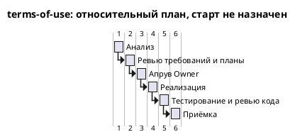

# Roadmap terms-of-use M1-9 — Условия использования

Старт: не назначен · Обновлено: 2026-10-22, TASK-M-02

Изменение находится в APPROVAL / cycle 1. Owner подтвердил объём первой версии в TASK-M-01; Analyst применил решение о контакте в TASK-A-02; Developer и Tester завершили review как DONE / done. Полный текст ещё не утверждён. Самодостаточная сводка и предмет решения — в [TASK-M-02](tasks/TASK-M-02.md).

Календарный старт и срок поставки не назначены. Дата обновления — дата сводки, не начало календарных обязательств. Текст и страница должны быть поставлены и проверены до передачи ссылки другим людям; остальные условия публичного запуска остаются вне M1-9.

## Оценки

| Этап | Роль | Оценка чч | Оценка мч | Уверенность | Источник | Факт мч |
| --- | --- | --- | --- | --- | --- | --- |
| Анализ — стартовая оценка | Analyst | 16 (2 чд) | — | — | [правило процесса в шаблоне](../../../development_approach/artifacts/roadmap.md), [TASK-M-01](tasks/TASK-M-01.md) | — |
| Анализ — оценка роли | Analyst | 8 | 1.5 | medium | [TASK-A-01, estimate и допущения](tasks/TASK-A-01.md) | — |
| Применение решения о контакте | Analyst | 1.5 | 0.5 | high | [TASK-A-02, estimate и допущения](tasks/TASK-A-02.md) | — |
| Реализация и независимое ревью кода | Developer | 17 | 6 | medium | [TASK-D-01, estimate](tasks/TASK-D-01.md), [план реализации](plans/implementation_plan.md) | — |
| Тестирование, включая review и план | Tester | 24 | 8 | medium | [TASK-T-01, estimate](tasks/TASK-T-01.md), [тест-план](plans/test_plan.md) | — |
| **Итого по estimate задач ролей** | | **50.5** | **16** | общая не задана | 8 + 1.5 + 17 + 24 чч; 1.5 + 0.5 + 6 + 8 мч | **не измерено** |
| Отдельная оценка review требований и плана | Developer | 3 | 1 | отдельно не указана | [TASK-D-01, раздел «Оценка»](tasks/TASK-D-01.md); не входит в его 17/6 | — |
| **Итого всех явно оценённых работ** | | **53.5** | **17** | общая не задана | итог estimate + отдельное review Developer | **не измерено** |

Стартовые 16 чч остаются как история правила процесса и не прибавляются к оценке Analyst. Анализ вместе с apply_decisions: 9.5 чч / 2 мч. Значение confidence Analyst для двух задач не усредняется. Оценки не представлены как фактическое время или утверждённый Owner бюджет.

Developer разделил 17/6 на реализацию и свои проверки 15/5.5 (промты 01: 6/2; 02: 5/2; 03: 4/1.5) и независимое code_review 2/0.5. Отдельное review требований Developer — 3/1. Tester включил в 24/8 review и план 6/2, подготовку/автоматизацию 10/3, прогоны/отчёт 6/2 и один небольшой ретест 2/1. Его review повторно не прибавляется.

Из явно оценённого объёма после APPROVAL остаются реализация с code_review 17/6 и работа Tester без уже подготовленного review 18/6: **35 чч / 12 мч**. Это вычитание оценок этапов, не измеренный остаток и не полный бюджет поставки. Работы Manager, ожидания Owner и исправлений, восстановление окружения, transfer Analyst, публикация/интеграция, юридическая и эксплуатационная готовность отдельно не оценены. Историческая строка M1-9 [общей дорожной карты](../../Roadmap/roadmap.md) не подменяет эти оценки.

Допущения ролей: утверждается текст в текущем объёме C1…C8 без новых требований; доступны Python-зависимости проекта, Node, браузер и точная поставка для проверки; одна небольшая итерация code_review и один небольшой ретест Tester. Иное содержание, объём исправлений или недоступное окружение требуют переоценки ответственной ролью. В текущем review HTTP/wheel не подтверждены из-за отсутствующих зависимостей .venv; время восстановления не включено.

## Gantt

Относительный план по правилам [шаблона](../../../development_approach/artifacts/roadmap.md), без календарных дат: длительность оценённого этапа = max(1, ceil(мч / 8)) рабочих дней. `Project starts` намеренно не задан: старт не согласован. Шкала показывает порядок и расчётную длительность, не даты исполнения и не фактическое время; календарную привязку с исключением суббот/воскресений можно добавить после назначения старта.

| Этап диаграммы | Основание мч | Расчётная длительность |
| --- | --- | --- |
| Анализ | 1.5 + 0.5 = 2, TASK-A-01/02 | 1 рабочий день |
| Ревью требований и планы | Developer 1 + Tester 2 = 3 | 1 рабочий день |
| Апрув Owner | правило шаблона; мч не оценены | 1 рабочий день по правилу |
| Реализация | Developer 5.5, три промта | 1 рабочий день |
| Тестирование и ревью кода | Tester 8 − 2 = 6; code_review 0.5; всего 6.5 | 1 рабочий день |
| Приёмка | правило шаблона; мч не оценены | 1 рабочий день по правилу |

Анализ и review завершены как задачи подготовки, но факт их мч неизвестен. Code_review показано после test по процессу v3; внутри общей строки это последовательные работы. Неоценённые transfer, восстановление окружения и интеграция на Gantt не нарисованы; их отсутствие не означает нулевую стоимость и не позволяет считать диаграмму обещанием даты поставки. Ожидания сверх процессного дня Owner не оценены. Рендер PlantUML — NOT RUN; проверены только структура и арифметика.

## Отклонения

| Этап | Оценка мч | Факт мч | Причина |
| --- | --- | --- | --- |

В [debug_log.md](debug_log.md) нет записей факта мч. По времени Git-коммитов и событий переходов длительность работы агента не вычислялась. Превышение порога 1.5× не установлено; оснований объявлять отсутствие превышений тоже нет. Оценки задним числом не изменены.
