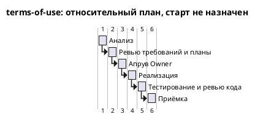

# Roadmap terms-of-use M1-9 — Условия использования

Старт: не назначен · Обновлено: 2026-11-03, TASK-M-03

Сводка поставки для приёмки — в [TASK-M-03](tasks/TASK-M-03.md). Owner утвердил требования, планы и полный текст в [TASK-O-02](tasks/TASK-O-02.md); реализация и тестирование завершены, повторный Reviewer закрыл BUG-001…003 в [TASK-R-02](tasks/TASK-R-02.md). DP-R-01 остаётся ON_HOLD. В основной рабочей копии оркестратор выполнил переход 13 в DONE / cycle 1 и создал summary и transfer; transfer и приёмка Owner ещё не завершены. Проверенная база этой сводки — опубликованный `0807cd05cedc457434149b4479ee4c6262a88dec`. В ней change.md ещё содержит BUG_FIX: более поздний переход взят из локальных входов назначения и этим коммитом не публикуется. Статус изменения Manager не меняет.

Календарный старт и срок поставки не назначены. Дата обновления — дата сводки, не начало календарных обязательств. Текст и страница должны быть поставлены и проверены до передачи ссылки другим людям; остальные условия публичного запуска остаются вне M1-9.

## Оценки

| Этап | Роль | Оценка чч | Оценка мч | Уверенность | Источник | Факт мч |
| --- | --- | --- | --- | --- | --- | --- |
| Анализ — стартовая оценка | Analyst | 16 (2 чд) | — | — | [правило процесса в шаблоне](../../../development_approach/artifacts/roadmap.md), [TASK-M-01](tasks/TASK-M-01.md) | — |
| Анализ — оценка роли | Analyst | 8 | 1.5 | medium | [TASK-A-01, estimate и допущения](tasks/TASK-A-01.md) | — |
| Применение решения о контакте | Analyst | 1.5 | 0.5 | high | [TASK-A-02, estimate и допущения](tasks/TASK-A-02.md) | — |
| Реализация и независимое ревью кода | Developer | 17 | 6 | medium | [TASK-D-01, estimate](tasks/TASK-D-01.md), [план реализации](plans/implementation_plan.md) | — |
| Тестирование, включая review и план | Tester | 24 | 8 | medium | [TASK-T-01, estimate](tasks/TASK-T-01.md), [тест-план](plans/test_plan.md) | — |
| **Итого по estimate задач ролей** | | **50.5** | **16** | общая не задана | 8 + 1.5 + 17 + 24 чч; 1.5 + 0.5 + 6 + 8 мч | **не измерено** |
| Отдельная оценка review требований и плана | Developer | 3 | 1 | отдельно не указана | [TASK-D-01, раздел «Оценка»](tasks/TASK-D-01.md); не входит в его 17/6 | — |
| **Итого всех явно оценённых работ** | | **53.5** | **17** | общая не задана | итог estimate + отдельное review Developer | **не измерено** |

Стартовые 16 чч остаются как история правила процесса и не прибавляются к оценке Analyst. Анализ вместе с apply_decisions: 9.5 чч / 2 мч. Значение confidence Analyst для двух задач не усредняется. Оценки не представлены как фактическое время или утверждённый Owner бюджет.

Developer разделил 17/6 на реализацию и свои проверки 15/5.5 (промты 01: 6/2; 02: 5/2; 03: 4/1.5) и независимое code_review 2/0.5. Отдельное review требований Developer — 3/1. Tester включил в 24/8 review и план 6/2, подготовку/автоматизацию 10/3, прогоны/отчёт 6/2 и один небольшой ретест 2/1. Его review повторно не прибавляется.

На момент APPROVAL оценённый последующий объём составлял **35 чч / 12 мч**: реализация с code_review 17/6 и работа Tester без уже подготовленного review 18/6. Это исторический план, а не текущий остаток: implement, test и повторное review уже DONE. Работы Manager, ожидания Owner и исправлений, восстановление окружения, transfer Analyst, публикация/интеграция, юридическая и эксплуатационная готовность отдельно не оценены. Историческая строка M1-9 [общей дорожной карты](../../Roadmap/roadmap.md) не подменяет эти оценки.

Допущения исходного плана: текст C1…C8 без расширения требований, доступные runtime/browser, одна небольшая итерация code_review и один небольшой ретест Tester. На review Developer HTTP/wheel были недоступны из-за зависимостей .venv; последующие успешные проверки записаны в задачах поставки. Время восстановления окружения не измерено.

### Дополнительные оценки после APPROVAL

Исходные оценки выше сохранены. Новые назначения приведены отдельно, без объявления оценки фактом и без повторного сложения подзадач исходного плана.

| Работа | Роль | Оценка чч | Оценка мч | Уверенность | Источник | Факт мч |
| --- | --- | --- | --- | --- | --- | --- |
| Разбор DP-R-01 | Analyst | 4 | 1.3 | medium | [TASK-A-03](tasks/TASK-A-03.md) | не измерен |
| Упрощение фокуса, BUG-003 | Developer | 1 | 0.5 | high | [TASK-D-05](tasks/TASK-D-05.md) | не измерен |
| Исправление T-29, BUG-001 | Tester | 4 | 1.5 | medium | [TASK-T-03](tasks/TASK-T-03.md) | не измерен |
| Новый T-31, BUG-002 | Tester | 2 | 0.7 | high | [TASK-T-04](tasks/TASK-T-04.md) | не измерен |
| **Итого дополнительных назначений с оценкой** | | **11** | **4** | общая не задана | оценки ролей | **не измерен** |
| **Справочно: арифметическая сумма двух блоков** | | **64.5** | **21** | общая не задана | 53.5 + 11 чч; 17 + 4 мч | **не измерен** |

Это сумма зафиксированных оценок, не пересогласованный бюджет. Исходный Tester уже включал один небольшой ретест 2 чч / 1 мч; пересечение этого резерва с последующими bug_fix роль отдельно не оценила. Поэтому 11/4 — оценки новых назначений, а не доказанное увеличение бюджета целиком на эту величину; 64.5/21 не является очищенным от всех пересечений итогом. Оценка TASK-A-03 дана до итогового выбора Owner отложить уточнение; задним числом она не заменяется нулём. TASK-D-02/03/04 дают реализацию 15/5.5, уже включённую в TASK-D-01. TASK-T-02 оценил свой запуск в 16/3 вместо исходного остатка тестирования 18/6; это перекрывающаяся оценка, повторно не прибавляется. Отдельные 0.5/0.2 code_review в TASK-D-04 также не прибавлены к исходным 2/0.5 независимого ревью: отдельное расширение объёма не установлено. У TASK-R-01/02 estimate отсутствует; стоимость повторного независимого ревью неизвестна. Transfer и приёмка пока не оценены.

## Gantt

Исходный относительный план APPROVAL по правилам [шаблона](../../../development_approach/artifacts/roadmap.md), без календарных дат: длительность оценённого этапа = max(1, ceil(мч / 8)) рабочих дней. `Project starts` не задан: календарный старт не согласован. Шкала сохранена как плановая база; она не показывает фактическую длительность и дополнительные проходы исправлений/ревью.

| Этап диаграммы | Основание мч | Расчётная длительность |
| --- | --- | --- |
| Анализ | 1.5 + 0.5 = 2, TASK-A-01/02 | 1 рабочий день |
| Ревью требований и планы | Developer 1 + Tester 2 = 3 | 1 рабочий день |
| Апрув Owner | правило шаблона; мч не оценены | 1 рабочий день по правилу |
| Реализация | Developer 5.5, три промта | 1 рабочий день |
| Тестирование и ревью кода | Tester 8 − 2 = 6; code_review 0.5; всего 6.5 | 1 рабочий день |
| Приёмка | правило шаблона; мч не оценены | 1 рабочий день по правилу |

Анализ, implement, test и повторное code_review завершены как задачи; факт их мч неизвестен. Code_review показано после test по процессу v3; внутри общей строки это последовательные работы. Дополнительные задачи и известные оценки перечислены выше; последовательность фактических проходов — в [events.jsonl](events.jsonl) и TASK-M-03 с оговоркой о неопубликованных переходах. Неоценённые transfer, восстановление окружения и интеграция на Gantt не нарисованы; их отсутствие не означает нулевую стоимость и не позволяет считать диаграмму обещанием даты поставки. Ожидания сверх процессного дня Owner не оценены. Рендер PlantUML — NOT RUN; проверены только структура и арифметика.

## Отклонения

| Этап | Оценка мч | Факт мч | Причина |
| --- | --- | --- | --- |
| Анализ, реализация, test и review исходного плана | 17 | неизвестен | В журнале нет измерений; сравнение с порогом 1.5× невозможно |
| Дополнительный разбор DP и три bug_fix | 4 | неизвестен | После первого ревью потребовались разбор конфликтующих требований, два исправления приёмочного покрытия и упрощение трёх условий фокуса |
| Три bug_fix без разбора DP | Owner: менее 1; роли: 2.7 | неизвестен | Ожидание Owner в журнале и событиях не совпадает с суммой оценок TASK-D-05/T-03/T-04; это расхождение оценок, не установленный перерасход |

В [debug_log.md](debug_log.md), включая более поздние локальные записи основной копии, нет численного факта мч. По времени Git-коммитов, длительности отдельных тестов и событиям переходов длительность работы агента не вычислялась. Превышение порога 1.5× не установлено; оснований объявлять отсутствие превышений тоже нет. Оценки задним числом не изменены. Неоценённые повторное review, transfer и интеграция не включены в итог 21 мч.
